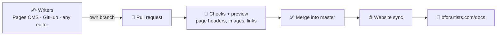

# 📘 The Bforartists Manual

The official manual of [Bforartists](https://www.bforartists.com), the free and open-source 3D software built by artists, for artists. Every page is a small Markdown file in this repository; merging a change publishes it to the website.

---

## ✏️ Fix or write a page in 5 minutes

You need a GitHub account and a browser, nothing else.

1. Click **✏️ Edit the docs** above and sign in with GitHub.
2. In the branch menu at the top, **create a branch** for your change (`master` is protected).
3. Pick a page, change it, click **Save**. Each save is a commit with your name.
4. Open a pull request from your branch. A bot checks the pages and posts a 👀 **preview link**.
5. A maintainer merges it, and the page is updated on the website.

Just a typo? Every page on the website has **Edit this page** at the bottom: it opens that file in GitHub's editor, and **Propose changes** makes the branch and pull request for you.

> 💡 First time? [Editing the docs online](https://github.com/Bforartists/Manual/wiki/Editing-the-docs-online) walks you through it, and [Plain writing](https://github.com/Bforartists/Manual/wiki/Plain-writing) shows the few patterns that turn into tips, keycaps and menu paths on the website.

## 🗺️ How it works

- **📄 One file per page.** Pages live in [`docs2/content/`](docs2/content), grouped like the website's sidebar: Getting Started, Interface, Workspaces, Editors, Assets, Extensions, Keymap, Advanced, Information.
- **✍️ Plain Markdown.** No special tags. `> **Tip:**` becomes a callout, `Ctrl + Space` becomes keycaps, `Edit › Preferences` becomes a menu path.
- **🖼️ One image library.** Drop a screenshot anywhere; the image bot names it, files it in [`docs2/images/`](docs2/images) and fixes the links.
- **🤖 Robots do the busywork.** On every pull request the docs workflow fills in page headers, checks every page and builds a preview. After a merge it syncs the pages to the website. The keymap pages are rebuilt from the Bforartists source every week.

The full picture, for writers and maintainers, is in the **[🤝 wiki](https://github.com/Bforartists/Manual/wiki)**: [How Docs 2.0 works](https://github.com/Bforartists/Manual/wiki/How-Docs-2.0-Works) · [Branches and review](https://github.com/Bforartists/Manual/wiki/Branches-and-Review) · [Images and screenshots](https://github.com/Bforartists/Manual/wiki/Images-and-Screenshots) · [Maintainer guide](https://github.com/Bforartists/Manual/wiki/Maintainer-Guide).

## 📂 What is where

| Folder | Holds |
|---|---|
| 📘 [`docs2/`](docs2) | **The manual.** Pages, images, shared snippets, sidebar order, tools ([details](docs2/README.md)) |
| 📦 [`docs1/`](docs1) | The legacy `.odt` chapters, archived. Kept as the source of the conversion; please edit `docs2/` instead |
| ⚙️ [`.github/workflows/`](.github/workflows) | Checks, previews, website sync, search index, weekly keymap update |
| 🧰 [`.pages.yml`](.pages.yml) | Pages CMS setup: which folders appear in the online editor |

## 🌿 Branches

- **`master`** is the manual. It is protected: every change goes in by pull request, and merging publishes it.
- **`docs2/main`** holds the history of the Docs 2.0 build-out (October 2026), kept for reference.

---

Bforartists is a fork of [Blender](https://www.blender.org). Find it at [bforartists.com](https://www.bforartists.com) and on [GitHub](https://github.com/Bforartists/Bforartists).
