Node groups for the compositor that come with Bforartists.

> **Draft:** this page is being filled asset by asset, one category at a time. Categories that are not written yet are marked below.

Each asset is a node group. Drag it from the Asset Shelf or the Asset Browser into the node editor.

# Color

Assets that change the color of an image.

## Adjust RGB

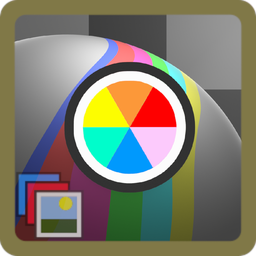

Adjusts the red, green and blue channels of an image individually.

### Inputs

#### Image

Data type: Color.

The input image to process.

#### Strength

Data type: Float (factor).

Controls the overall intensity of the RGB adjustment.

#### Red

Data type: Float.

Adjusts the intensity of the red channel.

#### Green

Data type: Float.

Adjusts the intensity of the green channel.

#### Blue

Data type: Float.

Adjusts the intensity of the blue channel.

### Outputs

#### Image

Data type: Color.

The output image after processing the effect.

### How to use

Connect an image to Image and the output to the next node. In the picture, Red is 30 and Blue is -30.

## Average Color

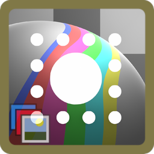

Calculates the average color of the input image.

### Inputs

#### Image

Data type: Color.

The input image to process.

### Outputs

#### Color

Data type: Color.

The output color after processing the effect.

### How to use

Connect an image to Image. The output is a single color, shown here as a flat fill.

## Color Temperature

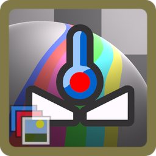

Adjusts the color temperature of the image to simulate different lighting conditions.

### Inputs

#### Image

Data type: Color.

The input image to process.

#### Strength

Data type: Float (factor).

Controls the intensity of the color temperature adjustment.

#### Temp Kelvin

Data type: Float.

Sets the color temperature in Kelvin.

### Outputs

#### Image

Data type: Color.

The output image after processing the effect.

### How to use

Connect an image to Image and set Temp Kelvin. In the picture, Temp Kelvin is 3500.

## Color Tint

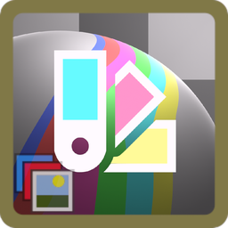

Applies a color tint to the image with adjustable strength and power.

### Inputs

#### Image

Data type: Color.

The input image to process.

#### Strength

Data type: Float (factor).

Controls the intensity of the color tint effect.

#### Color

Data type: Color.

The color to apply as a tint.

#### Power

Data type: Float.

Adjusts the strength of the tint blending.

### Outputs

#### Image

Data type: Color.

The output image after processing the effect.

### How to use

Connect an image to Image and pick a Color. In the picture, Color is blue and Strength is 0.6.

## Color Variation

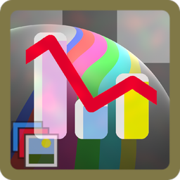

Adds subtle random color variation across the image.

### Inputs

#### Image

Data type: Color.

The image to vary.

#### Strength

Data type: Float (factor).

How strong the color variation is.

#### Scale

Data type: Vector.

Size of the variation pattern.

#### Offset

Data type: Vector.

Shifts the variation pattern.

### Outputs

#### Image

Data type: Color.

The image with color variation applied.

### How to use

Connect an image to Image. In the picture, Strength is 1.0.

## Desaturator

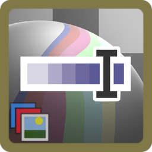

Desaturates the image, with control over strength and hue.

### Inputs

#### Image

Data type: Color.

The image to desaturate.

#### Saturation Strength

Data type: Float (factor).

Adjust the strength of desaturation.

#### Hue Ratio

Data type: Float.

Adjusts a biased ratio of the saturation.

### Outputs

#### Image

Data type: Color.

The desaturated image.

### How to use

Connect an image to Image. In the picture, Saturation Strength is 0.8.

## Halftone Color

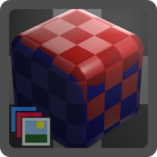

Colors a halftone pattern, sizing dots by brightness. Use it together with Halftone Pattern: connect the Distance output of Halftone Pattern to the Distance input here.

### Inputs

#### Distance

Data type: Float.

Connect the Distance output of Halftone Pattern.

#### Foreground

Data type: Color.

Image or color that sets dot color and size.

#### Background

Data type: Color.

Color between the dots.

#### Min Dot Size

Data type: Float (factor).

Dot size in the darkest areas.

#### Max Dot Size

Data type: Float (factor).

Dot size in the brightest areas.

### Outputs

#### Color

Data type: Color.

The colored halftone.

#### Mask

Data type: Float.

Black and white dots.

### How to use

Connect the Distance output of Halftone Pattern to Distance, an image to Foreground, and set Background to white. Connect Color to the next node.

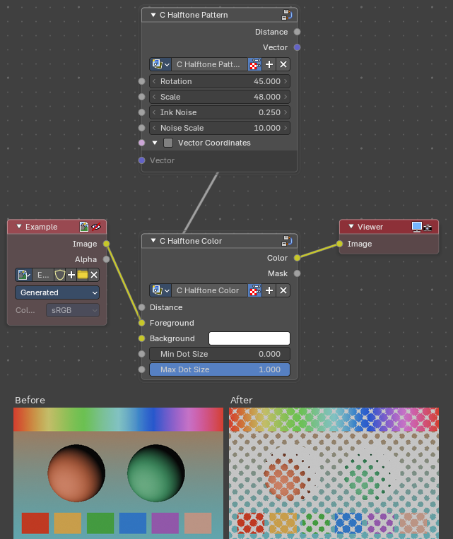

## Halftone Pattern

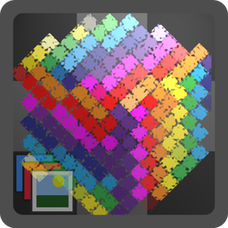

Creates a halftone dot pattern with distance and vector outputs. Use it together with Halftone Color: connect the Distance output to Halftone Color.

### Inputs

#### Rotation

Data type: Float.

Rotates the dot grid.

#### Scale

Data type: Float.

Number of dots. Higher values give more, smaller dots.

#### Ink Noise

Data type: Float.

Adds roughness to the dots.

#### Noise Scale

Data type: Float.

Size of the roughness.

#### Vector Coordinates

Data type: Boolean.

Use the Vector input instead of the automatic image coordinates.

#### Vector

Data type: Vector.

Used when Vector Coordinates is on. Best used with the Vector Mapping node group.

### Outputs

#### Distance

Data type: Float.

Distance from each dot center. Connect to Halftone Color.

#### Vector

Data type: Vector.

Coordinates inside each dot.

### How to use

Use it together with Halftone Color: connect Distance to the Distance input of Halftone Color.

## Simple Saturation

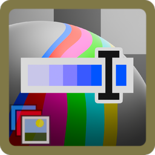

Adjusts the saturation level of the image.

### Inputs

#### Image

Data type: Color.

The input image to process.

#### Saturation

Data type: Float.

Controls the intensity of the image's color saturation. The range is 0 to 2.

### Outputs

#### Image

Data type: Color.

The output image after processing the effect.

### How to use

Connect an image to Image. In the picture, Saturation is 0.25.

# Creative / Design

Assets that create a designed look from render passes.

## Blueprint

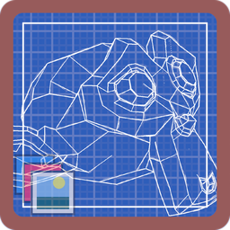

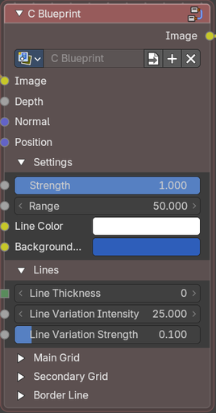

Generates a blueprint-style effect with grid lines and outlines based on depth and normals.

### Inputs

#### Image

Data type: Color.

The input image to process.

#### Depth

Data type: Float.

Depth Pass input to define object distances.

#### Normal

Data type: Vector.

Normal Pass for surface normal data for edge detection.

#### Position

Data type: Vector.

Position Pass for camera or object position data for effect calculations.

#### Settings

##### Strength

Data type: Float (factor).

Controls the overall intensity of the blueprint effect.

##### Range

Data type: Float.

Sets the range for depth-based calculations.

##### Line Color

Data type: Color.

Color of the blueprint lines.

##### Background Color

Data type: Color.

Color of the background in the blueprint effect.

#### Lines

##### Line Thickness

Data type: Integer.

Controls the thickness of the geometry lines

##### Line Variation Intensity

Data type: Float.

Adjusts the intensity of line variation patterns.

##### Line Variation Strength

Data type: Float (factor).

Controls the intensity of line variation effects.

#### Main Grid

##### Grid Strength

Data type: Float.

Controls the intensity of the grid pattern.

##### Grid Size

Data type: Float.

Sets the size of the grid pattern.

##### Grid Thickness

Data type: Float.

Adjusts the thickness of the grid lines.

#### Secondary Grid

##### Detailed Grid Strength

Data type: Float.

Controls the intensity of a finer grid pattern.

##### Detailed Grid Size

Data type: Float.

Sets the size of the finer grid pattern.

##### Detailed Grid Thickness

Data type: Float.

Adjusts the thickness of the finer grid lines.

#### Border Line

##### Border Strength

Data type: Float.

Controls the intensity of the object borders.

##### Border Size

Data type: Float.

Sets the size of the object borders.

##### Border Thickness

Data type: Float.

Adjusts the thickness of the object borders.

##### Border Double Line

Data type: Boolean.

Enables or disables a double-line effect for borders.

### Outputs

#### Image

Data type: Color.

The output image after processing the effect.

### How to use

Blueprint needs render passes. Connect the Depth, Normal and Position passes of a Render Layers node to the inputs of the same name, and the rendered image to Image. Line Color and Background Color set the two colors of the blueprint. The panels Main Grid, Secondary Grid and Border Line control the grid and the outlines.

## Breakdown Animation

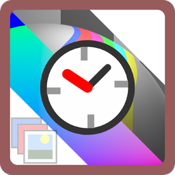

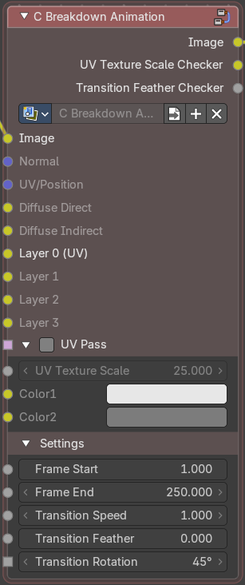

Creates an animated breakdown effect using multiple render passes and UV data.

### Inputs

#### Image

Data type: Color.

The input image to process.

#### Normal

Data type: Vector.

Surface normal data for effect calculations.

#### UV/Position

Data type: Vector.

UV map data for texture mapping.

#### Diffuse Direct

Data type: Color.

Direct diffuse lighting render pass.

#### Diffuse Indirect

Data type: Color.

Indirect diffuse lighting render pass.

#### Layer 0 (UV)

Data type: Color.

Custom layer. It is replaced by the UV pass when UV Pass is on.

#### Layer 1

Data type: Color.

Custom layer, for example a diffuse color render pass.

#### Layer 2

Data type: Color.

Custom layer, for example a direct glossy lighting render pass.

#### Layer 3

Data type: Color.

Custom layer, for example an ambient occlusion render pass.

#### UV Pass

##### UV Pass

Data type: Boolean.

UV pass from Render Layers

##### UV Texture Scale

Data type: Float.

Scales the UV texture for the effect.

##### Color1

Data type: Color.

Color of the first checker

##### Color2

Data type: Color.

Color of the second checker

#### Settings

##### Frame Start

Data type: Float.

The starting frame for the animation effect.

##### Frame End

Data type: Float.

The ending frame for the animation effect.

##### Transition Speed

Data type: Float.

Controls the speed of the animation transition.

##### Transition Feather

Data type: Float.

Adjusts the softness of the transition edges.

##### Transition Rotation

Data type: Float.

Rotates the transition effect.

### Outputs

#### Image

Data type: Color.

The output image after processing the effect.

#### UV Texture Scale Checker

Data type: Color.

Indicator of the separate UV checker texture mapping channel.

#### Transition Feather Checker

Data type: Float.

Indicator of the separate transition mask channel.

### How to use

Breakdown Animation works on render passes. Connect the passes of a Render Layers node to Normal, UV/Position, Diffuse Direct and Diffuse Indirect, and the rendered image to Image. Frame Start and Frame End set when the transition runs, and Transition Speed, Transition Feather and Transition Rotation shape it. The two extra outputs, UV Texture Scale Checker and Transition Feather Checker, show the checker texture and the transition mask as separate channels.

# Distortion

Assets that shift, split or mirror the image.

## Glitch Block

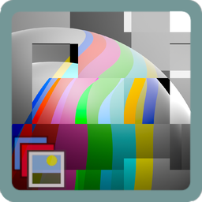

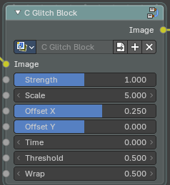

Applies a block-based glitch effect to the image with customizable parameters.

### Inputs

#### Image

Data type: Color.

The input image to process.

#### Strength

Data type: Float (factor).

Controls the intensity of the glitch effect.

#### Scale

Data type: Float.

Determines the size or frequency of the glitch pattern.

#### Offset X

Data type: Float (factor).

Shifts the glitch effect along the X-axis.

#### Offset Y

Data type: Float (factor).

Shifts the glitch effect along the Y-axis.

#### Time

Data type: Float.

Controls the time-based variation of the glitch effect.

#### Threshold

Data type: Float.

Sets the brightness threshold for triggering the glitch effect.

#### Wrap

Data type: Float.

Controls how the glitch wraps around the image edges.

### Outputs

#### Image

Data type: Color.

The output image after processing the effect.

### How to use

Connect an image to Image and the output to the next node. Blocks of the image are shifted sideways. In the slider every value is at its default: Strength 1, Scale 5, Offset X 0.25. Time changes the pattern, so animate it for a flickering glitch.

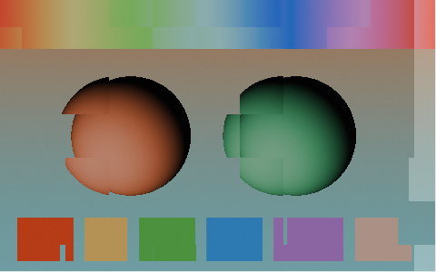

The setup used for the slider:

## Glitch Offset

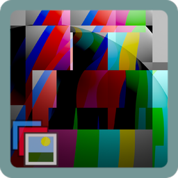

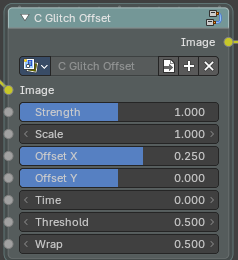

Applies an offset-based glitch effect to the image with customizable parameters.

### Inputs

#### Image

Data type: Color.

The input image to process.

#### Strength

Data type: Float (factor).

Controls the intensity of the glitch effect.

#### Scale

Data type: Float.

Determines the size or frequency of the glitch pattern.

#### Offset X

Data type: Float (factor).

Shifts the glitch effect along the X-axis.

#### Offset Y

Data type: Float (factor).

Shifts the glitch effect along the Y-axis.

#### Time

Data type: Float.

Controls the time-based variation of the glitch effect.

#### Threshold

Data type: Float.

Sets the brightness threshold for triggering the glitch effect.

#### Wrap

Data type: Float.

Controls how the glitch wraps around the image edges.

### Outputs

#### Image

Data type: Color.

The output image after processing the effect.

### How to use

Connect an image to Image and the output to the next node. Parts of the image are shifted sideways. In the slider every value is at its default: Strength 1, Scale 1, Offset X 0.25. Time changes the pattern.

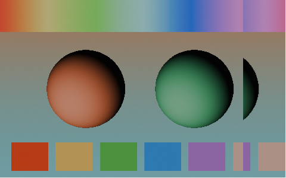

The setup used for the slider:

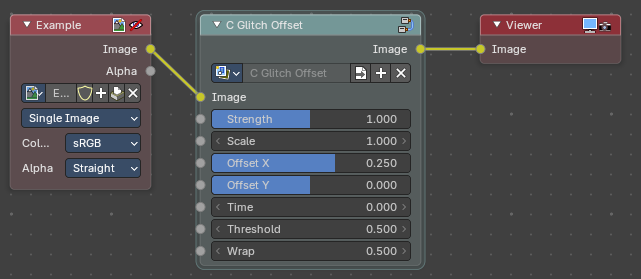

## Glitch RGB

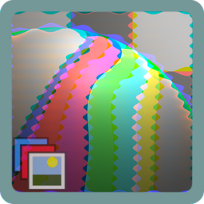

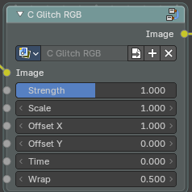

Applies an RGB channel offset glitch effect to the image.

### Inputs

#### Image

Data type: Color.

The input image to process.

#### Strength

Data type: Float (factor).

Controls the intensity of the RGB glitch effect.

#### Scale

Data type: Float.

Determines the size or frequency of the glitch pattern.

#### Offset X

Data type: Float.

Shifts the glitch effect along the X-axis.

#### Offset Y

Data type: Float.

Shifts the glitch effect along the Y-axis.

#### Time

Data type: Float.

Controls the time-based variation of the glitch effect.

#### Wrap

Data type: Float.

Controls how the glitch wraps around the image edges.

### Outputs

#### Image

Data type: Color.

The output image after processing the effect.

### How to use

Connect an image to Image and the output to the next node. The red, green and blue channels are shifted apart, which leaves colored edges around the shapes. In the slider every value is at its default: Strength 1, Scale 1, Offset X 1.

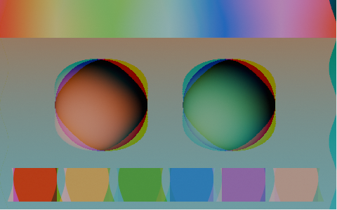

The setup used for the slider:

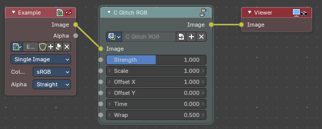

## Simple Distortion

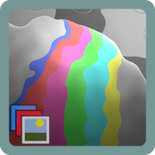

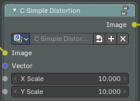

Applies a distortion effect to the image based on a vector field.

### Inputs

#### Image

Data type: Color.

The input image to process.

#### Vector

Data type: Vector.

Vector field input to control distortion direction and magnitude.

#### X Scale

Data type: Float.

Scales the distortion effect along the X-axis.

#### Y Scale

Data type: Float.

Scales the distortion effect along the Y-axis.

### Outputs

#### Image

Data type: Color.

The output image after processing the effect.

### How to use

Connect an image to Image and a vector field to Vector, for example from a texture. The vector sets the direction and strength of the distortion, and X Scale and Y Scale scale it along each axis.

## Symmetry

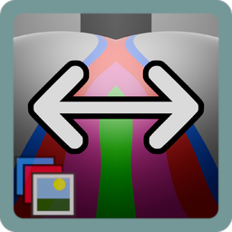

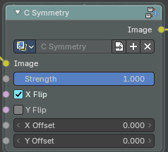

Creates a symmetrical effect by flipping and offsetting the image.

### Inputs

#### Image

Data type: Color.

The input image to process.

#### Strength

Data type: Float (factor).

Controls the intensity of the symmetry effect.

#### X Flip

Data type: Boolean.

Enables or disables flipping along the X-axis.

#### Y Flip

Data type: Boolean.

Enables or disables flipping along the Y-axis.

#### X Offset

Data type: Float.

Shifts the symmetry effect along the X-axis.

#### Y Offset

Data type: Float.

Shifts the symmetry effect along the Y-axis.

### Outputs

#### Image

Data type: Color.

The output image after processing the effect.

### How to use

Connect an image to Image and the output to the next node. In the slider X Flip is on, so the right half of the image is a mirror of the left half. Y Flip does the same from top to bottom, and X Offset and Y Offset move the mirror line.

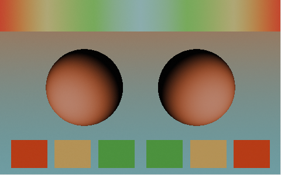

The setup used for the slider:

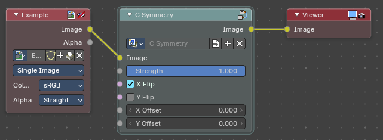

# Filters

Assets that filter the image into a new look.

## Halftone

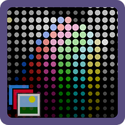

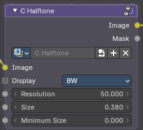

Applies a halftone pattern effect to simulate printed media visuals.

### Inputs

#### Image

Data type: Color.

The input image to process.

#### Display

Data type: Menu.

Selects the display mode or style of the halftone effect.

#### Resolution

Data type: Float.

Controls the resolution or density of the halftone pattern.

#### Size

Data type: Float.

Controls the dot size. Higher values may clip into pixels.

#### Minimum Size

Data type: Float.

Controls the minimum dot size in shaded areas

### Outputs

#### Image

Data type: Color.

The output image after processing the effect.

#### Mask

Data type: Float.

Black and white halftone dots

### How to use

Connect an image to Image and the output to the next node. With Display on BW the result is white dots on black, and the dot size follows the brightness of the image. Resolution sets how many dots there are, Size sets the dot size and Minimum Size sets the dot size in the shaded areas. The Mask output gives the black and white dots on their own. In the slider every value is at its default.

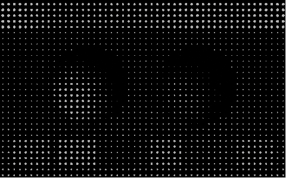

The setup used for the slider:

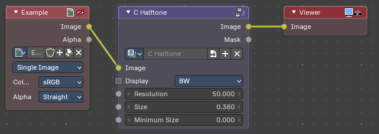

## Ordered Dithering 2x2

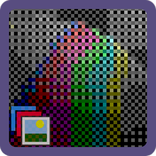

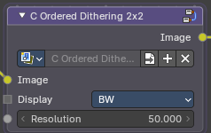

Applies a 2x2 ordered dithering effect to create a patterned texture.

### Inputs

#### Image

Data type: Color.

The input image to process.

#### Display

Data type: Menu.

Selects the display mode or style of the dithering effect.

#### Resolution

Data type: Float.

Controls the resolution or density of the dithering pattern.

### Outputs

#### Image

Data type: Color.

The output image after processing the effect.

### How to use

Connect an image to Image and the output to the next node. Display sets the display mode and Resolution sets the density of the dither pattern. The 2x2 matrix gives the coarsest pattern of the three Ordered Dithering assets.

## Ordered Dithering 4x4

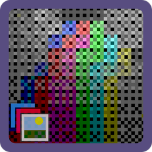

Applies a 4x4 ordered dithering effect to create a patterned texture.

### Inputs

#### Image

Data type: Color.

The input image to process.

#### Display

Data type: Menu.

Selects the display mode or style of the dithering effect.

#### Resolution

Data type: Float.

Controls the resolution or density of the dithering pattern.

### Outputs

#### Image

Data type: Color.

The output image after processing the effect.

### How to use

Connect an image to Image and the output to the next node. Display on BW turns the image into a black and white pattern. Resolution sets the density of the pattern. The slider shows the result with the default values.

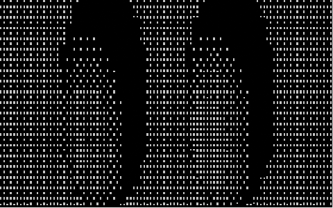

The setup used for the slider:

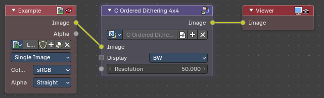

## Ordered Dithering 8x8

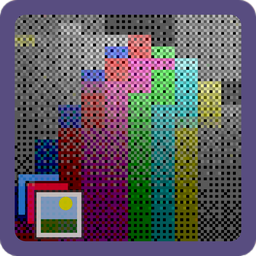

Applies an 8x8 ordered dithering effect to create a patterned texture.

### Inputs

#### Image

Data type: Color.

The input image to process.

#### Display

Data type: Menu.

Selects the display mode or style of the dithering effect.

#### Resolution

Data type: Float.

Controls the resolution or density of the dithering pattern.

### Outputs

#### Image

Data type: Color.

The output image after processing the effect.

### How to use

Connect an image to Image and the output to the next node. Display on BW turns the image into a black and white pattern. Resolution sets the density of the pattern. The slider shows the result with the default values.

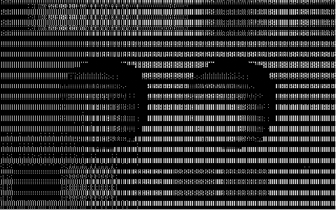

The setup used for the slider:

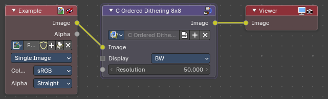

## Screen Space Pixelate

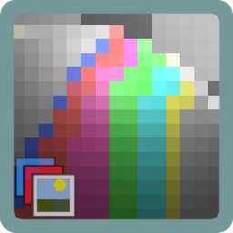

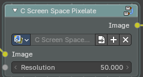

Applies a pixelation effect to the image in screen space.

### Inputs

#### Image

Data type: Color.

The input image to process.

#### Resolution

Data type: Float.

Controls the resolution or size of the pixelation effect.

### Outputs

#### Image

Data type: Color.

The output image after processing the effect.

### How to use

Connect an image to Image and the output to the next node. Resolution controls the size of the pixelation. In the slider Resolution is 50.

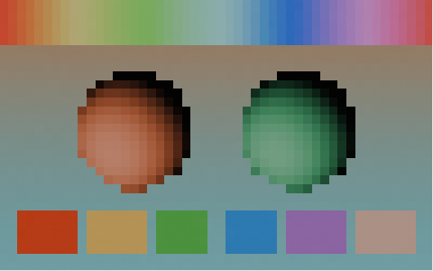

The setup used for the slider:

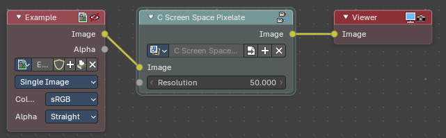

## Sepia Advanced

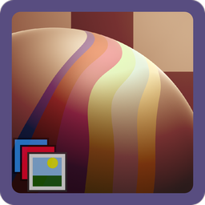

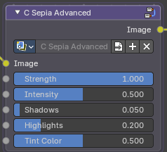

Applies a sepia tone effect to the image for a vintage look.

### Inputs

#### Image

Data type: Color.

The input image to process.

#### Strength

Data type: Float (factor).

Controls the intensity of the sepia effect.

#### Intensity

Data type: Float (factor).

Adjusts the overall intensity of the sepia tone.

#### Shadows

Data type: Float (factor).

Adjusts the intensity of the sepia effect in shadow areas.

#### Highlights

Data type: Float (factor).

Adjusts the intensity of the sepia effect in highlight areas.

#### Tint Color

Data type: Float (factor).

The color used for the sepia tint.

### Outputs

#### Image

Data type: Color.

The output image after processing the effect.

### How to use

Connect an image to Image and the output to the next node. The image gets a brown sepia tone. Strength sets how much of the effect is applied, Shadows and Highlights set how strongly it acts in the dark and bright areas. In the slider every value is at its default.

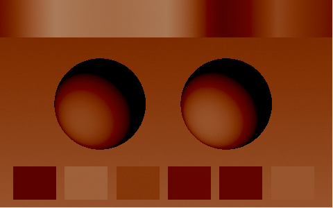

The setup used for the slider:

# Lenses

_Assets in this category will be documented here._

# Output

_Assets in this category will be documented here._

# Texture / Patterns

_Assets in this category will be documented here._

# Texture / Shapes

_Assets in this category will be documented here._

# Utilities

_Assets in this category will be documented here._

# Utilities / Vector

_Assets in this category will be documented here._
