Node groups for the compositor that come with Bforartists.

> **Draft:** this page is being filled asset by asset, one category at a time. Categories that are not written yet are marked below.

Each asset is a node group. Drag it from the Asset Shelf or the Asset Browser into the node editor.

# Color

Assets that change the color of an image.

## Adjust RGB

Adjusts the red, green and blue channels of an image individually.

### Inputs

#### Image

Data type: Color.

The input image to process.

#### Strength

Data type: Float (factor).

Controls the overall intensity of the RGB adjustment.

#### Red

Data type: Float.

Adjusts the intensity of the red channel.

#### Green

Data type: Float.

Adjusts the intensity of the green channel.

#### Blue

Data type: Float.

Adjusts the intensity of the blue channel.

### Outputs

#### Image

Data type: Color.

The output image after processing the effect.

### How to use

Connect an image to Image and the output to the next node. In the slider, Red is 30 and Blue is -30.

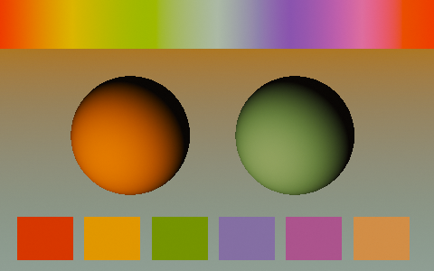

The setup used for the slider:

## Average Color

Calculates the average color of the input image.

### Inputs

#### Image

Data type: Color.

The input image to process.

### Outputs

#### Color

Data type: Color.

The output color after processing the effect.

### How to use

Connect an image to Image. The output is a single color, shown here as a flat fill.

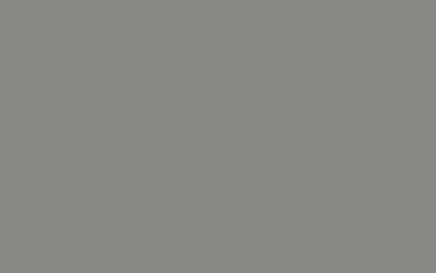

The setup used for the slider:

## Color Temperature

Adjusts the color temperature of the image to simulate different lighting conditions.

### Inputs

#### Image

Data type: Color.

The input image to process.

#### Strength

Data type: Float (factor).

Controls the intensity of the color temperature adjustment.

#### Temp Kelvin

Data type: Float.

Sets the color temperature in Kelvin.

### Outputs

#### Image

Data type: Color.

The output image after processing the effect.

### How to use

Connect an image to Image and set Temp Kelvin. In the slider, Temp Kelvin is 3500.

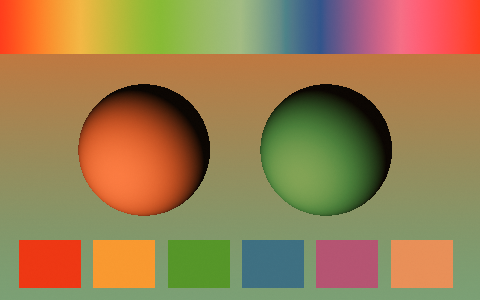

The setup used for the slider:

## Color Tint

Applies a color tint to the image with adjustable strength and power.

### Inputs

#### Image

Data type: Color.

The input image to process.

#### Strength

Data type: Float (factor).

Controls the intensity of the color tint effect.

#### Color

Data type: Color.

The color to apply as a tint.

#### Power

Data type: Float.

Adjusts the strength of the tint blending.

### Outputs

#### Image

Data type: Color.

The output image after processing the effect.

### How to use

Connect an image to Image and pick a Color. In the slider, Color is blue and Strength is 0.6.

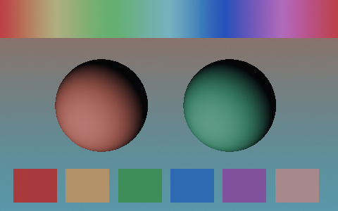

The setup used for the slider:

## Color Variation

Adds subtle random color variation across the image.

### Inputs

#### Image

Data type: Color.

The image to vary.

#### Strength

Data type: Float (factor).

How strong the color variation is.

#### Scale

Data type: Vector.

Size of the variation pattern.

#### Offset

Data type: Vector.

Shifts the variation pattern.

### Outputs

#### Image

Data type: Color.

The image with color variation applied.

### How to use

Connect an image to Image. In the slider, Strength is 1.0.

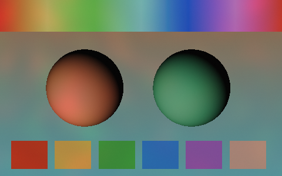

The setup used for the slider:

## Desaturator

Desaturates the image, with control over strength and hue.

### Inputs

#### Image

Data type: Color.

The image to desaturate.

#### Saturation Strength

Data type: Float (factor).

Adjust the strength of desaturation.

#### Hue Ratio

Data type: Float.

Adjusts a biased ratio of the saturation.

### Outputs

#### Image

Data type: Color.

The desaturated image.

### How to use

Connect an image to Image. Saturation Strength sets how much color is removed: 1 leaves the image as it is, and lower values remove more.

Hue Ratio changes which colors lose their saturation. In the slider, Saturation Strength is 0.3 and Hue Ratio is 1. At Hue Ratio 0 every color is desaturated evenly. At Hue Ratio 1 the strongly colored areas stay vivid and the muted areas lose their color.

The setup used for the slider:

## Halftone Color

Colors a halftone pattern, sizing dots by brightness. Use it together with Halftone Pattern: connect the Distance output of Halftone Pattern to the Distance input here.

### Inputs

#### Distance

Data type: Float.

Connect the Distance output of Halftone Pattern.

#### Foreground

Data type: Color.

Image or color that sets dot color and size.

#### Background

Data type: Color.

Color between the dots.

#### Min Dot Size

Data type: Float (factor).

Dot size in the darkest areas.

#### Max Dot Size

Data type: Float (factor).

Dot size in the brightest areas.

### Outputs

#### Color

Data type: Color.

The colored halftone.

#### Mask

Data type: Float.

Black and white dots.

### How to use

Connect an image to Foreground and set Background to the color between the dots. Distance decides where the dots are. It is normally connected to the Distance output of Halftone Pattern, as shown in the next section.

In the setup picture below the slider, Distance is a single value (0.5) instead of a pattern, so the image is cut at one brightness: the dark parts of the spheres turn to the Background color. Dots need a Distance that changes across the image.

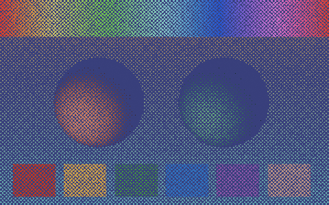

In the slider, Distance comes from Halftone Pattern (Scale 64) and Background is dark blue.

The setup picture shows Distance as a single value:

## Halftone Pattern

Creates a halftone dot pattern with distance and vector outputs. Use it together with Halftone Color: connect the Distance output to Halftone Color.

### Inputs

#### Rotation

Data type: Float.

Rotates the dot grid.

#### Scale

Data type: Float.

Number of dots. Higher values give more, smaller dots.

#### Ink Noise

Data type: Float.

Adds roughness to the dots.

#### Noise Scale

Data type: Float.

Size of the roughness.

#### Vector Coordinates

Data type: Boolean.

Use the Vector input instead of the automatic image coordinates.

#### Vector

Data type: Vector.

Used when Vector Coordinates is on. Best used with the Vector Mapping node group.

### Outputs

#### Distance

Data type: Float.

Distance from each dot center. Connect to Halftone Color.

#### Vector

Data type: Vector.

Coordinates inside each dot.

### How to use

Halftone Pattern does not need an image. Connect its Distance output to any node that takes a number to see how far each pixel is from the center of its dot. In the picture, Scale is 16 and the Distance output goes straight to the viewer.

The Vector output gives the coordinates inside each dot.

## Halftone Pattern and Halftone Color together

Halftone Pattern makes the dot grid and Halftone Color colors it. Connect the Distance output of Halftone Pattern to the Distance input of Halftone Color, and connect an image to Foreground. Halftone Color sizes each dot by the brightness of the image: dots are Max Dot Size in the brightest areas and Min Dot Size in the darkest.

Keeping them apart lets you change the grid (Rotation, Scale, Ink Noise) separately from the colors (Foreground, Background and the dot sizes). The Mask output of Halftone Color shows the same dots in black and white.

## Simple Saturation

Adjusts the saturation level of the image.

### Inputs

#### Image

Data type: Color.

The input image to process.

#### Saturation

Data type: Float.

Controls the intensity of the image's color saturation. The range is 0 to 2.

### Outputs

#### Image

Data type: Color.

The output image after processing the effect.

### How to use

Connect an image to Image. In the slider, Saturation is 0.25.

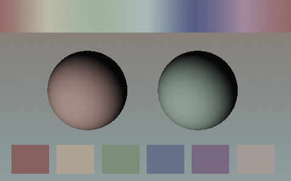

The setup used for the slider:

# Creative / Design

Assets that create a designed look from render passes.

## Blueprint

Generates a blueprint-style effect with grid lines and outlines based on depth and normals.

### Inputs

#### Image

Data type: Color.

The input image to process.

#### Depth

Data type: Float.

Depth Pass input to define object distances.

#### Normal

Data type: Vector.

Normal Pass for surface normal data for edge detection.

#### Position

Data type: Vector.

Position Pass for camera or object position data for effect calculations.

#### Settings

##### Strength

Data type: Float (factor).

Controls the overall intensity of the blueprint effect.

##### Range

Data type: Float.

Sets the range for depth-based calculations.

##### Line Color

Data type: Color.

Color of the blueprint lines.

##### Background Color

Data type: Color.

Color of the background in the blueprint effect.

#### Lines

##### Line Thickness

Data type: Integer.

Controls the thickness of the geometry lines

##### Line Variation Intensity

Data type: Float.

Adjusts the intensity of line variation patterns.

##### Line Variation Strength

Data type: Float (factor).

Controls the intensity of line variation effects.

#### Main Grid

##### Grid Strength

Data type: Float.

Controls the intensity of the grid pattern.

##### Grid Size

Data type: Float.

Sets the size of the grid pattern.

##### Grid Thickness

Data type: Float.

Adjusts the thickness of the grid lines.

#### Secondary Grid

##### Detailed Grid Strength

Data type: Float.

Controls the intensity of a finer grid pattern.

##### Detailed Grid Size

Data type: Float.

Sets the size of the finer grid pattern.

##### Detailed Grid Thickness

Data type: Float.

Adjusts the thickness of the finer grid lines.

#### Border Line

##### Border Strength

Data type: Float.

Controls the intensity of the object borders.

##### Border Size

Data type: Float.

Sets the size of the object borders.

##### Border Thickness

Data type: Float.

Adjusts the thickness of the object borders.

##### Border Double Line

Data type: Boolean.

Enables or disables a double-line effect for borders.

### Outputs

#### Image

Data type: Color.

The output image after processing the effect.

### How to use

Blueprint needs render passes. Connect the Depth, Normal and Position passes of a Render Layers node to the inputs of the same name, and the rendered image to Image. Line Color and Background Color set the two colors of the blueprint. The panels Main Grid, Secondary Grid and Border Line control the grid and the outlines.

## Breakdown Animation

Creates an animated breakdown effect using multiple render passes and UV data.

### Inputs

#### Image

Data type: Color.

The input image to process.

#### Normal

Data type: Vector.

Surface normal data for effect calculations.

#### UV/Position

Data type: Vector.

UV map data for texture mapping.

#### Diffuse Direct

Data type: Color.

Direct diffuse lighting render pass.

#### Diffuse Indirect

Data type: Color.

Indirect diffuse lighting render pass.

#### Layer 0 (UV)

Data type: Color.

Custom layer. It is replaced by the UV pass when UV Pass is on.

#### Layer 1

Data type: Color.

Custom layer, for example a diffuse color render pass.

#### Layer 2

Data type: Color.

Custom layer, for example a direct glossy lighting render pass.

#### Layer 3

Data type: Color.

Custom layer, for example an ambient occlusion render pass.

#### UV Pass

##### UV Pass

Data type: Boolean.

UV pass from Render Layers

##### UV Texture Scale

Data type: Float.

Scales the UV texture for the effect.

##### Color1

Data type: Color.

Color of the first checker

##### Color2

Data type: Color.

Color of the second checker

#### Settings

##### Frame Start

Data type: Float.

The starting frame for the animation effect.

##### Frame End

Data type: Float.

The ending frame for the animation effect.

##### Transition Speed

Data type: Float.

Controls the speed of the animation transition.

##### Transition Feather

Data type: Float.

Adjusts the softness of the transition edges.

##### Transition Rotation

Data type: Float.

Rotates the transition effect.

### Outputs

#### Image

Data type: Color.

The output image after processing the effect.

#### UV Texture Scale Checker

Data type: Color.

Indicator of the separate UV checker texture mapping channel.

#### Transition Feather Checker

Data type: Float.

Indicator of the separate transition mask channel.

### How to use

Breakdown Animation works on render passes. Connect the passes of a Render Layers node to Normal, UV/Position, Diffuse Direct and Diffuse Indirect, and the rendered image to Image. Frame Start and Frame End set when the transition runs, and Transition Speed, Transition Feather and Transition Rotation shape it. The two extra outputs, UV Texture Scale Checker and Transition Feather Checker, show the checker texture and the transition mask as separate channels.

# Distortion

Assets that shift, split or mirror the image.

## Glitch Block

Applies a block-based glitch effect to the image with customizable parameters.

### Inputs

#### Image

Data type: Color.

The input image to process.

#### Strength

Data type: Float (factor).

Controls the intensity of the glitch effect.

#### Scale

Data type: Float.

Determines the size or frequency of the glitch pattern.

#### Offset X

Data type: Float (factor).

Shifts the glitch effect along the X-axis.

#### Offset Y

Data type: Float (factor).

Shifts the glitch effect along the Y-axis.

#### Time

Data type: Float.

Controls the time-based variation of the glitch effect.

#### Threshold

Data type: Float.

Sets the brightness threshold for triggering the glitch effect.

#### Wrap

Data type: Float.

Controls how the glitch wraps around the image edges.

### Outputs

#### Image

Data type: Color.

The output image after processing the effect.

### How to use

Connect an image to Image and the output to the next node. Blocks of the image are shifted sideways. In the slider every value is at its default: Strength 1, Scale 5, Offset X 0.25. Time changes the pattern, so animate it for a flickering glitch.

The setup used for the slider:

## Glitch Offset

Applies an offset-based glitch effect to the image with customizable parameters.

### Inputs

#### Image

Data type: Color.

The input image to process.

#### Strength

Data type: Float (factor).

Controls the intensity of the glitch effect.

#### Scale

Data type: Float.

Determines the size or frequency of the glitch pattern.

#### Offset X

Data type: Float (factor).

Shifts the glitch effect along the X-axis.

#### Offset Y

Data type: Float (factor).

Shifts the glitch effect along the Y-axis.

#### Time

Data type: Float.

Controls the time-based variation of the glitch effect.

#### Threshold

Data type: Float.

Sets the brightness threshold for triggering the glitch effect.

#### Wrap

Data type: Float.

Controls how the glitch wraps around the image edges.

### Outputs

#### Image

Data type: Color.

The output image after processing the effect.

### How to use

Connect an image to Image and the output to the next node. Parts of the image are shifted sideways. In the slider every value is at its default: Strength 1, Scale 1, Offset X 0.25. Time changes the pattern.

The setup used for the slider:

## Glitch RGB

Applies an RGB channel offset glitch effect to the image.

### Inputs

#### Image

Data type: Color.

The input image to process.

#### Strength

Data type: Float (factor).

Controls the intensity of the RGB glitch effect.

#### Scale

Data type: Float.

Determines the size or frequency of the glitch pattern.

#### Offset X

Data type: Float.

Shifts the glitch effect along the X-axis.

#### Offset Y

Data type: Float.

Shifts the glitch effect along the Y-axis.

#### Time

Data type: Float.

Controls the time-based variation of the glitch effect.

#### Wrap

Data type: Float.

Controls how the glitch wraps around the image edges.

### Outputs

#### Image

Data type: Color.

The output image after processing the effect.

### How to use

Connect an image to Image and the output to the next node. The red, green and blue channels are shifted apart, which leaves colored edges around the shapes. In the slider every value is at its default: Strength 1, Scale 1, Offset X 1.

The setup used for the slider:

## Simple Distortion

Applies a distortion effect to the image based on a vector field.

### Inputs

#### Image

Data type: Color.

The input image to process.

#### Vector

Data type: Vector.

Vector field input to control distortion direction and magnitude.

#### X Scale

Data type: Float.

Scales the distortion effect along the X-axis.

#### Y Scale

Data type: Float.

Scales the distortion effect along the Y-axis.

### Outputs

#### Image

Data type: Color.

The output image after processing the effect.

### How to use

Connect an image to Image and a vector field to Vector, for example from a texture. The vector sets the direction and strength of the distortion, and X Scale and Y Scale scale it along each axis.

## Symmetry

Creates a symmetrical effect by flipping and offsetting the image.

### Inputs

#### Image

Data type: Color.

The input image to process.

#### Strength

Data type: Float (factor).

Controls the intensity of the symmetry effect.

#### X Flip

Data type: Boolean.

Enables or disables flipping along the X-axis.

#### Y Flip

Data type: Boolean.

Enables or disables flipping along the Y-axis.

#### X Offset

Data type: Float.

Shifts the symmetry effect along the X-axis.

#### Y Offset

Data type: Float.

Shifts the symmetry effect along the Y-axis.

### Outputs

#### Image

Data type: Color.

The output image after processing the effect.

### How to use

Connect an image to Image and the output to the next node. In the slider X Flip is on, so the right half of the image is a mirror of the left half. Y Flip does the same from top to bottom, and X Offset and Y Offset move the mirror line.

The setup used for the slider:

# Filters

Assets that filter the image into a new look.

## Halftone

Applies a halftone pattern effect to simulate printed media visuals.

### Inputs

#### Image

Data type: Color.

The input image to process.

#### Display

Data type: Menu.

Selects the display mode or style of the halftone effect.

#### Resolution

Data type: Float.

Controls the resolution or density of the halftone pattern.

#### Size

Data type: Float.

Controls the dot size. Higher values may clip into pixels.

#### Minimum Size

Data type: Float.

Controls the minimum dot size in shaded areas

### Outputs

#### Image

Data type: Color.

The output image after processing the effect.

#### Mask

Data type: Float.

Black and white halftone dots

### How to use

Connect an image to Image and the output to the next node. With Display on BW the result is white dots on black, and the dot size follows the brightness of the image. Resolution sets how many dots there are, Size sets the dot size and Minimum Size sets the dot size in the shaded areas. The Mask output gives the black and white dots on their own. In the slider every value is at its default.

The setup used for the slider:

## Ordered Dithering 2x2

Applies a 2x2 ordered dithering effect to create a patterned texture.

### Inputs

#### Image

Data type: Color.

The input image to process.

#### Display

Data type: Menu.

Selects the display mode or style of the dithering effect.

#### Resolution

Data type: Float.

Controls the resolution or density of the dithering pattern.

### Outputs

#### Image

Data type: Color.

The output image after processing the effect.

### How to use

Connect an image to Image and the output to the next node. Display sets the display mode and Resolution sets the density of the dither pattern. The 2x2 matrix gives the coarsest pattern of the three Ordered Dithering assets.

## Ordered Dithering 4x4

Applies a 4x4 ordered dithering effect to create a patterned texture.

### Inputs

#### Image

Data type: Color.

The input image to process.

#### Display

Data type: Menu.

Selects the display mode or style of the dithering effect.

#### Resolution

Data type: Float.

Controls the resolution or density of the dithering pattern.

### Outputs

#### Image

Data type: Color.

The output image after processing the effect.

### How to use

Connect an image to Image and the output to the next node. Display on BW turns the image into a black and white pattern. Resolution sets the density of the pattern. The slider shows the result with the default values.

The setup used for the slider:

## Ordered Dithering 8x8

Applies an 8x8 ordered dithering effect to create a patterned texture.

### Inputs

#### Image

Data type: Color.

The input image to process.

#### Display

Data type: Menu.

Selects the display mode or style of the dithering effect.

#### Resolution

Data type: Float.

Controls the resolution or density of the dithering pattern.

### Outputs

#### Image

Data type: Color.

The output image after processing the effect.

### How to use

Connect an image to Image and the output to the next node. Display on BW turns the image into a black and white pattern. Resolution sets the density of the pattern. The slider shows the result with the default values.

The setup used for the slider:

## Screen Space Pixelate

Applies a pixelation effect to the image in screen space.

### Inputs

#### Image

Data type: Color.

The input image to process.

#### Resolution

Data type: Float.

Controls the resolution or size of the pixelation effect.

### Outputs

#### Image

Data type: Color.

The output image after processing the effect.

### How to use

Connect an image to Image and the output to the next node. Resolution controls the size of the pixelation. In the slider Resolution is 50.

The setup used for the slider:

## Sepia Advanced

Applies a sepia tone effect to the image for a vintage look.

### Inputs

#### Image

Data type: Color.

The input image to process.

#### Strength

Data type: Float (factor).

Controls the intensity of the sepia effect.

#### Intensity

Data type: Float (factor).

Adjusts the overall intensity of the sepia tone.

#### Shadows

Data type: Float (factor).

Adjusts the intensity of the sepia effect in shadow areas.

#### Highlights

Data type: Float (factor).

Adjusts the intensity of the sepia effect in highlight areas.

#### Tint Color

Data type: Float (factor).

The color used for the sepia tint.

### Outputs

#### Image

Data type: Color.

The output image after processing the effect.

### How to use

Connect an image to Image and the output to the next node. The image gets a brown sepia tone. Strength sets how much of the effect is applied, Shadows and Highlights set how strongly it acts in the dark and bright areas. In the slider every value is at its default.

The setup used for the slider:

# Lenses

Assets that imitate what a camera lens does: vignettes, blur, glow, flares and shake.

## Anamorphic Flare

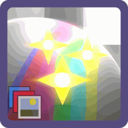

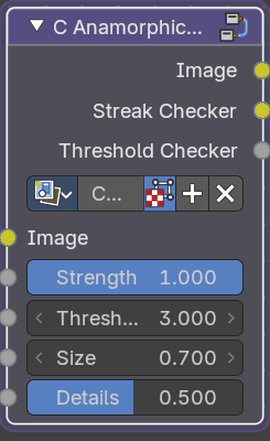

Adds an anamorphic lens flare effect to bright areas of the image.

### Inputs

#### Image

Data type: Color.

The input image to process.

#### Strength

Data type: Float (factor).

Controls the intensity of the anamorphic flare effect. Default: 1.

#### Threshold

Data type: Float.

Sets the brightness threshold for triggering the flare effect. Default: 3.

#### Size

Data type: Float.

Controls the size of the flare effect. Default: 0.7.

#### Details

Data type: Float (factor).

Adjusts the level of detail or complexity in the flare effect. Default: 0.5.

### Outputs

#### Image

Data type: Color.

The output image after processing the effect.

#### Streak Checker

Data type: Color.

Indicator of the separate streaks channel.

#### Threshold Checker

Data type: Float.

Indicator of the threshold mask.

### How to use

Connect an image to Image. Bright areas above Threshold are stretched into the horizontal blue streaks of an anamorphic lens. Size sets the length, Details the fine structure and Strength the brightness. Streak Checker and Threshold Checker show the masks.

## Bokeh

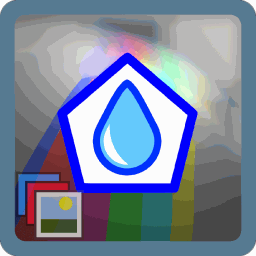

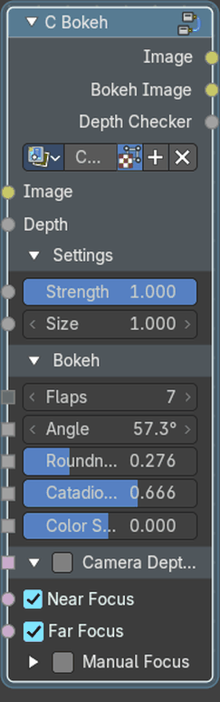

Applies a bokeh blur effect to simulate out-of-focus lens characteristics.

### Inputs

#### Image

Data type: Color.

The input image to process.

#### Depth

Data type: Float.

Depth pass used to calculate the blur. Default: 0.

#### Settings

##### Strength

Data type: Float (factor).

Controls the intensity of the bokeh effect. Default: 1.

##### Size

Data type: Float.

Controls the size of the bokeh blur. Default: 1.

#### Bokeh

##### Flaps

Data type: Integer.

The number of flaps in the bokeh. Default: 7.

##### Angle

Data type: Float (angle).

The angle of the bokeh. Default: 30°.

##### Roundness

Data type: Float (factor).

Specifies how round the bokeh is, maximum roundness produces a circular bokeh. Default: 0.276.

##### Catadioptric Size

Data type: Float (factor).

Specifies the size of the catadioptric iris, zero means no iris. Default: 0.666.

##### Color Shift

Data type: Float (factor).

Specifies the amount of color shifting. 1 means maximum shifting towards blue while -1 means maximum shifting toward red. Default: 0.

#### Camera Depth of Field

##### Camera Depth of Field

Data type: Boolean.

Enables or disables defocus for near-field areas. Default: Off.

##### Near Focus

Data type: Boolean.

Enables or disables defocus for near-field areas. Default: On.

##### Far Focus

Data type: Boolean.

Enables or disables defocus for far-field areas. Default: On.

#### Manual Focus

##### Manual Focus

Data type: Boolean.

Set the focus distance by hand instead of using the camera. Default: Off.

##### Focus Distance

Data type: Float.

Adjusts the center offset for the defocus mask. Default: 5.

##### F-Stop

Data type: Float.

Adjusts the fstop depth field for the defocus mask. Default: 2.8.

##### Near Offset

Data type: Float.

Sets the distance threshold for near-field defocus. Default: 0.

##### Far Offset

Data type: Float.

Sets the distance threshold for far-field defocus. Default: 0.

### Outputs

#### Image

Data type: Color.

The output image after processing the effect.

#### Bokeh Image

Data type: Color.

Indicator of the separate Bokeh image channel.

#### Depth Checker

Data type: Float.

Indicator of the threshold mask.

### How to use

Connect an image to Image and a depth pass to Depth. Out of focus highlights turn into the shape of the lens opening. The Bokeh panel sets that shape: Flaps, Angle, Roundness, Catadioptric Size and Color Shift. Camera Depth of Field takes the focus settings from the camera or lets you set them by hand.

## Camera Shake

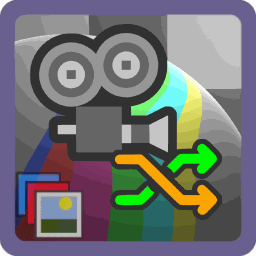

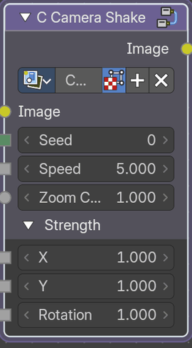

Simulates camera shake by applying random translations and rotations to the image.

### Inputs

#### Image

Data type: Color.

The input image to process.

#### Seed

Data type: Integer.

Changes the random shake pattern. Default: 0.

#### Speed

Data type: Float.

How fast the camera shakes. Default: 5.

#### Zoom Correction

Data type: Float.

Adjusts the image scale to compensate for shake-induced cropping. Default: 1.

#### Strength

##### Strength X

Data type: Float.

Controls the intensity of horizontal camera shake. Default: 1.

##### Strength Y

Data type: Float.

Controls the intensity of vertical camera shake. Default: 1.

##### Strength Rotation

Data type: Float.

Controls the intensity of rotational camera shake. Default: 1.

### Outputs

#### Image

Data type: Color.

The output image after processing the effect.

### How to use

Connect an image to Image. The image is moved and rotated randomly, like a handheld camera. Speed sets how fast, Strength X, Strength Y and Strength Rotation how much, and Zoom Correction scales the image so that the moving borders stay hidden. Change Seed for another shake.

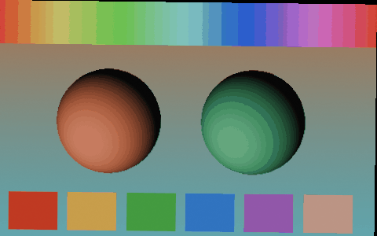

## Fast Defocus

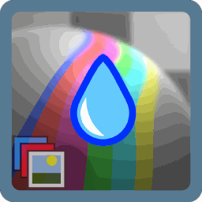

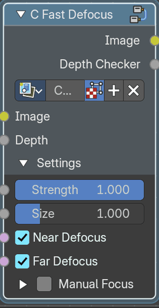

Applies a fast depth-of-field defocus effect based on depth data.

### Inputs

#### Image

Data type: Color.

The input image to process.

#### Depth

Data type: Float.

Depth map input to define focus distances. Default: 1.

#### Settings

##### Strength

Data type: Float (factor).

Controls the intensity of the defocus effect. Default: 1.

##### Size

Data type: Float (factor).

Controls the size of the blur of the defocus effect. Default: 1.

##### Near Defocus

Data type: Boolean.

Enables or disables defocus for near-field areas. Default: On.

##### Far Defocus

Data type: Boolean.

Enables or disables defocus for far-field areas. Default: On.

#### Manual Focus

##### Manual Focus

Data type: Boolean.

Set the focus distance by hand instead of using the camera. Default: Off.

##### Focus Distance

Data type: Float (distance).

Adjusts the center offset for the defocus mask. Default: 5.

##### F-Stop

Data type: Float.

Adjusts the fstop depth field for the defocus mask. Default: 2.8.

##### Near Offset

Data type: Float.

Sets the distance threshold for near-field defocus. Default: 0.

##### Far Offset

Data type: Float.

Sets the distance threshold for far-field defocus. Default: 0.

### Outputs

#### Image

Data type: Color.

The output image after processing the effect.

#### Depth Checker

Data type: Float.

Views the field of focus to troubleshoot.

### How to use

Connect an image to Image and a depth pass to Depth. Things far from the focus are blurred. Use Near Defocus and Far Defocus to choose which side blurs, and Manual Focus with Focus Distance and F-Stop for control by hand. Depth Checker shows the blur mask.

## Fringing

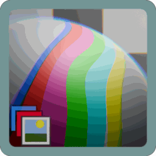

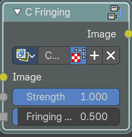

Simulates chromatic aberration fringing around high-contrast edges.

### Inputs

#### Image

Data type: Color.

The input image to process.

#### Strength

Data type: Float (factor).

Controls the intensity of the fringing effect. Default: 1.

#### Fringing Radius

Data type: Float (factor).

Sets the radius or spread of the color fringing. Default: 1.

### Outputs

#### Image

Data type: Color.

The output image after processing the effect.

### How to use

Connect an image to Image. The color channels are pulled apart toward the edges of the picture, like chromatic aberration of a cheap lens. Strength sets how far, Fringing Radius where it starts.

## Godrays

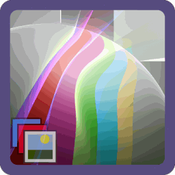

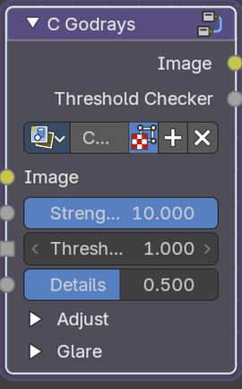

Adds volumetric godray effects emanating from bright areas of the image.

### Inputs

#### Image

Data type: Color.

The input image to process.

#### Strength

Data type: Float (factor).

Controls the intensity of the godray effect. Default: 1.

#### Threshold

Data type: Float.

Sets the brightness threshold for triggering the godray effect. Default: 1.

#### Details

Data type: Float (factor).

Adjusts the level of detail or complexity in the godray effect. Default: 0.5.

#### Adjust

##### Smoothness

Data type: Float (factor).

The smoothness of the extracted highlights. Default: 0.1.

##### Saturation

Data type: Float (factor).

Adjusts the saturation of the glare. Default: 1.

##### Tint

Data type: Color.

Tints the glare. Consider desaturating the glare to more accurate tinting.

#### Glare

##### Size

Data type: Float (factor).

The size of the glare relative to the image. 1 means the glare covers the entire image, 0.5 means the glare covers half the image, and so on. Default: 0.5.

##### Sun Position

Data type: Vector.

The position of the source of the rays in normalized coordinates. 0 means lower left corner and 1 means upper right corner. Default: (0.5, 0.65, 0).

### Outputs

#### Image

Data type: Color.

The output image after processing the effect.

#### Threshold Checker

Data type: Float.

Indicator of the threshold mask.

### How to use

Connect an image to Image and set Sun Position to where the light comes from. Bright areas above Threshold are smeared away from the sun into rays. Size sets how far the rays reach, Details and Smoothness shape them, and Tint and Saturation color them.

## Lens Dirt

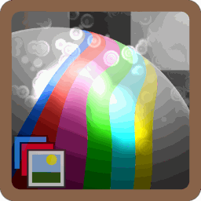

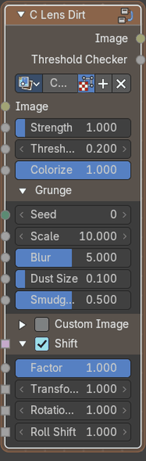

Simulates lens dirt or smudges affecting light flares in the image.

### Inputs

#### Image

Data type: Color.

The input image to process.

#### Strength

Data type: Float (factor).

Controls the intensity of the lens dirt effect. Default: 1.

#### Threshold

Data type: Float.

Sets the brightness threshold for triggering the lens dirt effect. Default: 0.2.

#### Colorize

Data type: Float (factor).

Controls the colorization intensity of the flare effect. Default: 1.

#### Grunge

##### Seed

Data type: Integer.

Value used as seed for random lens dirt generation. Default: 0.

##### Scale

Data type: Float.

Scales the overall size of the lens dirt pattern. Default: 10.

##### Blur

Data type: Float (factor).

Adjusts the blur intensity of the lens dirt effect. Default: 5.

##### Dust Size

Data type: Float (factor).

Size of the dust specks. Default: 0.1.

##### Smudge Size

Data type: Float (factor).

Size of the smudges. Default: 0.5.

#### Custom Image

##### Custom Image

Data type: Boolean.

Use a. Default: Off.

##### Image

Data type: Color.

Defines the custom grunge image. Use another image texture.

##### Factor

Data type: Float (factor).

Amount of mixing between the grunge image and procedural grunge. Default: 1.

#### Shift

##### Shift

Data type: Boolean.

Moves the dirt pattern across the image. Default: On.

##### Factor

Data type: Float (factor).

Controls the intensity of positional shifts in the lens dirt effect. Default: 1.

##### Transform Shift

Data type: Float.

Controls the strength of the camera transformation influence to shift the grunge. Default: 1.

##### Rotation Shift

Data type: Float.

Controls the strength of the camera rotation Yaw and Pitch influence to shift the grunge. Default: 1.

##### Roll Shift

Data type: Float.

Controls the strength of the camera rotation Roll influence to shift the grunge. Default: 1.

### Outputs

#### Image

Data type: Color.

The output image after processing the effect.

#### Threshold Checker

Data type: Float.

Indicator of the threshold mask.

### How to use

Connect a rendered image to Image. Bright areas light up a dirt texture, like smudges on a real lens. Threshold picks the bright areas, Strength sets the effect and Colorize adds the color of the light. The panels Grunge and Custom Image set the dirt pattern. Threshold Checker shows the bright areas.

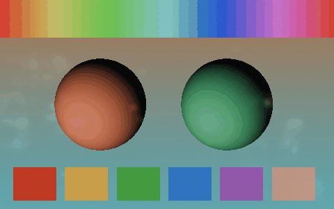

## Simple Bloom

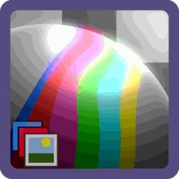

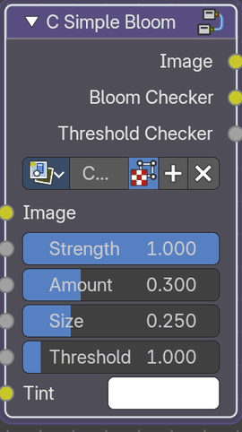

Creates a bloom effect, adding glow to bright areas of the image.

### Inputs

#### Image

Data type: Color.

The input image to process.

#### Strength

Data type: Float (factor).

Controls the intensity of the bloom effect. Default: 1.

#### Amount

Data type: Float (factor).

Adjusts the overall amount of bloom applied. Default: 0.3.

#### Size

Data type: Float (factor).

Controls the size of the bloom glow. Default: 0.25.

#### Threshold

Data type: Float (factor).

Sets the brightness threshold for triggering the bloom effect. Default: 1.

#### Tint

Data type: Color.

Applies a color tint to the bloom effect.

### Outputs

#### Image

Data type: Color.

The output image after processing the effect.

#### Bloom Checker

Data type: Color.

Indicator of the separate bloom channel.

#### Threshold Checker

Data type: Float.

Indicator of the threshold mask.

### How to use

Connect an image to Image. Everything brighter than Threshold glows: Size sets how far the glow spreads, Amount how much is added, Strength the overall effect and Tint colors the glow. Threshold Checker and Bloom Checker show the masks.

## Simple Grain

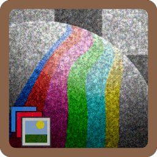

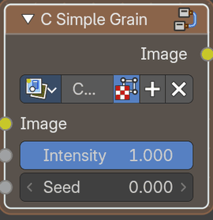

Adds a simple grain or noise effect to the image.

### Inputs

#### Image

Data type: Color.

The input image to process.

#### Intensity

Data type: Float (factor).

Controls the intensity of the grain effect. Default: 0.15.

#### Seed

Data type: Float.

Value used as seed for random grain generation. Default: 0.

### Outputs

#### Image

Data type: Color.

The image with grain applied.

### How to use

Connect an image to Image. Intensity sets how strong the grain is and Seed changes the pattern. Animate the Seed to get moving grain.

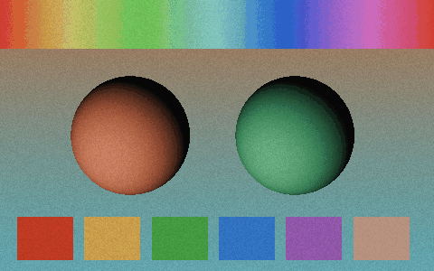

## Solarize

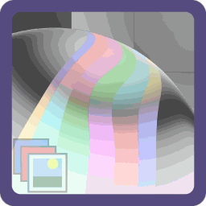

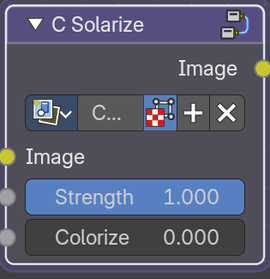

Applies a solarization effect, inverting tones based on brightness.

### Inputs

#### Image

Data type: Color.

The input image to process.

#### Strength

Data type: Float (factor).

Controls the intensity of the solarization effect. Default: 1.

#### Colorize

Data type: Float (factor).

Controls the amount of colorization in the solarized image. Default: 0.

### Outputs

#### Image

Data type: Color.

The output image after processing the effect.

### How to use

Connect an image to Image. Strength sets how much of the tones are inverted and Colorize adds color to the inverted tones. Use it for a surreal, photographic darkroom look.

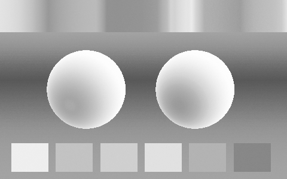

## Tilt Shift

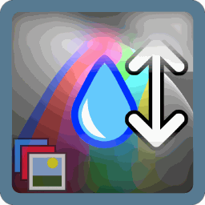

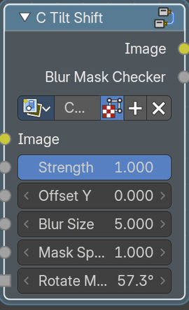

Simulates a tilt-shift lens effect with selective blur.

### Inputs

#### Image

Data type: Color.

The input image to process.

#### Strength

Data type: Float (factor).

Controls the intensity of the tilt-shift effect. Default: 1.

#### Offset Y

Data type: Float.

Shifts the tilt-shift effect along the Y-axis. Default: 0.

#### Blur Size

Data type: Float.

Controls the size of the blur in the tilt-shift effect. Default: 5.

#### Mask Spread

Data type: Float.

Adjusts the spread of the blur mask. Default: 1.

#### Rotate Mask

Data type: Float (angle).

Rotates the blur mask for the tilt-shift effect. Default: 0°.

### Outputs

#### Image

Data type: Color.

The output image after processing the effect.

#### Blur Mask Checker

Data type: Float.

Indicator of the separate blur channel.

### How to use

Connect an image to Image. A band across the image stays sharp and the rest is blurred, which makes a scene look like a miniature. Offset Y moves the sharp band, Mask Spread sets how wide it is, Rotate Mask tilts it and Blur Size sets how blurry the rest gets.

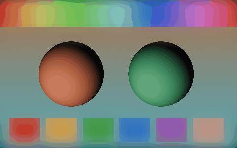

## Vignette Box

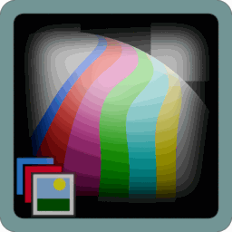

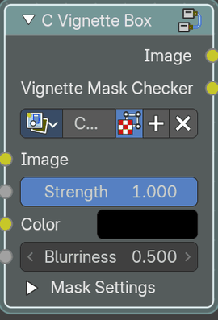

Applies a rectangular vignette effect to darken or color the image edges.

### Inputs

#### Image

Data type: Color.

The input image to process.

#### Strength

Data type: Float (factor).

Controls the intensity of the vignette effect. Default: 1.

#### Color

Data type: Color.

The color of the vignette effect.

#### Blurriness

Data type: Float.

Controls the softness of the vignette edges. Default: 0.5.

#### Mask Settings

##### Position

Data type: Vector.

Sets the center position of the vignette effect. Default: (0.5, 0.5, 0).

##### Size

Data type: Vector.

Controls the size of the vignette effect. Default: (0.75, 0.35, 0).

##### Rotation

Data type: Float (angle).

Rotates the vignette effect. Default: 0°.

### Outputs

#### Image

Data type: Color.

The output image after processing the effect.

#### Vignette Mask Checker

Data type: Color.

Indicator of the separate mask channel.

### How to use

Connect an image to Image and the result to the next node. Position, Size and Rotation place and shape the rectangle, Blurriness softens its edge, and Strength and Color set how strongly and in which color the edges are darkened. Vignette Mask Checker shows the mask.

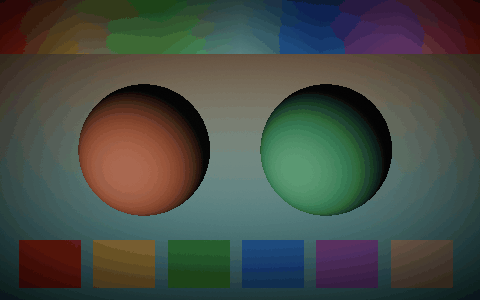

## Vignette Custom

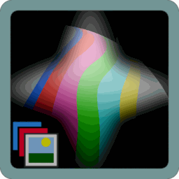

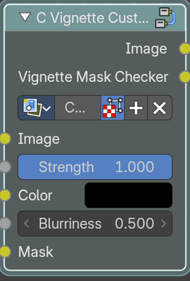

Applies a custom vignette effect using a user-defined mask.

### Inputs

#### Image

Data type: Color.

The input image to process.

#### Strength

Data type: Float (factor).

Controls the intensity of the vignette effect. Default: 1.

#### Color

Data type: Color.

The color of the vignette effect.

#### Blurriness

Data type: Float.

Controls the softness of the vignette edges. Default: 0.5.

#### Mask

Data type: Color.

Custom mask input to define the vignette shape.

### Outputs

#### Image

Data type: Color.

The output image after processing the effect.

#### Vignette Mask Checker

Data type: Color.

Indicator of the separate mask channel.

### How to use

Connect an image to Image and any black and white image to Mask. White areas of the mask stay clear and dark areas receive the vignette, so you can draw a vignette of any shape. Blurriness softens the mask, Strength and Color set how it looks.

## Vignette Ellipse

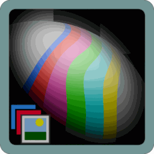

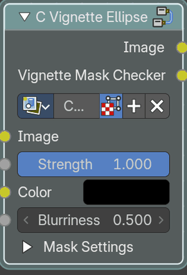

Applies an elliptical vignette effect to darken or color the image edges.

### Inputs

#### Image

Data type: Color.

The input image to process.

#### Strength

Data type: Float (factor).

Controls the intensity of the vignette effect. Default: 1.

#### Color

Data type: Color.

The color of the vignette effect.

#### Blurriness

Data type: Float.

Controls the softness of the vignette edges. Default: 0.5.

#### Mask Settings

##### Position

Data type: Vector.

Sets the center position of the vignette effect. Default: (0.5, 0.5, 0).

##### Size

Data type: Vector.

Controls the size of the vignette effect. Default: (0.75, 0.35, 0).

##### Rotation

Data type: Float (angle).

Rotates the vignette effect. Default: 0°.

### Outputs

#### Image

Data type: Color.

The output image after processing the effect.

#### Vignette Mask Checker

Data type: Color.

Indicator of the separate mask channel.

### How to use

Connect an image to Image and the result to the next node. Position, Size and Rotation place and shape the ellipse, Blurriness softens its edge, and Strength and Color set how strongly and in which color the edges are darkened. Connect Vignette Mask Checker to a Viewer to see the mask on its own.

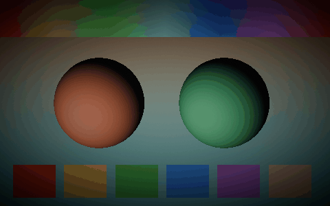

# Output

Assets that combine or prepare render passes for the final image.

## Combine Cycles Passes

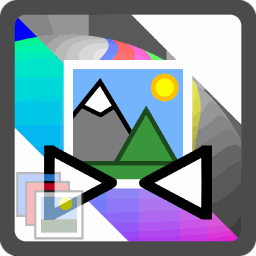

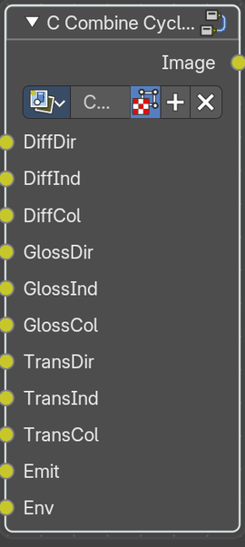

Combines multiple Cycles render passes for advanced compositing

### Inputs

#### DiffDir

Data type: Color.

Direct diffuse lighting render pass.

#### DiffInd

Data type: Color.

Indirect diffuse lighting render pass.

#### DiffCol

Data type: Color.

Diffuse color render pass.

#### GlossDir

Data type: Color.

Direct glossy lighting render pass.

#### GlossInd

Data type: Color.

Indirect glossy lighting render pass.

#### GlossCol

Data type: Color.

Glossy color render pass.

#### TransDir

Data type: Color.

Direct transmission lighting render pass.

#### TransInd

Data type: Color.

Indirect transmission lighting render pass.

#### TransCol

Data type: Color.

Transmission color render pass.

#### Emit

Data type: Color.

Emission render pass for emissive materials.

#### Env

Data type: Color.

Environment lighting render pass.

### Outputs

#### Image

Data type: Color.

The output image after processing the effect.

### How to use

Connect the passes of a Render Layers node to the inputs of the same name. The node adds them back together into the finished image, so you can change single passes before. Enable the passes in the View Layer properties first.

## Combine EEVEE Passes

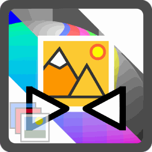

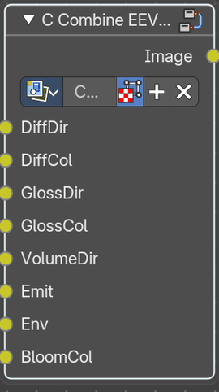

Combines multiple Eevee render passes for advanced compositing.

### Inputs

#### DiffDir

Data type: Color.

Direct diffuse lighting render pass.

#### DiffCol

Data type: Color.

Diffuse color render pass.

#### GlossDir

Data type: Color.

Direct glossy lighting render pass.

#### GlossCol

Data type: Color.

Glossy color render pass.

#### VolumeDir

Data type: Color.

Direct volumetric lighting render pass.

#### Emit

Data type: Color.

Emission render pass for emissive materials.

#### Env

Data type: Color.

Environment lighting render pass.

#### BloomCol

Data type: Color.

Bloom color render pass for glow effects.

### Outputs

#### Image

Data type: Color.

The output image after processing the effect.

### How to use

Connect the passes of a Render Layers node to the inputs of the same name. The node adds them back together into the finished image, so you can change single passes before. Enable the passes in the View Layer properties first.

## Multipass Template

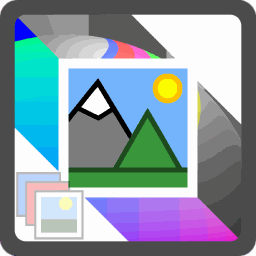

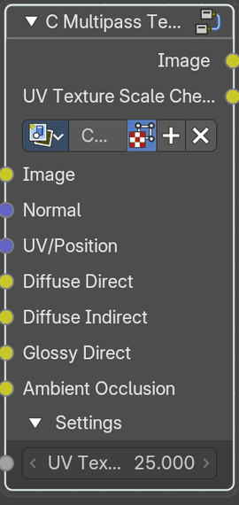

Processes an image with a breakdown effect using multiple render passes and UV data.

### Inputs

#### Image

Data type: Color.

The input image to process.

#### Normal

Data type: Vector.

Surface normal data for effect calculations.

#### UV/Position

Data type: Vector.

UV map data for texture mapping. Default: (1, 1, 1).

#### Diffuse Direct

Data type: Color.

Direct diffuse lighting render pass.

#### Diffuse Indirect

Data type: Color.

Indirect diffuse lighting render pass.

#### Glossy Direct

Data type: Color.

Direct glossy lighting render pass.

#### Ambient Occlusion

Data type: Color.

Ambient occlusion render pass.

#### Settings

##### UV Texture Scale

Data type: Float.

Scales the UV texture for the effect. Default: 25.

### Outputs

#### Image

Data type: Color.

The output image after processing the effect. To compile to a Multilayer EXR, use the File Output inside this nodegroup.

#### UV Texture Scale Checker

Data type: Color.

Indicator of the separate UV checker texture mapping channel.

### How to use

Connect the passes of a Render Layers node to the inputs of the same name and the rendered image to Image. UV Texture Scale sets the size of the texture on the effect. It is a template to adapt for your own breakdown look.

# Texture / Patterns

Assets that make procedural patterns. Most of them cover the whole image by default and have a Vector Coordinates option to use a vector of your own.

## Cross Wave

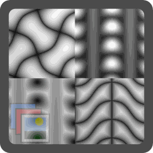

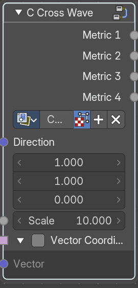

Creates a pattern with vector coordinates and settings with multiple outputs

### Inputs

#### Direction

Data type: Vector.

Direction of the pattern. Default: (1, 1, 0).

#### Scale

Data type: Float.

The scale of the pattern. Default: 10.

#### Vector Coordinates

##### Vector Coordinates

Data type: Boolean.

Use the Vector input instead of the automatic image coordinates. Default: Off.

##### Vector

Data type: Vector.

Vector Coordinates input. Best used with the Vector Mapping node group.

### Outputs

#### Metric 1

Data type: Float.

Wave pattern using distance metric 1.

#### Metric 2

Data type: Float.

Wave pattern using distance metric 2.

#### Metric 3

Data type: Float.

Wave pattern using distance metric 3.

#### Metric 4

Data type: Float.

Wave pattern using distance metric 4.

### How to use

Crossing waves in a pattern. Direction rotates them and Scale sets their size. The four Metric outputs give different shapes of the same pattern.

The pattern with default values:

## Generalized Checker

Creates a pattern with vector coordinates and settings with multiple outputs

### Inputs

#### Color 1

Data type: Color.

First pattern color.

#### Color 2

Data type: Color.

Second pattern color.

#### Dot

Data type: Vector.

The randomization values of the checker pattern defined by vector input. Default: (1, 1, 1).

#### Modulo

Data type: Float.

The modulo diagonal distance of the colour of the checker pattern defined by float input. Default: 2.

#### Scale

Data type: Float.

The scale of the checker pattern. Default: 1.

#### Vector Coordinates

##### Vector Coordinates

Data type: Boolean.

Use the Vector input instead of the automatic image coordinates. Default: Off.

##### Vector

Data type: Vector.

Vector Coordinates input. Best used with the Vector Mapping node group.

### Outputs

#### Value

Data type: Float.

Smooth value of the pattern.

#### Color

Data type: Color.

A colour output.

#### Position

Data type: Vector.

Position vector output.

#### UVs

Data type: Vector.

The UVs per checker vector output.

### How to use

A checkerboard with any two colors. Color 1 and Color 2 set the colors, Modulo the number of steps and Dot a dot variant. Scale sets the size of the squares.

The pattern with default values:

## Grid

Creates a pattern with vector coordinates and settings with multiple outputs

### Inputs

#### Spacing X

Data type: Integer.

Spacing of the grid pattern in the X axis, best used as integers. Default: 5.

#### Spacing Y

Data type: Integer.

Spacing of the grid pattern in the Y axis, best used as integers. Default: 5.

#### Thickness X

Data type: Float.

Thickness of the grid pattern in the X axis. Default: 0.5.

#### Thickness Y

Data type: Float.

Thickness of the grid pattern in the Y axis. Default: 0.5.

#### Scale

Data type: Float.

Scale of the grid pattern. Default: 1.

#### Relative Thickness

Data type: Boolean.

Relative thickness of the grid pattern. Default: Off.

#### Tileable

Data type: Boolean.

Makes the pattern tileable. Default: Off.

#### Vector Coordinates

##### Vector Coordinates

Data type: Boolean.

Use the Vector input instead of the automatic image coordinates. Default: Off.

##### Vector

Data type: Vector.

Vector Coordinates input. Best used with the Vector Mapping node group.

### Outputs

#### Value

Data type: Float.

Smooth value of the pattern.

#### Height

Data type: Float.

A hight value output.

#### Mask

Data type: Float.

A mask float output.

### How to use

A grid of lines. Spacing X and Spacing Y set the cells, Thickness X and Thickness Y the lines. Relative Thickness scales the lines with the spacing. With Tileable on, the grid repeats without seams.

The pattern with default values:

## Hexagon Tiles

Creates a pattern with vector coordinates and settings with multiple outputs

### Inputs

#### Scale

Data type: Float.

Scale of the hexagon pattern. Default: 1.

#### Vector Coordinates

##### Vector Coordinates

Data type: Boolean.

Use the Vector input instead of the automatic image coordinates. Default: Off.

##### Vector

Data type: Vector.

Vector Coordinates input. Best used with the Vector Mapping node group.

### Outputs

#### UVs

Data type: Vector.

UVs per hexagon vector output.

#### Position

Data type: Vector.

Position vector output.

#### Random

Data type: Float.

Random float output.

#### Random

Data type: Color.

Random color output.

#### Hexagonal

Data type: Float.

Sharp Hexagonal float output.

#### Distance

Data type: Float.

Smooth Distance float output.

### How to use

A honeycomb pattern. Scale sets the number of cells. Distance is the distance to the cell center, Hexagonal the hexagon shape, and UVs and Position give a coordinate for each cell.

The pattern with default values:

## Knurling

Creates a pattern with vector coordinates and settings with multiple outputs

### Inputs

#### Tile Width

Data type: Float.

Knurling tile width. Default: 0.5.

#### Tile Height

Data type: Float.

Knurling tile height. Default: 0.5.

#### Max

Data type: Float.

Knurling maximum depth. Default: 1.

#### Min

Data type: Float.

Knurling minimum depth. Default: 0.

#### Smooth

Data type: Float.

Knurling smoothness. Default: 0.5.

#### Scale

Data type: Float.

Knurling pattern scale. Default: 5.

#### Vector Coordinates

##### Vector Coordinates

Data type: Boolean.

Use the Vector input instead of the automatic image coordinates. Default: Off.

##### Vector

Data type: Vector.

Vector Coordinates input. Best used with the Vector Mapping node group.

### Outputs

#### Height

Data type: Float.

Height float output.

#### Value

Data type: Float.

Height float output.

#### UVs

Data type: Vector.

The UV vector output.

#### Position

Data type: Vector.

Position vector output.

#### Random

Data type: Float.

Random float output.

#### Random

Data type: Color.

Random color output.

### How to use

A diamond pattern like the grip on a metal tool. Tile Width and Tile Height set the diamonds, Max and Min the height, Smooth the rounding and Scale the number of tiles. Height can be used as a displacement.

The pattern with default values:

## Linear Gradient Advanced

Creates a pattern with vector coordinates and settings with multiple outputs

### Inputs

#### Start

Data type: Vector.

Start of the gradient with a vector input.

#### End

Data type: Vector.

End of the gradient with a vector input. Default: (1, 1, 0).

#### Softness

Data type: Float.

The softness of the gradient curve. Default: 1.

#### Vector Coordinates

##### Vector Coordinates

Data type: Boolean.

Use the Vector input instead of the automatic image coordinates. Default: Off.

##### Vector

Data type: Vector.

Vector Coordinates input. Best used with the Vector Mapping node group.

### Outputs

#### Value

Data type: Float.

Smooth value of the pattern.

#### Mask

Data type: Float.

Black and white mask of the pattern.

#### Visualized

Data type: Color.

A visualized version of the gradient with a color output.

### How to use

A gradient between two points. Start and End place the points and Softness sets how smooth the transition is. Value is the gradient and Mask a sharp version. Visualized shows the points.

The pattern with default values:

## Polka Dots

Creates a pattern with vector coordinates and settings with multiple outputs

### Inputs

#### Dot Size

Data type: Float (factor).

The size of the polkadots. Default: 0.5.

#### Rotation

Data type: Float (angle).

Rotation of the dot grid. Default: 45°.

#### Scale

Data type: Float.

The scale of the polkadots pattern. Default: 5.

#### Vector Coordinates

##### Vector Coordinates

Data type: Boolean.

Use the Vector input instead of the automatic image coordinates. Default: Off.

##### Vector

Data type: Vector.

Vector Coordinates input. Best used with the Vector Mapping node group.

### Outputs

#### Value

Data type: Float.

Smooth value of the pattern.

#### Mask

Data type: Float.

Black and white mask of the pattern.

#### UVs

Data type: Vector.

The UVs of the polkadots vector output.

#### Position

Data type: Vector.

Position vector output.

#### Random

Data type: Float.

Random value output.

#### Random

Data type: Color.

Random colour output.

### How to use

A pattern of round dots. Dot Size sets their size, Rotation turns the grid and Scale sets how many there are. Value is the shading and Mask the sharp dot.

The pattern with default values:

## Simplex Grid

A triangle grid, with value, mask and vector outputs

### Inputs

#### Border Thickness

Data type: Float (factor).

Thickness of the borders between triangles. Default: 0.1.

#### Invert

Data type: Boolean.

Swap the light and dark areas of the pattern. Default: On.

#### Scale

Data type: Float.

Overall size of the pattern. Default: 1.

#### Vector Coordinates

##### Vector Coordinates

Data type: Boolean.

Use the Vector input instead of the automatic image coordinates. Default: Off.

##### Vector

Data type: Vector.

Vector Coordinates input. Best used with the Vector Mapping node group.

### Outputs

#### Value

Data type: Float.

Smooth distance across each triangle.

#### Mask

Data type: Float.

Black and white triangles.

#### Vector

Data type: Vector.

Coordinates inside each triangle.

### How to use

A grid of triangles. Scale sets the size and Border Thickness the width of the lines, Invert swaps lines and fills. Value is the shading, Mask the sharp grid and Vector the position inside each triangle.

The pattern with default values:

## Simplex Noise 3D

Smooth procedural noise with no visible grid pattern

### Inputs

#### Scale

Data type: Float.

Size of the noise. Higher values give finer detail. Default: 1.

#### Vector Coordinates

##### Vector Coordinates

Data type: Boolean.

Use the Vector input instead of the automatic image coordinates. Default: Off.

##### Vector

Data type: Vector.

Vector Coordinates input. Best used with the Vector Mapping node group.

### Outputs

#### Value

Data type: Float.

Noise value.

### How to use

Smooth noise without the grid look of a Perlin noise. Scale sets the size of the features. Use Value as a mask, a displacement or to vary a color.

The pattern with default values:

## Smooth Tiles

Rounded square tiles with value, mask, UV and position outputs

### Inputs

#### Scale

Data type: Float.

Overall size of the pattern. Higher values give more, smaller tiles. Default: 2.

#### Roundness

Data type: Float.

Shape of the tiles. Low values are rounder, high values are squarer. Default: 5.

#### Vector Coordinates

##### Vector Coordinates

Data type: Boolean.

Use the Vector input instead of the automatic image coordinates. Default: Off.

##### Vector

Data type: Vector.

Vector Coordinates input. Best used with the Vector Mapping node group.

### Outputs

#### Value

Data type: Float.

Smooth height of each tile.

#### Mask

Data type: Float.

Black and white tile shapes.

#### UVs

Data type: Vector.

UV coordinates inside each tile.

#### Position

Data type: Vector.

Position of each tile.

### How to use

Rounded square tiles. Scale sets the number of tiles and Roundness how round the corners are. Value is the shading, Mask the sharp tile, and UVs and Position give a coordinate for each tile.

The pattern with default values:

## Spiral

A spiral, with a smooth value and a sharp mask output

### Inputs

#### Rotate

Data type: Float.

Rotates the spiral around its center. Default: 0.

#### Turns

Data type: Float.

How many times the spiral winds around its center. Default: 1.

#### Double Spiral

Data type: Boolean.

Use two spiral arms instead of one. Default: Off.

#### Mask Threshold

Data type: Float (factor).

Where the Mask output switches from black to white. Default: 0.5.

#### Scale

Data type: Float.

Overall size of the spiral. Default: 5.

#### Vector Coordinates

##### Vector Coordinates

Data type: Boolean.

Use the Vector input instead of the automatic image coordinates. Default: Off.

##### Vector

Data type: Vector.

Vector Coordinates input. Best used with the Vector Mapping node group.

### Outputs

#### Value

Data type: Float.

Smooth ramp along the spiral arm.

#### Mask

Data type: Float.

Black and white spiral.

### How to use

Set Turns to the number of windings and Rotate to turn the spiral. Double Spiral adds a second arm. Value is smooth and Mask is sharp, with Mask Threshold deciding how wide it is.

The pattern with default values:

## Stripes

Stripes in any direction, with a smooth ramp and a sharp mask output

### Inputs

#### Direction

Data type: Vector.

Direction the stripes run across, as a vector. Only its direction matters. Default: (1, 0, 0).

#### Spacing

Data type: Float.

Distance between stripes. Default: 1.

#### Scale

Data type: Float.

Overall size of the pattern. Higher values give more, thinner stripes. Default: 5.

#### Thickness

Data type: Float (factor).

Width of each stripe compared to the spacing. Default: 0.5.

#### Vector Coordinates

##### Vector Coordinates

Data type: Boolean.

Use the Vector input instead of the automatic image coordinates. Default: Off.

##### Vector

Data type: Vector.

Vector Coordinates input. Best used with the Vector Mapping node group.

### Outputs

#### Value

Data type: Float.

Smooth ramp across each stripe, from 0 to 1.

#### Mask

Data type: Float.

Sharp black and white stripes.

### How to use

Set Direction to the angle of the stripes, Spacing to the distance between them and Thickness to their width. Value is a smooth ramp and Mask is the sharp stripe.

The pattern with default values:

## Threads 1

Woven thread pattern with shading, position, UV and random outputs

### Inputs

#### X Shade

Data type: Float.

Brightness of the threads running along X. Default: 1.

#### Y Shade

Data type: Float.

Brightness of the threads running along Y. Default: 1.

#### Skew

Data type: Float.

Slants the weave. Default: 0.

#### Scale

Data type: Float.

Overall size of the weave. Default: 1.

#### Distortion Map

Data type: Color.

Color or vector used to warp the threads.

#### Distortion

Data type: Float.

How strongly the Distortion Map warps the threads. Default: 0.

#### Vector Coordinates

##### Vector Coordinates

Data type: Boolean.

Use the Vector input instead of the automatic image coordinates. Default: Off.

##### Vector

Data type: Vector.

Vector Coordinates input. Best used with the Vector Mapping node group.

### Outputs

#### Value

Data type: Float.

Height of the threads.

#### Position

Data type: Vector.

Position of each thread.

#### UVs

Data type: Vector.

UV coordinates along each thread.

#### Random

Data type: Float.

Random value for each thread.

#### Random

Data type: Color.

Random color for each thread.

### How to use

A woven fabric pattern. X Shade and Y Shade set the brightness of the two thread directions, Skew shears the weave, Scale sets its size and Distortion with Distortion Map wobbles it. Value is the shading and Random gives each thread its own value.

The pattern with default values:

## Threads 2

Woven thread pattern with shading, position, UV and random outputs

### Inputs

#### X Shade

Data type: Float.

Brightness of the threads running along X. Default: 1.

#### Y Shade

Data type: Float.

Brightness of the threads running along Y. Default: 1.

#### Skew

Data type: Float.

Slants the weave. Default: 2.

#### Scale

Data type: Float.

Overall size of the weave. Default: 1.

#### Distortion Map

Data type: Color.

Color or vector used to warp the threads.

#### Distortion

Data type: Float.

How strongly the Distortion Map warps the threads. Default: 0.

#### Vector Coordinates

##### Vector Coordinates

Data type: Boolean.

Use the Vector input instead of the automatic image coordinates. Default: Off.

##### Vector

Data type: Vector.

Vector Coordinates input. Best used with the Vector Mapping node group.

### Outputs

#### Value

Data type: Float.

Height of the threads.

#### Position

Data type: Vector.

Position of each thread.

#### UVs

Data type: Vector.

UV coordinates along each thread.

#### Random

Data type: Float.

Random value for each thread.

#### Random

Data type: Color.

Random color for each thread.

### How to use

A woven fabric pattern. X Shade and Y Shade set the brightness of the two thread directions, Skew shears the weave, Scale sets its size and Distortion with Distortion Map wobbles it. Value is the shading and Random gives each thread its own value.

The pattern with default values:

## Tileable Perlin 2D

Perlin noise that can tile seamlessly

### Inputs

#### Scale

Data type: Float.

Size of the noise. Whole numbers are used when Tileable is on. Default: 5.

#### Tileable

Data type: Boolean.

Make the noise repeat seamlessly. Default: On.

#### Vector Coordinates

##### Vector Coordinates

Data type: Boolean.

Use the Vector input instead of the automatic image coordinates. Default: Off.

##### Vector

Data type: Vector.

Vector Coordinates input. Best used with the Vector Mapping node group.

### Outputs

#### Value

Data type: Float.

Noise value.

### How to use

The pattern covers the whole image by default. Set Scale for the size of the noise. With Tileable on, the pattern repeats without visible seams. Switch Vector Coordinates on to use your own Vector instead.

The pattern with default values:

## Tileable Voronoi 2D

Voronoi cells that can tile seamlessly, with distance, color and position outputs

### Inputs

#### Randomness

Data type: Vector.

How far cell points can move from a regular grid, in X and Y. Default: (1, 1, 0).

#### Point Rotation

Data type: Float.

Rotates each cell point around its cell center. Animate it for a swirling effect. Default: 0.

#### Smoothness

Data type: Float (factor).

How much Smooth F1 rounds off the edges between cells. 0 matches F1. Default: 0.5.

#### Scale

Data type: Float.

Number of cells across. Whole numbers are used when Tileable is on. Default: 5.

#### Tileable

Data type: Boolean.

Make the pattern repeat seamlessly. Default: On.

#### Vector Coordinates

##### Vector Coordinates

Data type: Boolean.

Use the Vector input instead of the automatic image coordinates. Default: Off.

##### Vector

Data type: Vector.

Vector Coordinates input. Best used with the Vector Mapping node group.

### Outputs

#### F1

Data type: Float.

Distance to the nearest cell point.

#### Smooth F1

Data type: Float.

Distance to the nearest cell point, with soft blending between cells.

#### Random Color

Data type: Color.

Random color for each cell.

#### Position

Data type: Vector.

Position of the nearest cell point.

### How to use

Set Scale to the number of cells. With Tileable on, the pattern repeats without visible seams, so it can be used as a texture tile. Randomness, Point Rotation and Smoothness shape the cells. F1 is the distance to the nearest point and Random Color gives each cell a color.

The pattern with default values:

## Truchet

Randomly rotated tiles that join into winding curves or lines

### Inputs

#### Scale

Data type: Float.

Overall size of the pattern. Default: 5.

#### Circles / Lines

Data type: Boolean.

Use straight lines instead of curves. Default: Off.

#### Thickness

Data type: Float (factor).

Thickness of the lines. Default: 0.25.

#### Vector Coordinates

##### Vector Coordinates

Data type: Boolean.

Use the Vector input instead of the automatic image coordinates. Default: Off.

##### Vector

Data type: Vector.

Vector Coordinates input. Best used with the Vector Mapping node group.

### Outputs

#### Value

Data type: Float.

Smooth distance from the pattern.

#### Mask

Data type: Float.

Black and white pattern.

#### UV

Data type: Vector.

UV coordinates inside each tile.

#### Position

Data type: Vector.

Position of each tile.

#### Random

Data type: Float.

Random value for each tile.

#### Random

Data type: Color.

Random color for each tile.

### How to use

The pattern covers the whole image by default. Set Scale to the size of the tiles and switch Circles / Lines to choose the curve style. Thickness sets the line width. Switch Vector Coordinates on to use your own Vector instead. Value is the pattern and Mask its sharp version.

The pattern with default values:

# Texture / Shapes

Assets that draw a vector shape: curves, flowers, hearts and polygons. They cover the whole image by default, and Value is the smooth shape while Mask is the sharp one.

## Ampersand Curve

Creates a a vector shape with vector coordinates and controls

### Inputs

#### Scale

Data type: Float.

The scale of the shape. Default: 2.

#### Vector Coordinates

##### Vector Coordinates

Data type: Boolean.

Use the Vector input instead of the automatic image coordinates. Default: Off.

##### Vector

Data type: Vector.

Vector Coordinates input. Best used with the Vector Mapping node group.

### Outputs

#### Value

Data type: Float.

A gradient output of the shape.

#### Mask

Data type: Float.

A black and white mask of the shape.

### How to use

A vector shape that covers the whole image by default. Scale sets its size. Switch Vector Coordinates on to use your own Vector instead. Value is the smooth shape, Mask is the sharp version of it.

The pattern with default values:

## Astroid

Creates a a vector shape with vector coordinates and controls

### Inputs

#### Scale

Data type: Float.

The scale of the shape. Default: 1.

#### Vector Coordinates

##### Vector Coordinates

Data type: Boolean.

Use the Vector input instead of the automatic image coordinates. Default: Off.

##### Vector

Data type: Vector.

Vector Coordinates input. Best used with the Vector Mapping node group.

### Outputs

#### Value

Data type: Float.

A gradient output of the shape.

#### Mask

Data type: Float.

A black and white mask of the shape.

### How to use

A vector shape that covers the whole image by default. Scale sets its size. Switch Vector Coordinates on to use your own Vector instead. Value is the smooth shape, Mask is the sharp version of it.

The pattern with default values:

## Bean

Creates a a vector shape with vector coordinates and controls

### Inputs

#### Size

Data type: Float.

The scale of the shape. Default: 0.5.

#### Vector Coordinates

##### Vector Coordinates

Data type: Boolean.

Use the Vector input instead of the automatic image coordinates. Default: Off.

##### Vector

Data type: Vector.

Vector Coordinates input. Best used with the Vector Mapping node group.

### Outputs

#### Value

Data type: Float.

A gradient output of the shape.

#### Mask

Data type: Float.

A black and white mask of the shape.

### How to use

A vector shape that covers the whole image by default. Size sets its size. Switch Vector Coordinates on to use your own Vector instead. Value is the smooth shape, Mask is the sharp version of it.

The pattern with default values:

## Bicorn

Creates a a vector shape with vector coordinates and controls

### Inputs

#### Scale

Data type: Float.

The scale of the shape. Default: 2.

#### Vector Coordinates

##### Vector Coordinates

Data type: Boolean.

Use the Vector input instead of the automatic image coordinates. Default: Off.

##### Vector

Data type: Vector.

Vector Coordinates input. Best used with the Vector Mapping node group.

### Outputs

#### Value

Data type: Float.

A gradient output of the shape.

#### Mask

Data type: Float.

A black and white mask of the shape.

### How to use

A vector shape that covers the whole image by default. Scale sets its size. Switch Vector Coordinates on to use your own Vector instead. Value is the smooth shape, Mask is the sharp version of it.

The pattern with default values:

## Bicuspid Curve

Creates a a vector shape with vector coordinates and controls

### Inputs

#### Scale

Data type: Float.

The scale of the shape. Default: 1.

#### Vector Coordinates

##### Vector Coordinates

Data type: Boolean.

Use the Vector input instead of the automatic image coordinates. Default: Off.

##### Vector

Data type: Vector.

Value of the second vector input.

### Outputs

#### Value

Data type: Float.

A gradient output of the shape.

#### Mask

Data type: Float.

A black and white mask of the shape.

### How to use

A vector shape that covers the whole image by default. Scale sets its size. Switch Vector Coordinates on to use your own Vector instead. Value is the smooth shape, Mask is the sharp version of it.

The pattern with default values:

## Boat Propeller

Creates a a vector shape with vector coordinates and controls

### Inputs

#### Scale

Data type: Float.

The scale of the shape. Default: 1.

#### Vector Coordinates

##### Vector Coordinates

Data type: Boolean.

Use the Vector input instead of the automatic image coordinates. Default: Off.

##### Vector

Data type: Vector.

Vector Coordinates input. Best used with the Vector Mapping node group.

### Outputs

#### Value

Data type: Float.

A gradient output of the shape.

#### Mask

Data type: Float.

A black and white mask of the shape.

### How to use

A vector shape that covers the whole image by default. Scale sets its size. Switch Vector Coordinates on to use your own Vector instead. Value is the smooth shape, Mask is the sharp version of it.

The pattern with default values:

## Brush Tip

Creates a a vector shape with vector coordinates and controls

### Inputs

#### Scale

Data type: Float.

The scale of the shape. Default: 1.

#### Vector Coordinates

##### Vector Coordinates

Data type: Boolean.

Use the Vector input instead of the automatic image coordinates. Default: Off.

##### Vector

Data type: Vector.

Vector Coordinates input. Best used with the Vector Mapping node group.

### Outputs

#### Value

Data type: Float.

A gradient output of the shape.

#### Mask

Data type: Float.

A black and white mask of the shape.

### How to use

A vector shape that covers the whole image by default. Scale sets its size. Switch Vector Coordinates on to use your own Vector instead. Value is the smooth shape, Mask is the sharp version of it.

The pattern with default values:

## Bullet Nose

Creates a a vector shape with vector coordinates and controls

### Inputs

#### Scale

Data type: Float.

The scale of the shape. Default: 1.

#### Vector Coordinates

##### Vector Coordinates

Data type: Boolean.

Use the Vector input instead of the automatic image coordinates. Default: Off.

##### Vector

Data type: Vector.

Vector Coordinates input. Best used with the Vector Mapping node group.

### Outputs

#### Value

Data type: Float.

A gradient output of the shape.

#### Mask

Data type: Float.

A black and white mask of the shape.

### How to use

A vector shape that covers the whole image by default. Scale sets its size. Switch Vector Coordinates on to use your own Vector instead. Value is the smooth shape, Mask is the sharp version of it.

The pattern with default values:

## Burnside Curve

Creates a a vector shape with vector coordinates and controls

### Inputs

#### Scale

Data type: Float.

The scale of the shape. Default: 1.

#### Form

Data type: Float.

Modifies the shape procedurally. Default: 2.

#### Vector Coordinates

##### Vector Coordinates

Data type: Boolean.

Use the Vector input instead of the automatic image coordinates. Default: Off.

##### Vector

Data type: Vector.

Vector Coordinates input. Best used with the Vector Mapping node group.

### Outputs

#### Value

Data type: Float.

A gradient output of the shape.

#### Mask

Data type: Float.

A black and white mask of the shape.

### How to use

A vector shape that covers the whole image by default. Scale sets its size. Form changes the shape of the curve. Switch Vector Coordinates on to use your own Vector instead. Value is the smooth shape, Mask is the sharp version of it.

The pattern with default values:

## Butterfly 1

Creates a a vector shape with vector coordinates and controls

### Inputs

#### Scale

Data type: Float.

The scale of the shape. Default: 4.

#### Offset

Data type: Float.

The offset of the shape. Default: 1.

#### Number of Wings

Data type: Integer.

The number of wings the shape will have. Default: 4.

#### Form

Data type: Float.

Modifies the shape procedurallyModifies the shape procedurally. Default: 2.

#### Vector Coordinates

##### Vector Coordinates

Data type: Boolean.

Use the Vector input instead of the automatic image coordinates. Default: Off.

##### Vector

Data type: Vector.

Vector Coordinates input. Best used with the Vector Mapping node group.

### Outputs

#### Value

Data type: Float.

A gradient output of the shape.

#### Mask

Data type: Float.

A black and white mask of the shape.

### How to use

A vector shape that covers the whole image by default. Scale sets its size. Offset moves it. Number of Wings sets the wings. Form changes the shape of the curve. Switch Vector Coordinates on to use your own Vector instead. Value is the smooth shape, Mask is the sharp version of it.

The pattern with default values:

## Butterfly 2

Creates a a vector shape with vector coordinates and controls

### Inputs

#### Scale

Data type: Float.

The scale of the shape. Default: 1.

#### Offset

Data type: Float.

The offset of the shape. Default: 0.

#### Form

Data type: Vector.

Modifies the shape procedurallyModifies the shape procedurally. Default: (2, 6, 6).

#### Vector Coordinates

##### Vector Coordinates

Data type: Boolean.

Use the Vector input instead of the automatic image coordinates. Default: Off.

##### Vector

Data type: Vector.

Vector Coordinates input. Best used with the Vector Mapping node group.

### Outputs

#### Value

Data type: Float.

A gradient output of the shape.

#### Mask

Data type: Float.

A black and white mask of the shape.

### How to use

A vector shape that covers the whole image by default. Scale sets its size. Offset moves it. Form changes the shape of the curve. Switch Vector Coordinates on to use your own Vector instead. Value is the smooth shape, Mask is the sharp version of it.

The pattern with default values:

## Capsule

Creates a a vector shape with vector coordinates and controls

### Inputs

#### Scale

Data type: Float.

The scale of the shape. Default: 1.

#### Dimensions

Data type: Vector.

Modifies the shape procedurallyModifies the shape procedurally. Default: (0.5, 1).

#### Radius

Data type: Float.

The offset of the shape. Default: 0.5.

#### Vector Coordinates

##### Vector Coordinates

Data type: Boolean.

Use the Vector input instead of the automatic image coordinates. Default: Off.

##### Vector

Data type: Vector.

Vector Coordinates input. Best used with the Vector Mapping node group.

### Outputs

#### Value

Data type: Float.

A gradient output of the shape.

#### Mask

Data type: Float.

A black and white mask of the shape.

### How to use

A vector shape that covers the whole image by default. Scale sets its size. Dimensions set its width and height. Radius sets its roundness. Switch Vector Coordinates on to use your own Vector instead. Value is the smooth shape, Mask is the sharp version of it.

The pattern with default values:

## Cardioid

Creates a a vector shape with vector coordinates and controls

### Inputs

#### Scale

Data type: Float.

The scale of the shape. Default: 1.

#### Form

Data type: Vector.

Modifies the shape procedurallyModifies the shape procedurally. Default: (0.5, 0.5).

#### Vector Coordinates

##### Vector Coordinates

Data type: Boolean.

Use the Vector input instead of the automatic image coordinates. Default: Off.

##### Vector

Data type: Vector.

Vector Coordinates input. Best used with the Vector Mapping node group.

### Outputs

#### Value

Data type: Float.

A gradient output of the shape.

#### Mask

Data type: Float.

A black and white mask of the shape.

### How to use

A vector shape that covers the whole image by default. Scale sets its size. Form changes the shape of the curve. Switch Vector Coordinates on to use your own Vector instead. Value is the smooth shape, Mask is the sharp version of it.

The pattern with default values:

## Circumcircle

Creates a a vector shape with vector coordinates and controls

### Inputs

#### Point A

Data type: Vector.

Vector of point A, modifies the shape procedurally. Default: (1, 0, 0).

#### Point B

Data type: Vector.

Vector of point B, modifies the shape procedurally. Default: (0, 1, 0).

#### Point C

Data type: Vector.

Vector of point B, modifies the shape procedurally.

#### Vector Coordinates

##### Vector Coordinates

Data type: Boolean.

Use the Vector input instead of the automatic image coordinates. Default: Off.

##### Vector

Data type: Vector.

Vector Coordinates input. Best used with the Vector Mapping node group.

### Outputs

#### Value

Data type: Float.

A gradient output of the shape.

#### Mask

Data type: Float.

A black and white mask of the shape.

### How to use

A vector shape that covers the whole image by default. Point A, Point B and Point C set the corners. Switch Vector Coordinates on to use your own Vector instead. Value is the smooth shape, Mask is the sharp version of it.

The pattern with default values:

## Dumbbell Curve

Creates a a vector shape with vector coordinates and controls

### Inputs

#### Scale

Data type: Float.

The scale of the shape. Default: 1.

#### Form

Data type: Float.

Modifies the shape procedurally. Default: 2.

#### Vector Coordinates

##### Vector Coordinates

Data type: Boolean.

Use the Vector input instead of the automatic image coordinates. Default: Off.

##### Vector

Data type: Vector.

Vector Coordinates input. Best used with the Vector Mapping node group.

### Outputs

#### Value

Data type: Float.

A gradient output of the shape.

#### Mask

Data type: Float.

A black and white mask of the shape.

### How to use

A vector shape that covers the whole image by default. Scale sets its size. Form changes the shape of the curve. Switch Vector Coordinates on to use your own Vector instead. Value is the smooth shape, Mask is the sharp version of it.

The pattern with default values:

## Ellipsoid

Creates a a vector shape with vector coordinates and controls

### Inputs

#### Scale

Data type: Float.

The scale of the shape. Default: 1.

#### Dimensions

Data type: Vector.

The Dimensions of the shape. Default: (1, 0.5).

#### Position

Data type: Vector.

The position of the shape.

#### Roundness

Data type: Float.

The rounndness order of the shape. Default: 1.

#### Softness

Data type: Float.

The rounndness order of the shape. Default: 1.

#### Vector Coordinates

##### Vector Coordinates

Data type: Boolean.

Use the Vector input instead of the automatic image coordinates. Default: Off.

##### Vector

Data type: Vector.

Vector Coordinates input. Best used with the Vector Mapping node group.

### Outputs

#### Value

Data type: Float.

A gradient output of the shape.

#### Mask

Data type: Float.

A black and white mask of the shape.

### How to use

A vector shape that covers the whole image by default. Scale sets its size. Dimensions set its width and height. Position moves it. Roundness rounds the corners. Softness blurs its edge. Switch Vector Coordinates on to use your own Vector instead. Value is the smooth shape, Mask is the sharp version of it.

The pattern with default values:

## Epispiral

Creates a a vector shape with vector coordinates and controls

### Inputs

#### Scale

Data type: Float.

The scale of the shape. Default: 1.

#### Number of lines

Data type: Integer.

Modifies the shape procedurally. Default: 4.

#### Vector Coordinates

##### Vector Coordinates

Data type: Boolean.

Use the Vector input instead of the automatic image coordinates. Default: Off.

##### Vector

Data type: Vector.

Value of the second vector input.

### Outputs

#### Value

Data type: Float.

A gradient output of the shape.

#### Mask

Data type: Float.

A black and white mask of the shape.

### How to use

A vector shape that covers the whole image by default. Scale sets its size. Number of lines sets how many lines it draws. Switch Vector Coordinates on to use your own Vector instead. Value is the smooth shape, Mask is the sharp version of it.

The pattern with default values:

## Equilateral Triangle

Creates a a vector shape with vector coordinates and controls

### Inputs

#### Height

Data type: Float.

The scale/height of the shape. Default: 1.

#### Vector Coordinates

##### Vector Coordinates

Data type: Boolean.

Use the Vector input instead of the automatic image coordinates. Default: Off.

##### Vector

Data type: Vector.

Vector Coordinates input. Best used with the Vector Mapping node group.

### Outputs

#### Value

Data type: Float.

A gradient output of the shape.

#### Mask

Data type: Float.

A black and white mask of the shape.

### How to use

A vector shape that covers the whole image by default. Height sets its size. Switch Vector Coordinates on to use your own Vector instead. Value is the smooth shape, Mask is the sharp version of it.

The pattern with default values:

## Figure Eight

Creates a a vector shape with vector coordinates and controls

### Inputs

#### Scale

Data type: Float.

The scale of the shape. Default: 1.

#### Form

Data type: Float.

Modifies the shape procedurally. Default: 2.

#### Vector Coordinates

##### Vector Coordinates

Data type: Boolean.

Use the Vector input instead of the automatic image coordinates. Default: Off.

##### Vector

Data type: Vector.

Vector Coordinates input. Best used with the Vector Mapping node group.

### Outputs

#### Value

Data type: Float.

A gradient output of the shape.

#### Mask

Data type: Float.

A black and white mask of the shape.

### How to use

A vector shape that covers the whole image by default. Scale sets its size. Form changes the shape of the curve. Switch Vector Coordinates on to use your own Vector instead. Value is the smooth shape, Mask is the sharp version of it.

The pattern with default values:

## Habenicht Trefoil

Creates a a vector shape with vector coordinates and controls

### Inputs

#### Scale

Data type: Float.

The scale of the shape. Default: 1.

#### Form

Data type: Vector.

Modifies the shape procedurallyModifies the shape procedurally. Default: (3, 2, 0.25).

#### Vector Coordinates

##### Vector Coordinates

Data type: Boolean.

Use the Vector input instead of the automatic image coordinates. Default: Off.

##### Vector

Data type: Vector.

Vector Coordinates input. Best used with the Vector Mapping node group.

### Outputs

#### Value

Data type: Float.

A gradient output of the shape.

#### Mask

Data type: Float.

A black and white mask of the shape.

### How to use

A vector shape that covers the whole image by default. Scale sets its size. Form changes the shape of the curve. Switch Vector Coordinates on to use your own Vector instead. Value is the smooth shape, Mask is the sharp version of it.

The pattern with default values:

## Heart 1

Creates a a vector shape with vector coordinates and controls

### Inputs

#### Scale

Data type: Float.

The scale of the shape. Default: 2.

#### Vector Coordinates

##### Vector Coordinates

Data type: Boolean.

Use the Vector input instead of the automatic image coordinates. Default: Off.

##### Vector

Data type: Vector.

Vector Coordinates input. Best used with the Vector Mapping node group.

### Outputs

#### Value

Data type: Float.

A gradient output of the shape.

#### Mask

Data type: Float.

A black and white mask of the shape.

### How to use

A vector shape that covers the whole image by default. Scale sets its size. Switch Vector Coordinates on to use your own Vector instead. Value is the smooth shape, Mask is the sharp version of it.

The pattern with default values:

## Heart 2

Creates a a vector shape with vector coordinates and controls

### Inputs

#### Scale

Data type: Float.

The scale of the shape. Default: 2.

#### Vector Coordinates

##### Vector Coordinates

Data type: Boolean.

Use the Vector input instead of the automatic image coordinates. Default: Off.

##### Vector

Data type: Vector.

Vector Coordinates input. Best used with the Vector Mapping node group.

### Outputs

#### Value

Data type: Float.

A gradient output of the shape.

#### Mask

Data type: Float.

A black and white mask of the shape.

### How to use

A vector shape that covers the whole image by default. Scale sets its size. Switch Vector Coordinates on to use your own Vector instead. Value is the smooth shape, Mask is the sharp version of it.

The pattern with default values:

## Heart 3

Creates a a vector shape with vector coordinates and controls

### Inputs

#### Scale

Data type: Float.

The scale of the shape. Default: 2.

#### Factor

Data type: Boolean.

Amount of mixing between the A and B inputs. Default: Off.

#### Vector Coordinates

##### Vector Coordinates

Data type: Boolean.

Use the Vector input instead of the automatic image coordinates. Default: Off.

##### Vector

Data type: Vector.

Vector Coordinates input. Best used with the Vector Mapping node group.

### Outputs

#### Value

Data type: Float.

A gradient output of the shape.

#### Mask

Data type: Float.

A black and white mask of the shape.

### How to use

A vector shape that covers the whole image by default. Scale sets its size. Factor changes the shape. Switch Vector Coordinates on to use your own Vector instead. Value is the smooth shape, Mask is the sharp version of it.

The pattern with default values:

## Hexagon

Creates a a vector shape with vector coordinates and controls

### Inputs

#### Scale

Data type: Float.

The scale of the shape. Default: 1.

#### Vector Coordinates

##### Vector Coordinates

Data type: Boolean.

Use the Vector input instead of the automatic image coordinates. Default: Off.

##### Vector

Data type: Vector.

Vector Coordinates input. Best used with the Vector Mapping node group.

### Outputs

#### Value

Data type: Float.

A gradient output of the shape.

#### Mask

Data type: Float.

A black and white mask of the shape.

### How to use

A vector shape that covers the whole image by default. Scale sets its size. Switch Vector Coordinates on to use your own Vector instead. Value is the smooth shape, Mask is the sharp version of it.

The pattern with default values:

## Links Curve

Creates a a vector shape with vector coordinates and controls

### Inputs

#### Scale

Data type: Float.

The scale of the shape. Default: 3.

#### Form

Data type: Vector.

Modifies the shape procedurallyModifies the shape procedurally. Default: (2, 2, 3).

#### Vector Coordinates

##### Vector Coordinates

Data type: Boolean.

Use the Vector input instead of the automatic image coordinates. Default: Off.

##### Vector

Data type: Vector.

Vector Coordinates input. Best used with the Vector Mapping node group.

### Outputs

#### Value

Data type: Float.

A gradient output of the shape.

#### Mask

Data type: Float.

A black and white mask of the shape.

### How to use

A vector shape that covers the whole image by default. Scale sets its size. Form changes the shape of the curve. Switch Vector Coordinates on to use your own Vector instead. Value is the smooth shape, Mask is the sharp version of it.

The pattern with default values:

## Petal 2

Creates a a vector shape with vector coordinates and controls

### Inputs

#### Scale

Data type: Float.

The scale of the shape. Default: 0.75.

#### Vector Coordinates

##### Vector Coordinates

Data type: Boolean.

Use the Vector input instead of the automatic image coordinates. Default: Off.

##### Vector

Data type: Vector.

Vector Coordinates input. Best used with the Vector Mapping node group.

### Outputs

#### Value

Data type: Float.

A gradient output of the shape.

#### Mask

Data type: Float.

A black and white mask of the shape.

### How to use

A vector shape that covers the whole image by default. Scale sets its size. Switch Vector Coordinates on to use your own Vector instead. Value is the smooth shape, Mask is the sharp version of it.

The pattern with default values:

## Petal 4

Creates a a vector shape with vector coordinates and controls

### Inputs

#### Scale

Data type: Float.

The scale of the shape. Default: 0.5.

#### Vector Coordinates

##### Vector Coordinates

Data type: Boolean.

Use the Vector input instead of the automatic image coordinates. Default: Off.

##### Vector

Data type: Vector.

Vector Coordinates input. Best used with the Vector Mapping node group.

### Outputs

#### Value

Data type: Float.

A gradient output of the shape.

#### Mask

Data type: Float.

A black and white mask of the shape.

### How to use

A vector shape that covers the whole image by default. Scale sets its size. Switch Vector Coordinates on to use your own Vector instead. Value is the smooth shape, Mask is the sharp version of it.

The pattern with default values:

## Regular Polygon

Creates a a vector shape with vector coordinates and controls

### Inputs

#### Scale

Data type: Float.

The scale of the shape. Default: 1.

#### Number of sides

Data type: Integer.

The number of sides of the shape. Default: 5.

#### Curviness Exponent

Data type: Float.

The edge curviness exponent of the shape. Default: 1.

#### Vector Coordinates

##### Vector Coordinates

Data type: Boolean.

Use the Vector input instead of the automatic image coordinates. Default: Off.

##### Vector

Data type: Vector.

Value of the second vector input.

### Outputs

#### Value

Data type: Float.

A gradient output of the shape.

#### Mask

Data type: Float.

A black and white mask of the shape.

### How to use

A vector shape that covers the whole image by default. Scale sets its size. Number of sides sets the corners. Curviness Exponent rounds the sides. Switch Vector Coordinates on to use your own Vector instead. Value is the smooth shape, Mask is the sharp version of it.

The pattern with default values:

## Ring

Creates a a vector shape with vector coordinates and controls

### Inputs

#### Scale

Data type: Float.

The scale of the shape. Default: 1.

#### Position

Data type: Vector.

The position of the shape.

#### Outer

Data type: Float.

The outer edge of the shape. Default: 1.

#### Inner

Data type: Float.

The inner edge of the shape. Default: 0.5.

#### Vector Coordinates

##### Vector Coordinates

Data type: Boolean.

Use the Vector input instead of the automatic image coordinates. Default: Off.

##### Vector

Data type: Vector.

Vector Coordinates input. Best used with the Vector Mapping node group.

### Outputs

#### Value

Data type: Float.

A gradient output of the shape.

#### Mask

Data type: Float.

A black and white mask of the shape.

### How to use

A vector shape that covers the whole image by default. Scale sets its size. Position moves it. Outer and Inner set the two radii. Switch Vector Coordinates on to use your own Vector instead. Value is the smooth shape, Mask is the sharp version of it.

The pattern with default values:

## Rose

Creates a a vector shape with vector coordinates and controls

### Inputs

#### Scale

Data type: Float.

The scale of the shape. Default: 1.

#### Number of Petals

Data type: Integer.

The offset of the shape. Default: 5.

#### Rotate

Data type: Float (angle).

Rotates the shape. Default: 0°.

#### Vector Coordinates

##### Vector Coordinates

Data type: Boolean.

Use the Vector input instead of the automatic image coordinates. Default: Off.

##### Vector

Data type: Vector.

Vector Coordinates input. Best used with the Vector Mapping node group.

### Outputs

#### Value

Data type: Float.

A gradient output of the shape.

#### Mask

Data type: Float.

A black and white mask of the shape.

### How to use

A vector shape that covers the whole image by default. Scale sets its size. Number of Petals sets how many petals it has. Rotate turns it. Switch Vector Coordinates on to use your own Vector instead. Value is the smooth shape, Mask is the sharp version of it.

The pattern with default values:

## Rounded Rectangle

Creates a a vector shape with vector coordinates and controls

### Inputs

#### Width

Data type: Float.

The width of the shape. Default: 1.

#### Height

Data type: Float.

The height of the shape. Default: 1.

#### Bevel

Data type: Float.

The bevel of the shape. Default: 0.5.

#### Bevel Clamp

Data type: Float.

The bevel clamp of the shape. Default: 0.

#### Vector Coordinates

##### Vector Coordinates

Data type: Boolean.

Use the Vector input instead of the automatic image coordinates. Default: Off.

##### Vector

Data type: Vector.

Vector Coordinates input. Best used with the Vector Mapping node group.

### Outputs

#### Value

Data type: Float.

A gradient output of the shape.

#### Mask

Data type: Float.

A black and white mask of the shape.

### How to use

A vector shape that covers the whole image by default. Width and Height set its size. Height sets its size. Bevel rounds the corners. Switch Vector Coordinates on to use your own Vector instead. Value is the smooth shape, Mask is the sharp version of it.

The pattern with default values:

## Sphere-Circle

Creates a a vector shape with vector coordinates and controls

### Inputs

#### Position

Data type: Vector.

The position of the shape.

#### Radius

Data type: Float.

The radius of the shape. Default: 1.

#### Softness

Data type: Float.

The softness of the shape. Default: 1.

#### Border Thickness

Data type: Float.

The border thickness of the shape. Default: 0.

#### Vector Coordinates

##### Vector Coordinates

Data type: Boolean.

Use the Vector input instead of the automatic image coordinates. Default: Off.

##### Vector

Data type: Vector.

Vector Coordinates input. Best used with the Vector Mapping node group.

### Outputs

#### Value

Data type: Float.

A gradient output of the shape.

#### Mask

Data type: Float.

A black and white mask of the shape.

#### Border

Data type: Float.

The border  of the shape.

### How to use

A vector shape that covers the whole image by default. Position moves it. Radius sets its roundness. Softness blurs its edge. Border Thickness sets the width of the border. Switch Vector Coordinates on to use your own Vector instead. Value is the smooth shape, Mask is the sharp version of it.

The pattern with default values:

## Superellipse

Creates a a vector shape with vector coordinates and controls

### Inputs

#### Point A

Data type: Vector.

The Dimensions of the shape. Default: (4, 2, 2).

#### Point B

Data type: Vector.

The position of the shape. Default: (1, 1, 1).

#### Offset

Data type: Float.

The rounndness order of the shape. Default: 1.

#### Vector Coordinates

##### Vector Coordinates

Data type: Boolean.

Use the Vector input instead of the automatic image coordinates. Default: Off.

##### Vector

Data type: Vector.

Vector Coordinates input. Best used with the Vector Mapping node group.

### Outputs

#### Value

Data type: Float.

A gradient output of the shape.

#### Mask

Data type: Float.

A black and white mask of the shape.

### How to use

A vector shape that covers the whole image by default. Point A, Point B and Point C set the corners. Offset moves it. Switch Vector Coordinates on to use your own Vector instead. Value is the smooth shape, Mask is the sharp version of it.

The pattern with default values:

## Triangle

Creates a a vector shape with vector coordinates and controls

### Inputs

#### Point A

Data type: Vector.

Vector of point A, modifies the shape procedurally. Default: (1, 0).

#### Point B

Data type: Vector.

Vector of point B, modifies the shape procedurally. Default: (0, 1).

#### Point C

Data type: Vector.

Vector of point C, modifies the shape procedurally.

#### Smooth

Data type: Float.

The smoothness/roundness of the shape. Default: 0.

#### Vector Coordinates

##### Vector Coordinates

Data type: Boolean.

Use the Vector input instead of the automatic image coordinates. Default: Off.

##### Vector

Data type: Vector.

Vector Coordinates input. Best used with the Vector Mapping node group.

### Outputs

#### Value

Data type: Float.

A gradient output of the shape.

#### Mask

Data type: Float.

A black and white mask of the shape.

#### UV

Data type: Vector.

Outputs the UV of the shape.

### How to use

A vector shape that covers the whole image by default. Point A, Point B and Point C set the corners. Smooth softens the edge. Switch Vector Coordinates on to use your own Vector instead. Value is the smooth shape, Mask is the sharp version of it.

The pattern with default values:

# Utilities

Small helper assets for colors, masks and normal maps.

## Channel Invert

Inverts the red, green, blue and alpha channels, each with its own amount. Use it for a negative look, or to flip just one channel, for example to turn a mask around or fix the green channel of a normal map. Each channel is mixed between itself and its inverse by its slider.

### Inputs

#### Color

Data type: Color.

Color to change.

#### Alpha

Data type: Float.

Alpha to change. Default: 1.

#### Invert Red

Data type: Float.

How much to invert red. Default: 1.

#### Invert Green

Data type: Float.

How much to invert green. Default: 1.

#### Invert Blue

Data type: Float.

How much to invert blue. Default: 1.

#### Invert Alpha

Data type: Float.

How much to invert alpha. Default: 1.

### Outputs

#### Color

Data type: Color.

The result.

#### Alpha

Data type: Float.

The resulting alpha.

### How to use

Connect a color to Color and an alpha to Alpha. Invert Red, Invert Green, Invert Blue and Invert Alpha (0 to 1) set how much of each channel is inverted, so you can invert only one of them. In the slider every value is at its default of 1, so all color channels are inverted.

## Color Boolean

Combines two colors or images channel by channel, like boolean operations on masks. Use it to merge two color passes, keep only what they share, or show where two images differ. Each output is a simple per-channel operation: the brighter value, the darker value, A minus B, and the difference.

### Inputs

#### Color A

Data type: Color.

First color.

#### Color B

Data type: Color.

Second color.

### Outputs

#### Union (OR)

Data type: Color.

Brightest of the two, per channel.

#### Intersection (AND)

Data type: Color.

Darkest of the two, per channel.

#### Subtract

Data type: Color.

Color A with Color B removed.

#### Difference

Data type: Color.

Where the two colors differ.

### How to use

Connect two colors to Color A and Color B. The four outputs combine them per channel like boolean operations: Union (OR), Intersection (AND), Subtract and Difference.

The example connects the room to Color A and a mirrored copy of the room (Flip X) to Color B, and shows Difference: the red and green walls swap sides, so they light up.

## Combine CMYK

Builds a color from the four print inks: cyan, magenta, yellow and black. Use it with Separate CMYK to edit an image the way a printer sees it, for example to remove or boost one ink. It converts the four ink amounts back to RGB.

### Inputs

#### C

Data type: Float (factor).

Amount of cyan. Default: 0.

#### M

Data type: Float (factor).

Amount of magenta. Default: 0.

#### Y

Data type: Float (factor).

Amount of yellow. Default: 0.

#### K

Data type: Float (factor).

Amount of black. Default: 0.

### Outputs

#### Color

Data type: Color.

The combined color.

### How to use

Connect values to C, M, Y and K. Color is the color that these four print inks make. It is the opposite of Separate CMYK.

The example splits the room with Separate CMYK and connects only C, M and Y back. With no black ink the room prints lighter and softer.

## Compare Color

Creates a mask that is white where an image is close to a chosen color. Use it to pick one object or surface out of a render by its color, for example to recolor a wall. It measures the distance between the two colors and turns it into a soft or hard mask with Threshold and Contrast.

### Inputs

#### Base Color

Data type: Color.

Color or image to test.

#### Comparison Color

Data type: Color.

Color to match against.

#### Threshold

Data type: Float (factor).

How close colors must be to count as a match. Default: 0.5.

#### Contrast

Data type: Float (factor).

Sharpness of the mask edge. Default: 1.

### Outputs

#### Value

Data type: Float.

White where the colors match.

### How to use

Connect two colors to Base Color and Comparison Color. The output is white where they match closely and black where they differ. Threshold sets how close counts as a match and Contrast sharpens the mask. Use it to pick a color out of an image.

The example compares the room with the color of the red wall, with Threshold set to 0.15. The default Threshold of 0.5 is loose and lets most of a bright image match.

## Float Boolean

Combines two black and white masks like boolean operations on shapes. Use it to join masks, keep only their overlap, cut one out of the other, or keep only the parts that do not overlap. Each output is a simple per-pixel operation on the two values.

### Inputs

#### Value A

Data type: Float.

First mask. Default: 0.

#### Value B

Data type: Float.

Second mask. Default: 0.

### Outputs

#### Union (OR)

Data type: Float.

White where either mask is white.

#### Intersection (AND)

Data type: Float.

White where both masks are white.

#### Subtract

Data type: Float.

Value A with Value B removed.

#### Difference

Data type: Float.

White where only one mask is white.

### How to use

Connect two masks to Value A and Value B. The four outputs combine them like boolean operations: Union (OR) adds them, Intersection (AND) keeps what both share, Subtract removes B from A and Difference keeps what only one of them has.

The example connects two overlapping Ellipse Masks to Value A and Value B and shows Difference: only the parts where the ellipses do not overlap stay white.

## Layer Color

Stacks up to two color layers over a background, each with its own mask, like layers in a paint program. Use it to tint or recolor parts of an image, for example to paint a selected wall a new color. Each layer is mixed over what is below it by its mask.

### Inputs

#### Background

Data type: Color.

Color behind the layers.

#### Layer 1

Data type: Color.

First layer, above the background.

#### Alpha 1

Data type: Float.

Mask for Layer 1. Default: 0.

#### Layer 2

Data type: Color.

Second layer, on top.

#### Alpha 2

Data type: Float.

Mask for Layer 2. Default: 0.

### Outputs

#### Color

Data type: Color.

The layered result.

### How to use

Connect a color to Background and up to two layers to Layer 1 and Layer 2. Alpha 1 and Alpha 2 are the masks of the layers: where the mask is white the layer shows. Color is the stack of all three.

The example puts the room in Background, a blue Layer 1, and the red wall mask from Compare Color in Alpha 1, so the wall turns blue.

## Normal Blend Angle

Blends a detail normal map into a base normal map by rotating the normals. Use it to add small surface detail, such as scratches or fabric, on top of a larger normal map. Blending by angle keeps strong details correct where a simple mix would flatten them.

### Inputs

#### Base

Data type: Color.

Main normal map.

#### Details

Data type: Color.

Normal map to add on top.

#### Blend

Data type: Float (factor).

How much of Details to add. Default: 1.

#### Strength

Data type: Float (factor).

Strength of the result. Default: 1.

#### OpenGL / DirectX

Data type: Boolean.

Off for OpenGL normal maps, on for DirectX. Default: Off.

### Outputs

#### Normal

Data type: Vector.

Blended normal, in tangent space.

#### Color

Data type: Color.

Blended normal map color.

### How to use

Connect two normal maps to Base and Details. Blend mixes the details into the base by rotating the normals, which keeps the angles correct on strong details. Strength sets how strong the details are. Switch OpenGL / DirectX to match the green channel of your maps.

## Normal Blend Channels

Blends a detail normal map into a base normal map channel by channel. Use it for a quick and light way to add surface detail on top of a larger normal map. It overlays the red and green channels and multiplies the blue channel, which works well for soft details.

### Inputs

#### Base

Data type: Color.

Main normal map.

#### Details

Data type: Color.

Normal map to add on top.

#### Blend

Data type: Float.

How much of Details to add. Default: 1.

#### Strength

Data type: Float (factor).

Strength of the result. Default: 1.

#### OpenGL / DirectX

Data type: Boolean.

Off for OpenGL normal maps, on for DirectX. Default: Off.

### Outputs

#### Normal

Data type: Vector.

Blended normal, in tangent space.

#### Color

Data type: Color.

Blended normal map color.

### How to use

Connect two normal maps to Base and Details. Blend mixes the details into the base channel by channel. Strength sets how strong the details are. Switch OpenGL / DirectX to match the green channel of your maps. Normal is the result as a vector and Color the same as a picture.

## Select Color

Picks one of four colors by a number. Use it to build a palette that you switch with one value, or chain several nodes for more than four colors. Each slot is compared with Index, and the matching color is the output.

### Inputs

#### Background

Data type: Color.

Color used when no slot matches. Chain another Select Color here for more colors.

#### Index

Data type: Float.

Which color to pick. Use whole numbers. Default: 1.

#### Counter

Data type: Integer.

Position of this node in a chain. Connect the Counter output of the previous Select Color. Default: 0.

#### Color 1

Data type: Color.

First color.

#### Color 2

Data type: Color.

Second color.

#### Color 3

Data type: Color.

Third color.

#### Color 4

Data type: Color.

Fourth color.

### Outputs

#### Color

Data type: Color.

The selected color.

#### Index

Data type: Float.

Passes the Index through, for chaining.

#### Counter

Data type: Integer.

Connect to the Counter input of the next Select Color.

### How to use

Connect an integer to Index. The color with that number (1 to 4) is the output, and every other index gives Background. Counter keeps count of the steps and can be reused.

## Separate CMYK

Splits a color into the four print inks: cyan, magenta, yellow and black. Use it to look at or change one ink, for example to check how much black a print needs. Combine CMYK puts the four parts back together.

### Inputs

#### Color

Data type: Color.

Color to split.

### Outputs

#### C

Data type: Float.

Amount of cyan.

#### M

Data type: Float.

Amount of magenta.

#### Y

Data type: Float.

Amount of yellow.

#### K

Data type: Float.

Amount of black.

### How to use

Connect a color to Color. The four outputs C, M, Y and K are the cyan, magenta, yellow and black parts of it, as used in printing.

The K (black) output of the room image.

# Utilities / Vector

Assets that change or create vector coordinates. Connect their output to the Vector input of a pattern or shape to move, repeat, mirror or distort it.

## Advanced Tiling

Repeats coordinates as tiles, with position, random and mask outputs

### Inputs

#### Position

Data type: Vector.

Offset for the whole tile grid. Default: (0.5, 0.5, 0).

#### Tile Dimensions

Data type: Vector.

Width and height of each tile. Default: (1, 1, 0).

#### Tile Center

Data type: Vector.

Center point inside each tile.

#### Scale

Data type: Float.

Overall size of the tiles. Default: 5.

#### Repeat X

Data type: Float.

Number of tiles across. Default: 5.

#### Repeat Y

Data type: Float.

Number of tiles down. Default: 5.

#### Quincunx Flip

Data type: Boolean.

Offset every other row, like a five on a die. Default: Off.

#### Vector Coordinates

##### Vector Coordinates

Data type: Boolean.

Use the Vector input instead of the automatic image coordinates. Default: Off.

##### Vector

Data type: Vector.

Vector Coordinates input. Best used with the Vector Mapping node group.

### Outputs

#### Vector

Data type: Vector.

Coordinates inside each tile.

#### Position

Data type: Vector.

Position of each tile.

#### Random

Data type: Float.

Random value for each item.

#### Random

Data type: Color.

Random color for each item.

#### Mask

Data type: Float.

White inside tiles, black outside.

### How to use

Repeats coordinates as tiles. Tile Dimensions and Tile Center set the tile, Repeat X and Repeat Y how often, Quincunx Flip flips every second tile. Vector is the new coordinate and Position, Random and Mask describe each tile.

Default values: the image repeats as 5 x 5 tiles. The vector goes from an Image Coordinates node (Normalized) into the asset, and a Map UV node samples the room image with the result.

## Axis Symmetry

Mirrors coordinates across the X, Y or Z axis

### Inputs

#### Origin

Data type: Vector.

Center of the mirror. Default: (0.5, 0.5, 0).

#### X

Data type: Boolean.

Mirror across X. Default: On.

#### Y

Data type: Boolean.

Mirror across Y. Default: On.

#### Z

Data type: Boolean.

Mirror across Z. Default: Off.

#### Invert

Data type: Boolean.

Swap which side is mirrored. Default: On.

#### Vector Coordinates

##### Vector Coordinates

Data type: Boolean.

Use the Vector input instead of the automatic image coordinates. Default: Off.

##### Vector

Data type: Vector.

Vector Coordinates input. Best used with the Vector Mapping node group.

### Outputs

#### Vector

Data type: Vector.

The changed coordinates.

### How to use

The coordinates are mirrored across the X, Y or Z axis: Origin sets the center, X, Y and Z choose the axes and Invert swaps the sides. Vector Coordinates uses your own Vector.

Default values: mirrored across X and Y around the center. The vector goes from an Image Coordinates node (Normalized) into the asset, and a Map UV node samples the room image with the result.

## Brick Mapping

Brick layout with mask, UV, position and random outputs

### Inputs

#### Frequency

Data type: Float.

How often rows are offset. Default: 2.

#### Offset

Data type: Float (factor).

How far each offset row shifts. Default: 0.5.

#### Mortar Size

Data type: Float (factor).

Width of the gaps between bricks. Default: 0.5.

#### Mortar Smooth

Data type: Float (factor).

Softness of the brick edges. Default: 1.

#### Brick Width

Data type: Float.

Width of each brick. Default: 2.

#### Invert

Data type: Boolean.

Swap bricks and mortar. Default: Off.

#### Scale

Data type: Float.

Overall size of the bricks. Default: 5.

#### Align UVs to Brick Border

Data type: Boolean.

Start each brick's UVs at its edge instead of its center. Default: Off.

#### Vector Coordinates

##### Vector Coordinates

Data type: Boolean.

Use the Vector input instead of the automatic image coordinates. Default: Off.

##### Vector

Data type: Vector.

Vector Coordinates input. Best used with the Vector Mapping node group.

### Outputs

#### Value

Data type: Float.

Smooth height of each brick.

#### Mask

Data type: Float.

White bricks with black mortar.

#### UVs

Data type: Vector.

UV coordinates inside each brick.

#### Position

Data type: Vector.

Position of each brick.

#### Random

Data type: Float.

Random value for each item.

#### Random

Data type: Color.

Random color for each item.

### How to use

A brick layout. Frequency and Brick Width set the rows, Offset shifts every second row, Mortar Size and Mortar Smooth set the joints. Value, Mask, UVs, Position and Random give shading, a sharp mask, a coordinate for each brick and random values.

Default values: the UVs output places the image on every brick. The vector goes from an Image Coordinates node (Normalized) into the asset, and a Map UV node samples the room image with the result.

## Distortion Blur

Blurs coordinates with random noise, for a grainy blur

### Inputs

#### Vector

Data type: Vector.

Coordinates to change. Plug in Image Coordinates or another vector node.

#### Factor

Data type: Float (factor).

Amount of blur. Default: 0.2.

### Outputs

#### Vector

Data type: Vector.

The changed coordinates.

### How to use

Connect a vector to Vector. The coordinates are shaken with random noise, Factor sets how much. Use the result as the vector of a texture for a grainy blur.

Default values: random noise shakes the coordinates for a grainy blur. The vector goes from an Image Coordinates node (Normalized) into the asset, and a Map UV node samples the room image with the result.

## Equirectangular

Converts 3D directions to equirectangular coordinates

### Inputs

#### Cartesian

Data type: Vector.

Direction to convert, as X, Y and Z.

#### Flip

Data type: Boolean.

Flip the result. Default: On.

### Outputs

#### Equirectangular

Data type: Vector.

Equirectangular coordinates.

### How to use

Connect a 3D direction to Cartesian. The output is the matching position on an equirectangular (360° panorama) image. Flip mirrors the result.

## Flipbook

Plays frames from an image grid. Connect Scene Time to Index to animate

### Inputs

#### Index

Data type: Float.

Which frame to show. Default: 0.

#### Columns

Data type: Float.

Number of columns in the image grid. Default: 1.

#### Rows

Data type: Float.

Number of rows in the image grid. Default: 1.

#### Mask Coordinates

Data type: Boolean.

Hide everything outside the selected frame. Default: On.

#### Vector Coordinates

##### Vector Coordinates

Data type: Boolean.

Use the Vector input instead of the automatic image coordinates. Default: Off.

##### Vector

Data type: Vector.

Vector Coordinates input. Best used with the Vector Mapping node group.

### Outputs

#### Vector

Data type: Vector.

Coordinates of the selected frame.

#### Alpha

Data type: Float.

Mask of the selected frame.

### How to use

Connect an image sheet with frames in a grid. Columns and Rows set the grid and Index picks the frame, connect Scene Time to Index to animate it. Vector is the coordinate inside the frame and Alpha masks it.

Columns 2 and Rows 2, Index 0: the first frame of a 2 x 2 image grid fills the picture. The vector goes from an Image Coordinates node (Normalized) into the asset, and a Map UV node samples the room image with the result.

## Inherit Image Coordinates

Gets the vector coordinates of the pixels of the default image resolution

### Inputs

#### Image Coordinates

Data type: Menu.

Returns the vector coordinates of the pixels of an image.

### Outputs

#### Vector

Data type: Vector.

Zero centered coordinates normalizes along the larger dimension for uniform scaling.

### How to use

Connect the image coordinates to Image Coordinates. Vector is the position of every pixel in the default image size, so a pattern can cover the image.

## Mirror

Mirrors coordinates across a line

### Inputs

#### Vector

Data type: Vector.

Coordinates to change. Plug in Image Coordinates or another vector node.

#### Normal

Data type: Vector.

Direction the mirror line faces. Default: (1, 0, 0).

#### Offset

Data type: Vector.

Moves the mirror line along its direction. Default: (-1, 0, 0).

#### Mirror Position

Data type: Vector.

A point the mirror line passes through.

### Outputs

#### Vector

Data type: Vector.

The changed coordinates.

#### Is Original

Data type: Float.

White on the original side of the mirror, black on the mirrored side.

### How to use

Connect a vector to Vector. The coordinates are mirrored across a line: Normal is the direction of the line, Offset moves it and Mirror Position sets what is mirrored. Is Original is white on the side that was not mirrored.

Default values: the image is mirrored across a vertical line. The vector goes from an Image Coordinates node (Normalized) into the asset, and a Map UV node samples the room image with the result.

## Polar-Cylindrical

Converts X, Y, Z coordinates to polar coordinates, keeping Z

### Inputs

#### Cartesian

Data type: Vector.

Coordinates to convert.

### Outputs

#### Cylindrical

Data type: Vector.

Radius, angle and height.

### How to use

Connect cartesian coordinates (X, Y, Z) to Cartesian. The output is the same position as polar coordinates in the XY plane, and Z stays as it is.

## Radial Symmetry 1

Repeats coordinates around a center, like a kaleidoscope

### Inputs

#### Vector

Data type: Vector.

Coordinates to change. Plug in Image Coordinates or another vector node.

#### Center Axis

Data type: Vector.

Center point of the repeat. Default: (0.5, 0.5, 0).

#### Number of Repetitions

Data type: Float.

How many times the image repeats around the center. Default: 3.

#### Scale

Data type: Float.

Scales the result. Default: 1.

### Outputs

#### UV

Data type: Vector.

The changed coordinates.

### How to use

Connect a vector to Vector. Space is repeated around Center Axis like a kaleidoscope, Number of Repetitions sets how often and Scale the size. UV is the result.

Default values: three copies around the center. The vector goes from an Image Coordinates node (Normalized) into the asset, and a Map UV node samples the room image with the result.

## Radial Symmetry 2

Repeats coordinates around a center, with phase and rotation

### Inputs

#### Vector

Data type: Vector.

Coordinates to change. Plug in Image Coordinates or another vector node.

#### Center Axis

Data type: Vector.

Center point of the repeat.

#### Number of Repetitions

Data type: Float.

How many times the image repeats around the center. Default: 5.

#### Phase

Data type: Float.

Shifts where the repeats begin. Default: 0.

#### Rotate

Data type: Float.

Rotates the whole result. Default: 0.

#### Scale

Data type: Float.

Scales the result. Default: 1.

### Outputs

#### Vector

Data type: Vector.

The changed coordinates.

### How to use

Connect a vector to Vector. Space is repeated around Center Axis, Number of Repetitions sets how often, Phase and Rotate turn the copies and Scale sets the size. It is like Radial Symmetry 1 with more control.

Center Axis at the center (0.5, 0.5): five copies around the middle of the image. The vector goes from an Image Coordinates node (Normalized) into the asset, and a Map UV node samples the room image with the result.

## Separate Coordinates

Seperate the image coordinates into X and Y values

### Inputs

#### Image

Data type: Color.

Image that sets the coordinate size.

### Outputs

#### X

Data type: Float.

Horizontal image coordinates.

#### Y

Data type: Float.

Vertical image coordinates.

### How to use

Connect an image to Image. X and Y are the horizontal and vertical coordinates of every pixel as two separate values, for example to make a gradient.

## Spherical

Converts X, Y, Z coordinates to spherical coordinates

### Inputs

#### Cartesian

Data type: Vector.

Coordinates to convert.

### Outputs

#### Spherical

Data type: Vector.

Radius and the two angles.

### How to use

Connect cartesian coordinates (X, Y, Z) to Cartesian. The output is the same position as spherical coordinates: radius and two angles.

## Vector Mapping

Defines Vector Coordinates with rotation, scale and translation

### Inputs

#### Vector

Data type: Vector.

The vector to be transformed.

#### Location

Data type: Vector.

The amount of translations along each axis.

#### Rotation

Data type: Vector.

The amount of rotation on each axis, around the X, Y, then Z axes in that order.

#### Scale

Data type: Vector.

The amount of scaling along each axis. Default: (1, 1, 1).

### Outputs

#### Vector

Data type: Vector.

The transformed coordinates.

### How to use

Connect a vector to Vector. Location, Rotation and Scale move, turn and size it, like the Mapping node does for textures.

Rotation Z at 0.26 (15°): the coordinates turn around the corner of the image (0, 0). The vector goes from an Image Coordinates node (Normalized) into the asset, and a Map UV node samples the room image with the result.

## Vector Pan

Scrolls coordinates over time

### Inputs

#### Vector

Data type: Vector.

Coordinates to change. Plug in Image Coordinates or another vector node.

#### FPS

Data type: Float.

Frames per second. Match the scene frame rate. Default: 24.

#### Speed

Data type: Float.

How fast the coordinates scroll. Default: 1.

#### Offset

Data type: Float.

Starting position of the scroll. Default: 0.

#### Direction

Data type: Vector.

Direction of the scroll. Default: (1, 0, 0).

#### Current Frame

Data type: Float.

Current frame. Connect a Scene Time node to animate. Default: 0.5.

### Outputs

#### Vector

Data type: Vector.

The changed coordinates.

### How to use

Connect a vector to Vector. The coordinates scroll over time: Speed and Direction set the movement, FPS and Current Frame the timing, Offset a start position.

Default values: the coordinates move along X at frame 0.5, so the image scrolls. The vector goes from an Image Coordinates node (Normalized) into the asset, and a Map UV node samples the room image with the result.

## Vector Pixelate

Snaps coordinates to a grid, for a pixelated look

### Inputs

#### Vector

Data type: Vector.

Coordinates to change. Plug in Image Coordinates or another vector node.

#### Dimensions

Data type: Vector.

Number of pixels across X and Y. Default: (32, 32, 32).

### Outputs

#### Vector

Data type: Vector.

The changed coordinates.

### How to use

Connect a vector to Vector. The coordinates snap to a grid, Dimensions sets the number of cells, so what is drawn with this vector looks pixelated.

Default values: the coordinates snap to a 32 x 32 grid. The vector goes from an Image Coordinates node (Normalized) into the asset, and a Map UV node samples the room image with the result.

## Vector Skew

Slants coordinates along X and Y

### Inputs

#### Vector

Data type: Vector.

Coordinates to change. Plug in Image Coordinates or another vector node.

#### Origin

Data type: Vector.

Point that stays in place. Default: (0.5, 0.5, 0).

#### X

Data type: Float.

Amount of slant along X. Default: 0.

#### Y

Data type: Float.

Amount of slant along Y. Default: 0.

### Outputs

#### Vector

Data type: Vector.

The changed coordinates.

### How to use

Connect a vector to Vector. The coordinates are slanted around Origin, X and Y set how far along each axis.

X at 0.3: the image slants sideways around the center. The vector goes from an Image Coordinates node (Normalized) into the asset, and a Map UV node samples the room image with the result.

## Vector Whirl

Twists coordinates around a point

### Inputs

#### Vector

Data type: Vector.

Coordinates to change. Plug in Image Coordinates or another vector node.

#### Origin

Data type: Vector.

Center of the whirl. Default: (0.5, 0.5, 0).

#### Radius

Data type: Float.

Size of the whirl. Default: 1.

#### Factor

Data type: Float.

Strength of the twist. Default: 0.1.

### Outputs

#### Vector

Data type: Vector.

The changed coordinates.

### How to use

Connect a vector to Vector. The coordinates are twisted around Origin inside Radius, and Factor sets how strong the twist is. Use the result as the vector of a texture or pattern.

Default values: the image coordinates twist around the center. The vector goes from an Image Coordinates node (Normalized) into the asset, and a Map UV node samples the room image with the result.

## Vector Zoom

Zooms coordinates in or out around a point

### Inputs

#### Vector

Data type: Vector.

Coordinates to change. Plug in Image Coordinates or another vector node.

#### Location

Data type: Vector.

Point to zoom around.

#### Factor

Data type: Float.

Amount of zoom. Default: 1.

### Outputs

#### Vector

Data type: Vector.

The changed coordinates.

### How to use

Connect a vector to Vector. Location is the point the zoom comes from and Factor is how far it zooms in or out. Use the result as the vector of a texture or pattern.

Factor 0.5 and Location at the center (0.5, 0.5): the image is zoomed in on the middle. The vector goes from an Image Coordinates node (Normalized) into the asset, and a Map UV node samples the room image with the result.

## Voronoi Distribute

Scatters coordinates at random cell points, to place copies of an image

### Inputs

#### Spawn Threshold (Mask)

Data type: Float (factor).

Hides some copies. Higher values hide more. Default: 0.5.

#### Rotation Limit

Data type: Float (factor).

Maximum random rotation. Default: 1.

#### Randomness

Data type: Float (factor).

How far copies move from a regular grid. Default: 1.

#### Scale Distribution

Data type: Float.

How much copy sizes vary. Default: 0.

#### Seed

Data type: Float.

Changes the random layout. Default: 11.

#### Scale

Data type: Float.

Overall size of the layout. Default: 1.

#### Vector Coordinates

##### Vector Coordinates

Data type: Boolean.

Use the Vector input instead of the automatic image coordinates. Default: Off.

##### Vector

Data type: Vector.

Vector Coordinates input. Best used with the Vector Mapping node group.

### Outputs

#### Vector

Data type: Vector.

Coordinates of each scattered copy.

#### Random

Data type: Float.

Random value for each item.

#### Random

Data type: Color.

Random color for each item.

### How to use

Connect your own Vector, or leave Vector Coordinates off for the whole image. Space is cut into random cells and each cell gets its own coordinate, so a texture or image placed with this vector is repeated in different places. Spawn Threshold (Mask) leaves some cells empty, Rotation Limit and Scale Distribution vary the copies, Seed changes the layout.

Default values: copies of the image are scattered at random cell points. The vector goes from an Image Coordinates node (Normalized) into the asset, and a Map UV node samples the room image with the result.

