Node groups for the compositor that come with Bforartists.

> **Draft:** this page is being filled asset by asset, one category at a time. Categories that are not written yet are marked below.

Each asset is a node group. Drag it from the Asset Shelf or the Asset Browser into the node editor.

# Color

Assets that change the color of an image.

## Adjust RGB

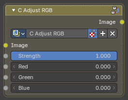

Adjusts the red, green and blue channels of an image individually.

### Inputs

#### Image

Data type: Color.

The input image to process.

#### Strength

Data type: Float (factor).

Controls the overall intensity of the RGB adjustment.

#### Red

Data type: Float.

Adjusts the intensity of the red channel.

#### Green

Data type: Float.

Adjusts the intensity of the green channel.

#### Blue

Data type: Float.

Adjusts the intensity of the blue channel.

### Outputs

#### Image

Data type: Color.

The output image after processing the effect.

### How to use

Connect an image to Image and the output to the next node. In the picture, Red is 30 and Blue is -30.

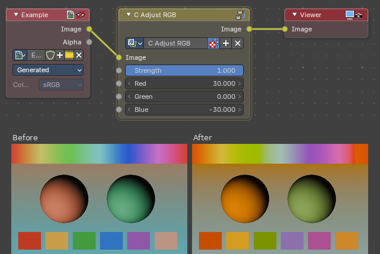

## Average Color

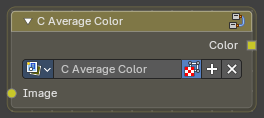

Calculates the average color of the input image.

### Inputs

#### Image

Data type: Color.

The input image to process.

### Outputs

#### Color

Data type: Color.

The output color after processing the effect.

### How to use

Connect an image to Image. The output is a single color, shown here as a flat fill.

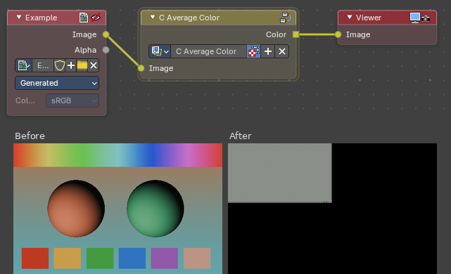

## Color Temperature

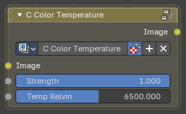

Adjusts the color temperature of the image to simulate different lighting conditions.

### Inputs

#### Image

Data type: Color.

The input image to process.

#### Strength

Data type: Float (factor).

Controls the intensity of the color temperature adjustment.

#### Temp Kelvin

Data type: Float.

Sets the color temperature in Kelvin.

### Outputs

#### Image

Data type: Color.

The output image after processing the effect.

### How to use

Connect an image to Image and set Temp Kelvin. In the picture, Temp Kelvin is 3500.

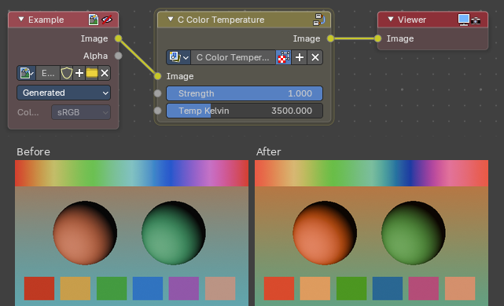

## Color Tint

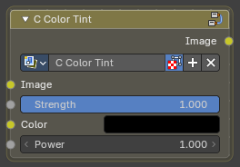

Applies a color tint to the image with adjustable strength and power.

### Inputs

#### Image

Data type: Color.

The input image to process.

#### Strength

Data type: Float (factor).

Controls the intensity of the color tint effect.

#### Color

Data type: Color.

The color to apply as a tint.

#### Power

Data type: Float.

Adjusts the strength of the tint blending.

### Outputs

#### Image

Data type: Color.

The output image after processing the effect.

### How to use

Connect an image to Image and pick a Color. In the picture, Color is blue and Strength is 0.6.

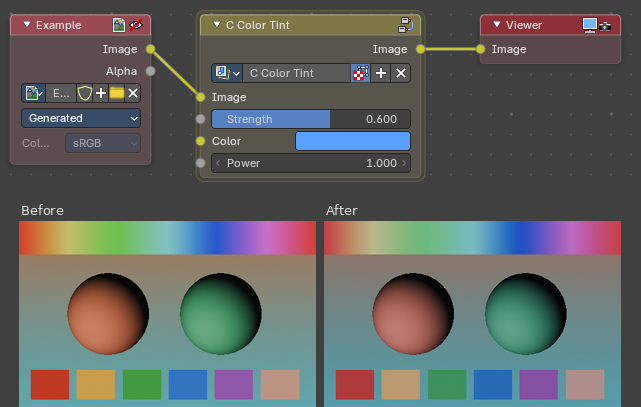

## Color Variation

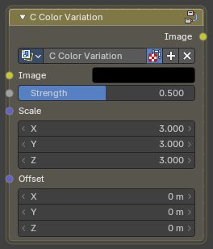

Adds subtle random color variation across the image.

### Inputs

#### Image

Data type: Color.

The image to vary.

#### Strength

Data type: Float (factor).

How strong the color variation is.

#### Scale

Data type: Vector.

Size of the variation pattern.

#### Offset

Data type: Vector.

Shifts the variation pattern.

### Outputs

#### Image

Data type: Color.

The image with color variation applied.

### How to use

Connect an image to Image. In the picture, Strength is 1.0.

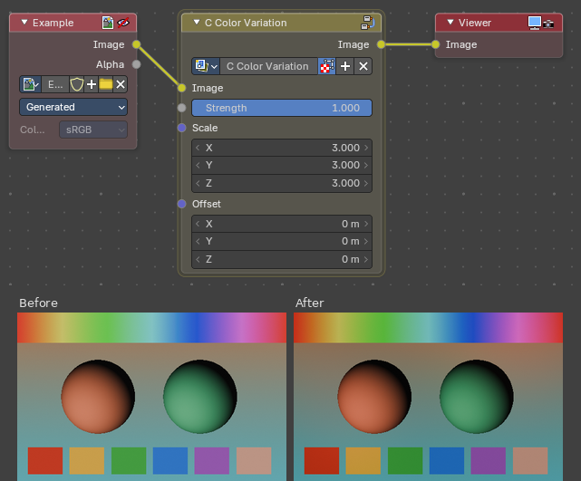

## Desaturator

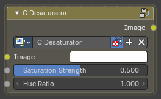

Desaturates the image, with control over strength and hue.

### Inputs

#### Image

Data type: Color.

The image to desaturate.

#### Saturation Strength

Data type: Float (factor).

Adjust the strength of desaturation.

#### Hue Ratio

Data type: Float.

Adjusts a biased ratio of the saturation.

### Outputs

#### Image

Data type: Color.

The desaturated image.

### How to use

Connect an image to Image. Saturation Strength sets how much color is removed: 1 leaves the image as it is, and lower values remove more.

Hue Ratio changes which colors lose their saturation. In the picture, Saturation Strength is 0.3. At Hue Ratio 0 every color is desaturated evenly. At Hue Ratio 1 the strongly colored areas stay vivid and the muted areas lose their color.

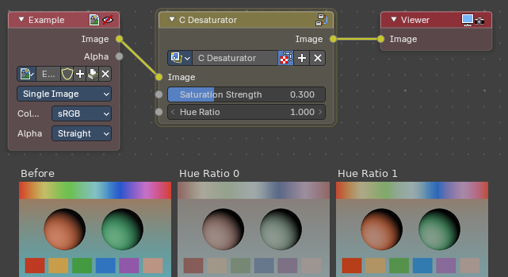

## Halftone Color

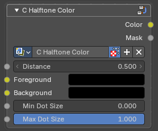

Colors a halftone pattern, sizing dots by brightness. Use it together with Halftone Pattern: connect the Distance output of Halftone Pattern to the Distance input here.

### Inputs

#### Distance

Data type: Float.

Connect the Distance output of Halftone Pattern.

#### Foreground

Data type: Color.

Image or color that sets dot color and size.

#### Background

Data type: Color.

Color between the dots.

#### Min Dot Size

Data type: Float (factor).

Dot size in the darkest areas.

#### Max Dot Size

Data type: Float (factor).

Dot size in the brightest areas.

### Outputs

#### Color

Data type: Color.

The colored halftone.

#### Mask

Data type: Float.

Black and white dots.

### How to use

Connect an image to Foreground and set Background to the color between the dots. Distance decides where the dots are. It is normally connected to the Distance output of Halftone Pattern, as shown in the next section.

In the picture, Distance is a single value (0.5) instead of a pattern, so the image is cut at one brightness: the dark parts of the spheres turn to the Background color. Dots need a Distance that changes across the image.

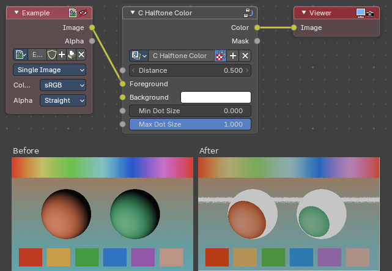

## Halftone Pattern

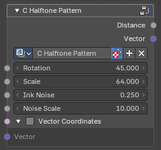

Creates a halftone dot pattern with distance and vector outputs. Use it together with Halftone Color: connect the Distance output to Halftone Color.

### Inputs

#### Rotation

Data type: Float.

Rotates the dot grid.

#### Scale

Data type: Float.

Number of dots. Higher values give more, smaller dots.

#### Ink Noise

Data type: Float.

Adds roughness to the dots.

#### Noise Scale

Data type: Float.

Size of the roughness.

#### Vector Coordinates

Data type: Boolean.

Use the Vector input instead of the automatic image coordinates.

#### Vector

Data type: Vector.

Used when Vector Coordinates is on. Best used with the Vector Mapping node group.

### Outputs

#### Distance

Data type: Float.

Distance from each dot center. Connect to Halftone Color.

#### Vector

Data type: Vector.

Coordinates inside each dot.

### How to use

Halftone Pattern does not need an image. Connect its Distance output to any node that takes a number to see how far each pixel is from the center of its dot. In the picture, Scale is 16 and the Distance output goes straight to the viewer.

The Vector output gives the coordinates inside each dot.

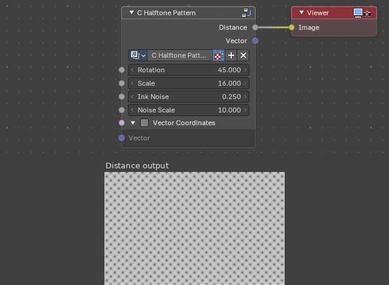

## Halftone Pattern and Halftone Color together

Halftone Pattern makes the dot grid and Halftone Color colors it. Connect the Distance output of Halftone Pattern to the Distance input of Halftone Color, and connect an image to Foreground. Halftone Color sizes each dot by the brightness of the image: dots are Max Dot Size in the brightest areas and Min Dot Size in the darkest.

Keeping them apart lets you change the grid (Rotation, Scale, Ink Noise) separately from the colors (Foreground, Background and the dot sizes). The Mask output of Halftone Color shows the same dots in black and white.

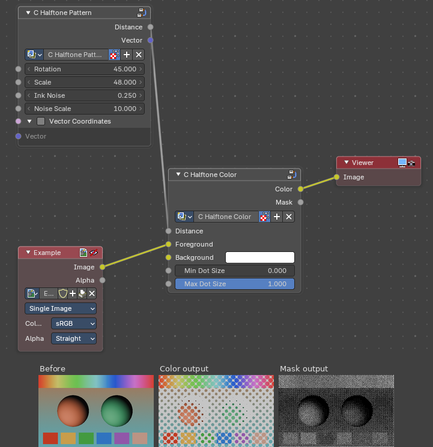

## Simple Saturation

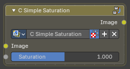

Adjusts the saturation level of the image.

### Inputs

#### Image

Data type: Color.

The input image to process.

#### Saturation

Data type: Float.

Controls the intensity of the image's color saturation. The range is 0 to 2.

### Outputs

#### Image

Data type: Color.

The output image after processing the effect.

### How to use

Connect an image to Image. In the picture, Saturation is 0.25.

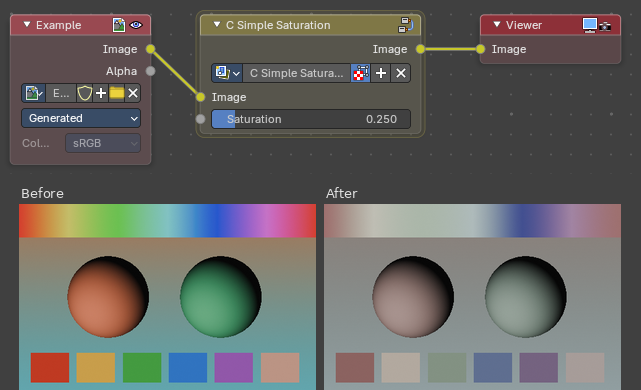

# Creative / Design

_Assets in this category will be documented here._

# Distortion

_Assets in this category will be documented here._

# Filters

_Assets in this category will be documented here._

# Lenses

_Assets in this category will be documented here._

# Output

_Assets in this category will be documented here._

# Texture / Patterns

_Assets in this category will be documented here._

# Texture / Shapes

_Assets in this category will be documented here._

# Utilities

_Assets in this category will be documented here._

# Utilities / Vector

_Assets in this category will be documented here._
