## Essentials Asset Library

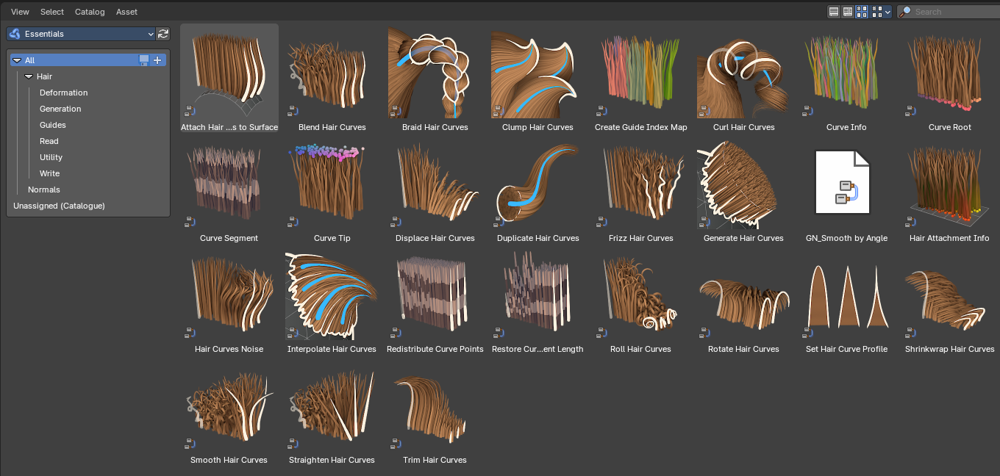

Bforartists comes with a default asset library created by Blender. This asset library is a special one that only allows to append assets, there is no way to link in the assets.

### The Asset Browser

The Asset Browser is an editor in the Asset Workspace that gives you some essential nodegroups mostly for curves objects and curve data geometry nodes modifiers and node groups.

#### Library Contents

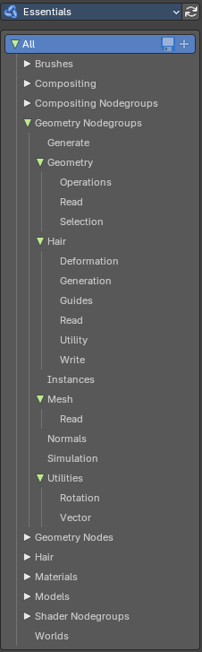

To select the Essential Library, choose it from drop-down box that contains the libraries that comes with Bforartists. Here you can select what asset you want to load.

The assets are grouped by categories.

## Introduction

### The Asset Browser Library and Modifier assets

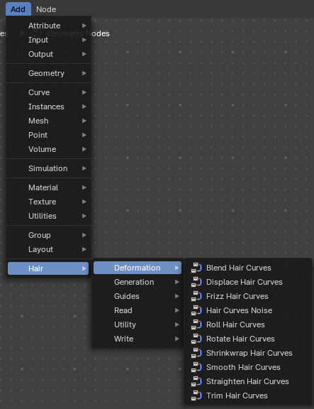

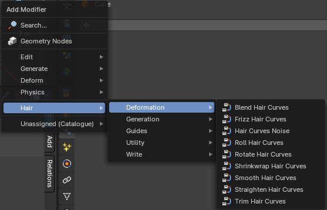

Hair nodes are Geometry node groups found in the Essentials Library included with Bforartists. They differ from the other nodes in the add menu due to being mid level node groups instead of individual low level nodes.

These hair nodes are also available as Modifier assets. When used as a Modifier asset, these adds the same node group as you would do it in the geometry node editor. Which means you can control these node groups in the modifier stack now instead of the geometry node editor.

> **Note:** Curves objects is usually a mesh only functionality. But shows for all other object types too. You can use some of the these node groups with Curve data also.

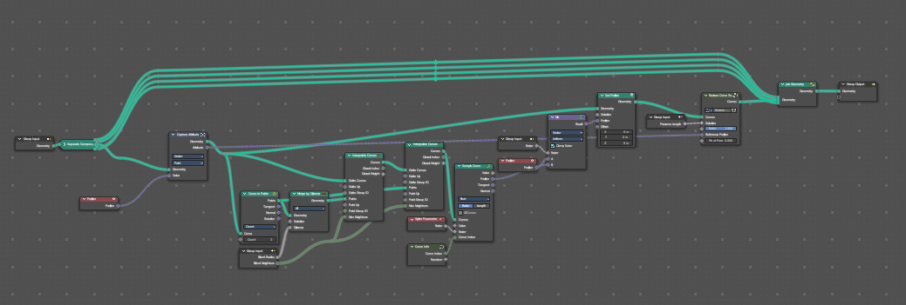

### General functionality

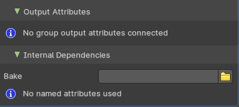

Every node group has a set of parameters with tooltips, each can help you understand what each node group does. You can view the properties in the modifiers stack in the Properties Editor or directly in the Geometry Nodes Editor.

All node groups also have an Output Attributes and Internal dependencies tab. If the hair node has output attributes or internal dependencies depends of the hair node.

#### Examples of properties:

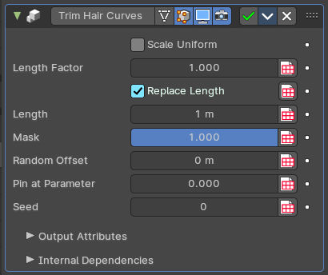

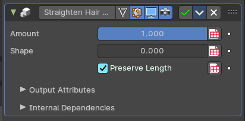

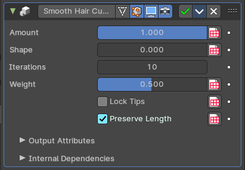

### Categories Overview

The library is updated with each Blender release. In Bforartists 5.3 the Geometry Nodegroups catalog has these categories:

- Generate
- Geometry (Operations, Read, Selection)
- Hair (Deformation, Generation, Guides, Read, Utility, Write)
- Instances
- Mesh (Read)
- Normals
- Simulation
- Utilities (Rotation, Vector)

The library also has **Brushes**, **Compositing Nodegroups** and **Shader Nodegroups**. The compositing node groups are covered on the [Compositor Library](/docs2/content/assets/compositor-library.md) page.

### Usage

#### Preparation

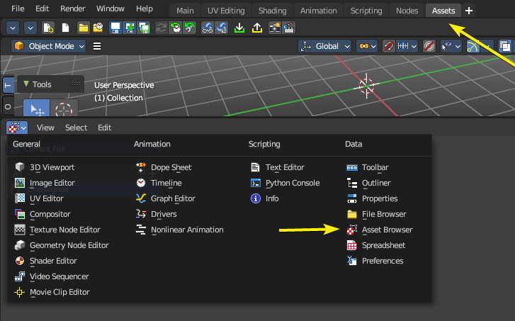

Select the **Assets Workspace** or alternatively change and editor by toggling the Hide Editor Type and changing it to the Asset Browser.

Once you have an asset browser open, select the Default Library from the drop down to the top left of the editor.

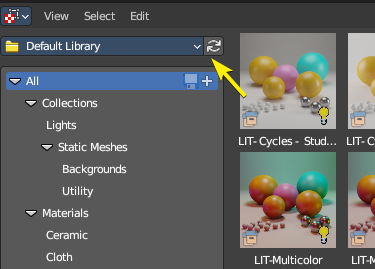

If you don’t see any assets, press the refresh icon.

#### Loading Assets

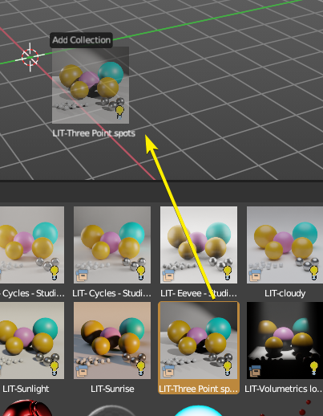

Click on any categories in the left sidebar, then click and drag on an item to then add it into either the Node editors or the 3D View.

The asset and editor context may influence where you can drag and drop. Example: A collection can only be added to the 3D Viewport, but a Node Group can only be added to the Node Editor in the correct mode (Shader, Geometry Nodes, etc)

You can also drag and drop the assets onto data slots.

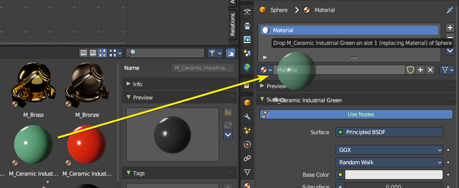

## Categories

### Brushes

#### Curve Sculpt

—

#### Grease Pencil Draw

—

#### Grease Pencil Draw

—

#### Grease Pencil Draw

—

#### Grease Pencil Draw

—

#### Mesh Sculpt

**General** · **Add & Subtract** · **Contrast** · **Transform** · **Utilities** · **Paint** · **Simulation**

#### Mesh Texture Paint

—

#### Mesh Vertex Paint

—

#### Mesh Weight Paint

—

### Generate

Modifier-ready node groups that build new geometry from the object. You can add them as modifiers from the Add Modifier menu or drag them into the Geometry Node Editor.

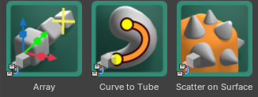

#### Array

Creates copies of the geometry, each one moved a bit further than the last. Good for fences, stairs or chains.

#### Curve to Tube

Turns curves into tube meshes, for example for cables, pipes or branches.

#### Scatter on Surface

Scatters copies of another object over the surface of a mesh, for example stones on the ground or leaves on a branch.

### Geometry

Node groups that work on any kind of geometry.

#### Operations

##### Displace Geometry

Moves the geometry by an offset, step by step, to push or pull its shape.

##### Smooth Geometry

Smooths the connected parts of a geometry, so sharp bumps become soft.

#### Read

##### Geometry Input

Brings in another geometry as a reference to work with.

##### Geometry Principal Components

Finds the main directions in which the points of a geometry spread out. Useful to align an object to its own shape.

#### Selection

##### Box Selection

Selects the parts of the geometry inside a box.

##### Normal Selection

Selects the faces that point in a chosen direction, for example only the tops of objects for snow.

##### Sphere Selection

Selects the parts of the geometry inside a sphere.

### Hair

#### Deformation

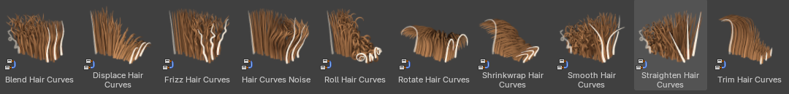

This group of hair node groups are useful for deforming the curves object hair strands. They can also be used on curve objects or curve data in other geometry nodes.

##### Blend Hair Curves

Blends the shape between multiple hair curves in a certain radius together.

##### Frizz Hair Curves

Deforms hair curves using a random vector per point to frizz them.

##### Hair Curves Noise

Deforms hair curves using noise texture.

##### Roll Hair Curves

Rolls up hair curves, starting from their tips.

##### Rotate Hair Curves

Rotates each hair curve around an axis.

##### Shrinkwrap Hair Curves

Shrinkwrap hair curves to a mesh surface from below and optionally from above.

##### Smooth Hair Curves

Smooths the shape of hair curves.

##### Displace Hair Curves

Moves hair curves along a direction, with several options for how strong the push is along each strand.

##### Straighten Hair Curves

Straightens hair curves between the root and the tip.

##### Trim Hair Curves

Trims or scales hair curves to a certain length.

#### Generation

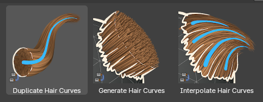

The curves object node groups contain methods to generate new hair strands.

##### Duplicate Hair Curves

Duplicates hair curves a certain amount of times in the given radius.

##### Generate Hair Curves

Generates new hair curves on a surface mesh.

##### Interpolate Hair Curves

Interpolates existing guide curves on a surface.

#### Guides

Node groups that shape existing hair with guide curves.

##### Braid Hair Curves

Deforms existing hair curves into braids using guide curves.

##### Clump Hair Curves

Clumps existing hair curves together using guide curves.

##### Create Guide Index Map

Creates an attribute that maps each curve to its nearest guide by index. This helps when you work with one index per hair clump.

##### Curl Hair Curves

Deforms existing hair curves into curls using guide curves.

#### Read

Node groups that read information from the hair curves, to use as fields in other nodes.

##### Curve Info

Reads information about each curve: index, curve ID, length, direction, a random value and the surface UV.

##### Curve Root

Reads information about the root point of each curve.

##### Curve Segment

Reads information about the previous curve segment of each point.

##### Curve Tip

Reads information about the tip point of each curve.

##### Attachment Info

Reads where each curve is attached to its surface mesh.

#### Utility

##### Attach Hair Curves to Surface

Attaches hair curves to a surface mesh.

> **Note:** Parent the hair curves to the mesh first, before you attach the curves to the surface mesh.

##### Set Attachment Surface

Attaches hair curves to a surface mesh inside a node tree. Unlike Attach Hair Curves to Surface, it is not a modifier.

##### Redistribute Curve Points

Spreads the existing control points evenly along each curve.

##### Restore Curve Segment Length

Restores the length of each curve segment from an earlier state, after a deformation changed it. Think of it as a way to undo the stretching.

#### Write

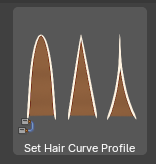

##### Set Hair Curve Profile

Set the radius attribute of hair curves according to a profile shape.

### Instances

#### Instance on Elements

Places copies of another object on the points, edges or faces of the geometry.

#### Randomize Transforms

Gives each instance a random position, rotation and scale, so copies don't all look the same.

### Mesh

#### Read

Node groups that read information from a mesh, to use as fields or selections.

##### Edge Length

Gives the length of each edge.

##### Face Corner Angle

Gives the angle between the two edges at each corner of a face.

##### Is Edge Boundary

Selects the boundary edges, the open border of a mesh.

##### Is Edge Loose

Selects the loose edges, edges that belong to no face.

##### Is Edge Manifold

Selects the manifold edges, edges shared by exactly two faces.

##### Is UV Split

Selects the edges that make a seam in the UV map, where the UV islands are cut apart.

### Normals

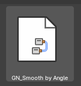

#### Smooth by Angle

Smooth normals by angle procedurally. Anything above a certain angle threshold will be marked as sharp.

### Simulation

Node groups for physics simulations built with geometry nodes. Several of them are modifiers you can add straight to an object.

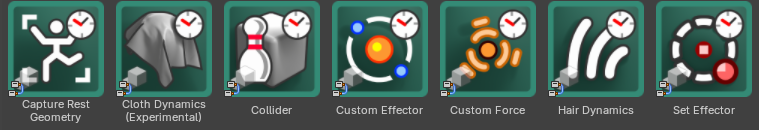

#### Capture Rest Geometry

Captures and stores the rest position of the geometry, so later deformations can use it.

#### Cloth Dynamics (Experimental)

Simulates a mesh as cloth, with settings for stretch, bending, pinning, gravity and tearing. Pin a vertex group to hold parts of the cloth in place.

#### Collider

Turns an object into a collider that the cloth and hair simulations bump into. Margin, friction and softness set how the contact feels.

#### Custom Effector

Creates your own effector that changes the simulation at a chosen stage, built with a closure.

#### Custom Force

Creates your own force, such as wind, that pushes the simulated points.

#### Hair Dynamics

Simulates hair curves so they swing and react to gravity, forces and collisions with their surface mesh.

#### Set Effector

Adds an effector to a simulation, so forces and colliders reach it.

### Utilities

#### Rotation

##### Random Rotation

Gives a random rotation, evenly spread in all directions.

#### Vector

Node groups that convert vectors and coordinates.

##### 3D to Screen Space

Converts 3D positions into the normalized space of the camera.

##### Screen to 3D Space

Converts screen coordinates back into 3D space.

##### Combine Cylindrical

Creates a vector from its cylindrical parts.

##### Separate Cylindrical

Splits a vector into its cylindrical parts.

##### Combine Spherical

Creates a vector from its spherical parts.

##### Separate Spherical

Splits a vector into its spherical parts.

##### Principal Components

Finds the main directions of a vector field (Principal Component Analysis).

##### Project with Depth

Turns 2D coordinates and their depth back into a 3D vector.

##### Transform and Project

Computes a normalized 2D vector and its depth from a 3D vector and a projection.
