Geometry node groups that come with Bforartists: grease pencil, material, mesh, normals, primitives and utilities.

> **Draft:** the assets of this library will be listed here: one section per category, one entry per asset with what it does and how to use it.

# Grease Pencil

_Assets in this category will be documented here._

# Material

_Assets in this category will be documented here._

# Mesh

The UV assets write UV coordinates onto a mesh. Drag one onto an object from the Asset Shelf or the Asset Browser. Each picture shows the result on a checker texture, next to the UV layout.

## Camera UV

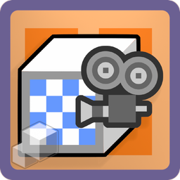

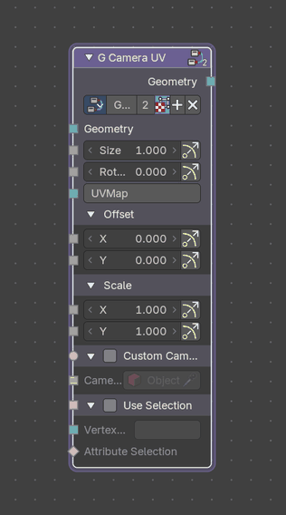

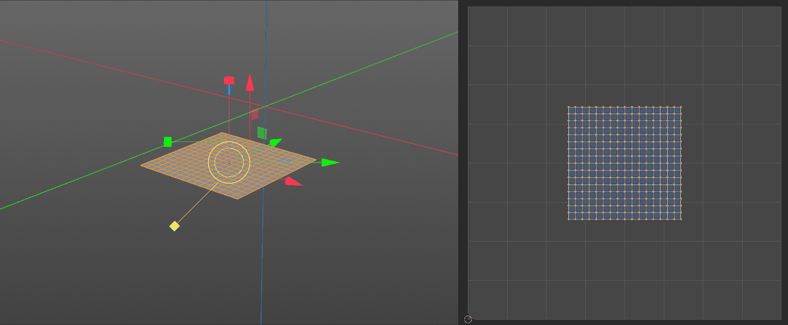

Creates UV coordinates by projecting the mesh through a camera. Use it to place a texture on an object as the camera sees it. Size, Rotation, Offset and Scale adjust the projection, and Custom Camera lets you choose another camera.

### Gizmos

The projection frame is drawn in the viewport and has gizmos:

- A **dial gizmo** sets the **Rotation**.
- **Linear gizmos** change the **Size** and the **Scale X** and **Scale Y** of the frame, and move it with **Offset X** and **Offset Y**.

### Inputs

#### Geometry

Data type: Geometry.

The mesh to create the UV coordinates for.

#### Size

Data type: Float.

Size of the UVs. Default: 1.

#### Rotation

Data type: Float.

The rotation of the UVs. Default: 0.

#### UV Name

Data type: String.

Defines the name of the UVMap to be referenced either on the mesh data or as an attribute in the material. Default: UVMap.

#### Offset

##### Offset X

Data type: Float.

Offset the UV in the X axis. Default: 0.

##### Offset Y

Data type: Float.

Offset the UV in the Y axis. Default: 0.

#### Scale

##### Scale X

Data type: Float.

Scale UVs in X. Default: 1.

##### Scale Y

Data type: Float.

Scale UVs in Y. Default: 1.

#### Custom Camera

##### Custom Camera

Data type: Boolean.

Turns the custom camera on or off. Default: Off.

##### Camera

Data type: Object.

Selects the Custom Camera object. Make sure this is a camera object.

#### Use Selection

##### Use Selection

Data type: Boolean.

Set UVs on a Vertex Group Selection. Default: Off.

##### Vertex Group

Data type: String.

The name of the Vertex Group to set UVs.

##### Attribute Selection

Data type: Boolean.

Or set the selection by attribute with a boolean on a domain. Default: Off.

### Outputs

#### Geometry

Data type: Geometry.

The mesh with the UV coordinates written to the UV map named by the UV Name or UV Map input.

## Cube UV

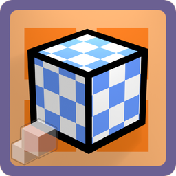

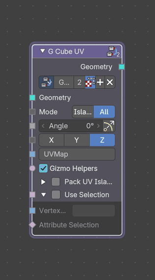

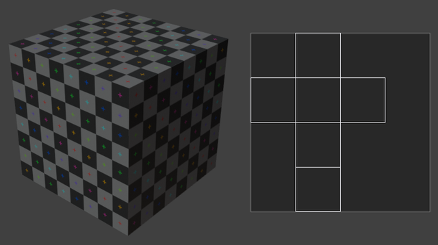

Creates cube projected UV coordinates, with each side of the box mapped flat. Mode switches between all islands and a single island chosen by Island Index. Axis and Angle turn the projection.

### Inputs

#### Geometry

Data type: Geometry.

The mesh to create the UV coordinates for.

#### Mode

Data type: Menu.

Toggles if the UV should evaluate on an individual island or all islands. Default: All.

#### Island Index

Data type: Integer.

The mesh Island Index. This defines where the gizmos will also draw. Default: 0.

#### Angle

Data type: Float.

Sets the angle of the projection. Default: 0°.

#### Axis

Data type: Menu.

Changes the active axis of the UV Projection. Default: Z.

#### UV Name

Data type: String.

Defines the name of the UVMap to be referenced either on the mesh data or as an attribute in the material. Default: UVMap.

#### Gizmo Helpers

Data type: Boolean.

Toggles helper gizmos made with Grease Pencil to assist tuning other gizmos. These will not render. Default: On.

#### Pack UV Islands

##### Pack UV Islands

Data type: Boolean.

Toggles UV Island Packing. Default: Off.

##### Margin

Data type: Float.

Adjusts the UV island margins. Default: 0.001.

##### Rotate

Data type: Boolean.

Toggles if the packing rotates UV Islands for a best fit. Default: Off.

##### Method

Data type: Menu.

The method of UV island packing. Default: Bounding Box.

#### Use Selection

##### Use Selection

Data type: Boolean.

Set UVs on a Vertex Group Selection. Default: Off.

##### Vertex Group

Data type: String.

The name of the Vertex Group to set UVs.

##### Attribute Selection

Data type: Boolean.

Or set the selection by attribute with a boolean on a domain. Default: Off.

### Outputs

#### Geometry

Data type: Geometry.

The mesh with the UV coordinates written to the UV map named by the UV Name or UV Map input.

## Cube UV Island

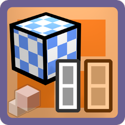

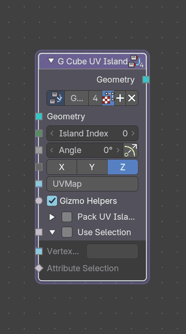

Creates cube projected UV coordinates on a single island. Island Index chooses the island. It works like Cube UV with Mode set to one island.

### Gizmos

The **Angle** input has a **dial gizmo** in the viewport on the selected island. Drag the dial to rotate the projection, instead of typing a number. Island Index decides which island shows the gizmo.

### Inputs

#### Geometry

Data type: Geometry.

The mesh to create the UV coordinates for.

#### Island Index

Data type: Integer.

The mesh Island Index. This defines where the gizmos will also draw. Default: 0.

#### Angle

Data type: Float.

Sets the angle of the projection. Default: 0°.

#### Axis

Data type: Menu.

Changes the active axis of the UV Projection. Default: Z.

#### UV Name

Data type: String.

Defines the name of the UVMap to be referenced either on the mesh data or as an attribute in the material. Default: UVMap.

#### Gizmo Helpers

Data type: Boolean.

Toggles helper gizmos made with Grease Pencil to assist tuning other gizmos. These will not render. Default: On.

#### Pack UV Islands

##### Pack UV Islands

Data type: Boolean.

Toggles UV Island Packing. Default: Off.

##### Margin

Data type: Float.

Adjusts the UV island margins. Default: 0.001.

##### Rotate

Data type: Boolean.

Toggles if the packing rotates UV Islands for a best fit. Default: Off.

##### Method

Data type: Menu.

The method of UV island packing. Default: Bounding Box.

#### Use Selection

##### Use Selection

Data type: Boolean.

Set UVs on a Vertex Group Selection. Default: Off.

##### Vertex Group

Data type: String.

The name of the Vertex Group to set UVs.

##### Attribute Selection

Data type: Boolean.

Or set the selection by attribute with a boolean on a domain. Default: Off.

### Outputs

#### Geometry

Data type: Geometry.

The mesh with the UV coordinates written to the UV map named by the UV Name or UV Map input.

## Cut Cylinder UV

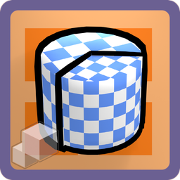

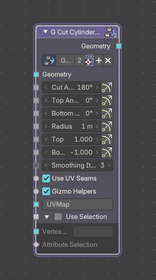

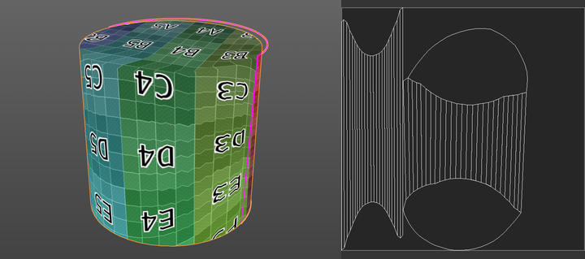

Creates cylinder projected UV coordinates by cutting the cylinder open. Cut Angle sets where the cut is made, and Top and Bottom set the limits of the projection. The side and the caps become separate islands.

### Gizmos

The projection cylinder is drawn in the viewport and can be tuned directly:

- **Linear gizmos** move **Top** and **Bottom** and change the **Radius**.
- **Dial gizmos** set the **Cut Angle**, **Top Angle** and **Bottom Angle**.

The example above uses a head, which is the typical use: cut the cylinder open at the back and the face unwraps in one piece.

### Inputs

#### Geometry

Data type: Geometry.

The mesh to create the UV coordinates for.

#### Cut Angle

Data type: Float.

Adjusts the cut angle. Default: 180°.

#### Top Angle

Data type: Float.

Adjusts the top angle of the cut. Default: 0°.

#### Bottom Angle

Data type: Float.

Adjusts the bottom angle of the cut. Default: 0°.

#### Radius

Data type: Float.

The radius of the Cylinder UV Projection. Default: 1.

#### Top

Data type: Float.

Moves the top limits of the UV Projection. Default: 1.

#### Bottom

Data type: Float.

Moves the bottom limits of the UV Projection. Default: -1.

#### Smoothing Iterations

Data type: Integer.

Number of iterations to run the SLIM solver for. Default: 3.

#### Use UV Seams

Data type: Boolean.

Use user marked UV seams in object Edit Mode. Default: On.

#### Gizmo Helpers

Data type: Boolean.

Toggles helper gizmos made with Grease Pencil to assist tuning other gizmos. These will not render. Default: On.

#### UV Name

Data type: String.

Defines the name of the UVMap to be referenced either on the mesh data or as an attribute in the material. Default: UVMap.

#### Use Selection

##### Use Selection

Data type: Boolean.

Set UVs on a Vertex Group Selection. Default: Off.

##### Vertex Group

Data type: String.

The name of the Vertex Group to set UVs.

##### Attribute Selection

Data type: Boolean.

Or set the selection by attribute with a boolean on a domain. Default: Off.

### Outputs

#### Geometry

Data type: Geometry.

The mesh with the UV coordinates written to the UV map named by the UV Name or UV Map input.

## Cylinder UV

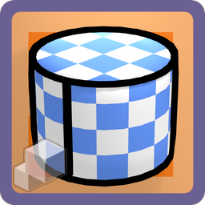

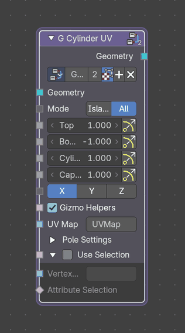

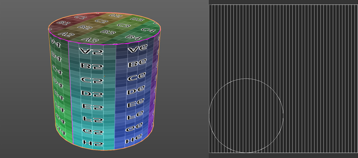

Creates cylinder projected UV coordinates, with the side and the caps scaled separately. Mode switches between all islands and a single island chosen by Island Index. Axis sets the direction of the cylinder.

### Inputs

#### Geometry

Data type: Geometry.

The mesh to create the UV coordinates for.

#### Mode

Data type: Menu.

Toggles if the UV should evaluate on an individual island or all islands. Default: All.

#### Island Index

Data type: Integer.

The mesh Island Index. This defines where the gizmos will also draw. Default: 0.

#### Top

Data type: Float.

Moves the top limits of the UV Projection. Default: 1.

#### Bottom

Data type: Float.

Moves the bottom limits of the UV Projection. Default: -1.

#### Cylinder Scale

Data type: Float.

Changes the scale of the side cylinder UV Projection. Default: 1.

#### Cap Scale

Data type: Float.

Changes the scale of the cylinder caps UV Projection. Default: 1.

#### Axis

Data type: Menu.

Changes the active axis of the UV Projection. Default: X.

#### Gizmo Helpers

Data type: Boolean.

Toggles helper gizmos made with Grease Pencil to assist tuning other gizmos. These will not render. Default: On.

#### UV Map

Data type: String.

Defines the name of the UVMap to be referenced either on the mesh data or as an attribute in the material. Default: UVMap.

#### Pole Settings

##### Pole Center

Data type: Vector.

Translates the axis pole center with an offset.

##### Tilt

Data type: Rotation.

Rotates and tilts the axis pole by degrees.

#### Use Selection

##### Use Selection

Data type: Boolean.

Set UVs on a Vertex Group Selection. Default: Off.

##### Vertex Group

Data type: String.

The name of the Vertex Group to set UVs.

##### Attribute Selection

Data type: Boolean.

Or set the selection by attribute with a boolean on a domain. Default: Off.

### Outputs

#### Geometry

Data type: Geometry.

The mesh with the UV coordinates written to the UV map named by the UV Name or UV Map input.

## Cylinder UV Island

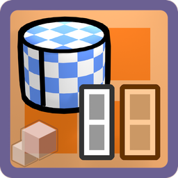

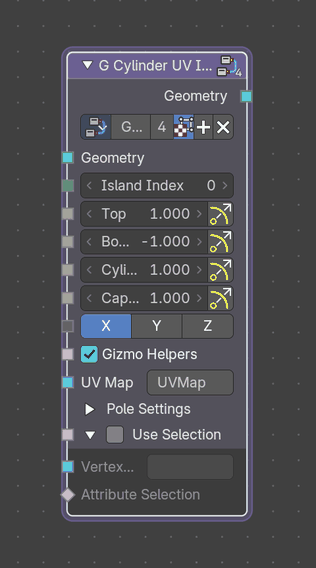

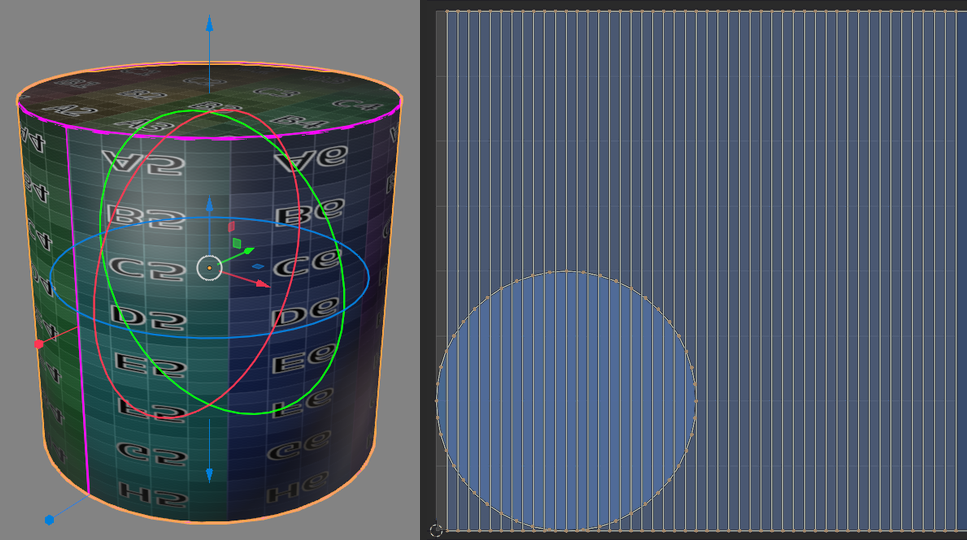

Creates cylinder projected UV coordinates on a single island. Island Index chooses the island. It works like Cylinder UV with Mode set to one island.

### Gizmos

The projection can be tuned in the viewport with gizmos on the selected island:

- **Linear gizmos** move the **Top** and **Bottom** limits and scale the **Cylinder Scale** and **Cap Scale**.
- **Dial gizmos** (red, green, blue) rotate the projection around X, Y and Z. This is the same as the **Tilt** input.

### Inputs

#### Geometry

Data type: Geometry.

The mesh to create the UV coordinates for.

#### Island Index

Data type: Integer.

The mesh Island Index. This defines where the gizmos will also draw. Default: 0.

#### Top

Data type: Float.

Moves the top limits of the UV Projection. Default: 1.

#### Bottom

Data type: Float.

Moves the bottom limits of the UV Projection. Default: -1.

#### Cylinder Scale

Data type: Float.

Changes the scale of the side cylinder UV Projection. Default: 1.

#### Cap Scale

Data type: Float.

Changes the scale of the cylinder caps UV Projection. Default: 1.

#### Axis

Data type: Menu.

Changes the active axis of the UV Projection. Default: X.

#### Gizmo Helpers

Data type: Boolean.

Toggles helper gizmos made with Grease Pencil to assist tuning other gizmos. These will not render. Default: On.

#### UV Map

Data type: String.

Defines the name of the UVMap to be referenced either on the mesh data or as an attribute in the material. Default: UVMap.

#### Pole Settings

##### Pole Center

Data type: Vector.

Translates the axis pole center with an offset.

##### Tilt

Data type: Rotation.

Rotates and tilts the axis pole by degrees.

#### Use Selection

##### Use Selection

Data type: Boolean.

Set UVs on a Vertex Group Selection. Default: Off.

##### Vertex Group

Data type: String.

The name of the Vertex Group to set UVs.

##### Attribute Selection

Data type: Boolean.

Or set the selection by attribute with a boolean on a domain. Default: Off.

### Outputs

#### Geometry

Data type: Geometry.

The mesh with the UV coordinates written to the UV map named by the UV Name or UV Map input.

## Generated UV

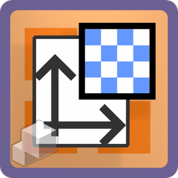

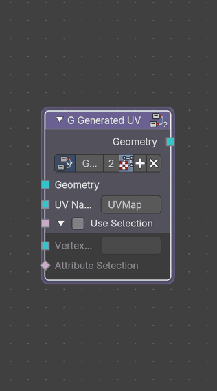

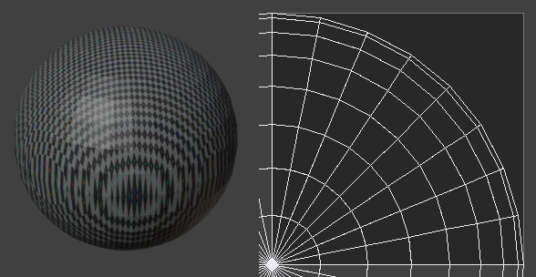

Creates the default generated UV coordinates for procedural meshes. It has no settings beyond the UV name and the selection.

### Inputs

#### Geometry

Data type: Geometry.

The mesh to create the UV coordinates for.

#### UV Name

Data type: String.

Defines the name of the UVMap to be referenced either on the mesh data or as an attribute in the material. Default: UVMap.

#### Use Selection

##### Use Selection

Data type: Boolean.

Set UVs on a Vertex Group Selection. Default: Off.

##### Vertex Group

Data type: String.

The name of the Vertex Group to set UVs.

##### Attribute Selection

Data type: Boolean.

Or set the selection by attribute with a boolean on a domain. Default: Off.

### Outputs

#### Geometry

Data type: Geometry.

The mesh with the UV coordinates written to the UV map named by the UV Name or UV Map input.

## Smart UV

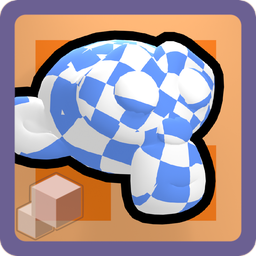

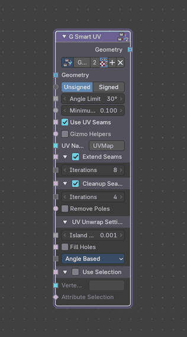

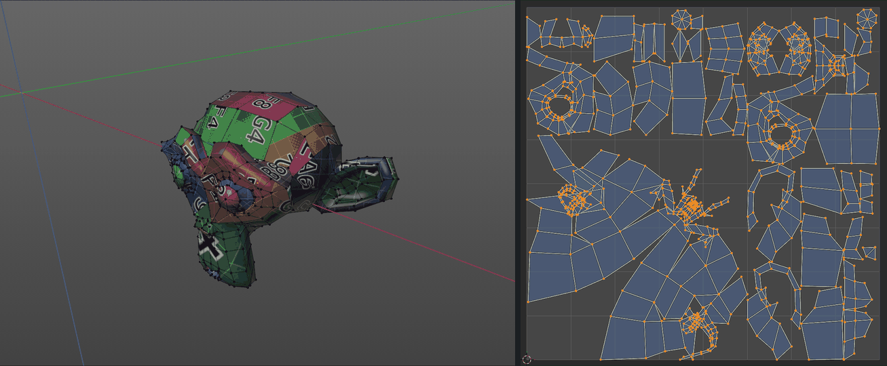

Creates smart projected UV coordinates. It uses signed angles to find seams on the edges, then unwraps the geometry into islands. Angle Limit and Minimum Edge Length decide which edges become seams.

### Inputs

#### Geometry

Data type: Geometry.

The mesh to create the UV coordinates for.

#### Mode

Data type: Menu.

The method the seams are detected on edges by angle. Default: Unsigned.

#### Angle Limit

Data type: Float.

The detection angle for the seams for the auto-unwrap. Default: 30°.

#### Minimum Edge Length

Data type: Float.

The minimum length of each edge to qualify for the angle detection. Default: 0.1.

#### Use UV Seams

Data type: Boolean.

Use user marked UV seams in object Edit Mode. Default: On.

#### Gizmo Helpers

Data type: Boolean.

Toggles helper gizmos made with Grease Pencil to assist tuning other gizmos. These will not render. Default: Off.

#### UV Name

Data type: String.

Defines the name of the UVMap to be referenced either on the mesh data or as an attribute in the material. Default: UVMap.

#### Extend Seams

##### Extend Seams

Data type: Boolean.

Turns extending the seams on or off. Default: On.

##### Iterations

Data type: Integer.

Number of iterations of extended edges. Default: 8.

#### Cleanup Seams

##### Cleanup Seams

Data type: Boolean.

Turns cleaning up the seams on or off. Default: On.

##### Iterations

Data type: Integer.

Number of iterations to remove and cleanup small edges by iterations. Default: 4.

##### Remove Poles

Data type: Boolean.

Removes corner and pole edges. You can use a Vertex Group as an Attribute mask. Default: Off.

#### UV Unwrap Settings

##### Island Margin

Data type: Float.

Space between islands. Default: 0.001.

##### Fill Holes

Data type: Boolean.

Virtually fill holes in mesh before unwrapping, to better avoid overlaps and preserve symmetry. Default: Off.

##### Method

Data type: Menu.

The method of UV island packing. Default: Angle Based.

##### Iterations

Data type: Integer.

Number of iterations to run the SLIM solver to unwrap UVs. Default: 10.

#### Use Selection

##### Use Selection

Data type: Boolean.

Set UVs on a Vertex Group Selection. Default: Off.

##### Vertex Group

Data type: String.

The name of the Vertex Group to set UVs.

##### Attribute Selection

Data type: Boolean.

Or set the selection by attribute with a boolean on a domain. Default: Off.

### Outputs

#### Geometry

Data type: Geometry.

The mesh with the UV coordinates written to the UV map named by the UV Name or UV Map input.

## Sphere UV

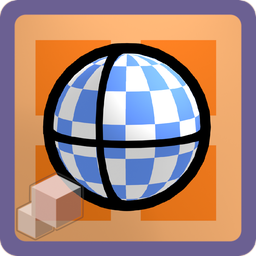

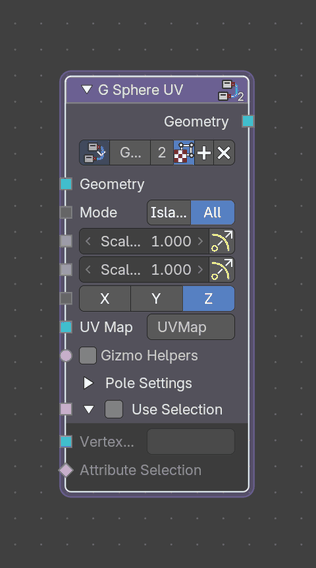

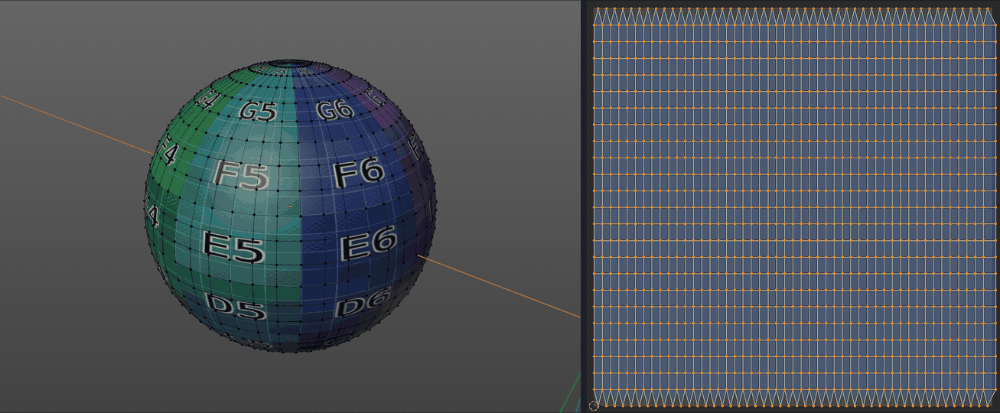

Creates sphere projected UV coordinates, with longitude and latitude. Mode switches between all islands and a single island chosen by Island Index. Axis sets the direction of the poles.

### Inputs

#### Geometry

Data type: Geometry.

The mesh to create the UV coordinates for.

#### Mode

Data type: Menu.

Toggles if the UV should evaluate on an individual island or all islands. Default: All.

#### Island Index

Data type: Integer.

The mesh Island Index. This defines where the gizmos will also draw. Default: 0.

#### Scale Longitude

Data type: Float.

Scale the UV along the horizontal longitude axis. Default: 1.

#### Scale Latitude

Data type: Float.

Scale the UV along the vertical latitude axis. Default: 1.

#### Axis

Data type: Menu.

Changes the active axis of the UV Projection. Default: Z.

#### UV Map

Data type: String.

Defines the name of the UVMap to be referenced either on the mesh data or as an attribute in the material. Default: UVMap.

#### Gizmo Helpers

Data type: Boolean.

Toggles helper gizmos made with Grease Pencil to assist tuning other gizmos. These will not render. Default: Off.

#### Pole Settings

##### Pole Pinch

Data type: Boolean.

Pinches the pole to get cleaner UVs at the axis poles. Default: On.

##### Pole Center

Data type: Vector.

Translates the axis pole center with an offset.

##### Tilt

Data type: Rotation.

Rotates and tilts the axis pole by degrees.

#### Use Selection

##### Use Selection

Data type: Boolean.

Set UVs on a Vertex Group Selection. Default: Off.

##### Vertex Group

Data type: String.

The name of the Vertex Group to set UVs.

##### Attribute Selection

Data type: Boolean.

Or set the selection by attribute with a boolean on a domain. Default: Off.

### Outputs

#### Geometry

Data type: Geometry.

The mesh with the UV coordinates written to the UV map named by the UV Name or UV Map input.

## Sphere UV Island

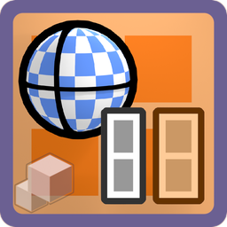

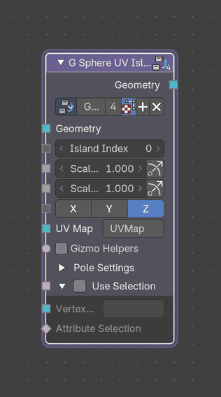

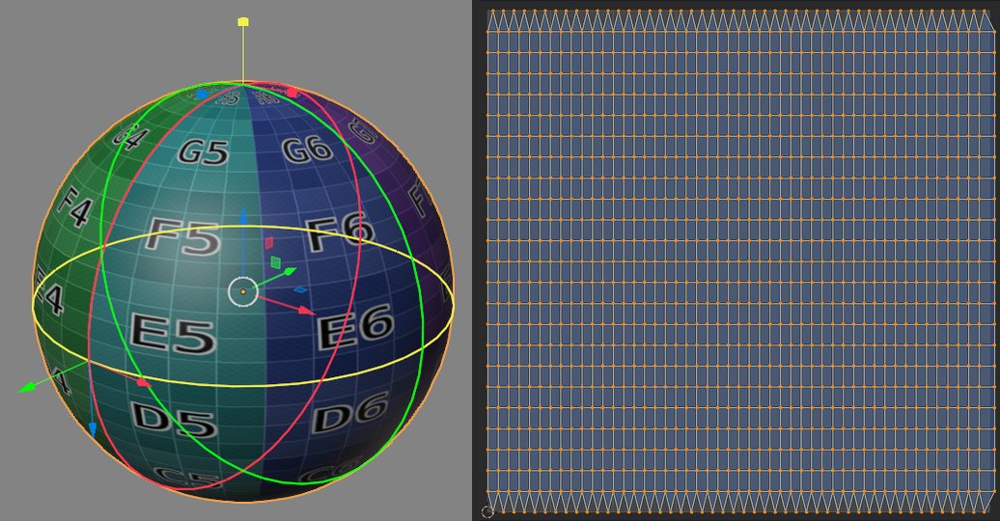

Creates sphere projected UV coordinates on a single island. Island Index chooses the island. It works like Sphere UV with Mode set to one island.

### Gizmos

The projection sphere is drawn in the viewport and has gizmos on the selected island:

- **Linear gizmos** change **Scale Longitude** and **Scale Latitude**.
- **Dial gizmos** (red, green, blue) rotate the projection around X, Y and Z. This is the same as the **Tilt** input.

### Inputs

#### Geometry

Data type: Geometry.

The mesh to create the UV coordinates for.

#### Island Index

Data type: Integer.

The mesh Island Index. This defines where the gizmos will also draw. Default: 0.

#### Scale Longitude

Data type: Float.

Scale the UV along the horizontal longitude axis. Default: 1.

#### Scale Latitude

Data type: Float.

Scale the UV along the vertical latitude axis. Default: 1.

#### Axis

Data type: Menu.

Changes the active axis of the UV Projection. Default: Z.

#### UV Map

Data type: String.

Defines the name of the UVMap to be referenced either on the mesh data or as an attribute in the material. Default: UVMap.

#### Gizmo Helpers

Data type: Boolean.

Toggles helper gizmos made with Grease Pencil to assist tuning other gizmos. These will not render. Default: Off.

#### Pole Settings

##### Pole Pinch

Data type: Boolean.

Pinches the pole to get cleaner UVs at the axis poles. Default: On.

##### Pole Center

Data type: Vector.

Translates the axis pole center with an offset.

##### Tilt

Data type: Rotation.

Rotates and tilts the axis pole by degrees.

#### Use Selection

##### Use Selection

Data type: Boolean.

Set UVs on a Vertex Group Selection. Default: Off.

##### Vertex Group

Data type: String.

The name of the Vertex Group to set UVs.

##### Attribute Selection

Data type: Boolean.

Or set the selection by attribute with a boolean on a domain. Default: Off.

### Outputs

#### Geometry

Data type: Geometry.

The mesh with the UV coordinates written to the UV map named by the UV Name or UV Map input.

## Triplanar UV

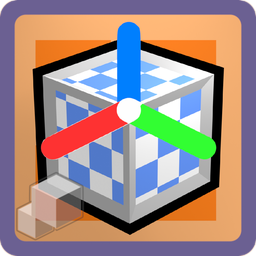

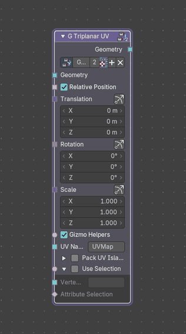

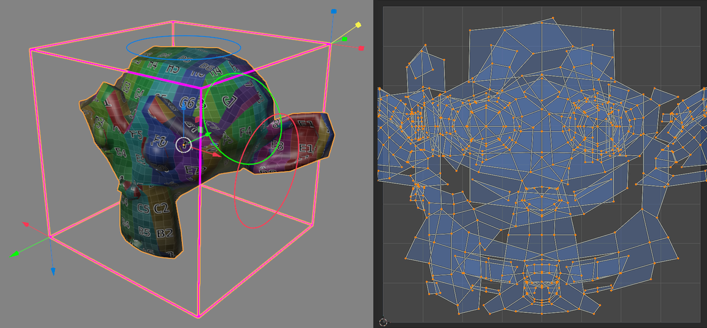

Creates triplanar cube projected UV coordinates, with scaling that stays relative to the object. Translation, Rotation and Scale move the projection.

### Gizmos

The projection box is drawn in the viewport and has gizmos:

- **Linear gizmos** per axis move the box (**Translation**) and scale it (**Scale**). The white linear gizmo scales all three axes together.
- **Dial gizmos** (red, green, blue) set the **Rotation** around X, Y and Z.

### Inputs

#### Geometry

Data type: Geometry.

The mesh to create the UV coordinates for.

#### Relative Position

Data type: Boolean.

Toggles relative UV positions to world space or local space. Default: On.

#### Translation

Data type: Vector.

Translates the triplanar UV projection in XYZ vectors.

#### Rotation

Data type: Rotation.

Rotates the triplanar UV projection.

#### Scale

Data type: Vector.

Scales the triplanar UV projection.

#### Gizmo Helpers

Data type: Boolean.

Toggles helper gizmos made with Grease Pencil. These will not render. Default: On.

#### UV Name

Data type: String.

Defines the name of the UVMap to be referenced either on the mesh data or as an attribute in the material. Default: UVMap.

#### Pack UV Islands

##### Pack UV Islands

Data type: Boolean.

Toggles UV Island Packing. Default: Off.

##### Island Margin

Data type: Float.

Adjusts the UV island margins. Default: 0.001.

##### Rotate

Data type: Boolean.

Toggles if the packing rotates UV Islands for a best fit. Default: On.

##### Method

Data type: Menu.

The method of UV island packing. Default: Bounding Box.

#### Use Selection

##### Use Selection

Data type: Boolean.

Set UVs on a Vertex Group Selection. Default: Off.

##### Vertex Group

Data type: String.

The name of the Vertex Group to set UVs.

##### Attribute Selection

Data type: Boolean.

Or set the selection by attribute with a boolean on a domain. Default: Off.

### Outputs

#### Geometry

Data type: Geometry.

The mesh with the UV coordinates written to the UV map named by the UV Name or UV Map input.

_The Mesh Operations assets will be documented here._

# Normals

## Smart Mesh Blend by Proximity

Adds an object that references a collection to merge all children mesh objects with blended normals and materials by proximity, through intersection distance and blur. This also displaces meshes at intersections.

This asset is ideal for smoothing transitions between intersecting surfaces, faking lighting continuity, or unifying shading across modular components.

> **Note:** In order to blend reliably, you will need topology to interpolate the blending. This means you will need to either subdivide, bevel or remesh your source meshes to blend smoothly. If you use only default cubes and a plane, it won't blend due to a lack of topology, but if you use a rounded subdivided cube with bevels and a grid, it will blend.

### Use: the Wizard

This contains a setup Wizard to begin.

1. **Drag and drop the asset** into the scene from the Asset Shelf or Asset Browser.
2. You will be prompted to select a **Target Collection**; this will then convert the target collection into driver objects.
3. Toggle optional **Bounds Display**, **Relative Position** and **Material Blending**. This will change and affect the Target Collection viewport display after applying. You can add or remove properties from the Target Collection by rerunning the Wizard and toggling the settings.
4. After confirming, this will create a new purple collection with a new Smart Mesh Blend by Proximity object. This is where the blended mesh is stored.
5. Change the settings by selecting the blended mesh and going to the Item tab in the Viewport Sidebar or the Modifier tab in the Properties Editor.

#### Asset Structure

- The **Blend Normals by Proximity object** is where the Geometry Nodes asset is stored. This is where the settings are stored.
- The **Purple collection** is where the asset is stored as a point of reference.
- The **Default Blend Collection** can be used as a reference if you have no Target Collection.

#### Wizard Options

##### Target Collection

Specifies the collection of the group of mesh objects used to influence the normal blending.

##### Apply Blend to Materials

This applies an intersection gradient alpha node group to the target collection object materials. This will iterate through all objects and materials and then apply the alpha at the Geometry Nodes intersection.

> **Note:** If you add new materials or objects to the target collection, re-running the wizard will re-apply to those new materials and objects.

If you toggle this option off and re-apply the Wizard, it will remove the Material Blend from all materials and objects in the target collection.

##### Use Relative Position

This will enable the relative position of the source target collection objects, making the new blended mesh snap to the original position. If you keep this off, the new blended mesh will spawn or move to its asset placement position.

##### Enable Bounds Display

This will turn on Bounds display for all the objects in the target collection, useful to remove any z-fighting normals when using a Relative Position on the new blended normals mesh object.

If you turn it off and re-run and re-apply the wizard, it will remove the Bounds display from all objects in the target collection.

> **Note:** If you add new objects to the target collection, re-running the wizard will re-apply the visibility settings on the new objects.

### Modifier Properties

#### Target Collection

Specifies the group of objects used to influence the normal blending.

#### Normal Distance

Sets the range within which intersecting geometry will contribute to the normal blending by proximity process.

#### Blending Iterations

Adds another blending iteration to the group of objects to assist in solving self-intersecting blending issues. This will affect performance as this repeats the operation.

#### Relative Position

When enabled, calculates blending based on object-relative coordinates. Useful for maintaining orientation consistency with source objects from the target collection.

#### Quality

This defines the quality of the normal blending which affects performance.

- **High**: Uses blending by proximity. Default. This can be low on performance if there are many islands or instances being evaluated.
- **Low**: Uses a "neutral" normal at the intersections. This is more performant but less noticeable.

#### Process

This defines the method the blending evaluates mesh islands or instances.

- **Islands**: Uses blending by proximity. Default. This can be low on performance if there are many islands or instances being evaluated.
- **Instances**: Uses a "neutral" normal at the intersections. This is more performant but less noticeable.

#### Material Blend

##### Strength

Controls how strongly materials are blended at the intersections.

##### Offset

Shifts the blend region inward or outward from the intersection. Fine-tunes where the material transition begins.

##### Debug Intersections

Visualizes intersection zones for troubleshooting. Helpful for verifying blend boundaries or for using it to bake to a new texture.

##### Noise

Adds procedural noise to the blend region. Useful for organic or stylized transitions.

###### Scale

Controls the scale of the noise pattern. Higher values produce larger, more visible noise features.

#### Intersection Displacement

Enables geometry displacement at intersection zones. Controls how intersection regions between meshes are offset and displaced before normal blending. Used to create bulges, dents, or organic merging effects.

##### Distance

The threshold for detecting intersections. This defines how far the geometry is displaced from its original surface.

##### Offset

Shifts the displacement region relative to the intersection. Moves vertices slightly to resolve overlap artifacts.

##### Blur

Softens the influence of blended normals across adjacent geometry.

###### Iterations

Number of smoothing passes on the displacement.

###### Weight

Intensity of smoothing. Higher values lead to broader averaging.

#### Normal Blur

Optional secondary blur targeting only normals.

> **Note:** This only blurs normals at the intersections. Object normals are preserved.

##### Iterations

Number of blur passes applied to normals.

##### Weight

Strength of normals blur smoothing.

#### Material Override

Toggles material overrides; otherwise each object inherits its material from the target collection.

##### Material

Selects the material for the material override.

##### Inherit Material

This toggles the use of the material in the Material tab of the Properties editor as the override.

#### Info

Displays how many mesh islands are currently being blended. Useful for performance monitoring and debugging.

> **Note:** This may also show when the target collection is nested, or if there are not enough objects to blend.

# Primitives

Smart Primitives are shapes built with geometry nodes. Drag one into the scene from the Asset Shelf or the Asset Browser, then change it with the gizmos in the 3D Viewport or with its properties. Nothing is destructive until you apply it.

## Using the Gizmos

Select a Smart Primitive and its gizmos appear in the 3D Viewport. A gizmo is a handle you drag to change a setting without typing a number. The color and the shape tell you what a gizmo changes.

| Gizmo | Color | What it changes |
|---|---|---|
| 🟥 Square | 🔴🟢🔵 Red, green, blue (X, Y, Z) | 📏 Scales the primitive along that axis |
| ➡️ Arrow | 🔴🟢🔵 Red, green, blue (X, Y, Z) | 🔁 Loop resolution along that axis |
| ⭕ Circle | 🟡 Primary (yellow) | 🔄 Revolve Angle |
| 🟨 Square | 🟡 Primary (yellow) | 🔍 Scale All |
| ↗️ Arrow | 🟡 Primary (yellow) | 🌀 Bend the profile |
| ➡️ Arrow | 🔵 Secondary (cyan) | 🧊 Bevel Resolution |
| 🟦 Square | 🔵 Secondary (cyan) | 📐 Bevel Scale |

Not every primitive has every gizmo. Each asset below lists the gizmos it has.

## Properties and operators

Every Smart Primitive can also be changed with numbers, in the **Asset Properties** panel of the 3D View sidebar (**Item** tab) or in its Geometry Nodes modifier. The properties are grouped into top-level, bevel, resolution and UV properties. To turn Smart Primitives into regular meshes, use **Object › Apply**, with the Join, Boolean and Remesh options. Both are explained in [Default Library](default-library.md#using-the-sidebar-to-change-asset-properties).

## Basic Shapes

### Cube

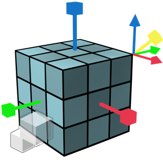
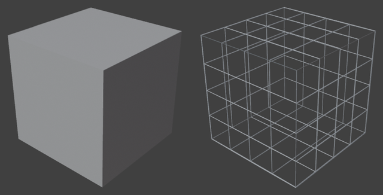

A standard six-sided shape, great for solid modeling. Includes relative UVs and resolution gizmos.

This asset uses the **Smart Cube** node group.

#### Gizmos

- **Size**: 3
- **Loop resolution**: 3
- **Scale All**: 1

#### Inputs

##### X

Data type: Float (distance).

Changes the width of the primitive in unit sizes. Default: 2 m.

##### Y

Data type: Float (distance).

Changes the depth of the primitive in unit sizes. Default: 2 m.

##### Z

Data type: Float (distance).

Changes the height of the primitive in unit sizes. Default: 2 m.

##### Resolution

###### X

Data type: Integer.

Changes the horizontal resolution of the geometry edges/loops. Default: 3.

###### Y

Data type: Integer.

Changes the vertical resolution of the geometry edges/loops. Default: 3.

###### Z

Data type: Integer.

Changes the base resolution of the geometry edges/loops. Default: 3.

##### UVs

###### Relative

Data type: Boolean.

Creates a triplanar UV projection that is relative to object scale. Default: on.

#### Outputs

##### Geometry

Data type: Geometry.

The generated shape.

### Cube Rounded

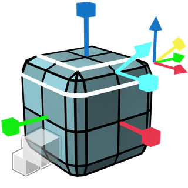
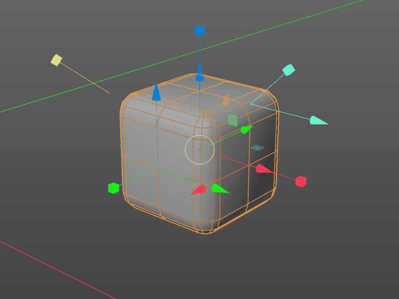

A cube with softened edges for a more organic feel.

This asset uses the **Smart Cube Rounded** node group.

#### Gizmos

- **Size**: 3
- **Loop resolution**: 3
- **Bevel Scale**: 1
- **Bevel Resolution**: 1
- **Scale All**: 1

#### Inputs

##### X

Data type: Float (distance).

Changes the width of the primitive in unit sizes. Default: 2 m.

##### Y

Data type: Float (distance).

Changes the depth of the primitive in unit sizes. Default: 2 m.

##### Z

Data type: Float (distance).

Changes the height of the primitive in unit sizes. Default: 2 m.

##### Bevel

###### Bevel Amount

Data type: Float.

Changes the radius percentage of the bevel. Default: 50.

###### Resolution

Data type: Integer.

Changes the bevel geometry edges/loops resolution. Default: 3.

##### Resolution

###### X

Data type: Integer.

Changes the horizontal resolution of the geometry edges/loops. Default: 3.

###### Y

Data type: Integer.

Changes the vertical resolution of the geometry edges/loops. Default: 3.

###### Z

Data type: Integer.

Changes the base resolution of the geometry edges/loops. Default: 3.

#### Outputs

##### Geometry

Data type: Geometry.

The generated shape.

### Sphere

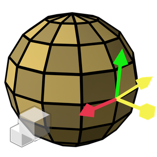
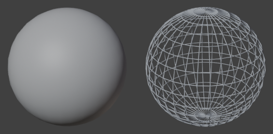

A perfect round primitive, ideal for smooth surfaces. Includes relative resolution controls.

This asset uses the **Smart Sphere** node group.

#### Gizmos

- **Scale All**: 1
- **Loop resolution**: 2
- **Bend profile**: 1

#### Inputs

##### Radius

Data type: Float (distance).

Changes the radius of the primitive in unit sizes. Default: 1 m.

##### Resolution

###### Horizontal

Data type: Integer.

Changes the horizontal resolution of the geometry edges/loops. Default: 16.

###### Vertical

Data type: Integer.

Changes the vertical resolution of the geometry edges/loops. Default: 32.

##### UVs

###### Relative

Data type: Boolean.

Creates a UV projection that is relative to object scale. Default: off.

#### Outputs

##### Geometry

Data type: Geometry.

The generated shape.

### Icosphere

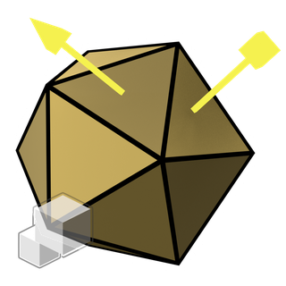
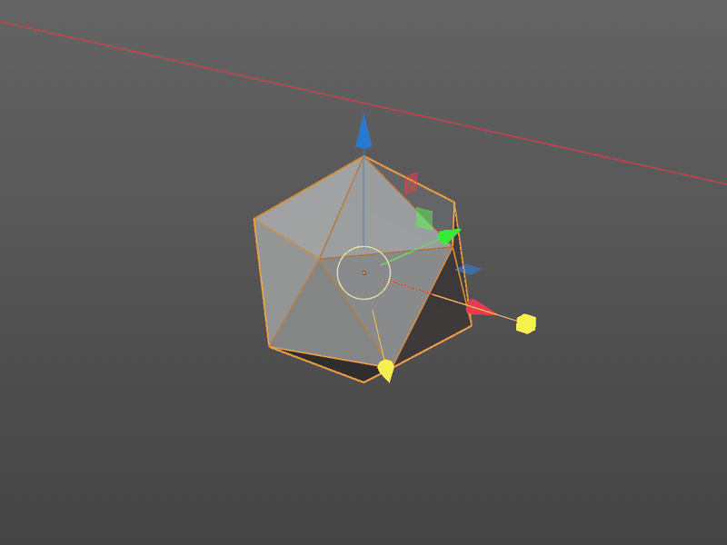

A low-poly spherical shape made of triangles, great for optimization, with various levels of resolution.

This asset uses the **Smart Icosphere** node group.

#### Gizmos

- **Bend profile**: 1
- **Scale All**: 1

#### Inputs

##### Radius

Data type: Float (distance).

Changes the radius of the primitive in unit sizes. Default: 1 m.

##### Resolution

Data type: Integer.

Subdivisions of the icosphere. Default: 1.

##### UVs

###### Relative

Data type: Boolean.

Creates a UV projection that is relative to object scale. Default: on.

#### Outputs

##### Geometry

Data type: Geometry.

The generated shape.

### Cone

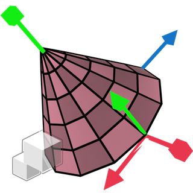
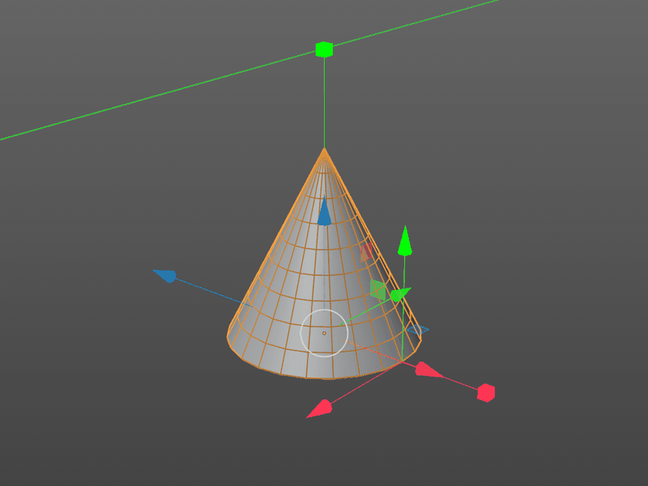

A tapered shape with a circular base, useful for pointed structures.

This asset uses the **Smart Cone** node group.

#### Gizmos

- **Size**: 2
- **Loop resolution**: 3

#### Inputs

##### Height

Data type: Float (distance).

Change the height of the primitive in unit sizes. Default: 2 m.

##### Radius

Data type: Float (distance).

Changes the radius of the primitive in unit sizes. Default: 1 m.

##### Resolution

###### Horizontal

Data type: Integer.

Changes the horizontal resolution of the geometry edges/loops. Default: 10.

###### Vertical

Data type: Integer.

Changes the vertical resolution of the geometry edges/loops. Default: 24.

###### Base

Data type: Integer.

Changes the base resolution of the geometry edges/loops. Default: 4.

#### Outputs

##### Geometry

Data type: Geometry.

The generated shape.

### Cone Rounded

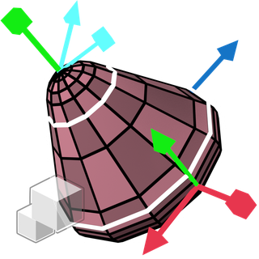
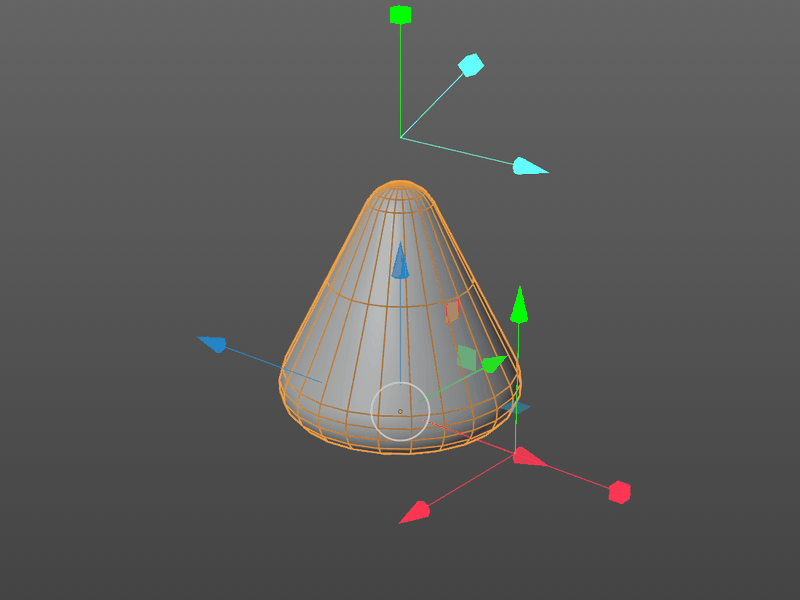

A cone with a smoother, more organic tip.

This asset uses the **Smart Cone Rounded** node group.

#### Gizmos

- **Size**: 2
- **Loop resolution**: 3
- **Bevel Resolution**: 1
- **Bevel Scale**: 1

#### Inputs

##### Height

Data type: Float (distance).

Changes the height of the primitive in unit sizes. Default: 2 m.

##### Radius

Data type: Float (distance).

Changes the radius of the primitive in unit sizes. Default: 1 m.

##### Bevel

###### Radius

Data type: Float.

Changes the radius percentage of the bevel. The bevel will clamp to the horizontal resolution, less horizontal loops increases bevel maximum limit. Default: 25.

###### Resolution

Data type: Integer.

Changes the bevel geometry edges/loops resolution. Default: 3.

##### Resolution

###### Horizontal

Data type: Integer.

Changes the horizontal resolution of the geometry edges/loops. Default: 3.

###### Vertical

Data type: Integer.

Changes the vertical resolution of the geometry edges/loops. Default: 24.

###### Base

Data type: Integer.

Changes the base resolution of the geometry edges/loops. Default: 3.

#### Outputs

##### Geometry

Data type: Geometry.

The generated shape.

### Cylinder

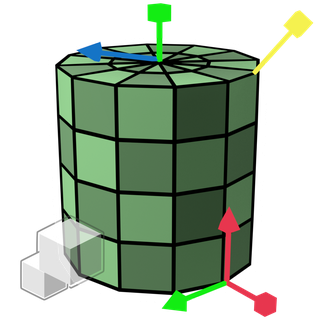
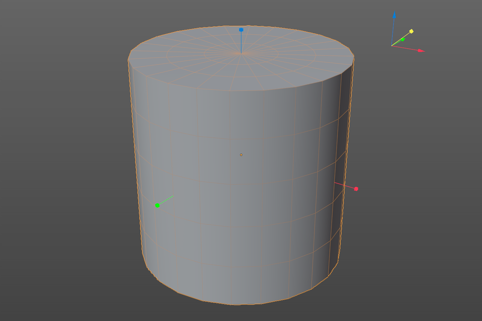

A uniform circular primitive, essential for pipes and tubes.

This asset uses the **Smart Cylinder** node group.

#### Gizmos

- **Size**: 2
- **Loop resolution**: 3
- **Scale All**: 1

#### Inputs

##### Radius

Data type: Float (distance).

Changes the radius of the primitive in unit sizes. Default: 1 m.

##### Height

Data type: Float (distance).

Changes the height of the primitive in unit sizes. Default: 2 m.

##### Resolution

###### Horizontal

Data type: Integer.

Changes the horizontal resolution of the geometry edges/loops. Default: 5.

###### Vertical

Data type: Integer.

Changes the vertical resolution of the geometry edges/loops. Default: 24.

###### Base

Data type: Integer.

Changes the base resolution of the geometry edges/loops. Default: 3.

#### Outputs

##### Geometry

Data type: Geometry.

The generated shape.

### Cylinder Rounded

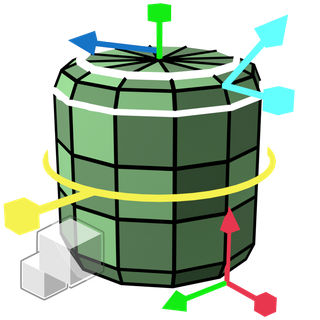
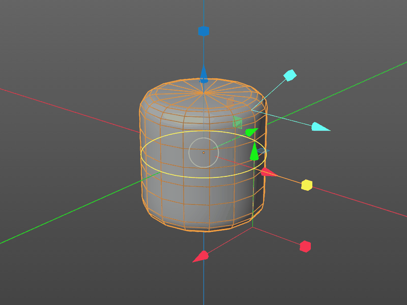

A cylinder with softened edges for better transitions.

This asset uses the **Smart Cylinder Rounded Revolved** node group. The same group is used by Cylinder Revolved, Cylinder Rounded Revolved; each asset starts from its own settings.

#### Gizmos

- **Revolve Angle**: 1
- **Size**: 2
- **Loop resolution**: 2
- **Bevel Resolution**: 1
- **Bevel Scale**: 1
- **Scale All**: 1

#### Inputs

##### Angle

Data type: Float (angle).

Changes the revolve angle in degrees. 360° closes the revolution. Default: 270°. This asset starts at 360°.

##### Height

Data type: Float.

Changes the height of the primitive in unit sizes. Default: 1.

##### Width

Data type: Float.

Changes the radius of the primitive in unit sizes. Default: 1.

##### Bevel

###### Radius

Data type: Float.

Changes the radius percentage of the bevel. Default: 25.

###### Resolution

Data type: Integer.

Changes the bevel geometry edges/loops resolution. Default: 4.

##### Resolution

###### Horizontal

Data type: Integer.

Changes the horizontal resolution of the geometry edges/loops. Default: 6.

###### Vertical

Data type: Integer.

Changes the vertical resolution of the geometry edges/loops. Default: 16.

###### Triangulate Center

Data type: Boolean.

Triangulates the center faces to remove NGONs. Default: on.

###### Triangulate All

Data type: Boolean.

Triangulates all faces. Default: off.

#### Outputs

##### Geometry

Data type: Geometry.

The generated shape.

### Tube

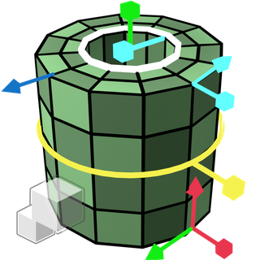
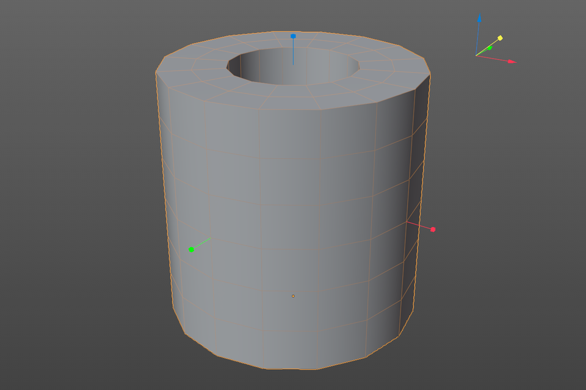

A hollow cylindrical primitive, great for mechanical parts.

This asset uses the **Smart Tube Revolved** node group. The same group is used by Tube Revolved; each asset starts from its own settings.

#### Gizmos

- **Revolve Angle**: 1
- **Size**: 2
- **Loop resolution**: 3
- **Scale All**: 1
- **Bevel Scale**: 1

#### Inputs

##### Angle

Data type: Float (angle).

Changes the revolve angle in degrees. 360° closes the revolution. Default: 270°. This asset starts at 360°.

##### Radius

Data type: Float (distance).

Changes the radius of the primitive in unit sizes. Default: 1 m.

##### Height

Data type: Float (distance).

Changes the height of the primitive in unit sizes. Default: 2 m.

##### Inner Radius

Data type: Float.

Changes the inner radius percentage. 100% is a full circle, meanwhile 0% is no inner radius. Default: 50.

##### Resolution

###### Horizontal

Data type: Integer.

Changes the horizontal resolution of the geometry edges/loops. Default: 6.

###### Vertical

Data type: Integer.

Changes the vertical resolution of the geometry edges/loops. Default: 16.

###### Base

Data type: Integer.

Changes the base resolution of the geometry edges/loops. Default: 2.

###### Triangulate Center

Data type: Boolean.

Triangulates the center faces to remove NGONs. Default: on.

###### Triangulate All

Data type: Boolean.

Triangulates all faces. Default: off.

#### Outputs

##### Geometry

Data type: Geometry.

The generated shape.

### Tube Rounded

A tube with smooth edges for a more natural look.

This asset uses the **Smart Tube Rounded Revolved** node group. The same group is used by Tube Rounded Revolved; each asset starts from its own settings.

#### Gizmos

- **Revolve Angle**: 1
- **Size**: 2
- **Loop resolution**: 3
- **Scale All**: 1
- **Bevel Scale**: 2
- **Bevel Resolution**: 1

#### Inputs

##### Angle

Data type: Float (angle).

Changes the revolve angle in degrees. 360° closes the revolution. Default: 270°. This asset starts at 360°.

##### Radius

Data type: Float (distance).

Changes the radius of the primitive in unit sizes. Default: 1 m.

##### Inner Radius

Data type: Float.

Changes the inner radius percentage. 100% is a full circle, meanwhile 0% is no inner radius. Default: 50.

##### Height

Data type: Float (distance).

Changes the height of the primitive in unit sizes. Default: 2 m.

##### Bevel

###### Radius

Data type: Float (distance).

Changes the radius percentage of the bevel. Default: 0.15 m.

###### Resolution

Data type: Integer.

Changes the bevel geometry edges/loops resolution. Default: 3.

##### Resolution

###### Horizontal

Data type: Integer.

Changes the horizontal resolution of the geometry edges/loops. Default: 6.

###### Vertical

Data type: Integer.

Changes the vertical resolution of the geometry edges/loops. Default: 16.

###### Base

Data type: Integer.

Changes the base resolution of the geometry edges/loops. Default: 2.

###### Triangulate Center

Data type: Boolean.

Triangulates the center faces to remove NGONs. Default: on.

###### Triangulate All

Data type: Boolean.

Triangulates all faces. Default: off.

#### Outputs

##### Geometry

Data type: Geometry.

The generated shape.

## Advanced Forms

### Capsule

A stretched sphere useful for stylized characters and smooth objects.

This asset uses the **Smart Capsule** node group.

#### Gizmos

- **Size**: 2
- **Loop resolution**: 3
- **Bevel Scale**: 1

#### Inputs

##### Height

Data type: Float (distance).

Changes the height of the primitive in unit sizes. Default: 1 m.

##### Radius

Data type: Float (distance).

Changes the radius of the primitive in unit sizes. Default: 0.5 m.

##### Cap

###### Resolution

Data type: Integer.

Changes the cap geometry edges/loops resolution. Default: 8.

###### Height

Data type: Float (factor).

Changes the height of the cap with a factor. Smaller values flattens the cap. Default: 1.

###### Corrective Tangent

Data type: Float (factor).

Controls the corrrective tangent of the cap. Tangent can be positive or negative. Useful to correct the cap shape. Default: 0.03.

##### Resolution

###### Horizontal

Data type: Integer.

Changes the horizontal resolution of the geometry edges/loops. Default: 16.

###### Vertical

Data type: Integer.

Changes the vertical resolution of the geometry edges/loops. Default: 6.

#### Outputs

##### Geometry

Data type: Geometry.

The generated shape.

### Capsule Revolved

A capsule rotated for unique geometry shaping. Includes the ability to revolve around an angle.

This asset uses the **Smart Capsule Revolved** node group.

#### Gizmos

- **Size**: 2
- **Loop resolution**: 3
- **Bevel Scale**: 1
- **Revolve Angle**: 1
- **Scale All**: 1

#### Inputs

##### Angle

Data type: Float (angle).

Changes the revolve angle in degrees. 360° closes the revolution. Default: 270°. This asset starts at 271.5°.

##### Height

Data type: Float (distance).

Changes the height of the primitive in unit sizes. Default: 1 m. This asset starts at 1.8 m.

##### Radius

Data type: Float (distance).

Changes the radius of the primitive in unit sizes. Default: 0.5 m.

##### Cap

###### Resolution

Data type: Integer.

Changes the cap geometry edges/loops resolution. Default: 8.

###### Height

Data type: Float (factor).

Control the cap height roundeness or flattness. Default: 1.

###### Corrective Tangent

Data type: Float (factor).

Controls the tangent of the roundness of the cap. Useful to correct the shape. Default: 0.03.

##### Resolution

###### Horizontal

Data type: Integer.

Changes the horizontal resolution of the geometry edges/loops. Default: 6.

###### Vertical

Data type: Integer.

Changes the vertical resolution of the geometry edges/loops. Default: 16.

###### Triangulate Center

Data type: Boolean.

Triangulates the center faces to remove NGONs. Default: on.

###### Triangulate All

Data type: Boolean.

Triangulates all faces. Default: off.

#### Outputs

##### Geometry

Data type: Geometry.

The generated shape.

### Grid

A flat subdivided plane useful for ground surfaces and mesh guides. Includes relative UVs.

This asset uses the **Smart Grid** node group.

#### Gizmos

- **Size**: 2
- **Loop resolution**: 2
- **Scale All**: 1

#### Inputs

##### X

Data type: Float (distance).

Changes the width of the primitive in unit sizes. Default: 2 m.

##### Y

Data type: Float (distance).

Changes the height of the primitive in unit sizes. Default: 2 m.

##### Resolution

###### X

Data type: Integer.

Changes the horizontal resolution of the geometry edges/loops. Default: 5.

###### Y

Data type: Integer.

Changes the vertical resolution of the geometry edges/loops. Default: 5.

##### UVs

###### Relative

Data type: Boolean.

Creates a UV projection that is relative to object scale. Default: on.

#### Outputs

##### Geometry

Data type: Geometry.

The generated shape.

### Torus

A ring-shaped primitive, ideal for looped structures.

This asset uses the **Smart Torus** node group. The same group is used by Torus Revolved; each asset starts from its own settings.

#### Gizmos

- **Revolve Angle**: 2
- **Size**: 1
- **Bevel Scale**: 1
- **Loop resolution**: 2
- **Scale All**: 1

#### Inputs

##### Angle

Data type: Float (angle).

Changes the revolve angle in degrees. 360° closes the revolution. Default: 270°. This asset starts at 360°.

##### Radius

Data type: Float (distance).

Changes the radius of the primitive in unit sizes. Default: 1 m.

##### Thickness

Data type: Float (distance).

Changes the radius of the thickness. Default: 0.25 m.

##### Twist

Data type: Float (angle).

Controls the twist of the torus is not fully revolved. Default: 0°.

##### Resolution

###### Horizontal

Data type: Integer.

Changes the horizontal resolution of the geometry edges/loops. Default: 8.

###### Vertical

Data type: Integer.

Changes the vertical resolution of the geometry edges/loops. Default: 24.

###### Triangulate Caps

Data type: Boolean.

Triangulates the cap faces to remove NGONs. Default: off.

#### Outputs

##### Geometry

Data type: Geometry.

The generated shape.

### Torus Revolved

A torus rotated for specialized forms. Includes the ability to revolve around an angle.

This asset uses the **Smart Torus** node group. The same group is used by Torus; each asset starts from its own settings.

#### Gizmos

- **Revolve Angle**: 2
- **Size**: 1
- **Bevel Scale**: 1
- **Loop resolution**: 2
- **Scale All**: 1

#### Inputs

##### Angle

Data type: Float (angle).

Changes the revolve angle in degrees. 360° closes the revolution. Default: 270°.

##### Radius

Data type: Float (distance).

Changes the radius of the primitive in unit sizes. Default: 1 m.

##### Thickness

Data type: Float (distance).

Changes the radius of the thickness. Default: 0.25 m.

##### Twist

Data type: Float (angle).

Controls the twist of the torus is not fully revolved. Default: 0°.

##### Resolution

###### Horizontal

Data type: Integer.

Changes the horizontal resolution of the geometry edges/loops. Default: 8.

###### Vertical

Data type: Integer.

Changes the vertical resolution of the geometry edges/loops. Default: 24.

###### Triangulate Caps

Data type: Boolean.

Triangulates the cap faces to remove NGONs. Default: off.

#### Outputs

##### Geometry

Data type: Geometry.

The generated shape.

### Spiral

A coiled shape, useful for decorative and mechanical designs.

This asset uses the **Smart Spiral** node group.

#### Gizmos

- **Size**: 3
- **Revolve Angle**: 2
- **Bevel Scale**: 2
- **Scale All**: 1
- **Loop resolution**: 2
- **Bend profile**: 1

#### Inputs

##### Height

Data type: Float (distance).

Changes the height of the primitive in unit sizes. Default: 2 m.

##### Rotations

Data type: Float.

Changes the rotations amount of the spiral. Default: 3.

##### Start Radius

Data type: Float (distance).

Changes the start of the spiral radius. Default: 1 m.

##### End Radius

Data type: Float (distance).

Changes the end of the spiral radius. Default: 0.25 m.

##### Profile

###### Radius

Data type: Float (distance).

Changes the radius of the profile that is lofted on the spiral. Default: 0.2 m.

###### Taper

Data type: Float (factor).

Changes the taper of the spiral by a factor. Negative values thickens the end radius. Default: 0.

###### Twist

Data type: Float (angle).

Changes the tilt of the profile loft which creates a twist. Default: 0°.

##### Resolution

###### Horizontal

Data type: Integer.

Changes the horizontal resolution of the geometry edges/loops. Default: 12.

###### Vertical

Data type: Integer.

Changes the vertical resolution of the geometry edges/loops. Default: 32.

###### Triangulate Caps

Data type: Boolean.

Triangulates the cap faces to remove NGONs. Default: off.

##### UVs

###### Scale

Data type: Float.

Scale the UVs. Default: 2.

###### U Scale

Data type: Float.

Scale UV's on the U axis. Default: 0.

###### V Scale

Data type: Float.

Scale UV's on the V axis. Default: 0.

#### Outputs

##### Geometry

Data type: Geometry.

The generated shape.

### Circle

A simple 2D shape for base geometry and cutouts. Includes stamped or path based UVs.

This asset uses the **Smart Circle** node group.

#### Gizmos

- **Size**: 1
- **Bevel Scale**: 1
- **Loop resolution**: 2
- **Bevel Resolution**: 1

#### Inputs

##### Outer Radius

Data type: Float (distance).

Changes the outer radius in unit sizes. Default: 1 m.

##### Inner Radius

Data type: Float.

Changes the inner radius percentage. 100% is a full circle, meanwhile 0% is no inner radius. Default: 50.

##### Inner Height

Data type: Float (factor).

Change the inner edge height offset. This is clamped to 1, but it is essentially limitless. Default: 0.

##### Resolution

###### Horizontal

Data type: Integer.

Changes the horizontal resolution of the geometry edges/loops. Default: 32.

###### Vertical

Data type: Integer.

Changes the vertical resolution of the geometry edges/loops. Default: 4.

##### UVs

###### Stamped UVs

Data type: Boolean.

Changes the UV's to stamped UV's, which is a flat top down projection. Otherwise, use path based UVs. Default: off.

#### Outputs

##### Geometry

Data type: Geometry.

The generated shape.

### Circle Revolved

A circular shape rotated into a 3D form. Includes the ability to revolve around an angle.

This asset uses the **Smart Circle Revolved** node group.

#### Gizmos

- **Size**: 1
- **Bevel Scale**: 1
- **Loop resolution**: 2
- **Revolve Angle**: 1
- **Bevel Resolution**: 1
- **Scale All**: 1

#### Inputs

##### Angle

Data type: Float (angle).

Changes the revolve angle in degrees. 360° closes the revolution. Default: 270°.

##### Outer Radius

Data type: Float (distance).

Changes the outer radius in unit sizes. Default: 1 m.

##### Inner Radius

Data type: Float.

Changes the inner radius percentage. 100% is a full circle, meanwhile 0% is no inner radius. Default: 50.

##### Inner Height

Data type: Float (factor).

Change the inner edge height offset. This is clamped to 1, but it is essentially limitless. Default: 0.

##### Resolution

###### Horizontal

Data type: Integer.

Changes the horizontal resolution of the geometry edges/loops. Default: 32.

###### Vertical

Data type: Integer.

Changes the vertical resolution of the geometry edges/loops. Default: 4.

##### UVs

###### Stamped UVs

Data type: Boolean.

Changes the UV's to stamped UV's, which is a flat top down projection. Otherwise, use path based UVs. Default: off.

#### Outputs

##### Geometry

Data type: Geometry.

The generated shape.

### Curve Lofted

Generates complex surfaces using lofted curves with a central profile gizmo system. Includes taper, bend, swell and volume bevel controls.

This asset uses the **Smart Curve Lofted** node group.

#### Gizmos

- **Size**: 3
- **Loop resolution**: 3
- **Bevel Scale**: 2
- **Bevel Resolution**: 1
- **Scale All**: 1
- **Bend profile**: 1

#### Inputs

##### Volume

Data type: Float.

Controls the volume of the lofted curve or grease pencil. Default: 2.

##### Tips

Data type: Float.

Changes the width of the tips of the loftes curve or grease pencil. Default: 0.

##### Bias

Data type: Float (factor).

Changes the bias of volume to the start or end of the curve or grease pencil. Default: 0.5.

##### Helper Gizmos

Data type: Boolean.

Toggles the custom object selector if you want to use a grease pencil or another curve object. Default: on.

##### Custom Object

###### Custom Object

Data type: Boolean.

Toggles the custom object selector if you want to use a grease pencil or another curve object. Default: off.

###### Curve Object

Data type: Object.

Chooses the custom object or grease pencil.

##### Profile

###### Width

Data type: Float.

Changes the width of the profile shape that is used to loft. Default: 1.

###### Depth

Data type: Float.

Changes the depth of the profile shape that is used to loft. Default: 0.72.

###### Swell

Data type: Float.

Changes the swell of the profile shape that is used to loft. Default: 0.

###### Bend

Data type: Float.

Changes the internal bend of the profile shape that is used to loft. Default: 0.

##### Resolution

###### Resolution Method

Data type: Menu.

Selects the resample method for horizontal resolution. Warning: length could be imperformant. Default: Count.

###### Length

Data type: Float (distance).

If the resolution method is by length, this creates a point per length distance unit. Default: 0.1 m.

###### Count

Data type: Integer.

If the resolution method is by count, this creates a total number of points per spline. Default: 10.

###### Vertical

Data type: Integer.

Changes the vertical resolution of the geometry edges/loops. Default: 5.

###### Depth

Data type: Integer.

Changes the depth resolution of the geometry edges/loops. Default: 2.

##### Bevel

###### Radius

Data type: Float (factor).

Changes the bevel radius factor. Warning: bevel could be imperformant. Default: 0.

###### Resolution

Data type: Integer.

Changes the resolution of the bevel. Default: 3. This asset starts at 2.

##### Smoothness

###### Inheriit

Data type: Boolean.

Inherits the normals smoothness settings of the Curve object. Warning: Grease Pencil objects do not have smoothness information to inherit. Default: off.

###### Smooth

Data type: Boolean.

Turns normals smoothness override on or off. Useful for Grease Pencil objects. Default: on.

#### Outputs

##### Geometry

Data type: Geometry.

The generated shape.

### Cylinder Revolved

A cylindrical shape rotated for varied effects. Includes the ability to revolve around an angle.

This asset uses the **Smart Cylinder Rounded Revolved** node group. The same group is used by Cylinder Rounded, Cylinder Rounded Revolved; each asset starts from its own settings.

#### Gizmos

- **Revolve Angle**: 1
- **Size**: 2
- **Loop resolution**: 2
- **Bevel Resolution**: 1
- **Bevel Scale**: 1
- **Scale All**: 1

#### Inputs

##### Angle

Data type: Float (angle).

Changes the revolve angle in degrees. 360° closes the revolution. Default: 270°. This asset starts at 270°.

##### Height

Data type: Float.

Changes the height of the primitive in unit sizes. Default: 1.

##### Width

Data type: Float.

Changes the radius of the primitive in unit sizes. Default: 1.

##### Bevel

###### Radius

Data type: Float.

Changes the radius percentage of the bevel. Default: 25. This asset starts at 0.

###### Resolution

Data type: Integer.

Changes the bevel geometry edges/loops resolution. Default: 4.

##### Resolution

###### Horizontal

Data type: Integer.

Changes the horizontal resolution of the geometry edges/loops. Default: 6.

###### Vertical

Data type: Integer.

Changes the vertical resolution of the geometry edges/loops. Default: 16.

###### Triangulate Center

Data type: Boolean.

Triangulates the center faces to remove NGONs. Default: on.

###### Triangulate All

Data type: Boolean.

Triangulates all faces. Default: off.

#### Outputs

##### Geometry

Data type: Geometry.

The generated shape.

### Cylinder Rounded Revolved

A rounded cylinder adapted for more curvature. Includes the ability to revolve around an angle.

This asset uses the **Smart Cylinder Rounded Revolved** node group. The same group is used by Cylinder Revolved, Cylinder Rounded; each asset starts from its own settings.

#### Gizmos

- **Revolve Angle**: 1
- **Size**: 2
- **Loop resolution**: 2
- **Bevel Resolution**: 1
- **Bevel Scale**: 1
- **Scale All**: 1

#### Inputs

##### Angle

Data type: Float (angle).

Changes the revolve angle in degrees. 360° closes the revolution. Default: 270°.

##### Height

Data type: Float.

Changes the height of the primitive in unit sizes. Default: 1.

##### Width

Data type: Float.

Changes the radius of the primitive in unit sizes. Default: 1.

##### Bevel

###### Radius

Data type: Float.

Changes the radius percentage of the bevel. Default: 25.

###### Resolution

Data type: Integer.

Changes the bevel geometry edges/loops resolution. Default: 4.

##### Resolution

###### Horizontal

Data type: Integer.

Changes the horizontal resolution of the geometry edges/loops. Default: 6.

###### Vertical

Data type: Integer.

Changes the vertical resolution of the geometry edges/loops. Default: 16.

###### Triangulate Center

Data type: Boolean.

Triangulates the center faces to remove NGONs. Default: on.

###### Triangulate All

Data type: Boolean.

Triangulates all faces. Default: off.

#### Outputs

##### Geometry

Data type: Geometry.

The generated shape.

### Tube Revolved

A tube rotated for improved modeling flexibility. Includes the ability to revolve around an angle.

This asset uses the **Smart Tube Revolved** node group. The same group is used by Tube; each asset starts from its own settings.

#### Gizmos

- **Revolve Angle**: 1
- **Size**: 2
- **Loop resolution**: 3
- **Scale All**: 1
- **Bevel Scale**: 1

#### Inputs

##### Angle

Data type: Float (angle).

Changes the revolve angle in degrees. 360° closes the revolution. Default: 270°.

##### Radius

Data type: Float (distance).

Changes the radius of the primitive in unit sizes. Default: 1 m.

##### Height

Data type: Float (distance).

Changes the height of the primitive in unit sizes. Default: 2 m.

##### Inner Radius

Data type: Float.

Changes the inner radius percentage. 100% is a full circle, meanwhile 0% is no inner radius. Default: 50.

##### Resolution

###### Horizontal

Data type: Integer.

Changes the horizontal resolution of the geometry edges/loops. Default: 6.

###### Vertical

Data type: Integer.

Changes the vertical resolution of the geometry edges/loops. Default: 16.

###### Base

Data type: Integer.

Changes the base resolution of the geometry edges/loops. Default: 2.

###### Triangulate Center

Data type: Boolean.

Triangulates the center faces to remove NGONs. Default: on.

###### Triangulate All

Data type: Boolean.

Triangulates all faces. Default: off.

#### Outputs

##### Geometry

Data type: Geometry.

The generated shape.

### Tube Rounded Revolved

A smoothed, rotated tube for streamlined designs. Includes the ability to revolve around an angle.

This asset uses the **Smart Tube Rounded Revolved** node group. The same group is used by Tube Rounded; each asset starts from its own settings.

#### Gizmos

- **Revolve Angle**: 1
- **Size**: 2
- **Loop resolution**: 3
- **Scale All**: 1
- **Bevel Scale**: 2
- **Bevel Resolution**: 1

#### Inputs

##### Angle

Data type: Float (angle).

Changes the revolve angle in degrees. 360° closes the revolution. Default: 270°.

##### Radius

Data type: Float (distance).

Changes the radius of the primitive in unit sizes. Default: 1 m.

##### Inner Radius

Data type: Float.

Changes the inner radius percentage. 100% is a full circle, meanwhile 0% is no inner radius. Default: 50.

##### Height

Data type: Float (distance).

Changes the height of the primitive in unit sizes. Default: 2 m.

##### Bevel

###### Radius

Data type: Float (distance).

Changes the radius percentage of the bevel. Default: 0.15 m.

###### Resolution

Data type: Integer.

Changes the bevel geometry edges/loops resolution. Default: 3.

##### Resolution

###### Horizontal

Data type: Integer.

Changes the horizontal resolution of the geometry edges/loops. Default: 6.

###### Vertical

Data type: Integer.

Changes the vertical resolution of the geometry edges/loops. Default: 16.

###### Base

Data type: Integer.

Changes the base resolution of the geometry edges/loops. Default: 2.

###### Triangulate Center

Data type: Boolean.

Triangulates the center faces to remove NGONs. Default: on.

###### Triangulate All

Data type: Boolean.

Triangulates all faces. Default: off.

#### Outputs

##### Geometry

Data type: Geometry.

The generated shape.

### Cone Rounded Revolved

A tapered primitive that blends sharpness with curvature. Includes the ability to revolve around an angle.

This asset uses the **Smart Cone Rounded Revolved** node group.

#### Gizmos

- **Size**: 2
- **Loop resolution**: 3
- **Bevel Resolution**: 1
- **Bevel Scale**: 1
- **Revolve Angle**: 1
- **Scale All**: 1

#### Inputs

##### Angle

Data type: Float (angle).

Changes the revolve angle in degrees. 360° closes the revolution. Default: 270°.

##### Height

Data type: Float (distance).

Changes the height of the primitive in unit sizes. Default: 2 m.

##### Radius

Data type: Float (distance).

Changes the radius of the primitive in unit sizes. Default: 1 m.

##### Bevel

###### Radius

Data type: Float.

Changes the radius percentage of the bevel. The bevel will clamp to the horizontal resolution, less horizontal loops increases bevel maximum limit. Default: 25.

###### Resolution

Data type: Integer.

Changes the bevel geometry edges/loops resolution. Default: 3.

##### Resolution

###### Horizontal

Data type: Integer.

Changes the horizontal resolution of the geometry edges/loops. Default: 3.

###### Vertical

Data type: Integer.

Changes the vertical resolution of the geometry edges/loops. Default: 24.

###### Base

Data type: Integer.

Changes the base resolution of the geometry edges/loops. Default: 3.

###### Triangulate Center

Data type: Boolean.

Triangulates the center faces to remove NGONs. Default: on.

###### Triangulate All

Data type: Boolean.

Triangulates all faces. Default: off.

#### Outputs

##### Geometry

Data type: Geometry.

The generated shape.

### Sphere Revolved

A sphere adjusted through rotation for unique formations. Includes the ability to revolve around an angle.

This asset uses the **Smart Sphere Revolved** node group.

#### Gizmos

- **Revolve Angle**: 1
- **Scale All**: 1
- **Loop resolution**: 2
- **Bend profile**: 1

#### Inputs

##### Angle

Data type: Float (angle).

Changes the revolve angle in degrees. 360° closes the revolution. Default: 270°.

##### Radius

Data type: Float (distance).

Changes the radius of the primitive in unit sizes. Default: 1 m.

##### Resolution

###### Horizontal

Data type: Integer.

Changes the horizontal resolution of the geometry edges/loops. Default: 16.

###### Vertical

Data type: Integer.

Changes the vertical resolution of the geometry edges/loops. Default: 16.

###### Triangulate Center

Data type: Boolean.

Triangulates the center faces to remove NGONs. Default: on.

#### Outputs

##### Geometry

Data type: Geometry.

The generated shape.

# Utilities

_Assets in this category will be documented here._
