Geometry node groups that come with Bforartists: curve, grease pencil, material, mesh, normals, primitives and utilities.

> **Draft:** the assets of this library will be listed here: one section per category, one entry per asset with what it does and how to use it.

# Curve

The Curve assets work on curves. The **Shapes** catalog draws flat curve shapes, the **Fill** catalog turns closed curves into meshes, and the **Operations** catalog simplifies curves. Curves can be Curve objects, Curves objects or Grease Pencil strokes, so you can draw an outline by hand and let a Fill node build the mesh.

Find them in the Asset Browser and in the Asset Shelf of the Geometry Node Editor, under **Geometry Nodegroups › Curve**. Drag one into the node tree to add it.

## Shapes

The Shapes assets draw a flat curve in the shape of a classic mathematical figure: a heart, a rose, a butterfly, a ring and more. Use the curve as an outline, as the input of a Fill node to make a mesh, as a profile for Curve to Mesh, or as a path. Most of the shapes also exist as pictures in the Texture / Shapes assets of the [Compositor Library](compositor-library.md) and the [Shader Library](shader-library.md), with the same controls.

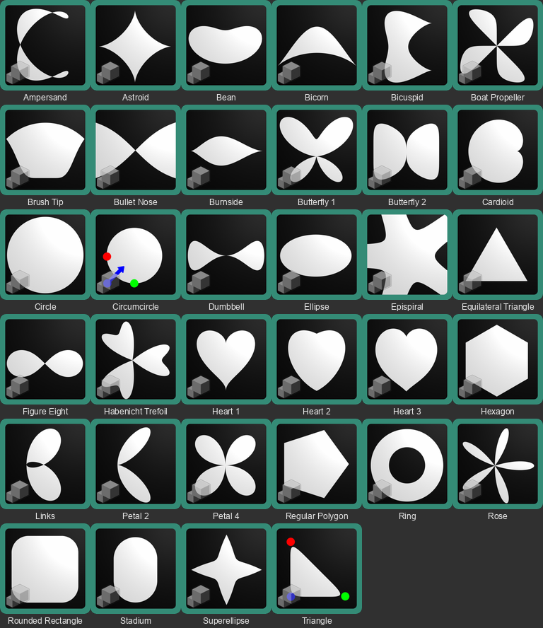

The shapes share the same kind of interface:

- Most shapes have a **Scale**. Some have a **Position**, a **Form** or other controls that change the figure.
- The **Curve** panel sets how the figure is turned into a curve. **Resolution** is the number of points. Shapes made from a formula draw the figure by tracing it, and for those **Bounds** is half the size of the traced area. Parts of the figure outside of it are cut off, so raise Bounds when a large Scale cuts the shape.
- Hexagon and Equilateral Triangle are made of straight lines and have no Curve panel.
- The only output is **Curve**, the shape as a flat curve.

Each shape has its own section below, in alphabetical order. The tooltip of a socket in the editor tells you more about it.

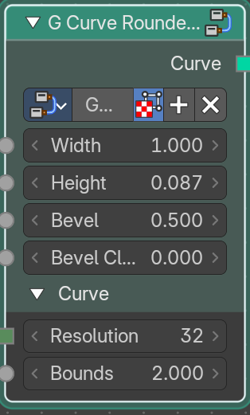

### Curve Ampersand

Draws the Ampersand shape as a flat curve.

#### Inputs

##### Scale

Data type: Float.

The scale of the shape. Default: 2.

##### Curve

How the shape is turned into a curve.

###### Resolution

Data type: Integer.

Detail of the tracing grid. Higher is more accurate but slower. Default: 96.

###### Bounds

Data type: Float.

Half the size of the traced area. Parts outside are cut off. Default: 1.

#### Outputs

##### Curve

Data type: Geometry.

The shape as a flat curve.

### Curve Astroid

Draws the Astroid shape as a flat curve.

#### Inputs

##### Scale

Data type: Float.

The scale of the shape. Default: 1.

##### Curve

How the shape is turned into a curve.

###### Resolution

Data type: Integer.

Number of points on the curve. Higher is smoother but slower. Default: 32.

###### Bounds

Data type: Float.

Half the size of the traced area. Parts outside are cut off. Default: 2.

#### Outputs

##### Curve

Data type: Geometry.

The shape as a flat curve.

### Curve Bean

Draws the Bean shape as a flat curve.

#### Inputs

##### Size

Data type: Float.

The scale of the shape. Default: 0.5.

##### Curve

How the shape is turned into a curve.

###### Resolution

Data type: Integer.

Number of points on the curve. Higher is smoother but slower. Default: 32.

###### Bounds

Data type: Float.

Half the size of the traced area. Parts outside are cut off. Default: 2.

#### Outputs

##### Curve

Data type: Geometry.

The shape as a flat curve.

### Curve Bicorn

Draws the Bicorn shape as a flat curve.

#### Inputs

##### Scale

Data type: Float.

The scale of the shape. Default: 1.

##### Curve

How the shape is turned into a curve.

###### Resolution

Data type: Integer.

Detail of the tracing grid. Higher is more accurate but slower. Default: 32.

###### Bounds

Data type: Float.

Half the size of the traced area. Parts outside are cut off. Default: 2.

#### Outputs

##### Curve

Data type: Geometry.

The shape as a flat curve.

### Curve Bicuspid

Draws the Bicuspid shape as a flat curve.

#### Inputs

##### Scale

Data type: Float.

The scale of the shape. Default: 1.

##### Curve

How the shape is turned into a curve.

###### Resolution

Data type: Integer.

Detail of the tracing grid. Higher is more accurate but slower. Default: 64.

###### Bounds

Data type: Float.

Half the size of the traced area. Parts outside are cut off. Default: 1.

#### Outputs

##### Curve

Data type: Geometry.

The shape as a flat curve.

### Curve Boat Propeller

Draws the Boat Propeller shape as a flat curve.

#### Inputs

##### Scale

Data type: Float.

The scale of the shape. Default: 1.

##### Curve

How the shape is turned into a curve.

###### Resolution

Data type: Integer.

Detail of the tracing grid. Higher is more accurate but slower. Default: 48.

###### Bounds

Data type: Float.

Half the size of the traced area. Parts outside are cut off. Default: 1.

#### Outputs

##### Curve

Data type: Geometry.

The shape as a flat curve.

### Curve Brush Tip

Draws the Brush Tip shape as a flat curve.

#### Inputs

##### Scale

Data type: Float.

The scale of the shape. Default: 1.

##### Curve

How the shape is turned into a curve.

###### Resolution

Data type: Integer.

Number of points on the curve. Higher is smoother but slower. Default: 48.

###### Bounds

Data type: Float.

Half the size of the traced area. Parts outside are cut off. Default: 2.

#### Outputs

##### Curve

Data type: Geometry.

The shape as a flat curve.

### Curve Bullet Nose

Draws the Bullet Nose shape as a flat curve.

#### Inputs

##### Scale

Data type: Float.

The scale of the shape. Default: 1.

##### Curve

How the shape is turned into a curve.

###### Resolution

Data type: Integer.

Number of points on the curve. Higher is smoother but slower. Default: 96.

###### Bounds

Data type: Float.

Half the size of the traced area. Parts outside are cut off. Default: 1.

#### Outputs

##### Curve

Data type: Geometry.

The shape as a flat curve.

### Curve Burnside

Draws the Burnside shape as a flat curve.

#### Inputs

##### Scale

Data type: Float.

The scale of the shape. Default: 1.

##### Form

Data type: Float.

Modifies the shape procedurally. Default: 2.

##### Curve

How the shape is turned into a curve.

###### Resolution

Data type: Integer.

Number of points on the curve. Higher is smoother but slower. Default: 32.

###### Bounds

Data type: Float.

Half the size of the traced area. Parts outside are cut off. Default: 2.

#### Outputs

##### Curve

Data type: Geometry.

The shape as a flat curve.

### Curve Butterfly 1

Draws the Butterfly 1 shape as a flat curve.

#### Inputs

##### Scale

Data type: Float.

The scale of the shape. Default: 3.

##### Offset

Data type: Float.

The offset of the shape. Default: 1.

##### Number of Wings

Data type: Integer.

The number of wings. Default: 4.

##### Form

Data type: Float.

Modifies the shape procedurally. Default: 2.

##### Curve

How the shape is turned into a curve.

###### Resolution

Data type: Integer.

Number of points on the curve. Higher is smoother but slower. Default: 64.

###### Bounds

Data type: Float.

Half the size of the traced area. Parts outside are cut off. Default: 2.

#### Outputs

##### Curve

Data type: Geometry.

The shape as a flat curve.

### Curve Butterfly 2

Draws the Butterfly 2 shape as a flat curve.

#### Inputs

##### Scale

Data type: Float.

The scale of the shape. Default: 1.

##### Offset

Data type: Float.

The offset of the shape. Default: 0.

##### Form

Data type: Vector.

Modifies the shape procedurally. Default: (2, 6, 6).

##### Curve

How the shape is turned into a curve.

###### Resolution

Data type: Integer.

Number of points on the curve. Higher is smoother but slower. Default: 48.

###### Bounds

Data type: Float.

Half the size of the traced area. Parts outside are cut off. Default: 2.

#### Outputs

##### Curve

Data type: Geometry.

The shape as a flat curve.

### Curve Cardioid

Draws the Cardioid shape as a flat curve.

#### Inputs

##### Scale

Data type: Float.

The scale of the shape. Default: 1.

##### Form

Data type: Vector.

Modifies the shape procedurally. Default: (0.5, 0.5).

##### Curve

How the shape is turned into a curve.

###### Resolution

Data type: Integer.

Number of points on the curve. Higher is smoother but slower. Default: 32.

###### Bounds

Data type: Float.

Half the size of the traced area. Parts outside are cut off. Default: 2.

#### Outputs

##### Curve

Data type: Geometry.

The shape as a flat curve.

### Curve Circle

Draws a circle as a flat curve.

#### Inputs

##### Position

Data type: Vector.

The position of the shape. Default: (0, 0, 0).

##### Radius

Data type: Float.

The radius of the shape. Default: 1.

##### Curve

How the shape is turned into a curve.

###### Resolution

Data type: Integer.

Number of points on the curve. Higher is smoother but slower. Default: 32.

#### Outputs

##### Curve

Data type: Geometry.

The shape as a flat curve.

### Curve Circumcircle

Draws the Circumcircle shape as a flat curve.

#### Inputs

##### Point A

Data type: Vector.

Vector of point A, modifies the shape procedurally. Default: (1, 0, 0).

##### Point B

Data type: Vector.

Vector of point B, modifies the shape procedurally. Default: (0, 1, 0).

##### Point C

Data type: Vector.

Vector of point B, modifies the shape procedurally. Default: (0, 0, 0).

##### Curve

How the shape is turned into a curve.

###### Resolution

Data type: Integer.

Number of points on the curve. Higher is smoother but slower. Default: 32.

###### Bounds

Data type: Float.

Half the size of the traced area. Parts outside are cut off. Default: 2.

#### Outputs

##### Curve

Data type: Geometry.

The shape as a flat curve.

### Curve Dumbbell

Draws the Dumbbell shape as a flat curve.

#### Inputs

##### Scale

Data type: Float.

The scale of the shape. Default: 1.

##### Form

Data type: Float.

Modifies the shape procedurally. Default: 1.

##### Curve

How the shape is turned into a curve.

###### Resolution

Data type: Integer.

Detail of the tracing grid. Higher is more accurate but slower. Default: 96.

###### Bounds

Data type: Float.

Half the size of the traced area. Parts outside are cut off. Default: 1.

#### Outputs

##### Curve

Data type: Geometry.

The shape as a flat curve.

### Curve Ellipse

Draws the Ellipse shape as a flat curve.

#### Inputs

##### Scale

Data type: Float.

The scale of the shape. Default: 1.

##### Dimensions

Data type: Vector.

The Dimensions of the shape. Default: (1, 0.5, 0).

##### Position

Data type: Vector.

The position of the shape. Default: (0, 0, 0).

##### Roundness

Data type: Float.

The roundness order of the shape. Default: 1.

##### Curve

How the shape is turned into a curve.

###### Resolution

Data type: Integer.

Number of points on the curve. Higher is smoother but slower. Default: 32.

###### Bounds

Data type: Float.

Half the size of the traced area. Parts outside are cut off. Default: 2.

#### Outputs

##### Curve

Data type: Geometry.

The shape as a flat curve.

### Curve Epispiral

Draws the Epispiral shape as a flat curve.

#### Inputs

##### Scale

Data type: Float.

The scale of the shape. Default: 1.

##### Number of lines

Data type: Float.

The number of lines of the spiral. Default: 4.

##### Curve

How the shape is turned into a curve.

###### Resolution

Data type: Integer.

Number of points on the curve. Higher is smoother but slower. Default: 48.

###### Bounds

Data type: Float.

Half the size of the traced area. Parts outside are cut off. Default: 1.

#### Outputs

##### Curve

Data type: Geometry.

The shape as a flat curve.

### Curve Equilateral Triangle

Draws the Equilateral Triangle shape as a flat curve.

#### Inputs

##### Height

Data type: Float.

The scale/height of the shape. Default: 1.

#### Outputs

##### Curve

Data type: Geometry.

The shape as a flat curve.

### Curve Figure Eight

Draws the Figure Eight shape as a flat curve.

#### Inputs

##### Scale

Data type: Float.

The scale of the shape. Default: 1.

##### Form

Data type: Float.

Modifies the shape procedurally. Default: 2.

##### Curve

How the shape is turned into a curve.

###### Resolution

Data type: Integer.

Number of points on the curve. Higher is smoother but slower. Default: 64.

###### Bounds

Data type: Float.

Half the size of the traced area. Parts outside are cut off. Default: 2.

#### Outputs

##### Curve

Data type: Geometry.

The shape as a flat curve.

### Curve Habenicht Trefoil

Draws the Habenicht Trefoil shape as a flat curve.

#### Inputs

##### Scale

Data type: Float.

The scale of the shape. Default: 1.

##### Form

Data type: Vector.

Modifies the shape procedurally. Default: (3, 2, 0.25).

##### Curve

How the shape is turned into a curve.

###### Resolution

Data type: Integer.

Number of points on the curve. Higher is smoother but slower. Default: 96.

###### Bounds

Data type: Float.

Half the size of the traced area. Parts outside are cut off. Default: 2.

#### Outputs

##### Curve

Data type: Geometry.

The shape as a flat curve.

### Curve Heart 1

Draws the Heart 1 shape as a flat curve.

#### Inputs

##### Scale

Data type: Float.

The scale of the shape. Default: 2.

##### Curve

How the shape is turned into a curve.

###### Resolution

Data type: Integer.

Number of points on the curve. Higher is smoother but slower. Default: 32.

###### Bounds

Data type: Float.

Half the size of the traced area. Parts outside are cut off. Default: 2.

#### Outputs

##### Curve

Data type: Geometry.

The shape as a flat curve.

### Curve Heart 2

Draws the Heart 2 shape as a flat curve.

#### Inputs

##### Scale

Data type: Float.

The scale of the shape. Default: 2.

##### Curve

How the shape is turned into a curve.

###### Resolution

Data type: Integer.

Number of points on the curve. Higher is smoother but slower. Default: 32.

###### Bounds

Data type: Float.

Half the size of the traced area. Parts outside are cut off. Default: 2.

#### Outputs

##### Curve

Data type: Geometry.

The shape as a flat curve.

### Curve Heart 3

Draws the Heart 3 shape as a flat curve.

#### Inputs

##### Scale

Data type: Float.

The scale of the shape. Default: 2.

##### Curve

How the shape is turned into a curve.

###### Resolution

Data type: Integer.

Number of points on the curve. Higher is smoother but slower. Default: 32.

###### Bounds

Data type: Float.

Half the size of the traced area. Parts outside are cut off. Default: 2.

#### Outputs

##### Curve

Data type: Geometry.

The shape as a flat curve.

### Curve Hexagon

Draws the Hexagon shape as a flat curve.

#### Inputs

##### Scale

Data type: Float.

The scale of the shape. Default: 1.

#### Outputs

##### Curve

Data type: Geometry.

The shape as a flat curve.

### Curve Links

Draws the Links shape as a flat curve.

#### Inputs

##### Scale

Data type: Float.

The scale of the shape. Default: 3.

##### Form

Data type: Vector.

Modifies the shape procedurally. Default: (2, 2, 3).

##### Curve

How the shape is turned into a curve.

###### Resolution

Data type: Integer.

Detail of the tracing grid. Higher is more accurate but slower. Default: 64.

###### Bounds

Data type: Float.

Half the size of the traced area. Parts outside are cut off. Default: 1.

#### Outputs

##### Curve

Data type: Geometry.

The shape as a flat curve.

### Curve Petal 2

Draws the Petal 2 shape as a flat curve.

#### Inputs

##### Scale

Data type: Float.

The scale of the shape. Default: 0.75.

##### Curve

How the shape is turned into a curve.

###### Resolution

Data type: Integer.

Number of points on the curve. Higher is smoother but slower. Default: 48.

###### Bounds

Data type: Float.

Half the size of the traced area. Parts outside are cut off. Default: 2.

#### Outputs

##### Curve

Data type: Geometry.

The shape as a flat curve.

### Curve Petal 4

Draws the Petal 4 shape as a flat curve.

#### Inputs

##### Scale

Data type: Float.

The scale of the shape. Default: 0.5.

##### Curve

How the shape is turned into a curve.

###### Resolution

Data type: Integer.

Number of points on the curve. Higher is smoother but slower. Default: 64.

###### Bounds

Data type: Float.

Half the size of the traced area. Parts outside are cut off. Default: 2.

#### Outputs

##### Curve

Data type: Geometry.

The shape as a flat curve.

### Curve Regular Polygon

Draws the Regular Polygon shape as a flat curve.

#### Inputs

##### Scale

Data type: Float.

The scale of the shape. Default: 1.

##### Number of sides

Data type: Integer.

The number of sides. Default: 5.

##### Curviness Exponent

Data type: Float.

How curved the sides are. Default: 1.

##### Curve

How the shape is turned into a curve.

###### Resolution

Data type: Integer.

Number of points on the curve. Higher is smoother but slower. Default: 32.

###### Bounds

Data type: Float.

Half the size of the traced area. Parts outside are cut off. Default: 2.

#### Outputs

##### Curve

Data type: Geometry.

The shape as a flat curve.

### Curve Ring

Draws the Ring shape as a flat curve.

#### Inputs

##### Scale

Data type: Float.

The scale of the shape. Default: 1.

##### Position

Data type: Vector.

The position of the shape. Default: (0, 0, 0).

##### Outer

Data type: Float.

The outer edge of the shape. Default: 1.

##### Inner

Data type: Float.

The inner edge of the shape. Default: 0.5.

##### Curve

How the shape is turned into a curve.

###### Resolution

Data type: Integer.

Number of points on each circle. Higher is smoother but slower. Default: 32.

#### Outputs

##### Curve

Data type: Geometry.

The shape as a flat curve.

### Curve Rose

Draws the Rose shape as a flat curve.

#### Inputs

##### Scale

Data type: Float.

The scale of the shape. Default: 1.

##### Number of Petals

Data type: Integer.

The number of petals. Default: 5.

##### Rotate

Data type: Float.

Rotates the shape. Default: 0.

##### Curve

How the shape is turned into a curve.

###### Resolution

Data type: Integer.

Number of points on the curve. Higher is smoother but slower. Default: 128.

###### Bounds

Data type: Float.

Half the size of the traced area. Parts outside are cut off. Default: 2.

#### Outputs

##### Curve

Data type: Geometry.

The shape as a flat curve.

### Curve Rounded Rectangle

Draws the Rounded Rectangle shape as a flat curve.

#### Inputs

##### Width

Data type: Float.

The width of the shape. Default: 1.

##### Height

Data type: Float.

The height of the shape. Default: 1.

##### Bevel

Data type: Float.

The bevel of the shape. Default: 0.5.

##### Bevel Clamp

Data type: Float.

The bevel clamp of the shape. Default: 0.

##### Curve

How the shape is turned into a curve.

###### Resolution

Data type: Integer.

Number of points on the curve. Higher is smoother but slower. Default: 32.

###### Bounds

Data type: Float.

Half the size of the traced area. Parts outside are cut off. Default: 2.

#### Outputs

##### Curve

Data type: Geometry.

The shape as a flat curve.

### Curve Stadium

Draws the Stadium shape as a flat curve.

#### Inputs

##### Scale

Data type: Float.

The scale of the shape. Default: 1.

##### Dimensions

Data type: Vector.

Modifies the shape procedurally. Default: (0.5, 1, 0.5).

##### Radius

Data type: Float.

The offset of the shape. Default: 0.5.

##### Curve

How the shape is turned into a curve.

###### Resolution

Data type: Integer.

Number of points on the curve. Higher is smoother but slower. Default: 32.

###### Bounds

Data type: Float.

Half the size of the traced area. Parts outside are cut off. Default: 2.

#### Outputs

##### Curve

Data type: Geometry.

The shape as a flat curve.

### Curve Superellipse

Draws the Superellipse shape as a flat curve.

#### Inputs

##### Point A

Data type: Vector.

The Dimensions of the shape. Default: (4, 2, 2).

##### Point B

Data type: Vector.

The position of the shape. Default: (1, 1, 1).

##### Offset

Data type: Float.

The roundness order of the shape. Default: 1.

##### Curve

How the shape is turned into a curve.

###### Resolution

Data type: Integer.

Number of points on the curve. Higher is smoother but slower. Default: 32.

###### Bounds

Data type: Float.

Half the size of the traced area. Parts outside are cut off. Default: 2.

#### Outputs

##### Curve

Data type: Geometry.

The shape as a flat curve.

### Curve Triangle

Draws the Triangle shape as a flat curve.

#### Inputs

##### Point A

Data type: Vector.

Vector of point A, modifies the shape procedurally. Default: (1, 0).

##### Point B

Data type: Vector.

Vector of point B, modifies the shape procedurally. Default: (0, 1).

##### Point C

Data type: Vector.

Vector of point C, modifies the shape procedurally. Default: (0, 0).

##### Smooth

Data type: Float.

The smoothness/roundness of the shape. Default: 0.

##### Curve

How the shape is turned into a curve.

###### Resolution

Data type: Integer.

Number of points on the curve. Higher gives smoother rounded corners. Default: 24.

#### Outputs

##### Curve

Data type: Geometry.

The shape as a flat curve.

## Fill

The Fill assets turn a closed curve into a mesh. They differ in the layout of the faces: triangles, quads in a grid, quads in rings or bands. Pick the one that fits what you do next. A mesh with even quads is good for sculpting and for subdividing, a mesh with a few triangles is light.

All Fill nodes use the same input curve and have the same extra settings, listed under **Shared inputs**. All of them output a mesh. The pictures below fill the same capsule shape, drawn by the Curve Stadium shape asset with its Resolution set to 64 for a smooth outline.

### Shared inputs

These inputs are on every Fill node.

#### Curve

Data type: Geometry.

The curve to fill. It takes Curve, Curves or Grease Pencil objects. Open curves are closed with a straight edge.

#### Overlaps

Data type: Menu.

What happens where curves overlap. **Join** merges them and treats fully enclosed curves as holes. **Cut** lets later curves cut the earlier ones. **Even-Odd** alternates filled and empty areas. Default: Join.

#### Split By Plane

Data type: Boolean.

Fills curves on different planes separately, so only curves on the same plane join or cut each other. Default: On.

#### Solidify

Gives the fill thickness, in one step. The panel has a checkbox named **Solidify**, which is off by default, and the same settings as the [Solidify](#solidify) node: Mode, Thickness, Offset, Even Thickness and the panels Rim, Thickness Clamp, Normals, Profile and Bubbly. The panel has no Factor input and no Materials panel.

#### Grease Pencil

Options that only apply to Grease Pencil input. They have no effect on other curves.

##### Separate Layers

Data type: Boolean.

Fills each layer on its own, so Overlaps only joins and cuts strokes on the same layer. Turn it off to treat all layers as one drawing. Default: On.

##### Material

How Grease Pencil materials and colors carry over to the mesh.

###### Inherit Material

Data type: Boolean.

Uses a simple default Grease Pencil material and the color attributes of the stroke. When it is off, the Material Override is used. Default: On.

###### Material Override

Data type: Material.

A custom material for the Grease Pencil fill mesh.

###### Use Shading

Data type: Boolean.

Uses shading and shadows on a simple Diffuse material with the Grease Pencil color attributes. Default: Off.

### Fill Curve

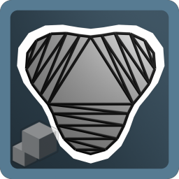

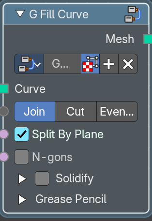

Fills a flat curve with triangles, or with one N-gon. It is the lightest fill and it keeps holes, so it is a good first choice for flat covers and for shapes that you solidify next. It triangulates the area inside the outline, and Overlaps decides how curves that cross or sit inside each other combine.

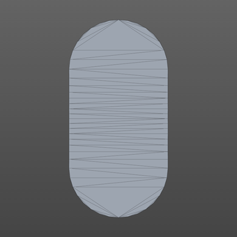

The picture shows a capsule filled with the default settings.

#### Inputs

This node has the [shared inputs](#shared-inputs) and the inputs below.

##### N-gons

Data type: Boolean.

Fill with one N-gon instead of triangles. Default: Off.

#### Outputs

##### Mesh

Data type: Geometry.

The filled mesh.

### Fill Curve Delaunay

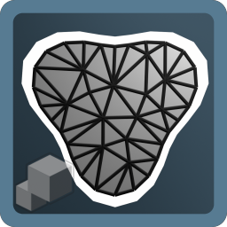

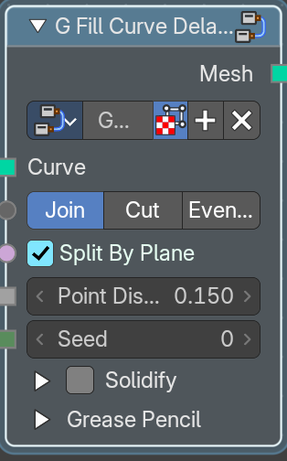

Fills a flat curve with even triangles. Points are scattered inside the outline and joined into triangles of about the same size, which gives a mesh that bends and sculpts evenly. Point Distance sets the spacing of the points, and Seed changes how they are scattered.

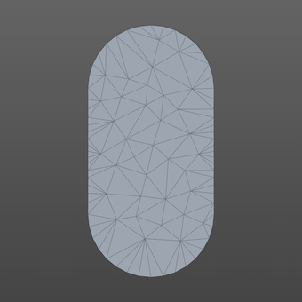

The picture shows a capsule filled with the default settings.

#### Inputs

This node has the [shared inputs](#shared-inputs) and the inputs below.

##### Point Distance

Data type: Float.

Spacing of the inner points. Smaller gives more, finer triangles. Default: 0.15.

##### Seed

Data type: Integer.

Changes the scatter of the inner points. Default: 0.

#### Outputs

##### Mesh

Data type: Geometry.

The filled mesh.

### Fill Curve Grid

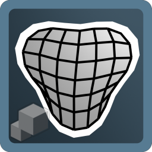

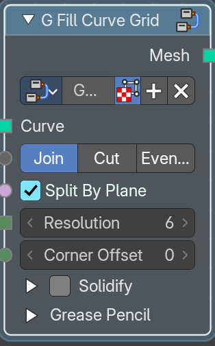

Fills one closed curve with a grid of quads. The outline is resampled and mapped on a square grid, which gives clean quad topology for shapes that are close to a square or a circle. Resolution sets the points along each side of the grid, and Corner Offset slides the four corners along the curve.

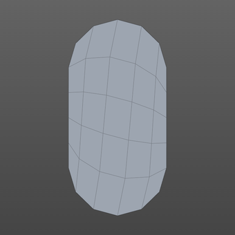

The picture shows a capsule filled with the default settings.

#### Inputs

This node has the [shared inputs](#shared-inputs) and the inputs below.

##### Resolution

Data type: Integer.

Points along each side of the grid. The outline is resampled to 4 x (Resolution - 1) points. Default: 6.

##### Corner Offset

Data type: Integer.

Slides the four grid corners along the curve, in points. Default: 0.

#### Outputs

##### Mesh

Data type: Geometry.

The filled mesh.

### Fill Curve Inset

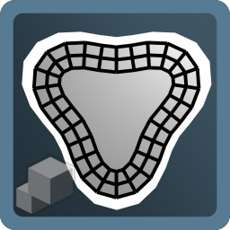

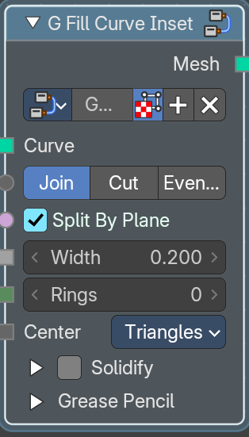

Fills a flat curve with bands of quads along the edge and a filled center. The edge loops follow the outline, which is useful for a clean border to bevel or to subdivide. Width and Rings set the band, and Center sets how the middle is filled.

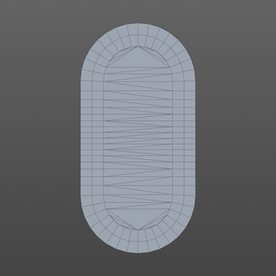

The picture shows a capsule filled with the default settings.

#### Inputs

This node has the [shared inputs](#shared-inputs) and the inputs below.

##### Width

Data type: Float.

Width of the band of quads along the edge. Points stop where they would meet, so narrow parts stay clean. Default: 0.2.

##### Rings

Data type: Integer.

Number of quad rings in the band. Default: 2.

##### Center

Data type: Menu.

How the middle is filled. Grid gives all quads but uses only the first curve, so holes are not kept. Options: Triangles, N-gon or Grid. Default: Triangles.

##### Resolution

Data type: Integer.

Points along each side of the center grid. Only used when Center is Grid. Default: 4.

#### Outputs

##### Mesh

Data type: Geometry.

The filled mesh.

### Fill Curve Quad

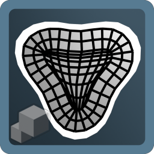

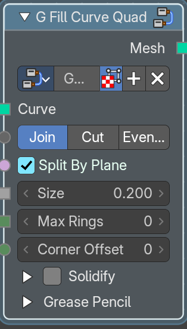

Fills a curve with even quads of a chosen size. Rings of quads grow from the edge, and they thin out until a grid closes the middle. Use it for an all-quad mesh with a size you control. Size sets the target size of the quads and Max Rings limits how many rings grow before the center is capped.

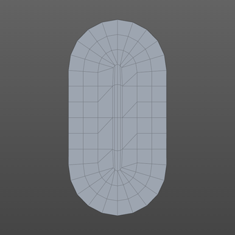

The picture shows a capsule filled with the default settings.

#### Inputs

This node has the [shared inputs](#shared-inputs) and the inputs below.

##### Size

Data type: Float.

Target size of the quads. Default: 0.15.

##### Max Rings

Data type: Integer.

Most rings to grow before the center is capped. Default: 12.

##### Corner Offset

Data type: Integer.

Slides the four grid corners along the curve, in points. Default: 0.

#### Outputs

##### Mesh

Data type: Geometry.

The filled mesh.

### Fill Curve Radial

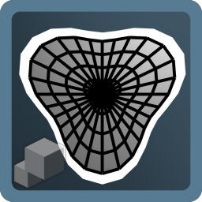

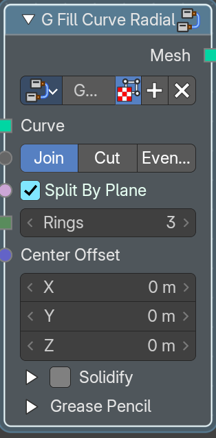

Fills a closed curve with rings of quads around a center point, like a spider web. It suits round shapes, disks and anything you want to scale in rings. Rings sets the number of rings and Center Offset moves the center away from the average of the curve points.

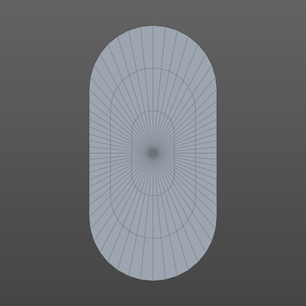

The picture shows a capsule filled with the default settings.

#### Inputs

This node has the [shared inputs](#shared-inputs) and the inputs below.

##### Rings

Data type: Integer.

Number of rings between the edge and the center. Default: 3.

##### Center Offset

Data type: Vector (translation).

Moves the center away from the average of the curve points. Default: (0, 0, 0).

#### Outputs

##### Mesh

Data type: Geometry.

The filled mesh.

### Fill Curve Wavefront

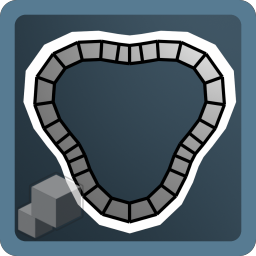

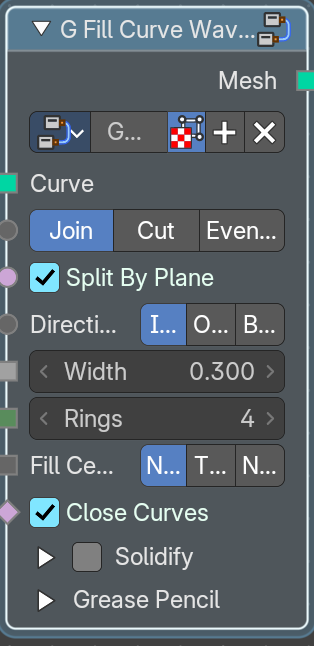

Grows rings of quads from a curve, inward, outward or both. Each ring is solved from the last one, like a wave that travels from the outline. Use it for borders, outlines with thickness and ribbons: with Close Curves off, an open stroke grows a ribbon of rings. Direction picks the way, Width is the total width of all rings and Rings is their number.

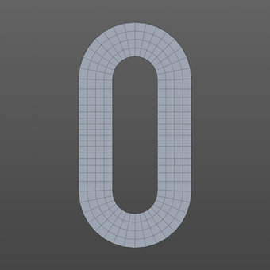

The picture shows a capsule filled with the default settings. Fill Center is None, so the middle stays open.

#### Inputs

This node has the [shared inputs](#shared-inputs) and the inputs below.

##### Direction

Data type: Menu.

Grow the rings inward from the curve, outward, or both. Options: Inset, Outset or Both. Default: Inset.

##### Width

Data type: Float.

Total width of the rings. Default: 0.3.

##### Rings

Data type: Integer.

Number of rings. Each ring is a full solve, so this is the main cost. Default: 4.

##### Fill Center

Data type: Menu.

Close the middle with triangles or one N-gon, or leave it open. On Outset this fills the area inside the curve. Options: None, Triangles or N-gon. Default: None.

##### Close Curves

Data type: Boolean.

Close open curves with a straight edge. Turn off to keep curves as drawn, so open strokes grow a ribbon of rings. Overlaps, Fill Center and the repair pass only apply to closed curves. Default: On.

#### Outputs

##### Mesh

Data type: Geometry.

The filled mesh.

## Operations

### Decimate Curve

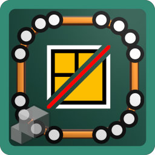

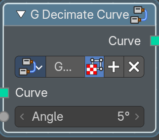

Removes points from a curve by angle. Straight runs reduce to their end points, while bends keep their detail. Use it to clean up a hand-drawn stroke or a dense curve before you fill it. It checks how much the curve turns at each point and removes the points that do not turn more than the Angle.

#### Inputs

##### Curve

Data type: Geometry.

The curve to simplify. Takes Curve, Curves or Grease Pencil objects.

##### Angle

Data type: Float (angle).

How much the curve may turn between kept points. Straight runs always reduce to their ends. Lower keeps more detail, higher removes more. Default: 5.002°.

#### Outputs

##### Curve

Data type: Geometry.

The simplified curve.

# Grease Pencil

_Assets in this category will be documented here._

# Material

_Assets in this category will be documented here._

# Mesh

The Mesh assets are in two catalogs: **Mesh › UV** and **Mesh › Operations**. The Operations assets, [Solidify](#solidify) and [Bevel Advanced](#bevel-advanced), change an existing mesh.

The UV assets write UV coordinates onto a mesh. Drag one onto an object from the Asset Shelf or the Asset Browser. Each picture shows the result on a checker texture, next to the UV layout.

## Camera UV

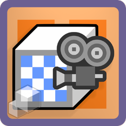

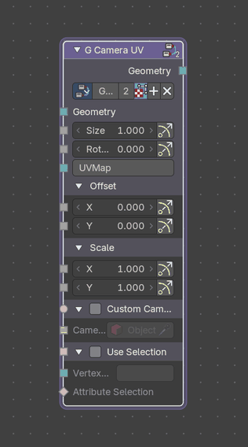

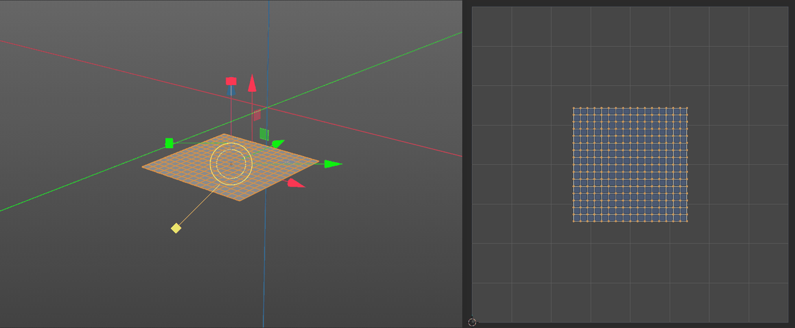

Creates UV coordinates by projecting the mesh through a camera. Use it to place a texture on an object as the camera sees it. Size, Rotation, Offset and Scale adjust the projection, and Custom Camera lets you choose another camera.

### Gizmos

The projection frame is drawn in the viewport and has gizmos:

- A **dial gizmo** sets the **Rotation**.
- **Linear gizmos** change the **Size** and the **Scale X** and **Scale Y** of the frame, and move it with **Offset X** and **Offset Y**.

### Inputs

#### Geometry

Data type: Geometry.

The mesh to create the UV coordinates for.

#### Size

Data type: Float.

Size of the UVs. Default: 1.

#### Rotation

Data type: Float.

The rotation of the UVs. Default: 0.

#### UV Name

Data type: String.

Defines the name of the UVMap to be referenced either on the mesh data or as an attribute in the material. Default: UVMap.

#### Offset

##### Offset X

Data type: Float.

Offset the UV in the X axis. Default: 0.

##### Offset Y

Data type: Float.

Offset the UV in the Y axis. Default: 0.

#### Scale

##### Scale X

Data type: Float.

Scale UVs in X. Default: 1.

##### Scale Y

Data type: Float.

Scale UVs in Y. Default: 1.

#### Custom Camera

##### Custom Camera

Data type: Boolean.

Turns the custom camera on or off. Default: Off.

##### Camera

Data type: Object.

Selects the Custom Camera object. Make sure this is a camera object.

#### Use Selection

##### Use Selection

Data type: Boolean.

Set UVs on a Vertex Group Selection. Default: Off.

##### Vertex Group

Data type: String.

The name of the Vertex Group to set UVs.

##### Attribute Selection

Data type: Boolean.

Or set the selection by attribute with a boolean on a domain. Default: Off.

### Outputs

#### Geometry

Data type: Geometry.

The mesh with the UV coordinates written to the UV map named by the UV Name or UV Map input.

## Cube UV

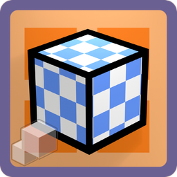

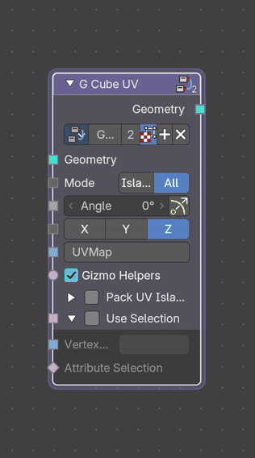

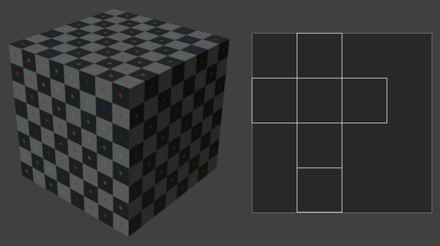

Creates cube projected UV coordinates, with each side of the box mapped flat. Mode switches between all islands and a single island chosen by Island Index. Axis and Angle turn the projection.

### Gizmos

The **Angle** input has a **dial gizmo** in the viewport on the selected island. Drag the dial to rotate the projection, instead of typing a number. Island Index decides which island shows the gizmo.

### Inputs

#### Geometry

Data type: Geometry.

The mesh to create the UV coordinates for.

#### Mode

Data type: Menu.

Toggles if the UV should evaluate on an individual island or all islands. Default: All.

#### Island Index

Data type: Integer.

The mesh Island Index. This defines where the gizmos will also draw. Default: 0.

#### Angle

Data type: Float.

Sets the angle of the projection. Default: 0°.

#### Axis

Data type: Menu.

Changes the active axis of the UV Projection. Default: Z.

#### UV Name

Data type: String.

Defines the name of the UVMap to be referenced either on the mesh data or as an attribute in the material. Default: UVMap.

#### Gizmo Helpers

Data type: Boolean.

Toggles helper gizmos made with Grease Pencil to assist tuning other gizmos. These will not render. Default: On.

#### Pack UV Islands

##### Pack UV Islands

Data type: Boolean.

Toggles UV Island Packing. Default: Off.

##### Margin

Data type: Float.

Adjusts the UV island margins. Default: 0.001.

##### Rotate

Data type: Boolean.

Toggles if the packing rotates UV Islands for a best fit. Default: Off.

##### Method

Data type: Menu.

The method of UV island packing. Default: Bounding Box.

#### Use Selection

##### Use Selection

Data type: Boolean.

Set UVs on a Vertex Group Selection. Default: Off.

##### Vertex Group

Data type: String.

The name of the Vertex Group to set UVs.

##### Attribute Selection

Data type: Boolean.

Or set the selection by attribute with a boolean on a domain. Default: Off.

### Outputs

#### Geometry

Data type: Geometry.

The mesh with the UV coordinates written to the UV map named by the UV Name or UV Map input.

## Cube UV Island

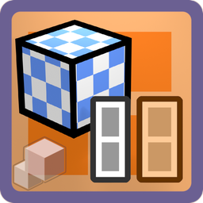

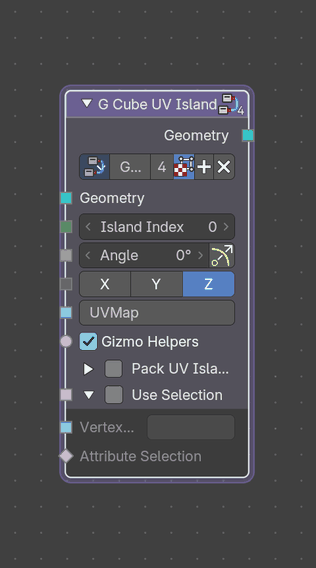

Creates cube projected UV coordinates on a single island. Island Index chooses the island. It works like Cube UV with Mode set to one island.

### Gizmos

The **Angle** input has a **dial gizmo** in the viewport on the selected island. Drag the dial to rotate the projection, instead of typing a number. Island Index decides which island shows the gizmo.

### Inputs

#### Geometry

Data type: Geometry.

The mesh to create the UV coordinates for.

#### Island Index

Data type: Integer.

The mesh Island Index. This defines where the gizmos will also draw. Default: 0.

#### Angle

Data type: Float (angle).

Sets the angle of the projection. Default: 0°.

#### Axis

Data type: Menu.

Changes the active axis of the UV Projection. Default: Z.

#### UV Name

Data type: String.

Defines the name of the UVMap to be referenced either on the mesh data or as an attribute in the material. Default: UVMap.

#### Gizmo Helpers

Data type: Boolean.

Toggles helper gizmos made with Grease Pencil to assist tuning other gizmos. These will not render. Default: On.

#### Pack UV Islands

##### Pack UV Islands

Data type: Boolean.

Toggles UV Island Packing. Default: Off.

##### Margin

Data type: Float.

Adjusts the UV island margins. Default: 0.001.

##### Rotate

Data type: Boolean.

Toggles if the packing rotates UV Islands for a best fit. Default: Off.

##### Method

Data type: Menu.

The method of UV island packing. Default: Bounding Box.

#### Use Selection

##### Use Selection

Data type: Boolean.

Set UVs on a Vertex Group Selection. Default: Off.

##### Vertex Group

Data type: String.

The name of the Vertex Group to set UVs.

##### Attribute Selection

Data type: Boolean.

Or set the selection by attribute with a boolean on a domain. Default: Off.

### Outputs

#### Geometry

Data type: Geometry.

The mesh with the UV coordinates written to the UV map named by the UV Name or UV Map input.

## Cut Cylinder UV

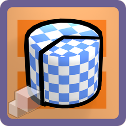

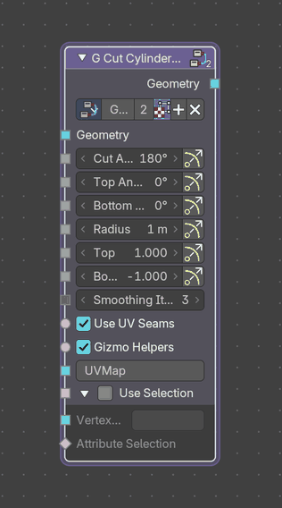

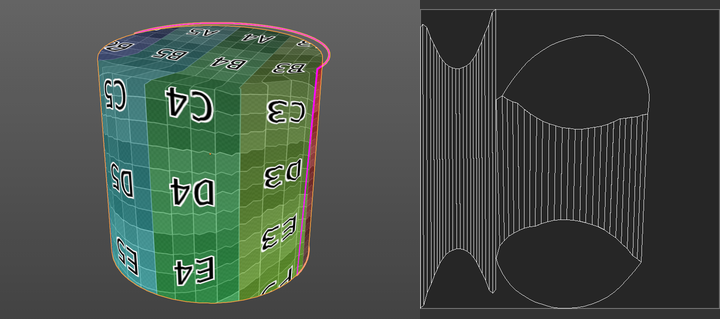

Creates cylinder projected UV coordinates by cutting the cylinder open. Cut Angle sets where the cut is made, and Top and Bottom set the limits of the projection. The side and the caps become separate islands.

### Gizmos

The projection cylinder is drawn in the viewport and can be tuned directly:

- **Linear gizmos** move **Top** and **Bottom** and change the **Radius**.
- **Dial gizmos** set the **Cut Angle**, **Top Angle** and **Bottom Angle**.

The example above uses a head, which is the typical use: cut the cylinder open at the back and the face unwraps in one piece.

### Inputs

#### Geometry

Data type: Geometry.

The mesh to create the UV coordinates for.

#### Cut Angle

Data type: Float (angle).

Adjusts the cut angle. Default: 180°.

#### Top Angle

Data type: Float (angle).

Adjusts the top angle of the cut. Default: 0°.

#### Bottom Angle

Data type: Float (angle).

Adjusts the bottom angle of the cut. Default: 0°.

#### Radius

Data type: Float (distance).

The radius of the Cylinder UV Projection. Default: 1.

#### Top

Data type: Float.

Moves the top limits of the UV Projection. Default: 1.

#### Bottom

Data type: Float.

Moves the bottom limits of the UV Projection. Default: -1.

#### Smoothing Iterations

Data type: Integer.

Number of iterations to run the SLIM solver for. Default: 3.

#### Use UV Seams

Data type: Boolean.

Use user marked UV seams in object Edit Mode. Default: On.

#### Gizmo Helpers

Data type: Boolean.

Toggles helper gizmos made with Grease Pencil to assist tuning other gizmos. These will not render. Default: On.

#### UV Name

Data type: String.

Defines the name of the UVMap to be referenced either on the mesh data or as an attribute in the material. Default: UVMap.

#### Use Selection

##### Use Selection

Data type: Boolean.

Set UVs on a Vertex Group Selection. Default: Off.

##### Vertex Group

Data type: String.

The name of the Vertex Group to set UVs.

##### Attribute Selection

Data type: Boolean.

Or set the selection by attribute with a boolean on a domain. Default: Off.

### Outputs

#### Geometry

Data type: Geometry.

The mesh with the UV coordinates written to the UV map named by the UV Name or UV Map input.

## Cylinder UV

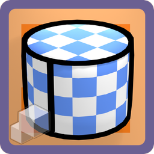

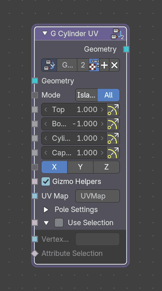

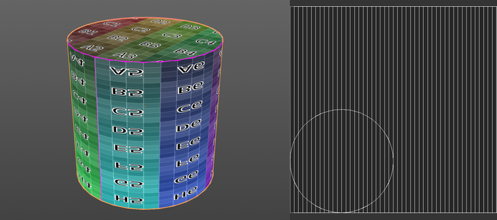

Creates cylinder projected UV coordinates, with the side and the caps scaled separately. Mode switches between all islands and a single island chosen by Island Index. Axis sets the direction of the cylinder.

### Gizmos

The projection can be tuned in the viewport with gizmos on the selected island:

- **Linear gizmos** move the **Top** and **Bottom** limits and scale the **Cylinder Scale** and **Cap Scale**.
- **Dial gizmos** (red, green, blue) rotate the projection around X, Y and Z. This is the same as the **Tilt** input.

### Inputs

#### Geometry

Data type: Geometry.

The mesh to create the UV coordinates for.

#### Mode

Data type: Menu.

Toggles if the UV should evaluate on an individual island or all islands. Default: All.

#### Island Index

Data type: Integer.

The mesh Island Index. This defines where the gizmos will also draw. Default: 0.

#### Top

Data type: Float.

Moves the top limits of the UV Projection. Default: 1.

#### Bottom

Data type: Float.

Moves the bottom limits of the UV Projection. Default: -1.

#### Cylinder Scale

Data type: Float.

Changes the scale of the side cylinder UV Projection. Default: 1.

#### Cap Scale

Data type: Float.

Changes the scale of the cylinder caps UV Projection. Default: 1.

#### Axis

Data type: Menu.

Changes the active axis of the UV Projection. Default: X.

#### Gizmo Helpers

Data type: Boolean.

Toggles helper gizmos made with Grease Pencil to assist tuning other gizmos. These will not render. Default: On.

#### UV Map

Data type: String.

Defines the name of the UVMap to be referenced either on the mesh data or as an attribute in the material. Default: UVMap.

#### Pole Settings

##### Pole Center

Data type: Vector.

Translates the axis pole center with an offset.

##### Tilt

Data type: Rotation.

Rotates and tilts the axis pole by degrees.

#### Use Selection

##### Use Selection

Data type: Boolean.

Set UVs on a Vertex Group Selection. Default: Off.

##### Vertex Group

Data type: String.

The name of the Vertex Group to set UVs.

##### Attribute Selection

Data type: Boolean.

Or set the selection by attribute with a boolean on a domain. Default: Off.

### Outputs

#### Geometry

Data type: Geometry.

The mesh with the UV coordinates written to the UV map named by the UV Name or UV Map input.

## Cylinder UV Island

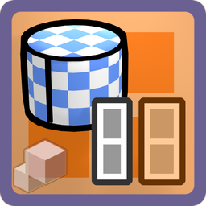

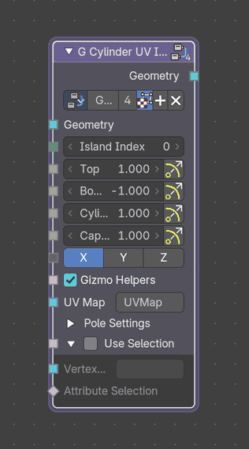

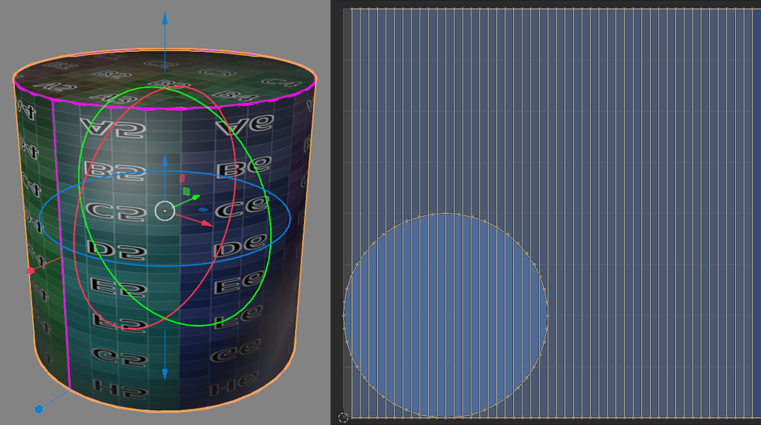

Creates cylinder projected UV coordinates on a single island. Island Index chooses the island. It works like Cylinder UV with Mode set to one island.

### Gizmos

The projection can be tuned in the viewport with gizmos on the selected island:

- **Linear gizmos** move the **Top** and **Bottom** limits and scale the **Cylinder Scale** and **Cap Scale**.
- **Dial gizmos** (red, green, blue) rotate the projection around X, Y and Z. This is the same as the **Tilt** input.

### Inputs

#### Geometry

Data type: Geometry.

The mesh to create the UV coordinates for.

#### Island Index

Data type: Integer.

The mesh Island Index. This defines where the gizmos will also draw. Default: 0.

#### Top

Data type: Float.

Moves the top limits of the UV Projection. Default: 1.

#### Bottom

Data type: Float.

Moves the bottom limits of the UV Projection. Default: -1.

#### Cylinder Scale

Data type: Float.

Changes the scale of the side cylinder UV Projection. Default: 1.

#### Cap Scale

Data type: Float.

Changes the scale of the cylinder caps UV Projection. Default: 1.

#### Axis

Data type: Menu.

Changes the active axis of the UV Projection. Default: X.

#### Gizmo Helpers

Data type: Boolean.

Toggles helper gizmos made with Grease Pencil to assist tuning other gizmos. These will not render. Default: On.

#### UV Map

Data type: String.

Defines the name of the UVMap to be referenced either on the mesh data or as an attribute in the material. Default: UVMap.

#### Pole Settings

##### Pole Center

Data type: Vector.

Translates the axis pole center with an offset.

##### Tilt

Data type: Rotation.

Rotates and tilts the axis pole by degrees.

#### Use Selection

##### Use Selection

Data type: Boolean.

Set UVs on a Vertex Group Selection. Default: Off.

##### Vertex Group

Data type: String.

The name of the Vertex Group to set UVs.

##### Attribute Selection

Data type: Boolean.

Or set the selection by attribute with a boolean on a domain. Default: Off.

### Outputs

#### Geometry

Data type: Geometry.

The mesh with the UV coordinates written to the UV map named by the UV Name or UV Map input.

## Generated UV

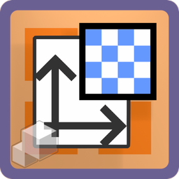

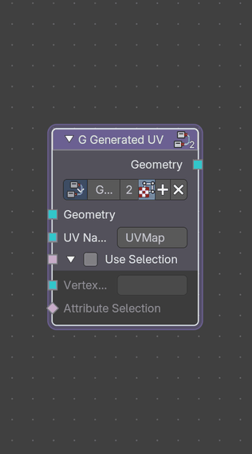

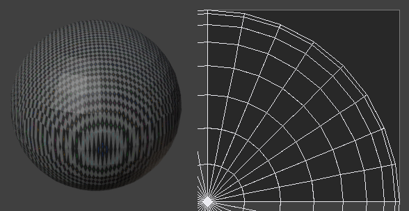

Creates the default generated UV coordinates for procedural meshes. It has no settings beyond the UV name and the selection.

### Inputs

#### Geometry

Data type: Geometry.

The mesh to create the UV coordinates for.

#### UV Name

Data type: String.

Defines the name of the UVMap to be referenced either on the mesh data or as an attribute in the material. Default: UVMap.

#### Use Selection

##### Use Selection

Data type: Boolean.

Set UVs on a Vertex Group Selection. Default: Off.

##### Vertex Group

Data type: String.

The name of the Vertex Group to set UVs.

##### Attribute Selection

Data type: Boolean.

Or set the selection by attribute with a boolean on a domain. Default: Off.

### Outputs

#### Geometry

Data type: Geometry.

The mesh with the UV coordinates written to the UV map named by the UV Name or UV Map input.

## Smart UV

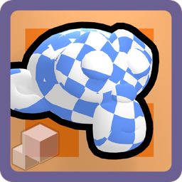

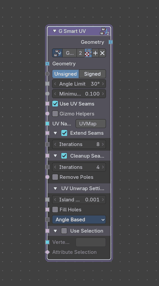

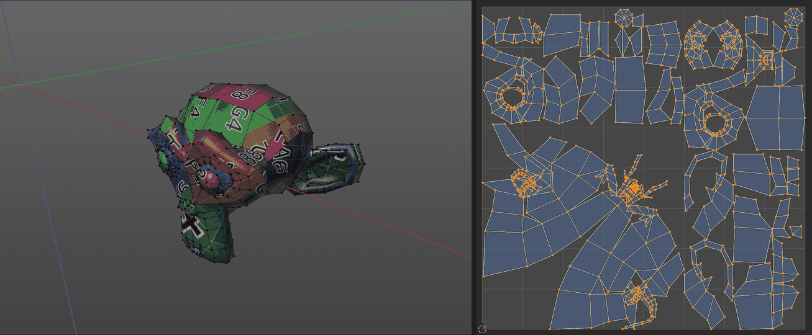

Creates smart projected UV coordinates. It uses signed angles to find seams on the edges, then unwraps the geometry into islands. Angle Limit and Minimum Edge Length decide which edges become seams.

### Inputs

#### Geometry

Data type: Geometry.

The mesh to create the UV coordinates for.

#### Mode

Data type: Menu.

The method the seams are detected on edges by angle. Default: Unsigned.

#### Angle Limit

Data type: Float (angle).

The detection angle for the seams for the auto-unwrap. Default: 30°.

#### Minimum Edge Length

Data type: Float.

The minimum length of each edge to qualify for the angle detection. Default: 0.1.

#### Use UV Seams

Data type: Boolean.

Use user marked UV seams in object Edit Mode. Default: On.

#### Gizmo Helpers

Data type: Boolean.

Toggles helper gizmos made with Grease Pencil to assist tuning other gizmos. These will not render. Default: Off.

#### UV Name

Data type: String.

Defines the name of the UVMap to be referenced either on the mesh data or as an attribute in the material. Default: UVMap.

#### Extend Seams

##### Extend Seams

Data type: Boolean.

Turns extending the seams on or off. Default: On.

##### Iterations

Data type: Integer.

Number of iterations of extended edges. Default: 8.

#### Cleanup Seams

##### Cleanup Seams

Data type: Boolean.

Turns cleaning up the seams on or off. Default: On.

##### Iterations

Data type: Integer.

Number of iterations to remove and cleanup small edges by iterations. Default: 4.

##### Remove Poles

Data type: Boolean.

Removes corner and pole edges. You can use a Vertex Group as an Attribute mask. Default: Off.

#### UV Unwrap Settings

##### Island Margin

Data type: Float.

Space between islands. Default: 0.001.

##### Fill Holes

Data type: Boolean.

Virtually fill holes in mesh before unwrapping, to better avoid overlaps and preserve symmetry. Default: Off.

##### Method

Data type: Menu.

The method of UV island packing. Default: Angle Based.

##### Iterations

Data type: Integer.

Number of iterations to run the SLIM solver to unwrap UVs. Default: 10.

#### Use Selection

##### Use Selection

Data type: Boolean.

Set UVs on a Vertex Group Selection. Default: Off.

##### Vertex Group

Data type: String.

The name of the Vertex Group to set UVs.

##### Attribute Selection

Data type: Boolean.

Or set the selection by attribute with a boolean on a domain. Default: Off.

### Outputs

#### Geometry

Data type: Geometry.

The mesh with the UV coordinates written to the UV map named by the UV Name or UV Map input.

## Sphere UV

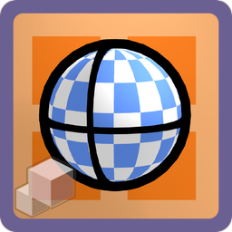

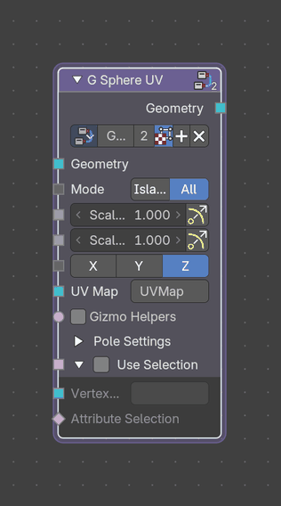

Creates sphere projected UV coordinates, with longitude and latitude. Mode switches between all islands and a single island chosen by Island Index. Axis sets the direction of the poles.

### Gizmos

The projection sphere is drawn in the viewport and has gizmos on the selected island:

- **Linear gizmos** change **Scale Longitude** and **Scale Latitude**.
- **Dial gizmos** (red, green, blue) rotate the projection around X, Y and Z. This is the same as the **Tilt** input.

### Inputs

#### Geometry

Data type: Geometry.

The mesh to create the UV coordinates for.

#### Mode

Data type: Menu.

Toggles if the UV should evaluate on an individual island or all islands. Default: All.

#### Island Index

Data type: Integer.

The mesh Island Index. This defines where the gizmos will also draw. Default: 0.

#### Scale Longitude

Data type: Float.

Scale the UV along the horizontal longitude axis. Default: 1.

#### Scale Latitude

Data type: Float.

Scale the UV along the vertical latitude axis. Default: 1.

#### Axis

Data type: Menu.

Changes the active axis of the UV Projection. Default: Z.

#### UV Map

Data type: String.

Defines the name of the UVMap to be referenced either on the mesh data or as an attribute in the material. Default: UVMap.

#### Gizmo Helpers

Data type: Boolean.

Toggles helper gizmos made with Grease Pencil to assist tuning other gizmos. These will not render. Default: Off.

#### Pole Settings

##### Pole Pinch

Data type: Boolean.

Pinches the pole to get cleaner UVs at the axis poles. Default: On.

##### Pole Center

Data type: Vector.

Translates the axis pole center with an offset.

##### Tilt

Data type: Rotation.

Rotates and tilts the axis pole by degrees.

#### Use Selection

##### Use Selection

Data type: Boolean.

Set UVs on a Vertex Group Selection. Default: Off.

##### Vertex Group

Data type: String.

The name of the Vertex Group to set UVs.

##### Attribute Selection

Data type: Boolean.

Or set the selection by attribute with a boolean on a domain. Default: Off.

### Outputs

#### Geometry

Data type: Geometry.

The mesh with the UV coordinates written to the UV map named by the UV Name or UV Map input.

## Sphere UV Island

Creates sphere projected UV coordinates on a single island. Island Index chooses the island. It works like Sphere UV with Mode set to one island.

### Gizmos

The projection sphere is drawn in the viewport and has gizmos on the selected island:

- **Linear gizmos** change **Scale Longitude** and **Scale Latitude**.
- **Dial gizmos** (red, green, blue) rotate the projection around X, Y and Z. This is the same as the **Tilt** input.

### Inputs

#### Geometry

Data type: Geometry.

The mesh to create the UV coordinates for.

#### Island Index

Data type: Integer.

The mesh Island Index. This defines where the gizmos will also draw. Default: 0.

#### Scale Longitude

Data type: Float.

Scale the UV along the horizontal longitude axis. Default: 1.

#### Scale Latitude

Data type: Float.

Scale the UV along the vertical latitude axis. Default: 1.

#### Axis

Data type: Menu.

Changes the active axis of the UV Projection. Default: Z.

#### UV Map

Data type: String.

Defines the name of the UVMap to be referenced either on the mesh data or as an attribute in the material. Default: UVMap.

#### Gizmo Helpers

Data type: Boolean.

Toggles helper gizmos made with Grease Pencil to assist tuning other gizmos. These will not render. Default: Off.

#### Pole Settings

##### Pole Pinch

Data type: Boolean.

Pinches the pole to get cleaner UVs at the axis poles. Default: On.

##### Pole Center

Data type: Vector.

Translates the axis pole center with an offset.

##### Tilt

Data type: Rotation.

Rotates and tilts the axis pole by degrees.

#### Use Selection

##### Use Selection

Data type: Boolean.

Set UVs on a Vertex Group Selection. Default: Off.

##### Vertex Group

Data type: String.

The name of the Vertex Group to set UVs.

##### Attribute Selection

Data type: Boolean.

Or set the selection by attribute with a boolean on a domain. Default: Off.

### Outputs

#### Geometry

Data type: Geometry.

The mesh with the UV coordinates written to the UV map named by the UV Name or UV Map input.

## Triplanar UV

Creates triplanar cube projected UV coordinates, with scaling that stays relative to the object. Translation, Rotation and Scale move the projection.

### Gizmos

The projection box is drawn in the viewport and has gizmos:

- **Linear gizmos** per axis move the box (**Translation**) and scale it (**Scale**). The white linear gizmo scales all three axes together.
- **Dial gizmos** (red, green, blue) set the **Rotation** around X, Y and Z.

### Inputs

#### Geometry

Data type: Geometry.

The mesh to create the UV coordinates for.

#### Relative Position

Data type: Boolean.

Toggles relative UV positions to world space or local space. Default: On.

#### Translation

Data type: Vector (translation).

Translates the triplanar UV projection in XYZ vectors.

#### Rotation

Data type: Rotation.

Rotates the triplanar UV projection.

#### Scale

Data type: Vector (XYZ).

Scales the triplanar UV projection.

#### Gizmo Helpers

Data type: Boolean.

Toggles helper gizmos made with Grease Pencil. These will not render. Default: On.

#### UV Name

Data type: String.

Defines the name of the UVMap to be referenced either on the mesh data or as an attribute in the material. Default: UVMap.

#### Pack UV Islands

##### Pack UV Islands

Data type: Boolean.

Toggles UV Island Packing. Default: Off.

##### Island Margin

Data type: Float.

Adjusts the UV island margins. Default: 0.001.

##### Rotate

Data type: Boolean.

Toggles if the packing rotates UV Islands for a best fit. Default: On.

##### Method

Data type: Menu.

The method of UV island packing. Default: Bounding Box.

#### Use Selection

##### Use Selection

Data type: Boolean.

Set UVs on a Vertex Group Selection. Default: Off.

##### Vertex Group

Data type: String.

The name of the Vertex Group to set UVs.

##### Attribute Selection

Data type: Boolean.

Or set the selection by attribute with a boolean on a domain. Default: Off.

### Outputs

#### Geometry

Data type: Geometry.

The mesh with the UV coordinates written to the UV map named by the UV Name or UV Map input.

_The Mesh Operations assets will be documented here._

## Solidify

Gives a mesh thickness, like the Solidify modifier, with a quick choice of side wall: straight, chamfered, rounded, inset or a bubbly remesh. Use it to turn a flat mesh, such as the result of a Fill node, into a solid. It pushes a second surface along the normals by the Thickness and closes the open edges with a rim.

The picture shows a filled rounded rectangle with Thickness 0.25 in the modes Straight, Chamfer, Round and Inset.

### Inputs

#### Mesh

Data type: Geometry.

The mesh to give thickness. This needs mesh data: fill curves first, or use the Solidify panel on a Fill node.

#### Mode

Data type: Menu.

Shape of the side wall. Options: Straight, Chamfer, Round, Inset or Bubbly. Default: Straight.

#### Thickness

Data type: Float.

Total thickness of the solid. Default: 0.2.

#### Offset

Data type: Float.

Which way the thickness grows. -1 grows behind the surface so it stays in place, 1 grows in front of it, and 0 grows equally both ways. Default: -1.

#### Even Thickness

Data type: Boolean.

Keep the same thickness at corners, like Even Thickness on the Solidify modifier. Default: On.

#### Factor

Data type: Float (factor).

Works like a mask for the thickness. 1 keeps the full Thickness, 0 leaves no thickness, and values in between taper it. Connect a vertex group or a painted attribute to control it across the surface. Default: 1.

#### Rim

Close the open edges of the surface with a side wall.

##### Fill Rim

Data type: Boolean.

Fill the gap between the two faces at open edges. Default: On.

##### Only Rim

Data type: Boolean.

Keep only the rim and remove both faces. Default: Off.

#### Thickness Clamp

Limit the thickness where it would collide with nearby geometry.

##### Clamp

Data type: Float.

Limit the offset to this many times the shortest edge at each vertex, so tight shapes do not cross themselves. 0 turns it off. Default: 0.

#### Normals

Control which way the surface faces.

##### Flip Normals

Data type: Boolean.

Flip the direction of the faces. Default: Off.

#### Profile

Shape of the side wall: bevel, segments and depth.

##### Bevel

Data type: Float.

Width of the chamfer, the rounding or the inset rim. Default: 0.05.

##### Segments

Data type: Integer.

Segments in each chamfered or rounded edge. Chamfers stay straight, so more segments only add edge loops. Rounds get smoother. Default: 3.

##### Loops

Data type: Integer.

Extra edge loops around the side wall. Default: 0.

##### Depth

Data type: Float.

How far the faces sit below the rim in Inset mode. Default: 0.05.

#### Bubbly

Remesh settings for the Bubbly mode.

##### Voxel Size

Data type: Float.

Detail of the Bubbly remesh. 0 picks a third of the Thickness. Smaller is much slower. Default: 0.

##### Smoothing

Data type: Float.

How round the shape gets, relative to Thickness. Higher is rounder and a little slower. Default: 0.6.

#### Materials

Material slots for the shell and the rim.

##### Material Offset

Data type: Integer.

Added to the material index of the new shell faces. Default: 0.

##### Rim Material Offset

Data type: Integer.

Added to the material index of the rim faces. Default: 0.

#### Grease Pencil

Options that only apply to Grease Pencil input.

##### Material

How Grease Pencil materials and colors carry over to the mesh.

###### Inherit Material

Data type: Boolean.

Keep the material and colors of the input mesh, such as a Grease Pencil fill. Otherwise, use the Material Override. Default: On.

###### Material Override

Data type: Material.

Use a custom material for the Grease Pencil fill mesh.

###### Use Shading

Data type: Boolean.

Turn on shading and shadows in the simple Grease Pencil material. Default: Off.

### Outputs

#### Mesh

Data type: Geometry.

The solid mesh.

#### Shell

Data type: Boolean.

The new faces, like the Shell Vertex Group of the modifier.

#### Rim

Data type: Boolean.

The rim faces, like the Rim Vertex Group of the modifier.

## Bevel Advanced

Bevels edges or vertices like the Bevel modifier, with extra controls: width types, limit by angle or weight, a profile, miters and shading, and overlap clamping built in. Use it to soften the hard edges of a mesh for a more realistic look. It cuts a chamfer of the given Amount along each chosen edge and splits it into Segments.

### Inputs

#### Mesh

Data type: Geometry.

The mesh to bevel.

#### Affect

Data type: Menu.

Bevel along edges, or round off corners at vertices. Options: Vertices or Edges. Default: Edges.

#### Width Type

Data type: Menu.

How Amount is measured. Offset is the distance along each face, Width is the size of the new bevel, Depth is how far it cuts in, and Percent is a share of the neighbouring edge. Options: Offset, Width, Depth or Percent. Default: Offset.

#### Amount

Data type: Float.

Size of the bevel, measured the way Width Type says. With Width Type Percent, this stops just before 50. Default: 0.1.

#### Segments

Data type: Integer.

How many pieces each bevel is split into. Higher is rounder. Default: 2.

#### Limit

Choose which edges get bevelled.

##### Limit Method

Data type: Menu.

Bevel every edge, only edges sharper than Angle, or scale each edge by a stored weight. Options: None, Angle or Weight. Default: Angle.

##### Angle

Data type: Float (angle).

Only bevel edges sharper than this. Default: 30°.

##### Weight Attribute

Data type: String.

Attribute that scales the bevel in Weight mode. Edges normally use bevel_weight_edge and vertices bevel_weight_vert. Default: bevel_weight_edge.

##### Selection

Data type: Boolean.

Only bevel what is selected here. Connect a vertex group or any mask. Default: On.

#### Profile

The shape of the bevel.

##### Profile Type

Data type: Menu.

Superellipse uses the Shape slider, and Custom uses a preset or your own curve. Options: Superellipse or Custom. Default: Superellipse.

##### Shape

Data type: Float (factor).

Profile curve of the bevel. 0.5 is round, lower is concave, higher is convex. Default: 0.5.

##### Preset

Data type: Menu.

Ready-made profiles matching the Bevel modifier, or Custom Curve to use your own. They look best with plenty of Segments. Options: Custom Curve, Support Loops, Cornice, Crown or Steps. Default: Custom Curve.

##### Custom Profile

Data type: Geometry.

Your own profile curve, drawn like the modifier: from (1, 0) to (0, 1) in X and Y, with (1, 1) at the original edge and (0, 0) on the inside.

#### Geometry

How corners are built.

##### Miter Outer

Data type: Menu.

Corners sticking outward where two bevelled edges meet. Sharp lets them meet in a point, Patch adds a small extra face, and Arc rounds them. Arc is built by bending the Patch, and with Shape above 0.5 or a Custom profile it stays closer to Patch. With Width Type Percent, Arc uses the Patch shape. Options: Sharp, Patch or Arc. Default: Sharp.

##### Miter Inner

Data type: Menu.

Corners folding inward where two bevelled edges meet. Sharp lets them meet in a point, and Arc rounds them using Spread. Options: Sharp or Arc. Default: Sharp.

##### Spread

Data type: Float.

How far an inner Arc miter spreads along the edges. Clamp Spread keeps it from poking out past the corner. Default: 0.1.

##### Clamp Spread

Data type: Boolean.

Keep Spread from going past Amount, so inner Arc miters do not poke out past the corner. Turn off to match the Bevel modifier. Default: On.

##### Clamp Overlap

Data type: Menu.

Keep the bevel from running past its neighbours. Minimum per Island limits each separate piece on its own, Minimum uses one size for the whole mesh, and Off leaves it free but it can turn inside-out. Options: Off, Minimum or Minimum per Island. Default: Minimum per Island.

#### Shading

Normals, marks and materials for the new faces.

##### Harden Normals

Data type: Boolean.

Keep the faces between bevels perfectly flat, and blend each bevel into the flat faces next to it. Default: Off.

##### Mark Sharp

Data type: Boolean.

Mark the outer edges of the bevel as sharp. Default: Off.

##### Mark Seam

Data type: Boolean.

Mark the outer edges of the bevel as UV seams. Default: Off.

##### Material Index

Data type: Integer.

Material slot for the new faces. -1 keeps the material of the neighbours. Default: -1.

#### Advanced

Controls the Bevel modifier does not have. At their defaults, the bevel is unchanged.

##### Amount Factor

Data type: Float.

Multiplies Amount per edge. Plug in a field or attribute to vary the width along the mesh. Edges at 0 are not beveled. Default: 1.

##### Side Bias

Data type: Float (factor).

Makes the bevel wider on one face and narrower on the other. Positive widens the upper face of each edge, negative the lower. Edges whose faces sit level, like the upright edges of a box, stay even. Outer Arc uses the Patch shape while this is on. Edges only. Default: 0.

##### Miter Selection

Data type: Boolean.

Vertices that can get a miter. Others stay sharp, whatever Miter Outer and Miter Inner are set to. Default: On.

### Outputs

#### Mesh

Data type: Geometry.

The beveled mesh.

#### Bevel Position

Data type: Float.

0 on the outer edge of the bevel, rising to 1 at the center, and 0 on the rest of the mesh. Handy for edge wear. Needs 2 or more segments. It is in the Advanced panel of the node.

#### Vertex Face

Data type: Boolean.

New faces at vertices. It is in the Selections panel of the node.

#### Edge Face

Data type: Boolean.

New faces along edges. It is in the Selections panel of the node.

#### Outer Edge

Data type: Boolean.

Outer edges of the new faces. It is in the Selections panel of the node.

#### Mid Edge

Data type: Boolean.

Edges between the segments. It is in the Selections panel of the node.

# Normals

## Smart Mesh Blend by Proximity

Adds an object that references a collection to merge all children mesh objects with blended normals and materials by proximity, through intersection distance and blur. This also displaces meshes at intersections.

This asset is ideal for smoothing transitions between intersecting surfaces, faking lighting continuity, or unifying shading across modular components.

> **Note:** In order to blend reliably, you will need topology to interpolate the blending. This means you will need to either subdivide, bevel or remesh your source meshes to blend smoothly. If you use only default cubes and a plane, it won't blend due to a lack of topology, but if you use a rounded subdivided cube with bevels and a grid, it will blend.

### Use: the Wizard

This contains a setup Wizard to begin.

1. **Drag and drop the asset** into the scene from the Asset Shelf or Asset Browser.
2. You will be prompted to select a **Target Collection**; this will then convert the target collection into driver objects.
3. Toggle optional **Bounds Display**, **Relative Position** and **Material Blending**. This will change and affect the Target Collection viewport display after applying. You can add or remove properties from the Target Collection by rerunning the Wizard and toggling the settings.
4. After confirming, this will create a new purple collection with a new Smart Mesh Blend by Proximity object. This is where the blended mesh is stored.
5. Change the settings by selecting the blended mesh and going to the Item tab in the Viewport Sidebar or the Modifier tab in the Properties Editor.

#### Asset Structure

- The **Blend Normals by Proximity object** is where the Geometry Nodes asset is stored. This is where the settings are stored.
- The **Purple collection** is where the asset is stored as a point of reference.
- The **Default Blend Collection** can be used as a reference if you have no Target Collection.

#### Wizard Options

##### Target Collection

Specifies the collection of the group of mesh objects used to influence the normal blending.

##### Apply Blend to Materials

This applies an intersection gradient alpha node group to the target collection object materials. This will iterate through all objects and materials and then apply the alpha at the Geometry Nodes intersection.

> **Note:** If you add new materials or objects to the target collection, re-running the wizard will re-apply to those new materials and objects.

If you toggle this option off and re-apply the Wizard, it will remove the Material Blend from all materials and objects in the target collection.

##### Use Relative Position

This will enable the relative position of the source target collection objects, making the new blended mesh snap to the original position. If you keep this off, the new blended mesh will spawn or move to its asset placement position.

##### Enable Bounds Display

This will turn on Bounds display for all the objects in the target collection, useful to remove any z-fighting normals when using a Relative Position on the new blended normals mesh object.

If you turn it off and re-run and re-apply the wizard, it will remove the Bounds display from all objects in the target collection.

> **Note:** If you add new objects to the target collection, re-running the wizard will re-apply the visibility settings on the new objects.

### Modifier Properties

#### Target Collection

Data type: Collection.

Specifies the group of objects used to influence the normal blending.

#### Normal Distance

Data type: Float.

Sets the range within which intersecting geometry will contribute to the normal blending by proximity process.

#### Relative Position

Data type: Boolean.

When enabled, calculates blending based on object-relative coordinates. Useful for maintaining orientation consistency with source objects from the target collection.

#### Process

Data type: Menu.

This defines how the blending evaluates the geometry.

- **Islands**: Evaluates the mesh islands. Default.
- **Instances**: Evaluates the instances.

#### Normal Blur

Optional secondary blur targeting only normals.

> **Note:** This only blurs normals at the intersections. Object normals are preserved.

##### Iterations

Data type: Integer.

Number of blur passes applied to normals.

##### Weight

Data type: Float (factor).

Strength of normals blur smoothing.

#### Material Blend

Settings for the material blend at the intersections.

##### Strength

Data type: Float.

Controls how strongly materials are blended at the intersections.

##### Offset

Data type: Float.

Shifts the blend region inward or outward from the intersection. Fine-tunes where the material transition begins.

##### Debug Intersections

Data type: Boolean.

Visualizes intersection zones for troubleshooting. Helpful for verifying blend boundaries or for using it to bake to a new texture.

##### Blur

Softens the material blend.

###### Iterations

Data type: Integer.

How many times the values are blurred.

###### Weight

Data type: Float (factor).

Relative mix weight of the neighboring elements.

##### Noise

Settings for the noise on the material blend.

###### Noise

Data type: Boolean.

Adds procedural noise to the blend region. Useful for organic or stylized transitions.

###### Noise Scale

Data type: Float.

Controls the scale of the noise pattern. Higher values produce larger, more visible noise features.

#### Intersection Displacement

Controls how intersection regions between meshes are offset and displaced before normal blending. Used to create bulges, dents, or organic merging effects.

##### Intersection Displacement

Data type: Boolean.

Enables geometry displacement at intersection zones.

##### Distance

Data type: Float.

The threshold for detecting intersections. This defines how far the geometry is displaced from its original surface.

##### Offset

Data type: Float.

Shifts the displacement region relative to the intersection. Moves vertices slightly to resolve overlap artifacts.

##### Blur

Softens the influence of blended normals across adjacent geometry.

###### Iterations

Data type: Integer.

Number of smoothing passes on the displacement.

###### Weight

Data type: Float (factor).

Intensity of smoothing. Higher values lead to broader averaging.

#### Intersection Removal

Settings for the intersection removal.

##### Intersection Removal

Data type: Boolean.

Turns the intersection removal on or off.

##### Threshold

Data type: Float.

The threshold of the intersection removal.

#### Material Override

Toggles material overrides; otherwise each object inherits its material from the target collection.

##### Material Override

Data type: Boolean.

Turns the material override on or off.

##### Material

Data type: Material.

Selects the material for the material override.

##### Inherit Material

Data type: Boolean.

This toggles the use of the material in the Material tab of the Properties editor as the override.

#### Info

Displays how many mesh islands are currently being blended. Useful for performance monitoring and debugging.

> **Note:** This may also show when the target collection is nested, or if there are not enough objects to blend.

# Primitives

Smart Primitives are shapes built with geometry nodes. Drag one into the scene from the Asset Shelf or the Asset Browser, then change it with the gizmos in the 3D Viewport or with its properties. Nothing is destructive until you apply it.

## Using the Gizmos

Select a Smart Primitive and its gizmos appear in the 3D Viewport. A gizmo is a handle you drag to change a setting without typing a number. The color and the shape tell you what a gizmo changes.

| Gizmo | Color | What it changes |
|---|---|---|
| 🟥 Square | 🔴🟢🔵 Red, green, blue (X, Y, Z) | 📏 Scales the primitive along that axis |
| ➡️ Arrow | 🔴🟢🔵 Red, green, blue (X, Y, Z) | 🔁 Loop resolution along that axis |
| ⭕ Circle | 🟡 Primary (yellow) | 🔄 Revolve Angle |
| 🟨 Square | 🟡 Primary (yellow) | 🔍 Scale All |
| ↗️ Arrow | 🟡 Primary (yellow) | 🌀 Bend the profile |
| ➡️ Arrow | 🔵 Secondary (cyan) | 🧊 Bevel Resolution |
| 🟦 Square | 🔵 Secondary (cyan) | 📐 Bevel Scale |

Not every primitive has every gizmo. Each asset below lists the gizmos it has.

## Properties and operators

Every Smart Primitive can also be changed with numbers, in the **Asset Properties** panel of the 3D View sidebar (**Item** tab) or in its Geometry Nodes modifier. The properties are grouped into top-level, bevel, resolution and UV properties. To turn Smart Primitives into regular meshes, use **Object › Apply**, with the Join, Boolean and Remesh options. Both are explained in [Default Library](default-library.md#using-the-sidebar-to-change-asset-properties).

## Basic Shapes

### Cube

A standard six-sided shape, great for solid modeling. Includes relative UVs and resolution gizmos.

This asset uses the **Smart Cube** node group.

#### Gizmos

- **Size**: 3
- **Loop resolution**: 3
- **Scale All**: 1

#### Inputs

##### Geometry

Data type: Geometry.

The geometry of the object that holds the modifier. The generated shape takes its material and its smooth shading from it.

##### X

Data type: Float (distance).

Changes the width of the primitive in unit sizes. Default: 2 m.

##### Y

Data type: Float (distance).

Changes the depth of the primitive in unit sizes. Default: 2 m.

##### Z

Data type: Float (distance).

Changes the height of the primitive in unit sizes. Default: 2 m.

##### Resolution

###### X

Data type: Integer.

Changes the horizontal resolution of the geometry edges/loops. Default: 3.

###### Y

Data type: Integer.

Changes the vertical resolution of the geometry edges/loops. Default: 3.

###### Z

Data type: Integer.

Changes the base resolution of the geometry edges/loops. Default: 3.

##### UVs

###### Relative

Data type: Boolean.

Creates a triplanar UV projection that is relative to object scale. Default: on.

#### Outputs

##### Geometry

Data type: Geometry.

The generated shape.

### Cube Rounded

A cube with softened edges for a more organic feel.

This asset uses the **Smart Cube Rounded** node group.

#### Gizmos

- **Size**: 3
- **Loop resolution**: 3
- **Bevel Scale**: 1
- **Bevel Resolution**: 1
- **Scale All**: 1

#### Inputs

##### Geometry

Data type: Geometry.

The geometry of the object that holds the modifier. The generated shape takes its material and its smooth shading from it.

##### X

Data type: Float (distance).

Changes the width of the primitive in unit sizes. Default: 2 m.

##### Y

Data type: Float (distance).

Changes the depth of the primitive in unit sizes. Default: 2 m.

##### Z

Data type: Float (distance).

Changes the height of the primitive in unit sizes. Default: 2 m.

##### Bevel

###### Bevel Amount

Data type: Float (percentage).

Changes the radius percentage of the bevel. Default: 50.

###### Resolution

Data type: Integer.

Changes the bevel geometry edges/loops resolution. Default: 3.

##### Resolution

###### X

Data type: Integer.

Changes the horizontal resolution of the geometry edges/loops. Default: 3.

###### Y

Data type: Integer.

Changes the vertical resolution of the geometry edges/loops. Default: 3.

###### Z

Data type: Integer.

Changes the base resolution of the geometry edges/loops. Default: 3.

#### Outputs

##### Geometry

Data type: Geometry.

The generated shape.

### Sphere

A perfect round primitive, ideal for smooth surfaces. Includes relative resolution controls.

This asset uses the **Smart Sphere** node group.

#### Gizmos

- **Scale All**: 1
- **Loop resolution**: 2
- **Bend profile**: 1

#### Inputs

##### Geometry

Data type: Geometry.

The geometry of the object that holds the modifier. The generated shape takes its material and its smooth shading from it.

##### Radius

Data type: Float (distance).

Changes the radius of the primitive in unit sizes. Default: 1 m.

##### Resolution

###### Horizontal

Data type: Integer.

Changes the horizontal resolution of the geometry edges/loops. Default: 16.

###### Vertical

Data type: Integer.

Changes the vertical resolution of the geometry edges/loops. Default: 32.

##### UVs

###### Relative

Data type: Boolean.

Creates a UV projection that is relative to object scale. Default: off.

#### Outputs

##### Geometry

Data type: Geometry.

The generated shape.

### Icosphere

A low-poly spherical shape made of triangles, great for optimization, with various levels of resolution.

This asset uses the **Smart Icosphere** node group.

#### Gizmos

- **Bend profile**: 1
- **Scale All**: 1

#### Inputs

##### Geometry

Data type: Geometry.

The geometry of the object that holds the modifier. The generated shape takes its material and its smooth shading from it.

##### Radius

Data type: Float (distance).

Changes the radius of the primitive in unit sizes. Default: 1 m.

##### Resolution

Data type: Integer.

Subdivisions of the icosphere. Default: 1.

##### UVs

###### Relative

Data type: Boolean.

Creates a UV projection that is relative to object scale. Default: on.

#### Outputs

##### Geometry

Data type: Geometry.

The generated shape.

### Cone

A tapered shape with a circular base, useful for pointed structures.

This asset uses the **Smart Cone** node group.

#### Gizmos

- **Size**: 2
- **Loop resolution**: 3

#### Inputs

##### Geometry

Data type: Geometry.

The geometry of the object that holds the modifier. The generated shape takes its material and its smooth shading from it.

##### Height

Data type: Float (distance).

Change the height of the primitive in unit sizes. Default: 2 m.

##### Radius

Data type: Float (distance).

Changes the radius of the primitive in unit sizes. Default: 1 m.

##### Resolution

###### Horizontal

Data type: Integer.

Changes the horizontal resolution of the geometry edges/loops. Default: 10.

###### Vertical

Data type: Integer.

Changes the vertical resolution of the geometry edges/loops. Default: 24.

###### Base

Data type: Integer.

Changes the base resolution of the geometry edges/loops. Default: 4.

#### Outputs

##### Geometry

Data type: Geometry.

The generated shape.

### Cone Rounded

A cone with a smoother, more organic tip.

This asset uses the **Smart Cone Rounded** node group.

#### Gizmos

- **Size**: 2
- **Loop resolution**: 3
- **Bevel Resolution**: 1
- **Bevel Scale**: 1

#### Inputs

##### Geometry

Data type: Geometry.

The geometry of the object that holds the modifier. The generated shape takes its material and its smooth shading from it.

##### Height

Data type: Float (distance).

Changes the height of the primitive in unit sizes. Default: 2 m.

##### Radius

Data type: Float (distance).

Changes the radius of the primitive in unit sizes. Default: 1 m.

##### Bevel

###### Radius

Data type: Float (percentage).

Changes the radius percentage of the bevel. The bevel will clamp to the horizontal resolution, less horizontal loops increases bevel maximum limit. Default: 25.

###### Resolution

Data type: Integer.

Changes the bevel geometry edges/loops resolution. Default: 3.

##### Resolution

###### Horizontal

Data type: Integer.

Changes the horizontal resolution of the geometry edges/loops. Default: 3.

###### Vertical

Data type: Integer.

Changes the vertical resolution of the geometry edges/loops. Default: 24.

###### Base

Data type: Integer.

Changes the base resolution of the geometry edges/loops. Default: 3.

#### Outputs

##### Geometry

Data type: Geometry.

The generated shape.

### Cylinder

A uniform circular primitive, essential for pipes and tubes.

This asset uses the **Smart Cylinder** node group.

#### Gizmos

- **Size**: 2
- **Loop resolution**: 3
- **Scale All**: 1

#### Inputs

##### Geometry

Data type: Geometry.

The geometry of the object that holds the modifier. The generated shape takes its material and its smooth shading from it.

##### Radius

Data type: Float (distance).

Changes the radius of the primitive in unit sizes. Default: 1 m.

##### Height

Data type: Float (distance).

Changes the height of the primitive in unit sizes. Default: 2 m.

##### Resolution

###### Horizontal

Data type: Integer.

Changes the horizontal resolution of the geometry edges/loops. Default: 5.

###### Vertical

Data type: Integer.

Changes the vertical resolution of the geometry edges/loops. Default: 24.

###### Base

Data type: Integer.

Changes the base resolution of the geometry edges/loops. Default: 3.

#### Outputs

##### Geometry

Data type: Geometry.

The generated shape.

### Cylinder Rounded

A cylinder with softened edges for better transitions.

This asset uses the **Smart Cylinder Rounded Revolved** node group. The same group is used by Cylinder Revolved, Cylinder Rounded Revolved; each asset starts from its own settings.

#### Gizmos

- **Revolve Angle**: 1
- **Size**: 2
- **Loop resolution**: 2
- **Bevel Resolution**: 1
- **Bevel Scale**: 1
- **Scale All**: 1

#### Inputs

##### Geometry

Data type: Geometry.

The geometry of the object that holds the modifier. The generated shape takes its material and its smooth shading from it.

##### Angle

Data type: Float (angle).

Changes the revolve angle in degrees. 360° closes the revolution. Default: 270°. This asset starts at 360°.

##### Height

Data type: Float.

Changes the height of the primitive in unit sizes. Default: 1.

##### Width

Data type: Float.

Changes the radius of the primitive in unit sizes. Default: 1.

##### Bevel

###### Radius

Data type: Float (percentage).

Changes the radius percentage of the bevel. Default: 25.

###### Resolution

Data type: Integer.

Changes the bevel geometry edges/loops resolution. Default: 4.

##### Resolution

###### Horizontal

Data type: Integer.

Changes the horizontal resolution of the geometry edges/loops. Default: 6.

###### Vertical

Data type: Integer.

Changes the vertical resolution of the geometry edges/loops. Default: 16.

###### Triangulate Center

Data type: Boolean.

Triangulates the center faces to remove NGONs. Default: on.

###### Triangulate All

Data type: Boolean.

Triangulates all faces. Default: off.

#### Outputs

##### Geometry

Data type: Geometry.

The generated shape.

### Tube

A hollow cylindrical primitive, great for mechanical parts.

This asset uses the **Smart Tube Revolved** node group. The same group is used by Tube Revolved; each asset starts from its own settings.

#### Gizmos

- **Revolve Angle**: 1
- **Size**: 2
- **Loop resolution**: 3
- **Scale All**: 1
- **Bevel Scale**: 1

#### Inputs

##### Geometry

Data type: Geometry.

The geometry of the object that holds the modifier. The generated shape takes its material and its smooth shading from it.

##### Angle

Data type: Float (angle).

Changes the revolve angle in degrees. 360° closes the revolution. Default: 270°. This asset starts at 360°.

##### Radius

Data type: Float (distance).

Changes the radius of the primitive in unit sizes. Default: 1 m.

##### Height

Data type: Float (distance).

Changes the height of the primitive in unit sizes. Default: 2 m.

##### Inner Radius

Data type: Float (percentage).

Changes the inner radius percentage. 100% is a full circle, meanwhile 0% is no inner radius. Default: 50.

##### Resolution

###### Horizontal

Data type: Integer.

Changes the horizontal resolution of the geometry edges/loops. Default: 6.

###### Vertical

Data type: Integer.

Changes the vertical resolution of the geometry edges/loops. Default: 16.

###### Base

Data type: Integer.

Changes the base resolution of the geometry edges/loops. Default: 2.

###### Triangulate Center

Data type: Boolean.

Triangulates the center faces to remove NGONs. Default: on.

###### Triangulate All

Data type: Boolean.

Triangulates all faces. Default: off.

#### Outputs

##### Geometry

Data type: Geometry.

The generated shape.

### Tube Rounded

A tube with smooth edges for a more natural look.

This asset uses the **Smart Tube Rounded Revolved** node group. The same group is used by Tube Rounded Revolved; each asset starts from its own settings.

#### Gizmos

- **Revolve Angle**: 1
- **Size**: 2
- **Loop resolution**: 3
- **Scale All**: 1
- **Bevel Scale**: 2
- **Bevel Resolution**: 1

#### Inputs

##### Geometry

Data type: Geometry.

The geometry of the object that holds the modifier. The generated shape takes its material and its smooth shading from it.

##### Angle

Data type: Float (angle).

Changes the revolve angle in degrees. 360° closes the revolution. Default: 270°. This asset starts at 360°.

##### Radius

Data type: Float (distance).

Changes the radius of the primitive in unit sizes. Default: 1 m.

##### Inner Radius

Data type: Float (percentage).

Changes the inner radius percentage. 100% is a full circle, meanwhile 0% is no inner radius. Default: 50.

##### Height

Data type: Float (distance).

Changes the height of the primitive in unit sizes. Default: 2 m.

##### Bevel

###### Radius

Data type: Float (distance).

Changes the radius percentage of the bevel. Default: 0.15 m.

###### Resolution

Data type: Integer.

Changes the bevel geometry edges/loops resolution. Default: 3.

##### Resolution

###### Horizontal

Data type: Integer.

Changes the horizontal resolution of the geometry edges/loops. Default: 6.

###### Vertical

Data type: Integer.

Changes the vertical resolution of the geometry edges/loops. Default: 16.

###### Base

Data type: Integer.

Changes the base resolution of the geometry edges/loops. Default: 2.

###### Triangulate Center

Data type: Boolean.

Triangulates the center faces to remove NGONs. Default: on.

###### Triangulate All

Data type: Boolean.

Triangulates all faces. Default: off.

#### Outputs

##### Geometry

Data type: Geometry.

The generated shape.

## Advanced Forms

### Capsule

A stretched sphere useful for stylized characters and smooth objects.

This asset uses the **Smart Capsule** node group.

#### Gizmos

- **Size**: 2
- **Loop resolution**: 3
- **Bevel Scale**: 1

#### Inputs

##### Geometry

Data type: Geometry.

The geometry of the object that holds the modifier. The generated shape takes its material and its smooth shading from it.

##### Height

Data type: Float (distance).

Changes the height of the primitive in unit sizes. Default: 1 m.

##### Radius

Data type: Float (distance).

Changes the radius of the primitive in unit sizes. Default: 0.5 m.

##### Cap

###### Resolution

Data type: Integer.

Changes the cap geometry edges/loops resolution. Default: 8.

###### Height

Data type: Float (factor).

Changes the height of the cap with a factor. Smaller values flattens the cap. Default: 1.

###### Corrective Tangent

Data type: Float (factor).

Controls the corrrective tangent of the cap. Tangent can be positive or negative. Useful to correct the cap shape. Default: 0.03.

##### Resolution

###### Horizontal

Data type: Integer.

Changes the horizontal resolution of the geometry edges/loops. Default: 16.

###### Vertical

Data type: Integer.

Changes the vertical resolution of the geometry edges/loops. Default: 6.

#### Outputs

##### Geometry

Data type: Geometry.

The generated shape.

### Capsule Revolved

A capsule rotated for unique geometry shaping. Includes the ability to revolve around an angle.

This asset uses the **Smart Capsule Revolved** node group.

#### Gizmos

- **Size**: 2
- **Loop resolution**: 3
- **Bevel Scale**: 1
- **Revolve Angle**: 1
- **Scale All**: 1

#### Inputs

##### Geometry

Data type: Geometry.

The geometry of the object that holds the modifier. The generated shape takes its material and its smooth shading from it.

##### Angle

Data type: Float (angle).

Changes the revolve angle in degrees. 360° closes the revolution. Default: 270°. This asset starts at 271.5°.

##### Height

Data type: Float (distance).

Changes the height of the primitive in unit sizes. Default: 1 m. This asset starts at 1.8 m.

##### Radius

Data type: Float (distance).

Changes the radius of the primitive in unit sizes. Default: 0.5 m.

##### Cap

###### Resolution

Data type: Integer.

Changes the cap geometry edges/loops resolution. Default: 8.

###### Height

Data type: Float (factor).

Control the cap height roundeness or flattness. Default: 1.

###### Corrective Tangent

Data type: Float (factor).

Controls the tangent of the roundness of the cap. Useful to correct the shape. Default: 0.03.

##### Resolution

###### Horizontal

Data type: Integer.

Changes the horizontal resolution of the geometry edges/loops. Default: 6.

###### Vertical

Data type: Integer.

Changes the vertical resolution of the geometry edges/loops. Default: 16.

###### Triangulate Center

Data type: Boolean.

Triangulates the center faces to remove NGONs. Default: on.

###### Triangulate All

Data type: Boolean.

Triangulates all faces. Default: off.

#### Outputs

##### Geometry

Data type: Geometry.

The generated shape.

### Grid

A flat subdivided plane useful for ground surfaces and mesh guides. Includes relative UVs.

This asset uses the **Smart Grid** node group.

#### Gizmos

- **Size**: 2
- **Loop resolution**: 2
- **Scale All**: 1

#### Inputs

##### Geometry

Data type: Geometry.

The geometry of the object that holds the modifier. The generated shape takes its material from it.

##### X

Data type: Float (distance).

Changes the width of the primitive in unit sizes. Default: 2 m.

##### Y

Data type: Float (distance).

Changes the height of the primitive in unit sizes. Default: 2 m.

##### Resolution

###### X

Data type: Integer.

Changes the horizontal resolution of the geometry edges/loops. Default: 5.

###### Y

Data type: Integer.

Changes the vertical resolution of the geometry edges/loops. Default: 5.

##### UVs

###### Relative

Data type: Boolean.

Creates a UV projection that is relative to object scale. Default: on.

#### Outputs

##### Geometry

Data type: Geometry.

The generated shape.

### Torus

A ring-shaped primitive, ideal for looped structures.

This asset uses the **Smart Torus** node group. The same group is used by Torus Revolved; each asset starts from its own settings.

#### Gizmos

- **Revolve Angle**: 2
- **Size**: 1
- **Bevel Scale**: 1
- **Loop resolution**: 2
- **Scale All**: 1

#### Inputs

##### Geometry

Data type: Geometry.

The geometry of the object that holds the modifier. The generated shape takes its material and its smooth shading from it.

##### Angle

Data type: Float (angle).

Changes the revolve angle in degrees. 360° closes the revolution. Default: 270°. This asset starts at 360°.

##### Radius

Data type: Float (distance).

Changes the radius of the primitive in unit sizes. Default: 1 m.

##### Thickness

Data type: Float (distance).

Changes the radius of the thickness. Default: 0.25 m.

##### Twist

Data type: Float (angle).

Controls the twist of the torus is not fully revolved. Default: 0°.

##### Resolution

###### Horizontal

Data type: Integer.

Changes the horizontal resolution of the geometry edges/loops. Default: 8.

###### Vertical

Data type: Integer.

Changes the vertical resolution of the geometry edges/loops. Default: 24.

###### Triangulate Caps

Data type: Boolean.

Triangulates the cap faces to remove NGONs. Default: off.

#### Outputs

##### Geometry

Data type: Geometry.

The generated shape.

### Torus Revolved

A torus rotated for specialized forms. Includes the ability to revolve around an angle.

This asset uses the **Smart Torus** node group. The same group is used by Torus; each asset starts from its own settings.

#### Gizmos

- **Revolve Angle**: 2
- **Size**: 1
- **Bevel Scale**: 1
- **Loop resolution**: 2
- **Scale All**: 1

#### Inputs

##### Geometry

Data type: Geometry.

The geometry of the object that holds the modifier. The generated shape takes its material and its smooth shading from it.

##### Angle

Data type: Float (angle).

Changes the revolve angle in degrees. 360° closes the revolution. Default: 270°.

##### Radius

Data type: Float (distance).

Changes the radius of the primitive in unit sizes. Default: 1 m.

##### Thickness

Data type: Float (distance).

Changes the radius of the thickness. Default: 0.25 m.

##### Twist

Data type: Float (angle).

Controls the twist of the torus is not fully revolved. Default: 0°.

##### Resolution

###### Horizontal

Data type: Integer.

Changes the horizontal resolution of the geometry edges/loops. Default: 8.

###### Vertical

Data type: Integer.

Changes the vertical resolution of the geometry edges/loops. Default: 24.

###### Triangulate Caps

Data type: Boolean.

Triangulates the cap faces to remove NGONs. Default: off.

#### Outputs

##### Geometry

Data type: Geometry.

The generated shape.

### Spiral

A coiled shape, useful for decorative and mechanical designs.

This asset uses the **Smart Spiral** node group.

#### Gizmos

- **Size**: 3
- **Revolve Angle**: 2
- **Bevel Scale**: 2
- **Scale All**: 1
- **Loop resolution**: 2
- **Bend profile**: 1

#### Inputs

##### Geometry

Data type: Geometry.

The geometry of the object that holds the modifier. The generated shape takes its material and its smooth shading from it.

##### Height

Data type: Float (distance).

Changes the height of the primitive in unit sizes. Default: 2 m.

##### Rotations

Data type: Float.

Changes the rotations amount of the spiral. Default: 3.

##### Start Radius

Data type: Float (distance).

Changes the start of the spiral radius. Default: 1 m.

##### End Radius

Data type: Float (distance).

Changes the end of the spiral radius. Default: 0.25 m.

##### Profile

###### Radius

Data type: Float (distance).

Changes the radius of the profile that is lofted on the spiral. Default: 0.2 m.

###### Taper

Data type: Float (factor).

Changes the taper of the spiral by a factor. Negative values thickens the end radius. Default: 0.

###### Twist

Data type: Float (angle).

Changes the tilt of the profile loft which creates a twist. Default: 0°.

##### Resolution

###### Horizontal

Data type: Integer.

Changes the horizontal resolution of the geometry edges/loops. Default: 12.

###### Vertical

Data type: Integer.

Changes the vertical resolution of the geometry edges/loops. Default: 32.

###### Triangulate Caps

Data type: Boolean.

Triangulates the cap faces to remove NGONs. Default: off.

##### UVs

###### Scale

Data type: Float.

Scale the UVs. Default: 2.

###### U Scale

Data type: Float.

Scale UV's on the U axis. Default: 0.

###### V Scale

Data type: Float.

Scale UV's on the V axis. Default: 0.

#### Outputs

##### Geometry

Data type: Geometry.

The generated shape.

### Circle

A simple 2D shape for base geometry and cutouts. Includes stamped or path based UVs.

This asset uses the **Smart Circle** node group.

#### Gizmos

- **Size**: 1
- **Bevel Scale**: 1
- **Loop resolution**: 2
- **Bevel Resolution**: 1

#### Inputs

##### Geometry

Data type: Geometry.

The geometry of the object that holds the modifier. The generated shape takes its material from it.

##### Outer Radius

Data type: Float (distance).

Changes the outer radius in unit sizes. Default: 1 m.

##### Inner Radius

Data type: Float (percentage).

Changes the inner radius percentage. 100% is a full circle, meanwhile 0% is no inner radius. Default: 50.

##### Inner Height

Data type: Float (factor).

Change the inner edge height offset. This is clamped to 1, but it is essentially limitless. Default: 0.

##### Resolution

###### Horizontal

Data type: Integer.

Changes the horizontal resolution of the geometry edges/loops. Default: 32.

###### Vertical

Data type: Integer.

Changes the vertical resolution of the geometry edges/loops. Default: 4.

##### UVs

###### Stamped UVs

Data type: Boolean.

Changes the UV's to stamped UV's, which is a flat top down projection. Otherwise, use path based UVs. Default: off.

#### Outputs

##### Geometry

Data type: Geometry.

The generated shape.

### Circle Revolved

A circular shape rotated into a 3D form. Includes the ability to revolve around an angle.

This asset uses the **Smart Circle Revolved** node group.

#### Gizmos

- **Size**: 1
- **Bevel Scale**: 1
- **Loop resolution**: 2
- **Revolve Angle**: 1
- **Bevel Resolution**: 1
- **Scale All**: 1

#### Inputs

##### Geometry

Data type: Geometry.

The geometry of the object that holds the modifier. The generated shape takes its material from it.

##### Angle

Data type: Float (angle).

Changes the revolve angle in degrees. 360° closes the revolution. Default: 270°.

##### Outer Radius

Data type: Float (distance).

Changes the outer radius in unit sizes. Default: 1 m.

##### Inner Radius

Data type: Float (percentage).

Changes the inner radius percentage. 100% is a full circle, meanwhile 0% is no inner radius. Default: 50.

##### Inner Height

Data type: Float (factor).

Change the inner edge height offset. This is clamped to 1, but it is essentially limitless. Default: 0.

##### Resolution

###### Horizontal

Data type: Integer.

Changes the horizontal resolution of the geometry edges/loops. Default: 32.

###### Vertical

Data type: Integer.

Changes the vertical resolution of the geometry edges/loops. Default: 4.

##### UVs

###### Stamped UVs

Data type: Boolean.

Changes the UV's to stamped UV's, which is a flat top down projection. Otherwise, use path based UVs. Default: off.

#### Outputs

##### Geometry

Data type: Geometry.

The generated shape.

### Curve Lofted

Generates complex surfaces using lofted curves with a central profile gizmo system. Includes taper, bend, swell and volume bevel controls.

This asset uses the **Smart Curve Lofted** node group.

#### Gizmos

- **Size**: 3
- **Loop resolution**: 3
- **Bevel Scale**: 2
- **Bevel Resolution**: 1
- **Scale All**: 1
- **Bend profile**: 1

#### Inputs

##### Geometry

Data type: Geometry.

The curve or Grease Pencil geometry of the object that holds the modifier. The shape is lofted along it when Custom Object is off. The generated shape also takes its material and its smooth shading from it.

##### Volume

Data type: Float.

Controls the volume of the lofted curve or grease pencil. Default: 2.

##### Tips

Data type: Float.

Changes the width of the tips of the loftes curve or grease pencil. Default: 0.

##### Bias

Data type: Float (factor).

Changes the bias of volume to the start or end of the curve or grease pencil. Default: 0.5.

##### Helper Gizmos

Data type: Boolean.

Toggles the custom object selector if you want to use a grease pencil or another curve object. Default: on.

##### Custom Object

###### Custom Object

Data type: Boolean.

Toggles the custom object selector if you want to use a grease pencil or another curve object. Default: off.

###### Curve Object

Data type: Object.

Chooses the custom object or grease pencil.

##### Profile

###### Width

Data type: Float.

Changes the width of the profile shape that is used to loft. Default: 1.

###### Depth

Data type: Float.

Changes the depth of the profile shape that is used to loft. Default: 0.72.

###### Swell

Data type: Float.

Changes the swell of the profile shape that is used to loft. Default: 0.

###### Bend

Data type: Float.

Changes the internal bend of the profile shape that is used to loft. Default: 0.

##### Resolution

###### Resolution Method

Data type: Menu.

Selects the resample method for horizontal resolution. Warning: length could be imperformant. Default: Count.

###### Length

Data type: Float (distance).

If the resolution method is by length, this creates a point per length distance unit. Default: 0.1 m.

###### Count

Data type: Integer.

If the resolution method is by count, this creates a total number of points per spline. Default: 10.

###### Vertical

Data type: Integer.

Changes the vertical resolution of the geometry edges/loops. Default: 5.

###### Depth

Data type: Integer.

Changes the depth resolution of the geometry edges/loops. Default: 2.

##### Bevel

###### Radius

Data type: Float (factor).

Changes the bevel radius factor. Warning: bevel could be imperformant. Default: 0.

###### Resolution

Data type: Integer.

Changes the resolution of the bevel. Default: 3. This asset starts at 2.

##### Smoothness

###### Inheriit

Data type: Boolean.

Inherits the normals smoothness settings of the Curve object. Warning: Grease Pencil objects do not have smoothness information to inherit. Default: off.

###### Smooth

Data type: Boolean.

Turns normals smoothness override on or off. Useful for Grease Pencil objects. Default: on.

#### Outputs

##### Geometry

Data type: Geometry.

The generated shape.

### Cylinder Revolved

A cylindrical shape rotated for varied effects. Includes the ability to revolve around an angle.

This asset uses the **Smart Cylinder Rounded Revolved** node group. The same group is used by Cylinder Rounded, Cylinder Rounded Revolved; each asset starts from its own settings.

#### Gizmos

- **Revolve Angle**: 1
- **Size**: 2
- **Loop resolution**: 2
- **Bevel Resolution**: 1
- **Bevel Scale**: 1
- **Scale All**: 1

#### Inputs

##### Geometry

Data type: Geometry.

The geometry of the object that holds the modifier. The generated shape takes its material and its smooth shading from it.

##### Angle

Data type: Float (angle).

Changes the revolve angle in degrees. 360° closes the revolution. Default: 270°. This asset starts at 270°.

##### Height

Data type: Float.

Changes the height of the primitive in unit sizes. Default: 1.

##### Width

Data type: Float.

Changes the radius of the primitive in unit sizes. Default: 1.

##### Bevel

###### Radius

Data type: Float (percentage).

Changes the radius percentage of the bevel. Default: 25. This asset starts at 0.

###### Resolution

Data type: Integer.

Changes the bevel geometry edges/loops resolution. Default: 4.

##### Resolution

###### Horizontal

Data type: Integer.

Changes the horizontal resolution of the geometry edges/loops. Default: 6.

###### Vertical

Data type: Integer.

Changes the vertical resolution of the geometry edges/loops. Default: 16.

###### Triangulate Center

Data type: Boolean.

Triangulates the center faces to remove NGONs. Default: on.

###### Triangulate All

Data type: Boolean.

Triangulates all faces. Default: off.

#### Outputs

##### Geometry

Data type: Geometry.

The generated shape.

### Cylinder Rounded Revolved

A rounded cylinder adapted for more curvature. Includes the ability to revolve around an angle.

This asset uses the **Smart Cylinder Rounded Revolved** node group. The same group is used by Cylinder Revolved, Cylinder Rounded; each asset starts from its own settings.

#### Gizmos

- **Revolve Angle**: 1
- **Size**: 2
- **Loop resolution**: 2
- **Bevel Resolution**: 1
- **Bevel Scale**: 1
- **Scale All**: 1

#### Inputs

##### Geometry

Data type: Geometry.

The geometry of the object that holds the modifier. The generated shape takes its material and its smooth shading from it.

##### Angle

Data type: Float (angle).

Changes the revolve angle in degrees. 360° closes the revolution. Default: 270°.

##### Height

Data type: Float.

Changes the height of the primitive in unit sizes. Default: 1.

##### Width

Data type: Float.

Changes the radius of the primitive in unit sizes. Default: 1.

##### Bevel

###### Radius

Data type: Float (percentage).

Changes the radius percentage of the bevel. Default: 25.

###### Resolution

Data type: Integer.

Changes the bevel geometry edges/loops resolution. Default: 4.

##### Resolution

###### Horizontal

Data type: Integer.

Changes the horizontal resolution of the geometry edges/loops. Default: 6.

###### Vertical

Data type: Integer.

Changes the vertical resolution of the geometry edges/loops. Default: 16.

###### Triangulate Center

Data type: Boolean.

Triangulates the center faces to remove NGONs. Default: on.

###### Triangulate All

Data type: Boolean.

Triangulates all faces. Default: off.

#### Outputs

##### Geometry

Data type: Geometry.

The generated shape.

### Tube Revolved

A tube rotated for improved modeling flexibility. Includes the ability to revolve around an angle.

This asset uses the **Smart Tube Revolved** node group. The same group is used by Tube; each asset starts from its own settings.

#### Gizmos

- **Revolve Angle**: 1
- **Size**: 2
- **Loop resolution**: 3
- **Scale All**: 1
- **Bevel Scale**: 1

#### Inputs

##### Geometry

Data type: Geometry.

The geometry of the object that holds the modifier. The generated shape takes its material and its smooth shading from it.

##### Angle

Data type: Float (angle).

Changes the revolve angle in degrees. 360° closes the revolution. Default: 270°.

##### Radius

Data type: Float (distance).

Changes the radius of the primitive in unit sizes. Default: 1 m.

##### Height

Data type: Float (distance).

Changes the height of the primitive in unit sizes. Default: 2 m.

##### Inner Radius

Data type: Float (percentage).

Changes the inner radius percentage. 100% is a full circle, meanwhile 0% is no inner radius. Default: 50.

##### Resolution

###### Horizontal

Data type: Integer.

Changes the horizontal resolution of the geometry edges/loops. Default: 6.

###### Vertical

Data type: Integer.

Changes the vertical resolution of the geometry edges/loops. Default: 16.

###### Base

Data type: Integer.

Changes the base resolution of the geometry edges/loops. Default: 2.

###### Triangulate Center

Data type: Boolean.

Triangulates the center faces to remove NGONs. Default: on.

###### Triangulate All

Data type: Boolean.

Triangulates all faces. Default: off.

#### Outputs

##### Geometry

Data type: Geometry.

The generated shape.

### Tube Rounded Revolved

A smoothed, rotated tube for streamlined designs. Includes the ability to revolve around an angle.

This asset uses the **Smart Tube Rounded Revolved** node group. The same group is used by Tube Rounded; each asset starts from its own settings.

#### Gizmos

- **Revolve Angle**: 1
- **Size**: 2
- **Loop resolution**: 3
- **Scale All**: 1
- **Bevel Scale**: 2
- **Bevel Resolution**: 1

#### Inputs

##### Geometry

Data type: Geometry.

The geometry of the object that holds the modifier. The generated shape takes its material and its smooth shading from it.

##### Angle

Data type: Float (angle).

Changes the revolve angle in degrees. 360° closes the revolution. Default: 270°.

##### Radius

Data type: Float (distance).

Changes the radius of the primitive in unit sizes. Default: 1 m.

##### Inner Radius

Data type: Float (percentage).

Changes the inner radius percentage. 100% is a full circle, meanwhile 0% is no inner radius. Default: 50.

##### Height

Data type: Float (distance).

Changes the height of the primitive in unit sizes. Default: 2 m.

##### Bevel

###### Radius

Data type: Float (distance).

Changes the radius percentage of the bevel. Default: 0.15 m.

###### Resolution

Data type: Integer.

Changes the bevel geometry edges/loops resolution. Default: 3.

##### Resolution

###### Horizontal

Data type: Integer.

Changes the horizontal resolution of the geometry edges/loops. Default: 6.

###### Vertical

Data type: Integer.

Changes the vertical resolution of the geometry edges/loops. Default: 16.

###### Base

Data type: Integer.

Changes the base resolution of the geometry edges/loops. Default: 2.

###### Triangulate Center

Data type: Boolean.

Triangulates the center faces to remove NGONs. Default: on.

###### Triangulate All

Data type: Boolean.

Triangulates all faces. Default: off.

#### Outputs

##### Geometry

Data type: Geometry.

The generated shape.

### Cone Rounded Revolved

A tapered primitive that blends sharpness with curvature. Includes the ability to revolve around an angle.

This asset uses the **Smart Cone Rounded Revolved** node group.

#### Gizmos

- **Size**: 2
- **Loop resolution**: 3
- **Bevel Resolution**: 1
- **Bevel Scale**: 1
- **Revolve Angle**: 1
- **Scale All**: 1

#### Inputs

##### Geometry

Data type: Geometry.

The geometry of the object that holds the modifier. The generated shape takes its material from it.

##### Angle

Data type: Float (angle).

Changes the revolve angle in degrees. 360° closes the revolution. Default: 270°.

##### Height

Data type: Float (distance).

Changes the height of the primitive in unit sizes. Default: 2 m.

##### Radius

Data type: Float (distance).

Changes the radius of the primitive in unit sizes. Default: 1 m.

##### Bevel

###### Radius

Data type: Float (percentage).

Changes the radius percentage of the bevel. The bevel will clamp to the horizontal resolution, less horizontal loops increases bevel maximum limit. Default: 25.

###### Resolution

Data type: Integer.

Changes the bevel geometry edges/loops resolution. Default: 3.

##### Resolution

###### Horizontal

Data type: Integer.

Changes the horizontal resolution of the geometry edges/loops. Default: 3.

###### Vertical

Data type: Integer.

Changes the vertical resolution of the geometry edges/loops. Default: 24.

###### Base

Data type: Integer.

Changes the base resolution of the geometry edges/loops. Default: 3.

###### Triangulate Center

Data type: Boolean.

Triangulates the center faces to remove NGONs. Default: on.

###### Triangulate All

Data type: Boolean.

Triangulates all faces. Default: off.

#### Outputs

##### Geometry

Data type: Geometry.

The generated shape.

### Sphere Revolved

A sphere adjusted through rotation for unique formations. Includes the ability to revolve around an angle.

This asset uses the **Smart Sphere Revolved** node group.

#### Gizmos

- **Revolve Angle**: 1
- **Scale All**: 1
- **Loop resolution**: 2
- **Bend profile**: 1

#### Inputs

##### Geometry

Data type: Geometry.

The geometry of the object that holds the modifier. The generated shape takes its material and its smooth shading from it.

##### Angle

Data type: Float (angle).

Changes the revolve angle in degrees. 360° closes the revolution. Default: 270°.

##### Radius

Data type: Float (distance).

Changes the radius of the primitive in unit sizes. Default: 1 m.

##### Resolution

###### Horizontal

Data type: Integer.

Changes the horizontal resolution of the geometry edges/loops. Default: 16.

###### Vertical

Data type: Integer.

Changes the vertical resolution of the geometry edges/loops. Default: 16.

###### Triangulate Center

Data type: Boolean.

Triangulates the center faces to remove NGONs. Default: on.

#### Outputs

##### Geometry

Data type: Geometry.

The generated shape.

# Utilities

_Assets in this category will be documented here._
