Shader node groups that come with Bforartists. Each asset has a thumbnail, a picture of the node, its inputs and outputs and a short how to use. Add them from the Asset Browser or the Add menu of the Shader Editor.

# Color

Assets for layering and halftone printing looks.

## Halftone Color

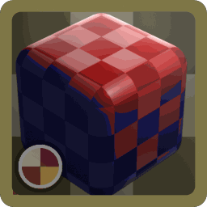

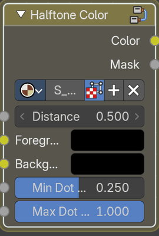

Colors a halftone pattern, sizing dots by brightness. Use with Halftone Pattern.

### Inputs

#### Distance

Data type: Float.

Connect the Distance output of Halftone Pattern. Default: 0.5.

#### Foreground

Data type: Color.

Image or color that sets dot color and size.

#### Background

Data type: Color.

Color between the dots.

#### Min Dot Size

Data type: Float (factor).

Dot size in the darkest areas. Default: 0.

#### Max Dot Size

Data type: Float (factor).

Dot size in the brightest areas. Default: 1.

### Outputs

#### Color

Data type: Color.

The colored halftone.

#### Mask

Data type: Float.

Black and white dots.

### How to use

Connect Distance from Halftone Pattern. Foreground and Background set the two colors, Min Dot Size and Max Dot Size set the range of the dots.

## Halftone Pattern

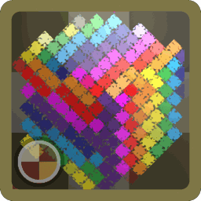

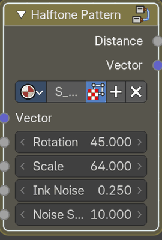

Halftone dot pattern with distance and vector outputs. Use with Halftone Color.

### Inputs

#### Vector

Data type: Vector.

Coordinates to use. Leave unconnected for automatic Object coordinates.

#### Rotation

Data type: Float.

Rotates the dot grid. Default: 45.

#### Scale

Data type: Float.

Number of dots. Higher values give more, smaller dots. Default: 64.

#### Ink Noise

Data type: Float.

Adds roughness to the dots. Default: 0.25.

#### Noise Scale

Data type: Float.

Size of the roughness. Default: 10.

### Outputs

#### Distance

Data type: Float.

Distance from each dot center. Connect to Halftone Color.

#### Vector

Data type: Vector.

The resulting vector.

### How to use

Connect a vector to Vector. Rotation turns the grid, Scale sets the size of the dots, Ink Noise and Noise Scale roughen the dots like printing ink. Connect Distance to Halftone Color.

## PBR-Simple Layer

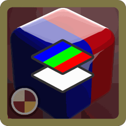

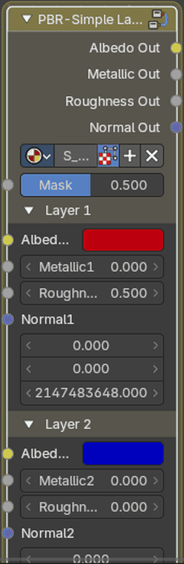

Layers a PBR material's color, roughness, metallic and normal.

### Inputs

#### Mask

Data type: Float (factor).

Layer Mask value input. Default: 0.5.

#### Layer 1

##### Albedo1

Data type: Color.

Albedo Layer 1 color input.

##### Metallic1

Data type: Float.

Metallic Layer 1 value input. Default: 0.

##### Roughness1

Data type: Float.

Roughness layer 1 value input. Default: 0.

##### Normal1

Data type: Vector.

Normal layer 1 vector input.

#### Layer 2

##### Albedo2

Data type: Color.

Albedo Layer 2 color input.

##### Metallic2

Data type: Float.

Metallic Layer 2 value input. Default: 0.

##### Roughness2

Data type: Float.

Roughness layer 2 value input. Default: 0.

##### Normal2

Data type: Vector.

Normal layer 2 vector input.

### Outputs

#### Albedo Out

Data type: Color.

Albedo color output.

#### Metallic Out

Data type: Float.

Metallic value output.

#### Roughness Out

Data type: Float.

Roughness value output.

#### Normal Out

Data type: Vector.

Normal vector output.

### How to use

Connect the maps of the first material to the inputs ending in 1 and those of the second to the inputs ending in 2. Mask decides where the second one shows. The outputs are the mixed maps.

# Mapping

Assets that create or change texture coordinates: projections, tiling, symmetry, warping and coordinate conversions. Connect their output to the Vector input of a texture.

## Advanced Tiling

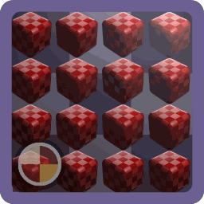

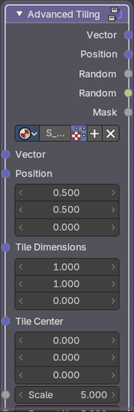

Repeats coordinates as tiles, with position, random and mask outputs.

### Inputs

#### Vector

Data type: Vector.

Coordinates to use. Leave unconnected for automatic Object coordinates.

#### Position

Data type: Vector.

Offset for the whole tile grid. Default: (0.5, 0.5, 0).

#### Tile Dimensions

Data type: Vector.

Width and height of each tile. Default: (1, 1, 0).

#### Tile Center

Data type: Vector.

Center point inside each tile.

#### Scale

Data type: Float.

Overall size of the tiles. Default: 5.

#### Repeat X

Data type: Float.

Number of tiles across. Default: 5.

#### Repeat Y

Data type: Float.

Number of tiles down. Default: 5.

#### Quincunx Flip

Data type: Float (factor).

Offset every other row, like a five on a die. Default: 0.

### Outputs

#### Vector

Data type: Vector.

The resulting vector.

#### Position

Data type: Vector.

Position of each tile.

#### Random

Data type: Float.

Random color for each item.

#### Random

Data type: Color.

Random color for each item.

#### Mask

Data type: Float.

White inside tiles, black outside.

### How to use

Repeats coordinates as tiles. Tile Dimensions and Tile Center set the tile, Repeat X and Repeat Y how often, Quincunx Flip flips every second tile. Vector is the new coordinate and Position, Random and Mask describe each tile.

## Axis Symmetry

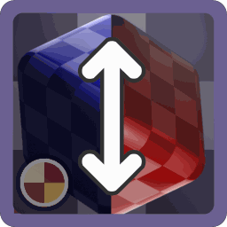

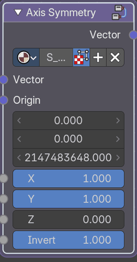

Mirrors coordinates across the X, Y or Z axis.

### Inputs

#### Vector

Data type: Vector.

Coordinates to use. Leave unconnected for automatic Object coordinates.

#### Origin

Data type: Vector.

Center of the mirror. Default: (0.5, 0.5, 0).

#### X

Data type: Float (factor).

Mirror across X. Default: 1.

#### Y

Data type: Float (factor).

Mirror across Y. Default: 1.

#### Z

Data type: Float (factor).

Mirror across Z. Default: 0.

#### Invert

Data type: Float (factor).

Swap which side is mirrored. Default: 1.

### Outputs

#### Vector

Data type: Vector.

The resulting vector.

### How to use

The coordinates are mirrored across the X, Y or Z axis: Origin sets the center, X, Y and Z choose the axes and Invert swaps the sides.

## Brick Mapping

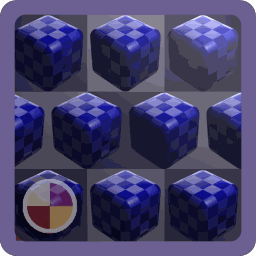

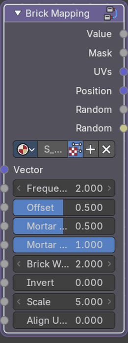

Brick layout with mask, UV, position and random outputs.

### Inputs

#### Vector

Data type: Vector.

Coordinates to use. Leave unconnected for automatic Object coordinates.

#### Frequency

Data type: Float.

How often rows are offset. Default: 2.

#### Offset

Data type: Float (factor).

How far each offset row shifts. Default: 0.5.

#### Mortar Size

Data type: Float (factor).

Width of the gaps between bricks. Default: 0.5.

#### Mortar Smooth

Data type: Float (factor).

Softness of the brick edges. Default: 1.

#### Brick Width

Data type: Float.

Width of each brick. Default: 2.

#### Invert

Data type: Float (factor).

Swap bricks and mortar. Default: 0.

#### Scale

Data type: Float.

Overall size of the bricks. Default: 5.

#### Align UVs to Brick Border

Data type: Float (factor).

Start each brick's UVs at its edge instead of its center. Default: 0.

### Outputs

#### Value

Data type: Float.

Smooth height of each brick.

#### Mask

Data type: Float.

White bricks with black mortar.

#### UVs

Data type: Vector.

UV coordinates inside each brick.

#### Position

Data type: Vector.

Position of each brick.

#### Random

Data type: Float.

Random color for each item.

#### Random

Data type: Color.

Random color for each item.

### How to use

A brick layout. Frequency and Brick Width set the rows, Offset shifts every second row, Mortar Size and Mortar Smooth set the joints. Value, Mask, UVs, Position and Random give shading, a sharp mask, a coordinate for each brick and random values.

## Distortion Blur

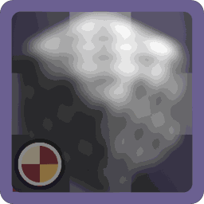

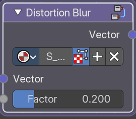

Blurs coordinates with random noise, for a grainy blur.

### Inputs

#### Vector

Data type: Vector.

Coordinates to use. Leave unconnected for automatic Object coordinates.

#### Factor

Data type: Float (factor).

Amount of blur. Default: 0.2.

### Outputs

#### Vector

Data type: Vector.

The resulting vector.

### How to use

Connect a vector to Vector. The coordinates are shaken with random noise, Factor sets how much. Use the result as the vector of a texture for a grainy blur.

## Equirectangular

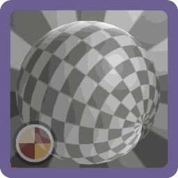

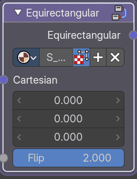

Converts 3D directions to equirectangular coordinates.

### Inputs

#### Cartesian

Data type: Vector.

Direction to convert, as X, Y and Z.

#### Flip

Data type: Float (factor).

Flip the result. Default: 1.

### Outputs

#### Equirectangular

Data type: Vector.

Equirectangular coordinates.

### How to use

Connect a 3D direction to Cartesian. The output is the matching position on an equirectangular (360° panorama) image. Flip mirrors the result.

## Flipbook

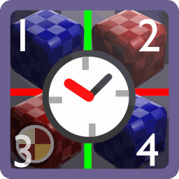

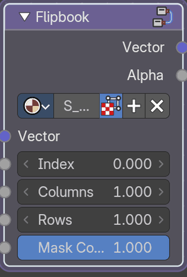

Plays frames from an image grid. Animate Index to play it.

### Inputs

#### Vector

Data type: Vector.

Coordinates to use. Leave unconnected for automatic Object coordinates.

#### Index

Data type: Float.

Which frame to show. Default: 0.

#### Columns

Data type: Float.

Number of columns in the image grid. Default: 1.

#### Rows

Data type: Float.

Number of rows in the image grid. Default: 1.

#### Mask Coordinates

Data type: Float (factor).

Hide everything outside the selected frame. Default: 1.

### Outputs

#### Vector

Data type: Vector.

A vector output, plug this into your Spritesheet.

#### Alpha

Data type: Float.

Mask of the selected frame.

### How to use

Connect an image sheet with frames in a grid. Columns and Rows set the grid and Index picks the frame, connect Scene Time to Index to animate it. Vector is the coordinate inside the frame and Alpha masks it.

## Gradient Warp Approx

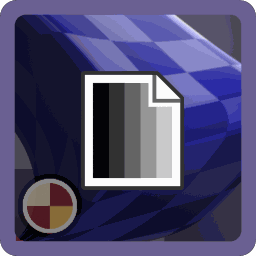

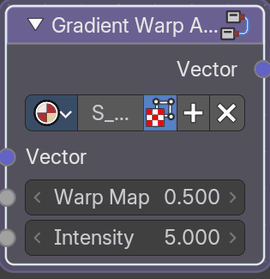

Warps coordinates with a map, as a fast approximation of a gradient warp.

### Inputs

#### Vector

Data type: Vector.

Coordinates to warp.

#### Warp Map

Data type: Float.

Grayscale map whose slopes push the coordinates. Default: 0.5.

#### Intensity

Data type: Float.

How strongly the map warps the coordinates. Default: 0.1.

### Outputs

#### Vector

Data type: Vector.

The warped coordinates.

### How to use

Connect a vector to Vector and a map to Warp Map. Intensity sets how strongly the map moves the coordinates.

## Mirror

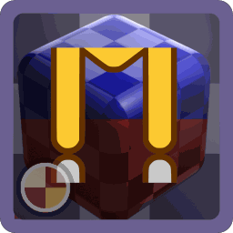

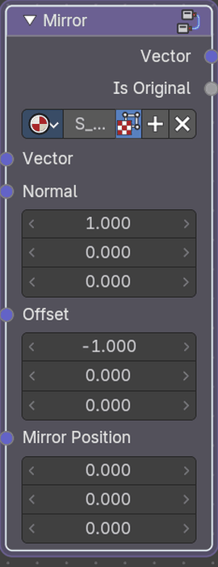

Mirrors coordinates across a line.

### Inputs

#### Vector

Data type: Vector.

Coordinates to use. Leave unconnected for automatic Object coordinates.

#### Normal

Data type: Vector.

Direction the mirror line faces. Default: (1, 0, 0).

#### Offset

Data type: Vector.

Moves the mirror line along its direction. Default: (-1, 0, 0).

#### Mirror Position

Data type: Vector.

A point the mirror line passes through.

### Outputs

#### Vector

Data type: Vector.

The resulting vector.

#### Is Original

Data type: Float.

White on the original side of the mirror, black on the mirrored side.

### How to use

Connect a vector to Vector. The coordinates are mirrored across a line: Normal is the direction of the line, Offset moves it and Mirror Position sets what is mirrored. Is Original is white on the side that was not mirrored.

## Object-World Normal

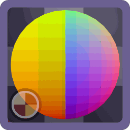

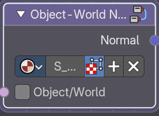

World and Object normals.

### Inputs

#### Object/World

Data type: Boolean.

Switches between object space and world space normals. Default: Off.

### Outputs

#### Normal

Data type: Vector.

The resulting normal.

### How to use

Object/World chooses the space. Connect the output to the Normal of a node that needs it.

## Parallax Mapping

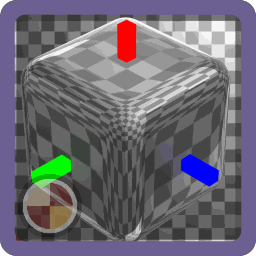

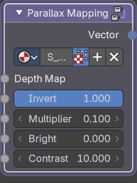

Fakes depth with a height map, by shifting the texture coordinates.

### Inputs

#### Depth Map

Data type: Float.

The depth of the parrallax set by a value input. Default: 1.

#### Invert

Data type: Float (factor).

Invert the parrallax efect. Default: 1.

#### Multiplier

Data type: Float.

Depth multiplier. Default: 0.1.

#### Bright

Data type: Float.

The brightness of the depth map. Default: 0.

#### Contrast

Data type: Float.

The copntrast of the depth map. Default: 10.

### Outputs

#### Vector

Data type: Vector.

A vector output, plug this into the vector input of an image.

### How to use

Connect a height image to Depth Map. Multiplier sets how deep it looks, Bright and Contrast adjust the map, Invert flips it. Use the output as the Vector of your textures.

## Polar-Cylindrical

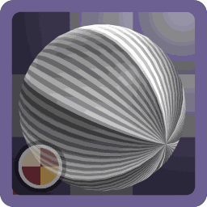

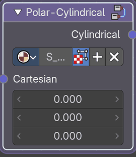

Converts X, Y, Z coordinates to polar coordinates, keeping Z.

### Inputs

#### Cartesian

Data type: Vector.

Coordinates to convert.

### Outputs

#### Cylindrical

Data type: Vector.

Radius, angle and height.

### How to use

Connect cartesian coordinates (X, Y, Z) to Cartesian. The output is the same position as polar coordinates in the XY plane, and Z stays as it is.

## Radial Symmetry 1

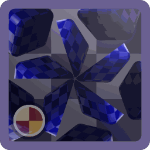

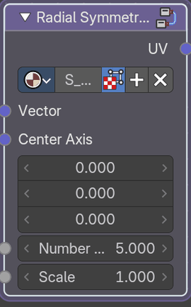

Repeats coordinates around a center, like a kaleidoscope.

### Inputs

#### Vector

Data type: Vector.

Coordinates to use. Leave unconnected for automatic Object coordinates.

#### Center Axis

Data type: Vector.

Center point of the repeat. Default: (0.5, 0.5, 0).

#### Number of Repetitions

Data type: Float.

How many times the image repeats around the center. Default: 3.

#### Scale

Data type: Float.

Scales the result. Default: 1.

### Outputs

#### UV

Data type: Vector.

The changed coordinates.

### How to use

Connect a vector to Vector. Space is repeated around Center Axis like a kaleidoscope, Number of Repetitions sets how often and Scale the size. UV is the result.

## Radial Symmetry 2

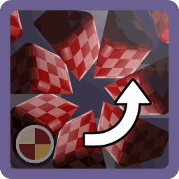

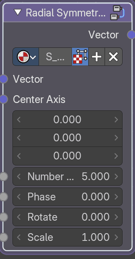

Repeats coordinates around a center, with phase and rotation.

### Inputs

#### Vector

Data type: Vector.

Coordinates to use. Leave unconnected for automatic Object coordinates.

#### Center Axis

Data type: Vector.

Center point of the repeat.

#### Number of Repetitions

Data type: Float.

How many times the image repeats around the center. Default: 5.

#### Phase

Data type: Float.

Shifts where the repeats begin. Default: 0.

#### Rotate

Data type: Float.

Rotates the whole result. Default: 0.

#### Scale

Data type: Float.

Scales the result. Default: 1.

### Outputs

#### Vector

Data type: Vector.

The resulting vector.

### How to use

Connect a vector to Vector. Space is repeated around Center Axis, Number of Repetitions sets how often, Phase and Rotate turn the copies and Scale sets the size. It is like Radial Symmetry 1 with more control.

## Spherical

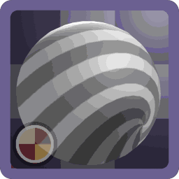

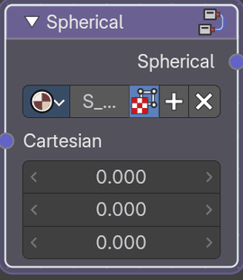

Converts X, Y, Z coordinates to spherical coordinates.

### Inputs

#### Cartesian

Data type: Vector.

Coordinates to convert.

### Outputs

#### Spherical

Data type: Vector.

Radius and the two angles.

### How to use

Connect cartesian coordinates (X, Y, Z) to Cartesian. The output is the same position as spherical coordinates: radius and two angles.

## Triplanar

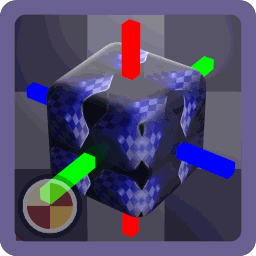

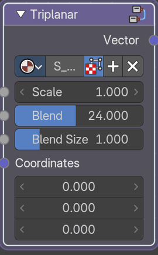

Projects a texture from three directions, so it needs no UV map.

### Inputs

#### Scale

Data type: Float.

Size of the projection. Default: 1.

#### Blend

Data type: Float (factor).

How much the projections blend where they meet. Default: 0.

#### Blend Size

Data type: Float (factor).

Width of the blend between projections. Default: 1.

#### Coordinates

Data type: Vector.

Coordinates to project. Use Object or Generated coordinates.

### Outputs

#### Vector

Data type: Vector.

Projected coordinates, for connecting to an image texture.

### How to use

Scale sets the size of the projection, Blend and Blend Size set how the three directions mix. Use the output as the Vector of a texture, or use Triplanar Coordinates and Triplanar Blend for more control.

## Triplanar Blend

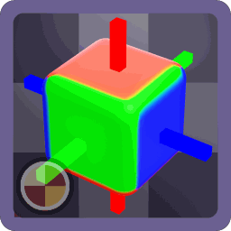

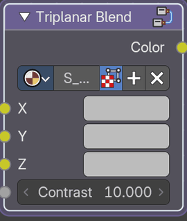

Mixes the three textures of a triplanar projection.

### Inputs

#### X

Data type: Color.

Color input of the X axis of the triplanar.

#### Y

Data type: Color.

Color input of the Y axis of the triplanar.

#### Z

Data type: Color.

Color input of the Z axis of the triplanar.

#### Contrast

Data type: Float.

Contrast of the triplanar blend. Default: 10.

### Outputs

#### Color

Data type: Color.

A colour output.

### How to use

Connect the three textures to X, Y and Z. Contrast sets how sharp the transition between the directions is.

## Triplanar Coordinates

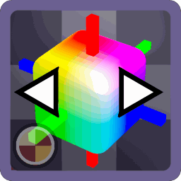

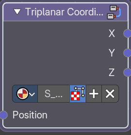

Makes the three coordinate sets (X, Y, Z) of a triplanar projection.

### Inputs

#### Position

Data type: Vector.

A vector position input.

### Outputs

#### X

Data type: Vector.

A planar X axis vector output.

#### Y

Data type: Vector.

A planar Y axis vector output.

#### Z

Data type: Vector.

A planar Z axis vector output.

### How to use

Connect Position to the object position. Use X, Y and Z as the vectors of three textures, then mix them with Triplanar Blend.

## Vector Pan

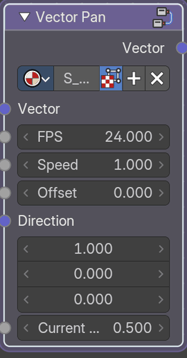

Scrolls coordinates over time.

### Inputs

#### Vector

Data type: Vector.

Coordinates to use. Leave unconnected for automatic Object coordinates.

#### FPS

Data type: Float.

Frames per second. Match the scene frame rate. Default: 24.

#### Speed

Data type: Float.

How fast the coordinates scroll. Default: 1.

#### Offset

Data type: Float.

Starting position of the scroll. Default: 0.

#### Direction

Data type: Vector.

Direction of the scroll. Default: (1, 0, 0).

#### Current Frame

Data type: Float.

Current frame. Animate it with keyframes or a driver. Default: 0.5.

### Outputs

#### Vector

Data type: Vector.

The resulting vector.

### How to use

Connect a vector to Vector. The coordinates scroll over time: Speed and Direction set the movement, FPS and Current Frame the timing, Offset a start position.

## Vector Pixelate

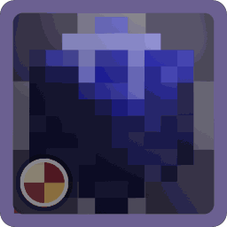

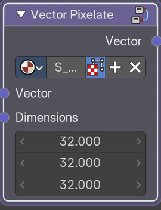

Snaps coordinates to a grid, for a pixelated look.

### Inputs

#### Vector

Data type: Vector.

Coordinates to use. Leave unconnected for automatic Object coordinates.

#### Dimensions

Data type: Vector.

Number of pixels across X and Y. Default: (32, 32, 32).

### Outputs

#### Vector

Data type: Vector.

The resulting vector.

### How to use

Connect a vector to Vector. The coordinates snap to a grid, Dimensions sets the number of cells, so what is drawn with this vector looks pixelated.

## Vector Skew

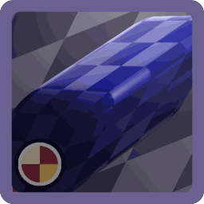

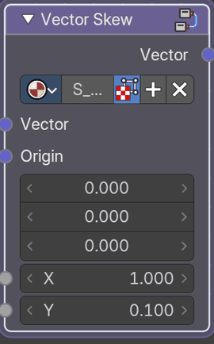

Slants coordinates along X and Y.

### Inputs

#### Vector

Data type: Vector.

Coordinates to use. Leave unconnected for automatic Object coordinates.

#### Origin

Data type: Vector.

Point that stays in place. Default: (0.5, 0.5, 0).

#### X

Data type: Float.

Amount of slant along X. Default: 0.

#### Y

Data type: Float.

Amount of slant along Y. Default: 0.

### Outputs

#### Vector

Data type: Vector.

The resulting vector.

### How to use

Connect a vector to Vector. The coordinates are slanted around Origin, X and Y set how far along each axis.

## Vector Whirl

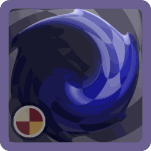

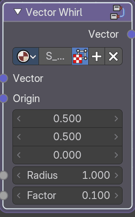

Twists coordinates around a point.

### Inputs

#### Vector

Data type: Vector.

Coordinates to use. Leave unconnected for automatic Object coordinates.

#### Origin

Data type: Vector.

Center of the whirl. Default: (0.5, 0.5, 0).

#### Radius

Data type: Float.

Size of the whirl. Default: 1.

#### Factor

Data type: Float.

Strength of the twist. Default: 0.1.

### Outputs

#### Vector

Data type: Vector.

The resulting vector.

### How to use

Connect a vector to Vector. The coordinates are twisted around Origin inside Radius, and Factor sets how strong the twist is. Use the result as the vector of a texture or pattern.

## Vector Zoom

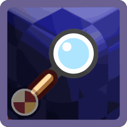

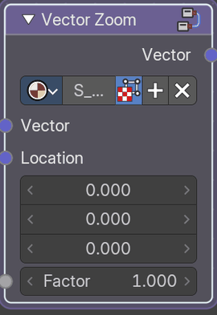

Zooms coordinates in or out around a point.

### Inputs

#### Vector

Data type: Vector.

Coordinates to use. Leave unconnected for automatic Object coordinates.

#### Location

Data type: Vector.

Point to zoom around.

#### Factor

Data type: Float.

Amount of zoom. Default: 1.

### Outputs

#### Vector

Data type: Vector.

The resulting vector.

### How to use

Connect a vector to Vector. Location is the point the zoom comes from and Factor is how far it zooms in or out. Use the result as the vector of a texture or pattern.

## Voronoi Distribute

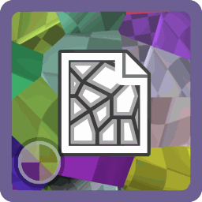

Scatters coordinates at random cell points, to place copies of an image.

### Inputs

#### Vector

Data type: Vector.

Coordinates to use. Leave unconnected for automatic Object coordinates.

#### Spawn Threshold (Mask)

Data type: Float (factor).

Hides some copies. Higher values hide more. Default: 0.5.

#### Rotation Limit

Data type: Float (factor).

Maximum random rotation. Default: 1.

#### Randomness

Data type: Float (factor).

How far copies move from a regular grid. Default: 1.

#### Scale Distribution

Data type: Float.

How much copy sizes vary. Default: 0.

#### Seed

Data type: Float.

Changes the random layout. Default: 11.

#### Scale

Data type: Float.

Overall size of the layout. Default: 1.

### Outputs

#### Vector

Data type: Vector.

The resulting vector.

#### Random

Data type: Float.

Random color for each item.

#### Random

Data type: Color.

Random color for each item.

### How to use

Space is cut into random cells and each cell gets its own coordinate, so a texture or image placed with this vector is repeated in different places. Spawn Threshold (Mask) leaves some cells empty, Rotation Limit and Scale Distribution vary the copies, Seed changes the layout.

## World Space

Gives the world space position as a vector.

### Outputs

#### Vector

Data type: Vector.

World Space vector output.

### How to use

Use the output as the Vector of a texture. The texture then stays fixed in the world and does not move with the object.

# Masks

Assets that make a mask from the shape of the object: edges, curvature and ambient occlusion. Use the mask to mix materials, for example to add wear on the edges.

## Beveled Edge - CYCLES

Procedural mask from Beveled Edges.

### Inputs

#### World Coordinates

Data type: Vector.

World Coordinates Vector for worldspace edge noise, vector input.

#### Strength

Data type: Float.

Overall strength of the mask. Default: 20.

#### Bevel

Data type: Float.

Radius of the bevel used to find edges. Default: 0.14.

#### Min

Data type: Float.

Darkest value of the mask. Default: 0.01.

#### Max

Data type: Float.

Brightest value of the mask. Default: 0.25.

#### Edge Noise

##### Factor

Data type: Float.

Amount of noise along the edges. Default: 1.

##### Scale

Data type: Float.

Size of the noise along the edges. Default: 20.

##### Roughness

Data type: Float.

Roughness of the noise along the edges. Default: 1.

##### Detail

Data type: Float.

Fine detail in the noise along the edges. Default: 2.

#### Edge Breakup

##### Factor

Data type: Float.

Amount of breakup of the edges. Default: 0.9.

##### Scale

Data type: Float.

Size of the breakup of the edges. Default: 1.

##### Roughness

Data type: Float.

Roughness of the breakup of the edges. Default: 0.

##### Detail

Data type: Float.

Fine detail in the breakup of the edges. Default: 0.

#### AO Mask

##### Factor

Data type: Float.

How much ambient occlusion reduces the mask. Default: 1.

##### Strength

Data type: Float.

Strength of the ambient occlusion. Default: 2.

##### Distance

Data type: Float.

How far ambient occlusion reaches. Default: 1.

##### Samples

Data type: Float.

Enter the nodegroup to change the samples. Default: 16.

### Outputs

#### Value

Data type: Float.

Smooth value of the pattern.

### How to use

Bevel sets the radius of the bevel. Strength, Min and Max shape the mask. World Coordinates switches the space, and the noise panels break it up. Value is the mask.

## Mask AO

Procedural mask from ambient occlusion.

### Inputs

#### Strength

Data type: Float.

Ambient occlusion streength factor. Default: 1.5.

#### Distance

Data type: Float.

Ambient occlusion distance factor. Default: 1.

#### Direction

Data type: Float.

Ambient occlusion direction factor, switches to inverse direction. Default: 0.

#### Normals

Data type: Vector.

Custom normals vector input.

#### Samples

Data type: Float.

Enter the nodegroup to change the samplesEnter the nodegroup to change the samples. Default: 0.

### Outputs

#### Value

Data type: Float.

Mask value output.

### How to use

Strength sets the effect, Distance how far it looks, Direction chooses inside or outside, Normals and Samples set the quality. Use it to darken or color the corners.

## Mask Curvature - CYCLES

Procedural mask from curvature, Cycles only.

### Inputs

#### In / Out

Data type: Boolean.

Direction of the curvature + pointiness. Inverts the direction. Default: Off.

#### Strength

Data type: Float.

Overall strength of the curvature. Default: 20.

#### Bevel

Data type: Float.

Strength of the bevel factor. Default: 0.02.

#### Curvature

Data type: Float.

Maximum strength of the pointiness factor. Default: 0.5.

#### World Coordinates

Data type: Vector.

World coordinates for the edge breakup noise, vector input.

#### Edge Break

##### Factor

Data type: Float.

Edge break factor. Default: 0.4.

##### Scale

Data type: Float.

Edge break scale factor. Default: 2.

##### Roughness

Data type: Float.

Edge break noise factor. Default: 0.

##### Detail

Data type: Float.

Edge detail factor. Default: 0.

#### AO Mask

##### Factor

Data type: Float.

Ambient occlusion mask factor. Default: 1.

##### Strength

Data type: Float.

Ambient occlusion mask strength factor. Default: 0.

##### Distance

Data type: Float.

Ambient occlusion mask distance factor. Default: 1.

##### Samples

Data type: Float.

Enter the nodegroup to change samples. Default: 16.

### Outputs

#### Value

Data type: Float.

Smooth value of the pattern.

### How to use

In / Out chooses inside or outside corners, Strength, Bevel and Curvature shape the mask, and the noise panels break it up. Value is the mask.

## Mask Hard Edge

Procedural mask from hard normal edges, works both in EEVEE and Cycles.

### Inputs

#### Strength

Data type: Float.

Strength of the hard edges value factor. Default: 50.

#### Min

Data type: Float.

Minimum hard edge value factor. Default: 0.05.

#### Max

Data type: Float.

Maximum hard edge value factor. Default: 0.5.

#### World Coordinates

Data type: Vector.

World coordinates for the edge breakup noise, vector input.

#### Edge Noise

##### Factor

Data type: Float.

Edge noise value factor. Default: 0.

##### Scale

Data type: Float.

Edge noise scale value factor. Default: 50.

##### Detail

Data type: Float.

Edge noise detail value factor. Default: 2.

##### Roughness

Data type: Float (factor).

Edge noise roughness value factor. Default: 1.

#### Edge Break

##### Factor

Data type: Float.

Edge break value factor. Default: 0.3.

##### Scale

Data type: Float.

Edge break noise scale value factor. Default: 20.

##### Roughness

Data type: Float (factor).

Edge break noise roughness value factor. Default: 0.

##### Detail

Data type: Float.

Edge break noise detail value factor. Default: 0.

#### AO Mask

##### Factor

Data type: Float.

Ambient occlusion mask value factor. Default: 0.

##### Strength

Data type: Float.

Ambient occlusion mask strength value factor. Default: 0.

##### Distance

Data type: Float.

Ambient occlusion mask distance value factor. Default: 1.

##### Samples

Data type: Float.

Enter the nodegroup to change the samples. Default: 16.

### Outputs

#### Value

Data type: Float.

Smooth value of the pattern.

### How to use

Strength, Min and Max shape the mask. World Coordinates switches the space, and the noise panels break up the edge. Value is the mask.

## Mask Local AO

Procedural mask from only local ambient occlusion.

### Inputs

#### Strength

Data type: Float.

Ambient occlusion streength factor. Default: 1.5.

#### Distance

Data type: Float.

Ambient occlusion distance factor. Default: 1.

#### Direction

Data type: Float.

Ambient occlusion direction factor, switches to inverse direction. Default: 0.

#### Normals

Data type: Vector.

Custom normals vector input.

#### Samples

Data type: Float.

Enter the nodegroup to change the samplesEnter the nodegroup to change the samples. Default: 16.

### Outputs

#### Value

Data type: Float.

Mask value output.

### How to use

Strength sets the effect, Distance how far it looks, Direction chooses inside or outside, Normals and Samples set the quality. Use it to darken or color the corners of one object.

## Mask Soft Edge - CYCLES

Procedural mask from soft edges, Cycles only.

### Inputs

#### Strength

Data type: Float.

Soft edge strength value factor. Default: 10.

#### Direction

Data type: Float.

Soft edge direction value factor. Inverts the direction. Default: 0.

#### Min

Data type: Float.

Soft edge minimum value factor. Default: 0.5.

#### Max

Data type: Float.

Soft edge maximum value factor. Default: 0.95.

#### World Coordinates

Data type: Vector.

World coordinates for the edge breakup noise, vector input.

#### Edge Noise

##### Factor

Data type: Float.

Edge noise value factor. Default: 1.

##### Scale

Data type: Float.

Edge noise scale value factor. Default: 10.

##### Roughness

Data type: Float.

Edge noise rougness value factor. Defines the noise detail. Higher values renders slower. Default: 1.

##### Detail

Data type: Float.

Edge noise detail value factor. Defines the noise detail. Higher values renders slower. Default: 2.

#### Edge Break

##### Factor

Data type: Float.

Edge break value factor. Default: 0.3.

##### Scale

Data type: Float.

Edge break noise scale value factor. Default: 3.

##### Roughness

Data type: Float.

Edge break noise rougness value factor. Defines the noise detail. Higher values renders slower. Default: 0.

##### Detail

Data type: Float.

Edge break noise detail value factor. Defines the noise detail. Higher values renders slower. Default: 0.

#### AO Mask

##### Factor

Data type: Float.

Ambient occlusion mask value factor. Default: 1.

##### Strength

Data type: Float.

Ambient occlusion mask strength value factor. Default: 2.

##### Distance

Data type: Float.

Ambient occlusion mask distance value factor. Default: 1.

### Outputs

#### Value

Data type: Float.

Smooth value of the pattern.

### How to use

Strength, Direction, Min and Max shape the mask. World Coordinates switches the space, and the noise panels break up the edge. Value is the mask.

## Raycast Edges

Procedural edge mask from Raycast Edges by using object, co-planar and normal edges.

### Inputs

#### Shader

Data type: Shader.

Optional. Overlays colored edges onto any shader. Place after your shader tree before the Material Output node.

#### Color

Data type: Color.

The color of the Shader edges overlay.

#### Width

Data type: Float.

General width of all the edges. If you want to change each individual edge type, use the width controls below. Default: 0.1.

#### Samples

Data type: Integer.

The amount of iterations to run the Ray Cast detection. Default: 8.

#### Object Edges

##### Object Edges

Data type: Boolean.

Include edges between different objects. Default: On.

##### Width

Data type: Float.

Width of the object intersection and silhouette edges. Default: 0.1.

#### Planar Edges

##### Planar Edges

Data type: Boolean.

Include edges between surfaces at different depths. Default: On.

##### Width

Data type: Float.

Width of the Planar Edges. Default: 0.1.

##### Threshold

Data type: Float.

Facomg angle threshold of the co-planar edges. Default: 0.5.

#### Normal Edges

##### Normal Edges

Data type: Boolean.

Include edges where the surface direction changes. Default: On.

##### Width

Data type: Float.

Width of the normal edges. Default: 0.1.

##### Threshold

Data type: Float.

Neighboring normal angle threshold of the normal edges. Default: 0.2.

### Outputs

#### Shader

Data type: Shader.

Optional. The output of the overlayed edges onto the shader. Place after your shader tree before the Material Output node.

#### Color

Data type: Color.

The color output of the edges mixed over black.

#### Value

Data type: Float.

Combined edges output value that can be used as a mask.

#### Object Edges

Data type: Float.

Object edges output value.

#### Planar Edges

Data type: Float.

Planar edges output value.

#### Normal Edges

Data type: Float.

Normal edges output value.

### How to use

Connect a shader to Shader and a color to Color. Each of Object Edges, Planar Edges and Normal Edges has its own width and threshold. Samples sets the quality. Value is the combined mask.

# Shader

Assets that choose between shaders.

## Select Shader

Picks one of four shaders by index.

### Inputs

#### Base

Data type: Shader.

The base shader input.

#### Index

Data type: Float.

The shader selection index, best used as integers. Default: 1.

#### Counter

Data type: Integer.

The counter offset of the shader index. Default: 0.

#### Shader 1

Data type: Shader.

First shader selection.

#### Shader 2

Data type: Shader.

Second shader selection.

#### Shader 3

Data type: Shader.

Third shader selection.

#### Shader 4

Data type: Shader.

Fourth shader selection.

### Outputs

#### Shader

Data type: Shader.

A shader output.

#### Index

Data type: Float.

An index output passthrough, best used as integers.

#### Counter

Data type: Float.

A counter offset passthrough output, best used as integers.

### How to use

Connect an integer to Index. The shader with that number (1 to 4) is the output, and every other index gives Base. Counter keeps count of the steps.

## Select Shader (ID Map)

Picks one of four shaders from an ID map.

### Inputs

#### Shader

Data type: Shader.

The base Shader input.

#### ID Map

Data type: Color.

The ID Map input to select the shader by color.

#### Threshold

Data type: Float (percentage).

The color threshold for the ID Map. Default: 0.5.

#### Contrast

Data type: Float (percentage).

The color contrast for the ID Map. Default: 1.

#### Color1

Data type: Color.

ID Color 1 input to mask Shader 1.

#### Shader1

Data type: Shader.

Shader 1 input.

#### Color2

Data type: Color.

ID Color 2 input to mask Shader 2.

#### Shader2

Data type: Shader.

Shader 2 input.

#### Color3

Data type: Color.

ID Color 3 input to mask Shader 3.

#### Shader3

Data type: Shader.

Shader 3 input.

#### Color4

Data type: Color.

ID Color 4 input to mask Shader 4.

#### Shader4

Data type: Shader.

Shader 4 input.

### Outputs

#### Shader

Data type: Shader.

A shader output.

#### ID Map

Data type: Color.

The ID Map passthrough output.

#### Threshold

Data type: Float (factor).

The threshold float passthrough output.

#### Contrast

Data type: Float (factor).

The contrast float passthrough output.

### How to use

Connect a base to Shader and an ID map to ID Map. Color1 to Color4 are the colors in the map and Shader1 to Shader4 the shaders for them. Threshold and Contrast set how exact the colors must match.

# Texture / Patterns

Assets that make procedural patterns from a vector. Connect the UV output of a Texture Coordinate node to Vector.

## Cross Wave

Creates a pattern with vector coordinates and settings with multiple outputs.

### Inputs

#### Vector

Data type: Vector.

Coordinates to use. Leave unconnected for automatic Object coordinates.

#### Direction

Data type: Vector.

Direction of the pattern. Default: (1, 1, 0).

#### Scale

Data type: Float.

The scale of the pattern. Default: 10.

### Outputs

#### Metric 1

Data type: Float.

Wave pattern using distance metric 1.

#### Metric 2

Data type: Float.

Wave pattern using distance metric 2.

#### Metric 3

Data type: Float.

Wave pattern using distance metric 3.

#### Metric 4

Data type: Float.

Wave pattern using distance metric 4.

### How to use

Connect a vector, for example the UV output of a Texture Coordinate node, to Vector. Crossing waves in a pattern. Direction rotates them and Scale sets their size. The four Metric outputs give different shapes of the same pattern.

The asset with default values on a plane, with the UV coordinates of the plane mapped from -1.6 to 1.6 in X and -1 to 1 in Y:

## Generalized Checker

Creates a pattern with vector coordinates and settings with multiple outputs.

### Inputs

#### Vector

Data type: Vector.

Coordinates to use. Leave unconnected for automatic Object coordinates.

#### Color 1

Data type: Color.

First pattern color.

#### Color 2

Data type: Color.

Second pattern color.

#### Dot

Data type: Vector.

The randomization values of the checker pattern defined by vector input. Default: (1, 1, 1).

#### Modulo

Data type: Float.

The modulo diagonal distance of the colour of the checker pattern defined by float input. Default: 2.

#### Scale

Data type: Float.

The scale of the checker pattern. Default: 1.

### Outputs

#### Value

Data type: Float.

Smooth value of the pattern.

#### Color

Data type: Color.

A colour output.

#### Position

Data type: Vector.

Position vector output.

#### UVs

Data type: Vector.

The UVs per checker vector output.

### How to use

Connect a vector, for example the UV output of a Texture Coordinate node, to Vector. A checkerboard with any two colors. Color 1 and Color 2 set the colors, Modulo the number of steps and Dot a dot variant. Scale sets the size of the squares.

The asset with default values on a plane, with the UV coordinates of the plane mapped from -1.6 to 1.6 in X and -1 to 1 in Y:

## Grid

Creates a pattern with vector coordinates and settings with multiple outputs.

### Inputs

#### Vector

Data type: Vector.

Coordinates to use. Leave unconnected for automatic Object coordinates.

#### Spacing X

Data type: Float.

Spacing of the grid pattern in the X axis, best used as integers. Default: 5.

#### Spacing Y

Data type: Float.

Spacing of the grid pattern in the Y axis, best used as integers. Default: 5.

#### Thickness X

Data type: Float.

Thickness of the grid pattern in the X axis. Default: 0.5.

#### Thickness Y

Data type: Float.

Thickness of the grid pattern in the Y axis. Default: 0.5.

#### Scale

Data type: Float.

Scale of the grid pattern. Default: 1.

#### Relative Thickness

Data type: Float (factor).

Relative thickness of the grid pattern. Default: 0.

#### Tileable

Data type: Float (factor).

Makes the pattern tileable. Default: 1.

### Outputs

#### Value

Data type: Float.

Smooth value of the pattern.

#### Height

Data type: Float.

A hight value output.

#### Mask

Data type: Float.

A mask float output.

### How to use

Connect a vector, for example the UV output of a Texture Coordinate node, to Vector. A grid of lines. Spacing X and Spacing Y set the cells, Thickness X and Thickness Y the lines. Relative Thickness scales the lines with the spacing. With Tileable on, the grid repeats without seams.

The asset with default values on a plane, with the UV coordinates of the plane mapped from -1.6 to 1.6 in X and -1 to 1 in Y:

## Hexagon Tiles

Creates a pattern with vector coordinates and settings with multiple outputs.

### Inputs

#### Vector

Data type: Vector.

Coordinates to use. Leave unconnected for automatic Object coordinates.

#### Scale

Data type: Float.

Scale of the hexagon pattern. Default: 1.

### Outputs

#### UVs

Data type: Vector.

UVs per hexagon vector output.

#### Position

Data type: Vector.

Position vector output.

#### Random

Data type: Float.

Random color output.

#### Random

Data type: Color.

Random color output.

#### Hexagonal

Data type: Float.

Sharp Hexagonal float output.

#### Distance

Data type: Float.

Smooth Distance float output.

### How to use

Connect a vector, for example the UV output of a Texture Coordinate node, to Vector. A honeycomb pattern. Scale sets the number of cells. Distance is the distance to the cell center, Hexagonal the hexagon shape, and UVs and Position give a coordinate for each cell.

The asset with default values on a plane, with the UV coordinates of the plane mapped from -1.6 to 1.6 in X and -1 to 1 in Y:

## Knurling

Creates a pattern with vector coordinates and settings with multiple outputs.

### Inputs

#### Vector

Data type: Vector.

Coordinates to use. Leave unconnected for automatic Object coordinates.

#### Tile Width

Data type: Float.

Knurling tile width. Default: 0.5.

#### Tile Height

Data type: Float.

Knurling tile height. Default: 0.5.

#### Max

Data type: Float.

Knurling maximum depth. Default: 1.

#### Min

Data type: Float.

Knurling minimum depth. Default: 0.

#### Smooth

Data type: Float (factor).

Knurling smoothness. Default: 0.5.

#### Scale

Data type: Float.

Knurling pattern scale. Default: 5.

### Outputs

#### Height

Data type: Float.

Height float output.

#### Value

Data type: Float.

Height float output.

#### UVs

Data type: Vector.

The UV vector output.

#### Position

Data type: Vector.

Position vector output.

#### Random

Data type: Float.

Random color output.

#### Random

Data type: Color.

Random color output.

### How to use

Connect a vector, for example the UV output of a Texture Coordinate node, to Vector. A diamond pattern like the grip on a metal tool. Tile Width and Tile Height set the diamonds, Max and Min the height, Smooth the rounding and Scale the number of tiles. Height can be used as a displacement.

The asset with default values on a plane, with the UV coordinates of the plane mapped from -1.6 to 1.6 in X and -1 to 1 in Y:

## Linear Gradient Advanced

Creates a pattern with vector coordinates and settings with multiple outputs.

### Inputs

#### Vector

Data type: Vector.

Coordinates to use. Leave unconnected for automatic Object coordinates.

#### Start

Data type: Vector.

Start of the gradient with a vector input.

#### End

Data type: Vector.

End of the gradient with a vector input. Default: (1, 1, 0).

#### Softness

Data type: Float.

The softness of the gradient curve. Default: 1.

### Outputs

#### Value

Data type: Float.

Smooth value of the pattern.

#### Mask

Data type: Float.

Black and white mask of the pattern.

#### Visualized

Data type: Color.

A visualized version of the gradient with a color output.

### How to use

Connect a vector, for example the UV output of a Texture Coordinate node, to Vector. A gradient between two points. Start and End place the points and Softness sets how smooth the transition is. Value is the gradient and Mask a sharp version. Visualized shows the points.

The asset with default values on a plane, with the UV coordinates of the plane mapped from -1.6 to 1.6 in X and -1 to 1 in Y:

## Polka Dots

Creates a pattern with vector coordinates and settings with multiple outputs.

### Inputs

#### Vector

Data type: Vector.

Coordinates to use. Leave unconnected for automatic Object coordinates.

#### Dot Size

Data type: Float (factor).

The size of the polkadots. Default: 0.5.

#### Rotation

Data type: Float.

The rotation angle of the polkadots. Default: 45.

#### Scale

Data type: Float.

The scale of the polkadots pattern. Default: 5.

### Outputs

#### Value

Data type: Float.

Smooth value of the pattern.

#### Mask

Data type: Float.

Black and white mask of the pattern.

#### UVs

Data type: Vector.

The UVs of the polkadots vector output.

#### Position

Data type: Vector.

Position vector output.

#### Random

Data type: Float.

Random colour output.

#### Random

Data type: Color.

Random colour output.

### How to use

Connect a vector, for example the UV output of a Texture Coordinate node, to Vector. A pattern of round dots. Dot Size sets their size, Rotation turns the grid and Scale sets how many there are. Value is the shading and Mask the sharp dot.

The asset with default values on a plane, with the UV coordinates of the plane mapped from -1.6 to 1.6 in X and -1 to 1 in Y:

## Simplex Grid

A triangle grid, with value, mask and vector outputs.

### Inputs

#### Vector

Data type: Vector.

Coordinates to use. Leave unconnected for automatic Object coordinates. Default: (0, 0, 100000).

#### Border Thickness

Data type: Float (factor).

Thickness of the borders between triangles. Default: 0.1.

#### Invert

Data type: Float (factor).

Swap the light and dark areas of the pattern. Default: 1.

#### Scale

Data type: Float.

Overall size of the pattern. Default: 1.

### Outputs

#### Value

Data type: Float.

Smooth distance across each triangle.

#### Mask

Data type: Float.

Black and white triangles.

#### Vector

Data type: Vector.

The resulting vector.

### How to use

Connect a vector, for example the UV output of a Texture Coordinate node, to Vector. A grid of triangles. Scale sets the size and Border Thickness the width of the lines, Invert swaps lines and fills. Value is the shading, Mask the sharp grid and Vector the position inside each triangle.

The asset with default values on a plane, with the UV coordinates of the plane mapped from -1.6 to 1.6 in X and -1 to 1 in Y:

## Simplex Noise 3D

Smooth procedural noise with no visible grid pattern.

### Inputs

#### Vector

Data type: Vector.

Coordinates to use. Leave unconnected for automatic Object coordinates.

#### Scale

Data type: Float.

Size of the noise. Higher values give finer detail. Default: 1.

### Outputs

#### Value

Data type: Float.

Noise value.

### How to use

Connect a vector, for example the UV output of a Texture Coordinate node, to Vector. Smooth noise without the grid look of a Perlin noise. Scale sets the size of the features. Use Value as a mask, a displacement or to vary a color.

The asset with default values on a plane, with the UV coordinates of the plane mapped from -1.6 to 1.6 in X and -1 to 1 in Y:

## Smooth Tiles

Rounded square tiles with value, mask, UV and position outputs.

### Inputs

#### Vector

Data type: Vector.

Coordinates to use. Leave unconnected for automatic Object coordinates.

#### Scale

Data type: Float.

Overall size of the pattern. Higher values give more, smaller tiles. Default: 2.

#### Roundness

Data type: Float.

Shape of the tiles. Low values are rounder, high values are squarer. Default: 5.

### Outputs

#### Value

Data type: Float.

Smooth height of each tile.

#### Mask

Data type: Float.

Black and white tile shapes.

#### UVs

Data type: Vector.

UV coordinates inside each tile.

#### Position

Data type: Vector.

Position of each tile.

### How to use

Connect a vector, for example the UV output of a Texture Coordinate node, to Vector. Rounded square tiles. Scale sets the number of tiles and Roundness how round the corners are. Value is the shading, Mask the sharp tile, and UVs and Position give a coordinate for each tile.

The asset with default values on a plane, with the UV coordinates of the plane mapped from -1.6 to 1.6 in X and -1 to 1 in Y:

## Spiral

A spiral, with a smooth value and a sharp mask output.

### Inputs

#### Vector

Data type: Vector.

Coordinates to use. Leave unconnected for automatic Object coordinates.

#### Rotate

Data type: Float.

Rotates the spiral around its center. Default: 0.

#### Turns

Data type: Float.

How many times the spiral winds around its center. Default: 1.

#### Double Spiral

Data type: Float (factor).

Use two spiral arms instead of one. Default: 0.

#### Mask Threshold

Data type: Float (factor).

Where the Mask output switches from black to white. Default: 0.5.

#### Scale

Data type: Float.

Overall size of the spiral. Default: 5.

### Outputs

#### Value

Data type: Float.

Smooth ramp along the spiral arm.

#### Mask

Data type: Float.

Black and white spiral.

### How to use

Connect a vector, for example the UV output of a Texture Coordinate node, to Vector. Set Turns to the number of windings and Rotate to turn the spiral. Double Spiral adds a second arm. Value is smooth and Mask is sharp, with Mask Threshold deciding how wide it is.

The asset with default values on a plane, with the UV coordinates of the plane mapped from -1.6 to 1.6 in X and -1 to 1 in Y:

## Stripes

Stripes in any direction, with a smooth ramp and a sharp mask output.

### Inputs

#### Vector

Data type: Vector.

Coordinates to use. Leave unconnected for automatic Object coordinates.

#### Direction

Data type: Vector.

Direction the stripes run across, as a vector. Only its direction matters. Default: (1, 0, 0).

#### Spacing

Data type: Float.

Distance between stripes. Default: 1.

#### Scale

Data type: Float.

Overall size of the pattern. Higher values give more, thinner stripes. Default: 5.

#### Thickness

Data type: Float (factor).

Width of each stripe compared to the spacing. Default: 0.5.

### Outputs

#### Value

Data type: Float.

Smooth ramp across each stripe, from 0 to 1.

#### Mask

Data type: Float.

Sharp black and white stripes.

### How to use

Connect a vector, for example the UV output of a Texture Coordinate node, to Vector. Set Direction to the angle of the stripes, Spacing to the distance between them and Thickness to their width. Value is a smooth ramp and Mask is the sharp stripe.

The asset with default values on a plane, with the UV coordinates of the plane mapped from -1.6 to 1.6 in X and -1 to 1 in Y:

## Threads 1

Woven thread pattern with shading, position, UV and random outputs.

### Inputs

#### Vector

Data type: Vector.

Coordinates to use. Leave unconnected for automatic Object coordinates.

#### X Shade

Data type: Float.

Brightness of the threads running along X. Default: 1.

#### Y Shade

Data type: Float.

Brightness of the threads running along Y. Default: 1.

#### Skew

Data type: Float.

Slants the weave. Default: 0.

#### Scale

Data type: Float.

Overall size of the weave. Default: 1.

#### Distortion Map

Data type: Color.

Color or vector used to warp the threads.

#### Distortion

Data type: Float.

How strongly the Distortion Map warps the threads. Default: 0.

### Outputs

#### Value

Data type: Float.

Height of the threads.

#### Position

Data type: Vector.

Position of each thread.

#### UVs

Data type: Vector.

UV coordinates along each thread.

#### Random

Data type: Float.

Random color for each thread.

#### Random

Data type: Color.

Random color for each thread.

### How to use

Connect a vector, for example the UV output of a Texture Coordinate node, to Vector. A woven fabric pattern. X Shade and Y Shade set the brightness of the two thread directions, Skew shears the weave, Scale sets its size and Distortion with Distortion Map wobbles it. Value is the shading and Random gives each thread its own value.

The asset with default values on a plane, with the UV coordinates of the plane mapped from -1.6 to 1.6 in X and -1 to 1 in Y:

## Threads 2

Woven thread pattern with shading, position, UV and random outputs.

### Inputs

#### Vector

Data type: Vector.

Coordinates to use. Leave unconnected for automatic Object coordinates.

#### X Shade

Data type: Float.

Brightness of the threads running along X. Default: 1.

#### Y Shade

Data type: Float.

Brightness of the threads running along Y. Default: 1.

#### Skew

Data type: Float.

Slants the weave. Default: 2.

#### Scale

Data type: Float.

Overall size of the weave. Default: 1.

#### Distortion Map

Data type: Color.

Color or vector used to warp the threads.

#### Distortion

Data type: Float.

How strongly the Distortion Map warps the threads. Default: 0.

### Outputs

#### Value

Data type: Float.

Height of the threads.

#### Position

Data type: Vector.

Position of each thread.

#### UVs

Data type: Vector.

UV coordinates along each thread.

#### Random

Data type: Float.

Random color for each thread.

#### Random

Data type: Color.

Random color for each thread.

### How to use

Connect a vector, for example the UV output of a Texture Coordinate node, to Vector. A woven fabric pattern. X Shade and Y Shade set the brightness of the two thread directions, Skew shears the weave, Scale sets its size and Distortion with Distortion Map wobbles it. Value is the shading and Random gives each thread its own value.

The asset with default values on a plane, with the UV coordinates of the plane mapped from -1.6 to 1.6 in X and -1 to 1 in Y:

## Tileable Perlin 2D

Perlin noise that can tile seamlessly.

### Inputs

#### Vector

Data type: Vector.

Coordinates to use. Leave unconnected for automatic Object coordinates.

#### Scale

Data type: Float.

Size of the noise. Whole numbers are used when Tileable is on. Default: 5.

#### Tileable

Data type: Float (factor).

Make the noise repeat seamlessly. Default: 1.

### Outputs

#### Value

Data type: Float.

Noise value.

### How to use

Connect a vector, for example the UV output of a Texture Coordinate node, to Vector. Set Scale for the size of the noise. With Tileable on, the pattern repeats without visible seams.

The asset with default values on a plane, with the UV coordinates of the plane mapped from -1.6 to 1.6 in X and -1 to 1 in Y:

## Tileable Voronoi 2D

Voronoi cells that can tile seamlessly, with distance, color and position outputs.

### Inputs

#### Vector

Data type: Vector.

Coordinates to use. Leave unconnected for automatic Object coordinates.

#### Randomness

Data type: Vector.

How far cell points can move from a regular grid, in X and Y. Default: (1, 1, 0).

#### Point Rotation

Data type: Float.

Rotates each cell point around its cell center. Animate it for a swirling effect. Default: 0.

#### Smoothness

Data type: Float (factor).

How much Smooth F1 rounds off the edges between cells. 0 matches F1. Default: 0.5.

#### Scale

Data type: Float.

Number of cells across. Whole numbers are used when Tileable is on. Default: 5.

#### Tileable

Data type: Float (factor).

Make the pattern repeat seamlessly. Default: 1.

### Outputs

#### F1

Data type: Float.

Distance to the nearest cell point.

#### Smooth F1

Data type: Float.

Distance to the nearest cell point, with soft blending between cells.

#### Random Color

Data type: Color.

Random color for each cell.

#### Position

Data type: Vector.

Position of the nearest cell point.

### How to use

Connect a vector, for example the UV output of a Texture Coordinate node, to Vector. Set Scale to the number of cells. With Tileable on, the pattern repeats without visible seams, so it can be used as a texture tile. Randomness, Point Rotation and Smoothness shape the cells. F1 is the distance to the nearest point and Random Color gives each cell a color.

The asset with default values on a plane, with the UV coordinates of the plane mapped from -1.6 to 1.6 in X and -1 to 1 in Y:

## Truchet

Randomly rotated tiles that join into winding curves or lines.

### Inputs

#### Vector

Data type: Vector.

Coordinates to use. Leave unconnected for automatic Object coordinates.

#### Scale

Data type: Float.

Overall size of the pattern. Default: 5.

#### Circles / Lines

Data type: Float (factor).

Use straight lines instead of curves. Default: 0.

#### Thickness

Data type: Float (factor).

Thickness of the lines. Default: 0.25.

### Outputs

#### Value

Data type: Float.

Smooth distance from the pattern.

#### Mask

Data type: Float.

Black and white pattern.

#### UV

Data type: Vector.

UV coordinates inside each tile.

#### Position

Data type: Vector.

Position of each tile.

#### Random

Data type: Float.

Random color for each tile.

#### Random

Data type: Color.

Random color for each tile.

### How to use

Connect a vector, for example the UV output of a Texture Coordinate node, to Vector. Set Scale to the size of the tiles and switch Circles / Lines to choose the curve style. Thickness sets the line width. Value is the pattern and Mask its sharp version.

The asset with default values on a plane, with the UV coordinates of the plane mapped from -1.6 to 1.6 in X and -1 to 1 in Y:

# Texture / Shapes

Assets that draw a vector shape: curves, flowers, hearts and polygons. Value is the smooth shape and Mask is the sharp one.

## Ampersand Curve

Draws a vector shape with controls. Value is the smooth shape and Mask the sharp one.

### Inputs

#### Vector

Data type: Vector.

Coordinates to use. Leave unconnected for automatic Object coordinates.

#### Scale

Data type: Float.

The scale of the shape. Default: 2.

### Outputs

#### Value

Data type: Float.

A gradient output of the shape.

#### Mask

Data type: Float.

A black and white mask of the shape.

### How to use

A vector shape. Connect a vector, for example the UV output of a Texture Coordinate node, to Vector. Scale sets its size. Value is the smooth shape, Mask is the sharp version of it.

The asset with default values on a plane, with the UV coordinates of the plane mapped from -1.6 to 1.6 in X and -1 to 1 in Y:

## Astroid

Draws a vector shape with controls. Value is the smooth shape and Mask the sharp one.

### Inputs

#### Vector

Data type: Vector.

Coordinates to use. Leave unconnected for automatic Object coordinates.

#### Scale

Data type: Float.

The scale of the shape. Default: 1.

### Outputs

#### Value

Data type: Float.

A gradient output of the shape.

#### Mask

Data type: Float.

A black and white mask of the shape.

### How to use

A vector shape. Connect a vector, for example the UV output of a Texture Coordinate node, to Vector. Scale sets its size. Value is the smooth shape, Mask is the sharp version of it.

The asset with default values on a plane, with the UV coordinates of the plane mapped from -1.6 to 1.6 in X and -1 to 1 in Y:

## Bean

Draws a vector shape with controls. Value is the smooth shape and Mask the sharp one.

### Inputs

#### Vector

Data type: Vector.

Coordinates to use. Leave unconnected for automatic Object coordinates.

#### Size

Data type: Float.

The scale of the shape. Default: 0.5.

### Outputs

#### Value

Data type: Float.

A gradient output of the shape.

#### Mask

Data type: Float.

A black and white mask of the shape.

### How to use

A vector shape. Connect a vector, for example the UV output of a Texture Coordinate node, to Vector. Size sets its size. Value is the smooth shape, Mask is the sharp version of it.

The asset with default values on a plane, with the UV coordinates of the plane mapped from -1.6 to 1.6 in X and -1 to 1 in Y:

## Bicorn

Draws a vector shape with controls. Value is the smooth shape and Mask the sharp one.

### Inputs

#### Vector

Data type: Vector.

Coordinates to use. Leave unconnected for automatic Object coordinates.

#### Scale

Data type: Float.

The scale of the shape. Default: 1.

### Outputs

#### Value

Data type: Float.

A gradient output of the shape.

#### Mask

Data type: Float.

A black and white mask of the shape.

### How to use

A vector shape. Connect a vector, for example the UV output of a Texture Coordinate node, to Vector. Scale sets its size. Value is the smooth shape, Mask is the sharp version of it.

The asset with default values on a plane, with the UV coordinates of the plane mapped from -1.6 to 1.6 in X and -1 to 1 in Y:

## Bicuspid Curve

Draws a vector shape with controls. Value is the smooth shape and Mask the sharp one.

### Inputs

#### Vector

Data type: Vector.

Coordinates to use. Leave unconnected for automatic Object coordinates.

#### Scale

Data type: Float.

The scale of the shape. Default: 1.

### Outputs

#### Value

Data type: Float.

A gradient output of the shape.

#### Mask

Data type: Float.

A black and white mask of the shape.

### How to use

A vector shape. Connect a vector, for example the UV output of a Texture Coordinate node, to Vector. Scale sets its size. Value is the smooth shape, Mask is the sharp version of it.

The asset with default values on a plane, with the UV coordinates of the plane mapped from -1.6 to 1.6 in X and -1 to 1 in Y:

## Boat Propeller

Draws a vector shape with controls. Value is the smooth shape and Mask the sharp one.

### Inputs

#### Vector

Data type: Vector.

Coordinates to use. Leave unconnected for automatic Object coordinates.

#### Scale

Data type: Float.

The scale of the shape. Default: 1.

### Outputs

#### Value

Data type: Float.

A gradient output of the shape.

#### Mask

Data type: Float.

A black and white mask of the shape.

### How to use

A vector shape. Connect a vector, for example the UV output of a Texture Coordinate node, to Vector. Scale sets its size. Value is the smooth shape, Mask is the sharp version of it.

The asset with default values on a plane, with the UV coordinates of the plane mapped from -1.6 to 1.6 in X and -1 to 1 in Y:

## Brush Tip

Draws a vector shape with controls. Value is the smooth shape and Mask the sharp one.

### Inputs

#### Vector

Data type: Vector.

Coordinates to use. Leave unconnected for automatic Object coordinates.

#### Scale

Data type: Float.

The scale of the shape. Default: 1.

### Outputs

#### Value

Data type: Float.

A gradient output of the shape.

#### Mask

Data type: Float.

A black and white mask of the shape.

### How to use

A vector shape. Connect a vector, for example the UV output of a Texture Coordinate node, to Vector. Scale sets its size. Value is the smooth shape, Mask is the sharp version of it.

The asset with default values on a plane, with the UV coordinates of the plane mapped from -1.6 to 1.6 in X and -1 to 1 in Y:

## Bullet Nose

Draws a vector shape with controls. Value is the smooth shape and Mask the sharp one.

### Inputs

#### Vector

Data type: Vector.

Coordinates to use. Leave unconnected for automatic Object coordinates.

#### Scale

Data type: Float.

The scale of the shape. Default: 1.

### Outputs

#### Value

Data type: Float.

A gradient output of the shape.

#### Mask

Data type: Float.

A black and white mask of the shape.

### How to use

A vector shape. Connect a vector, for example the UV output of a Texture Coordinate node, to Vector. Scale sets its size. Value is the smooth shape, Mask is the sharp version of it.

The asset with default values on a plane, with the UV coordinates of the plane mapped from -1.6 to 1.6 in X and -1 to 1 in Y:

## Burnside Curve

Draws a vector shape with controls. Value is the smooth shape and Mask the sharp one.

### Inputs

#### Vector

Data type: Vector.

Coordinates to use. Leave unconnected for automatic Object coordinates.

#### Scale

Data type: Float.

The scale of the shape. Default: 1.

#### Form

Data type: Float.

Modifies the shape procedurally. Default: 2.

### Outputs

#### Value

Data type: Float.

A gradient output of the shape.

#### Mask

Data type: Float.

A black and white mask of the shape.

### How to use

A vector shape. Connect a vector, for example the UV output of a Texture Coordinate node, to Vector. Scale sets its size. Form changes the shape of the curve. Value is the smooth shape, Mask is the sharp version of it.

The asset with default values on a plane, with the UV coordinates of the plane mapped from -1.6 to 1.6 in X and -1 to 1 in Y:

## Butterfly 1

Draws a vector shape with controls. Value is the smooth shape and Mask the sharp one.

### Inputs

#### Vector

Data type: Vector.

Coordinates to use. Leave unconnected for automatic Object coordinates.

#### Scale

Data type: Float.

The scale of the shape. Default: 3.

#### Offset

Data type: Float.

The offset of the shape. Default: 1.

#### Number of Wings

Data type: Integer.

The number of wings the shape will have. Default: 4.

#### Form

Data type: Float.

Modifies the shape procedurallyModifies the shape procedurally. Default: 2.

### Outputs

#### Value

Data type: Float.

A gradient output of the shape.

#### Mask

Data type: Float.

A black and white mask of the shape.

### How to use

A vector shape. Connect a vector, for example the UV output of a Texture Coordinate node, to Vector. Scale sets its size. Offset moves it. Number of Wings sets the wings. Form changes the shape of the curve. Value is the smooth shape, Mask is the sharp version of it.

The asset with default values on a plane, with the UV coordinates of the plane mapped from -1.6 to 1.6 in X and -1 to 1 in Y:

## Butterfly 2

Draws a vector shape with controls. Value is the smooth shape and Mask the sharp one.

### Inputs

#### Vector

Data type: Vector.

Coordinates to use. Leave unconnected for automatic Object coordinates.

#### Scale

Data type: Float.

The scale of the shape. Default: 1.

#### Offset

Data type: Float.

The offset of the shape. Default: 0.

#### Form

Data type: Vector.

Modifies the shape procedurallyModifies the shape procedurally. Default: (2, 6, 6).

### Outputs

#### Value

Data type: Float.

A gradient output of the shape.

#### Mask

Data type: Float.

A black and white mask of the shape.

### How to use

A vector shape. Connect a vector, for example the UV output of a Texture Coordinate node, to Vector. Scale sets its size. Offset moves it. Form changes the shape of the curve. Value is the smooth shape, Mask is the sharp version of it.

The asset with default values on a plane, with the UV coordinates of the plane mapped from -1.6 to 1.6 in X and -1 to 1 in Y:

## Capsule

Draws a vector shape with controls. Value is the smooth shape and Mask the sharp one.

### Inputs

#### Vector

Data type: Vector.

Coordinates to use. Leave unconnected for automatic Object coordinates.

#### Scale

Data type: Float.

The scale of the shape. Default: 1.

#### Dimensions

Data type: Vector.

Modifies the shape procedurallyModifies the shape procedurally. Default: (0.5, 1, 0.5).

#### Radius

Data type: Float.

The offset of the shape. Default: 0.5.

### Outputs

#### Value

Data type: Float.

A gradient output of the shape.

#### Mask

Data type: Float.

A black and white mask of the shape.

### How to use

A vector shape. Connect a vector, for example the UV output of a Texture Coordinate node, to Vector. Scale sets its size. Dimensions set its width and height. Radius sets its roundness. Value is the smooth shape, Mask is the sharp version of it.

The asset with default values on a plane, with the UV coordinates of the plane mapped from -1.6 to 1.6 in X and -1 to 1 in Y:

## Cardioid

Draws a vector shape with controls. Value is the smooth shape and Mask the sharp one.

### Inputs

#### Vector

Data type: Vector.

Coordinates to use. Leave unconnected for automatic Object coordinates.

#### Scale

Data type: Float.

The scale of the shape. Default: 1.

#### Form

Data type: Vector.

Modifies the shape procedurallyModifies the shape procedurally. Default: (0.5, 0.5).

### Outputs

#### Value

Data type: Float.

A gradient output of the shape.

#### Mask

Data type: Float.

A black and white mask of the shape.

### How to use

A vector shape. Connect a vector, for example the UV output of a Texture Coordinate node, to Vector. Scale sets its size. Form changes the shape of the curve. Value is the smooth shape, Mask is the sharp version of it.

The asset with default values on a plane, with the UV coordinates of the plane mapped from -1.6 to 1.6 in X and -1 to 1 in Y:

## Circumcircle

Draws a vector shape with controls. Value is the smooth shape and Mask the sharp one.

### Inputs

#### Vector

Data type: Vector.

Coordinates to use. Leave unconnected for automatic Object coordinates.

#### Point A

Data type: Vector.

Vector of point A, modifies the shape procedurally. Default: (1, 0, 0).

#### Point B

Data type: Vector.

Vector of point B, modifies the shape procedurally. Default: (0, 1, 0).

#### Point C

Data type: Vector.

Vector of point B, modifies the shape procedurally.

### Outputs

#### Value

Data type: Float.

A gradient output of the shape.

#### Mask

Data type: Float.

A black and white mask of the shape.

### How to use

A vector shape. Connect a vector, for example the UV output of a Texture Coordinate node, to Vector. Point A, Point B and Point C set the corners. Value is the smooth shape, Mask is the sharp version of it.

The asset with default values on a plane, with the UV coordinates of the plane mapped from -1.6 to 1.6 in X and -1 to 1 in Y:

## Dumbbell Curve

Draws a vector shape with controls. Value is the smooth shape and Mask the sharp one.

### Inputs

#### Vector

Data type: Vector.

Coordinates to use. Leave unconnected for automatic Object coordinates.

#### Scale

Data type: Float.

The scale of the shape. Default: 1.

#### Form

Data type: Float.

Modifies the shape procedurally. Default: 1.

### Outputs

#### Value

Data type: Float.

A gradient output of the shape.

#### Mask

Data type: Float.

A black and white mask of the shape.

### How to use

A vector shape. Connect a vector, for example the UV output of a Texture Coordinate node, to Vector. Scale sets its size. Form changes the shape of the curve. Value is the smooth shape, Mask is the sharp version of it.

The asset with default values on a plane, with the UV coordinates of the plane mapped from -1.6 to 1.6 in X and -1 to 1 in Y:

## Ellipsoid

Draws a vector shape with controls. Value is the smooth shape and Mask the sharp one.

### Inputs

#### Vector

Data type: Vector.

Coordinates to use. Leave unconnected for automatic Object coordinates.

#### Scale

Data type: Float.

The scale of the shape. Default: 1.

#### Dimensions

Data type: Vector.

The Dimensions of the shape. Default: (1, 0.5, 0).

#### Position

Data type: Vector.

The position of the shape.

#### Roundness

Data type: Float.

The rounndness order of the shape. Default: 1.

#### Softness

Data type: Float.

The rounndness order of the shape. Default: 1.

### Outputs

#### Value

Data type: Float.

A gradient output of the shape.

#### Mask

Data type: Float.

A black and white mask of the shape.

### How to use

A vector shape. Connect a vector, for example the UV output of a Texture Coordinate node, to Vector. Scale sets its size. Dimensions set its width and height. Position moves it. Roundness rounds the corners. Softness blurs its edge. Value is the smooth shape, Mask is the sharp version of it.

The asset with default values on a plane, with the UV coordinates of the plane mapped from -1.6 to 1.6 in X and -1 to 1 in Y:

## Epispiral

Draws a vector shape with controls. Value is the smooth shape and Mask the sharp one.

### Inputs

#### Vector

Data type: Vector.

Coordinates to use. Leave unconnected for automatic Object coordinates.

#### Scale

Data type: Float.

The scale of the shape. Default: 1.

#### Number of lines

Data type: Float.

Modifies the shape procedurally. Default: 4.

### Outputs

#### Value

Data type: Float.

A gradient output of the shape.

#### Mask

Data type: Float.

A black and white mask of the shape.

### How to use

A vector shape. Connect a vector, for example the UV output of a Texture Coordinate node, to Vector. Scale sets its size. Number of lines sets how many lines it draws. Value is the smooth shape, Mask is the sharp version of it.

The asset with default values on a plane, with the UV coordinates of the plane mapped from -1.6 to 1.6 in X and -1 to 1 in Y:

## Equilateral Triangle

Draws a vector shape with controls. Value is the smooth shape and Mask the sharp one.

### Inputs

#### Vector

Data type: Vector.

Coordinates to use. Leave unconnected for automatic Object coordinates.

#### Height

Data type: Float.

The scale/height of the shape. Default: 1.

### Outputs

#### Value

Data type: Float.

A gradient output of the shape.

#### Mask

Data type: Float.

A black and white mask of the shape.

### How to use

A vector shape. Connect a vector, for example the UV output of a Texture Coordinate node, to Vector. Height sets its size. Value is the smooth shape, Mask is the sharp version of it.

The asset with default values on a plane, with the UV coordinates of the plane mapped from -1.6 to 1.6 in X and -1 to 1 in Y:

## Figure Eight

Draws a vector shape with controls. Value is the smooth shape and Mask the sharp one.

### Inputs

#### Vector

Data type: Vector.

Coordinates to use. Leave unconnected for automatic Object coordinates.

#### Scale

Data type: Float.

The scale of the shape. Default: 1.

#### Form

Data type: Float.

Modifies the shape procedurally. Default: 2.

### Outputs

#### Value

Data type: Float.

A gradient output of the shape.

#### Mask

Data type: Float.

A black and white mask of the shape.

### How to use

A vector shape. Connect a vector, for example the UV output of a Texture Coordinate node, to Vector. Scale sets its size. Form changes the shape of the curve. Value is the smooth shape, Mask is the sharp version of it.

The asset with default values on a plane, with the UV coordinates of the plane mapped from -1.6 to 1.6 in X and -1 to 1 in Y:

## Habenicht Trefoil

Draws a vector shape with controls. Value is the smooth shape and Mask the sharp one.

### Inputs

#### Vector

Data type: Vector.

Coordinates to use. Leave unconnected for automatic Object coordinates.

#### Scale

Data type: Float.

The scale of the shape. Default: 1.

#### Form

Data type: Vector.

Modifies the shape procedurallyModifies the shape procedurally. Default: (3, 2, 0.25).

### Outputs

#### Value

Data type: Float.

A gradient output of the shape.

#### Mask

Data type: Float.

A black and white mask of the shape.

### How to use

A vector shape. Connect a vector, for example the UV output of a Texture Coordinate node, to Vector. Scale sets its size. Form changes the shape of the curve. Value is the smooth shape, Mask is the sharp version of it.

The asset with default values on a plane, with the UV coordinates of the plane mapped from -1.6 to 1.6 in X and -1 to 1 in Y:

## Heart 1

Draws a vector shape with controls. Value is the smooth shape and Mask the sharp one.

### Inputs

#### Vector

Data type: Vector.

Coordinates to use. Leave unconnected for automatic Object coordinates.

#### Scale

Data type: Float.

The scale of the shape. Default: 2.

### Outputs

#### Value

Data type: Float.

A gradient output of the shape.

#### Mask

Data type: Float.

A black and white mask of the shape.

### How to use

A vector shape. Connect a vector, for example the UV output of a Texture Coordinate node, to Vector. Scale sets its size. Value is the smooth shape, Mask is the sharp version of it.

The asset with default values on a plane, with the UV coordinates of the plane mapped from -1.6 to 1.6 in X and -1 to 1 in Y:

## Heart 2

Draws a vector shape with controls. Value is the smooth shape and Mask the sharp one.

### Inputs

#### Vector

Data type: Vector.

Coordinates to use. Leave unconnected for automatic Object coordinates.

#### Scale

Data type: Float.

The scale of the shape. Default: 2.

### Outputs

#### Value

Data type: Float.

A gradient output of the shape.

#### Mask

Data type: Float.

A black and white mask of the shape.

### How to use

A vector shape. Connect a vector, for example the UV output of a Texture Coordinate node, to Vector. Scale sets its size. Value is the smooth shape, Mask is the sharp version of it.

The asset with default values on a plane, with the UV coordinates of the plane mapped from -1.6 to 1.6 in X and -1 to 1 in Y:

## Heart 3

Draws a vector shape with controls. Value is the smooth shape and Mask the sharp one.

### Inputs

#### Vector

Data type: Vector.

Coordinates to use. Leave unconnected for automatic Object coordinates.

#### Scale

Data type: Float.

The scale of the shape. Default: 2.

### Outputs

#### Value

Data type: Float.

A gradient output of the shape.

#### Mask

Data type: Float.

A black and white mask of the shape.

### How to use

A vector shape. Connect a vector, for example the UV output of a Texture Coordinate node, to Vector. Scale sets its size. Value is the smooth shape, Mask is the sharp version of it.

The asset with default values on a plane, with the UV coordinates of the plane mapped from -1.6 to 1.6 in X and -1 to 1 in Y:

## Hexagon

Draws a vector shape with controls. Value is the smooth shape and Mask the sharp one.

### Inputs

#### Vector

Data type: Vector.

Coordinates to use. Leave unconnected for automatic Object coordinates.

#### Scale

Data type: Float.

The scale of the shape. Default: 1.

### Outputs

#### Value

Data type: Float.

A gradient output of the shape.

#### Mask

Data type: Float.

A black and white mask of the shape.

### How to use

A vector shape. Connect a vector, for example the UV output of a Texture Coordinate node, to Vector. Scale sets its size. Value is the smooth shape, Mask is the sharp version of it.

The asset with default values on a plane, with the UV coordinates of the plane mapped from -1.6 to 1.6 in X and -1 to 1 in Y:

## Links Curve

Draws a vector shape with controls. Value is the smooth shape and Mask the sharp one.

### Inputs

#### Vector

Data type: Vector.

Coordinates to use. Leave unconnected for automatic Object coordinates.

#### Scale

Data type: Float.

The scale of the shape. Default: 3.

#### Form

Data type: Vector.

Modifies the shape procedurallyModifies the shape procedurally. Default: (2, 2, 3).

### Outputs

#### Value

Data type: Float.

A gradient output of the shape.

#### Mask

Data type: Float.

A black and white mask of the shape.

### How to use

A vector shape. Connect a vector, for example the UV output of a Texture Coordinate node, to Vector. Scale sets its size. Form changes the shape of the curve. Value is the smooth shape, Mask is the sharp version of it.

The asset with default values on a plane, with the UV coordinates of the plane mapped from -1.6 to 1.6 in X and -1 to 1 in Y:

## Petal 2

Draws a vector shape with controls. Value is the smooth shape and Mask the sharp one.

### Inputs

#### Vector

Data type: Vector.

Coordinates to use. Leave unconnected for automatic Object coordinates.

#### Scale

Data type: Float.

The scale of the shape. Default: 0.75.

### Outputs

#### Value

Data type: Float.

A gradient output of the shape.

#### Mask

Data type: Float.

A black and white mask of the shape.

### How to use

A vector shape. Connect a vector, for example the UV output of a Texture Coordinate node, to Vector. Scale sets its size. Value is the smooth shape, Mask is the sharp version of it.

The asset with default values on a plane, with the UV coordinates of the plane mapped from -1.6 to 1.6 in X and -1 to 1 in Y:

## Petal 4

Draws a vector shape with controls. Value is the smooth shape and Mask the sharp one.

### Inputs

#### Vector

Data type: Vector.

Coordinates to use. Leave unconnected for automatic Object coordinates.

#### Scale

Data type: Float.

The scale of the shape. Default: 0.5.

### Outputs

#### Value

Data type: Float.

A gradient output of the shape.

#### Mask

Data type: Float.

A black and white mask of the shape.

### How to use

A vector shape. Connect a vector, for example the UV output of a Texture Coordinate node, to Vector. Scale sets its size. Value is the smooth shape, Mask is the sharp version of it.

The asset with default values on a plane, with the UV coordinates of the plane mapped from -1.6 to 1.6 in X and -1 to 1 in Y:

## Regular Polygon

Draws a vector shape with controls. Value is the smooth shape and Mask the sharp one.

### Inputs

#### Vector

Data type: Vector.

Coordinates to use. Leave unconnected for automatic Object coordinates.

#### Scale

Data type: Float.

The scale of the shape. Default: 1.

#### Number of sides

Data type: Integer.

The number of sides of the shape. Default: 5.

#### Curviness Exponent

Data type: Float.

The edge curviness exponent of the shape. Default: 1.

### Outputs

#### Value

Data type: Float.

A gradient output of the shape.

#### Mask

Data type: Float.

A black and white mask of the shape.

### How to use

A vector shape. Connect a vector, for example the UV output of a Texture Coordinate node, to Vector. Scale sets its size. Number of sides sets the corners. Curviness Exponent rounds the sides. Value is the smooth shape, Mask is the sharp version of it.

The asset with default values on a plane, with the UV coordinates of the plane mapped from -1.6 to 1.6 in X and -1 to 1 in Y:

## Ring

Draws a vector shape with controls. Value is the smooth shape and Mask the sharp one.

### Inputs

#### Vector

Data type: Vector.

Coordinates to use. Leave unconnected for automatic Object coordinates.

#### Scale

Data type: Float.

The scale of the shape. Default: 1.

#### Position

Data type: Vector.

The position of the shape.

#### Outer

Data type: Float.

The outer edge of the shape. Default: 1.

#### Inner

Data type: Float.

The inner edge of the shape. Default: 0.5.

### Outputs

#### Value

Data type: Float.

A gradient output of the shape.

#### Mask

Data type: Float.

A black and white mask of the shape.

### How to use

A vector shape. Connect a vector, for example the UV output of a Texture Coordinate node, to Vector. Scale sets its size. Position moves it. Outer and Inner set the two radii. Value is the smooth shape, Mask is the sharp version of it.

The asset with default values on a plane, with the UV coordinates of the plane mapped from -1.6 to 1.6 in X and -1 to 1 in Y:

## Rose

Draws a vector shape with controls. Value is the smooth shape and Mask the sharp one.

### Inputs

#### Vector

Data type: Vector.

Coordinates to use. Leave unconnected for automatic Object coordinates.

#### Scale

Data type: Float.

The scale of the shape. Default: 1.

#### Number of Petals

Data type: Integer.

The offset of the shape. Default: 5.

#### Rotate

Data type: Float.

Rotates the shape. Default: 0.

### Outputs

#### Value

Data type: Float.

A gradient output of the shape.

#### Mask

Data type: Float.

A black and white mask of the shape.

### How to use

A vector shape. Connect a vector, for example the UV output of a Texture Coordinate node, to Vector. Scale sets its size. Number of Petals sets how many petals it has. Rotate turns it. Value is the smooth shape, Mask is the sharp version of it.

The asset with default values on a plane, with the UV coordinates of the plane mapped from -1.6 to 1.6 in X and -1 to 1 in Y:

## Rounded Rectangle

Draws a vector shape with controls. Value is the smooth shape and Mask the sharp one.

### Inputs

#### Vector

Data type: Vector.

Coordinates to use. Leave unconnected for automatic Object coordinates.

#### Width

Data type: Float.

The width of the shape. Default: 1.

#### Height

Data type: Float.

The height of the shape. Default: 1.

#### Bevel

Data type: Float.

The bevel of the shape. Default: 0.5.

#### Bevel Clamp

Data type: Float.

The bevel clamp of the shape. Default: 0.

### Outputs

#### Value

Data type: Float.

A gradient output of the shape.

#### Mask

Data type: Float.

A black and white mask of the shape.

### How to use

A vector shape. Connect a vector, for example the UV output of a Texture Coordinate node, to Vector. Width and Height set its size. Height sets its size. Bevel rounds the corners. Value is the smooth shape, Mask is the sharp version of it.

The asset with default values on a plane, with the UV coordinates of the plane mapped from -1.6 to 1.6 in X and -1 to 1 in Y:

## Sphere-Circle

Draws a vector shape with controls. Value is the smooth shape and Mask the sharp one.

### Inputs

#### Vector

Data type: Vector.

Coordinates to use. Leave unconnected for automatic Object coordinates.

#### Position

Data type: Vector.

The position of the shape.

#### Radius

Data type: Float.

The radius of the shape. Default: 1.

#### Softness

Data type: Float.

The softness of the shape. Default: 1.

#### Border Thickness

Data type: Float.

The border thickness of the shape. Default: 0.

### Outputs

#### Value

Data type: Float.

A gradient output of the shape.

#### Mask

Data type: Float.

A black and white mask of the shape.

#### Border

Data type: Float.

The border  of the shape.

### How to use

A vector shape. Connect a vector, for example the UV output of a Texture Coordinate node, to Vector. Position moves it. Radius sets its roundness. Softness blurs its edge. Border Thickness sets the width of the border. Value is the smooth shape, Mask is the sharp version of it.

The asset with default values on a plane, with the UV coordinates of the plane mapped from -1.6 to 1.6 in X and -1 to 1 in Y:

## Superellipse

Draws a vector shape with controls. Value is the smooth shape and Mask the sharp one.

### Inputs

#### Vector

Data type: Vector.

Coordinates to use. Leave unconnected for automatic Object coordinates.

#### Point A

Data type: Vector.

The Dimensions of the shape. Default: (4, 2, 2).

#### Point B

Data type: Vector.

The position of the shape. Default: (1, 1, 1).

#### Offset

Data type: Float.

The rounndness order of the shape. Default: 1.

### Outputs

#### Value

Data type: Float.

A gradient output of the shape.

#### Mask

Data type: Float.

A black and white mask of the shape.

### How to use

A vector shape. Connect a vector, for example the UV output of a Texture Coordinate node, to Vector. Point A, Point B and Point C set the corners. Offset moves it. Value is the smooth shape, Mask is the sharp version of it.

The asset with default values on a plane, with the UV coordinates of the plane mapped from -1.6 to 1.6 in X and -1 to 1 in Y:

## Triangle

Draws a vector shape with controls. Value is the smooth shape and Mask the sharp one.

### Inputs

#### Vector

Data type: Vector.

Coordinates to use. Leave unconnected for automatic Object coordinates.

#### Point A

Data type: Vector.

Vector of point A, modifies the shape procedurally. Default: (1, 0).

#### Point B

Data type: Vector.

Vector of point B, modifies the shape procedurally. Default: (0, 1).

#### Point C

Data type: Vector.

Vector of point C, modifies the shape procedurally.

#### Smooth

Data type: Float.

The smoothness/roundness of the shape. Default: 0.

### Outputs

#### Value

Data type: Float.

A gradient output of the shape.

#### Mask

Data type: Float.

A black and white mask of the shape.

#### UV

Data type: Vector.

Outputs the UV of the shape.

### How to use

A vector shape. Connect a vector, for example the UV output of a Texture Coordinate node, to Vector. Point A, Point B and Point C set the corners. Smooth softens the edge. Value is the smooth shape, Mask is the sharp version of it.

The asset with default values on a plane, with the UV coordinates of the plane mapped from -1.6 to 1.6 in X and -1 to 1 in Y:

# Utilities

Small helper assets for colors, masks, normal maps and spaces.

## Channel Invert

Inverts the red, green, blue and alpha channels separately.

### Inputs

#### Color

Data type: Color.

Color to change.

#### Alpha

Data type: Float.

Alpha to change. Default: 1.

#### Invert Red

Data type: Float.

How much to invert red. Default: 1.

#### Invert Green

Data type: Float.

How much to invert green. Default: 1.

#### Invert Blue

Data type: Float.

How much to invert blue. Default: 1.

#### Invert Alpha

Data type: Float.

How much to invert alpha. Default: 1.

### Outputs

#### Color

Data type: Color.

The result.

#### Alpha

Data type: Float.

The resulting alpha.

### How to use

Connect a color to Color and an alpha to Alpha. Switch on Invert Red, Invert Green, Invert Blue or Invert Alpha to invert only that channel. In the slider Invert Red is on.

## Color Boolean

Combines two colors per channel with union, intersection, subtract and difference.

### Inputs

#### Color A

Data type: Color.

First color.

#### Color B

Data type: Color.

Second color.

### Outputs

#### Union (OR)

Data type: Color.

Brightest of the two, per channel.

#### Intersection (AND)

Data type: Color.

Darkest of the two, per channel.

#### Subtract

Data type: Color.

Color A with Color B removed.

#### Difference

Data type: Color.

Where the two colors differ.

### How to use

Connect two colors to Color A and Color B. The four outputs combine them per channel like boolean operations: Union (OR), Intersection (AND), Subtract and Difference.

## Combine CMYK

Builds a color from cyan, magenta, yellow and black.

### Inputs

#### C

Data type: Float (factor).

Amount of cyan. Default: 0.

#### M

Data type: Float (factor).

Amount of magenta. Default: 0.

#### Y

Data type: Float (factor).

Amount of yellow. Default: 0.

#### K

Data type: Float (factor).

Amount of black. Default: 0.

### Outputs

#### Color

Data type: Color.

The combined color.

### How to use

Connect values to C, M, Y and K. Color is the color that these four print inks make. It is the opposite of Separate CMYK.

## Compare Color

Creates a mask from how closely two colors match.

### Inputs

#### Base Color

Data type: Color.

Color or image to test.

#### Comparison Color

Data type: Color.

Color to match against.

#### Threshold

Data type: Float (factor).

How close colors must be to count as a match. Default: 0.5.

#### Contrast

Data type: Float (factor).

Sharpness of the mask edge. Default: 1.

### Outputs

#### Value

Data type: Float.

White where the colors match.

### How to use

Connect two colors to Base Color and Comparison Color. The output is white where they match closely and black where they differ. Threshold sets how close counts as a match and Contrast sharpens the mask. Use it to pick a color out of an image.

## Float Boolean

Combines two masks with union, intersection, subtract and difference.

### Inputs

#### Value A

Data type: Float.

First mask. Default: 0.

#### Value B

Data type: Float.

Second mask. Default: 0.

### Outputs

#### Union (OR)

Data type: Float.

White where either mask is white.

#### Intersection (AND)

Data type: Float.

White where both masks are white.

#### Subtract

Data type: Float.

Value A with Value B removed.

#### Difference

Data type: Float.

White where only one mask is white.

### How to use

Connect two masks to Value A and Value B. The four outputs combine them like boolean operations: Union (OR) adds them, Intersection (AND) keeps what both share, Subtract removes B from A and Difference keeps what only one of them has.

## Image Edge Detection

Finds edges in a color or an image.

### Inputs

#### Color

Data type: Color.

A color input.

#### Threshold

Data type: Float (factor).

The threshold of the line detection. Default: 0.99.

### Outputs

#### Value

Data type: Float.

A float output.

### How to use

Connect a color to Color. Threshold sets how big a change must be to count as an edge. Value is white on the edges.

## Landscape Slope Factor

Makes a mask from how steep a surface is.

### Inputs

#### Normal

Data type: Vector.

Addtional normal map input, default direction is to the Z normals of the object.

#### Flatness

Data type: Float (factor).

The flatness of the shelves to drive the side masks. Default: 0.5.

#### Contrast

Data type: Float (factor).

The contrast of the value output. Default: 0.

### Outputs

#### Value

Data type: Float.

Smooth value of the pattern.

### How to use

Connect a normal to Normal. Flatness sets which angle counts as flat and Contrast sharpens the mask. Use it to put snow on flat areas and rock on steep ones.

## Layer Color

Stacks two color layers over a background, with a mask for each.

### Inputs

#### Background

Data type: Color.

Color behind the layers.

#### Layer 1

Data type: Color.

First layer, above the background.

#### Alpha 1

Data type: Float.

Mask for Layer 1. Default: 0.

#### Layer 2

Data type: Color.

Second layer, on top.

#### Alpha 2

Data type: Float.

Mask for Layer 2. Default: 0.

### Outputs

#### Color

Data type: Color.

The layered result.

### How to use

Connect a color to Background and up to two layers to Layer 1 and Layer 2. Alpha 1 and Alpha 2 are the masks of the layers: where the mask is white the layer shows. Color is the stack of all three.

## Normal Blend Angle

Blends two normal maps by angle.

### Inputs

#### Base

Data type: Color.

Main normal map.

#### Details

Data type: Color.

Normal map to add on top.

#### Blend

Data type: Float (factor).

How much of Details to add. Default: 1.

#### Strength

Data type: Float (factor).

Strength of the result. Default: 1.

#### OpenGL / DirectX

Data type: Boolean.

Off for OpenGL normal maps, on for DirectX. Default: Off.

### Outputs

#### Normal

Data type: Vector.

Blended normal, in tangent space.

#### Color

Data type: Color.

Blended normal map color.

### How to use

Connect two normal maps to Base and Details. Blend mixes the details into the base by rotating the normals, which keeps the angles correct on strong details. Strength sets how strong the details are. Switch OpenGL / DirectX to match the green channel of your maps.

## Normal Blend Channels

Blends two normal maps by channel.

### Inputs

#### Base

Data type: Color.

Main normal map.

#### Details

Data type: Color.

Normal map to add on top.

#### Blend

Data type: Float.

How much of Details to add. Default: 1.

#### Strength

Data type: Float (factor).

Strength of the result. Default: 1.

#### OpenGL / DirectX

Data type: Boolean.

Off for OpenGL normal maps, on for DirectX. Default: Off.

### Outputs

#### Normal

Data type: Vector.

Blended normal, in tangent space.

#### Color

Data type: Color.

Blended normal map color.

### How to use

Connect two normal maps to Base and Details. Blend mixes the details into the base channel by channel. Strength sets how strong the details are. Switch OpenGL / DirectX to match the green channel of your maps. Normal is the result as a vector and Color the same as a picture.

## Random Per Object

Gives a random value or color for each object, or for each location.

### Inputs

#### Min Value

Data type: Float.

Minimum randomization value. Default: 0.

#### Max Value

Data type: Float (factor).

Maximum randomization value. Default: 1.

#### Per Object / Per Location

Data type: Float (percentage).

Randomization bias per object versus per world space location. Default: 0.

### Outputs

#### Color

Data type: Color.

The resulting color.

#### Value

Data type: Float.

Smooth value of the pattern.

### How to use

Min Value and Max Value set the range. Per Object / Per Location chooses whether every object or every point gets its own value. Use it to vary instances of the same material.

## Select Color

Picks one of four colors by index.

### Inputs

#### Background

Data type: Color.

Color used when no slot matches. Chain another Select Color here for more colors.

#### Index

Data type: Float.

Which color to pick. Use whole numbers. Default: 1.

#### Counter

Data type: Integer.

Position of this node in a chain. Connect the Counter output of the previous Select Color. Default: 0.

#### Color 1

Data type: Color.

First color.

#### Color 2

Data type: Color.

Second color.

#### Color 3

Data type: Color.

Third color.

#### Color 4

Data type: Color.

Fourth color.

### Outputs

#### Color

Data type: Color.

The selected color.

#### Index

Data type: Float.

Passes the Index through, for chaining.

#### Counter

Data type: Integer.

Connect to the Counter input of the next Select Color.

### How to use

Connect an integer to Index. The color with that number (1 to 4) is the output, and every other index gives Background. Counter keeps count of the steps and can be reused.

## Separate CMYK

Splits a color into cyan, magenta, yellow and black.

### Inputs

#### Color

Data type: Color.

Color to split.

### Outputs

#### C

Data type: Float.

Amount of cyan.

#### M

Data type: Float.

Amount of magenta.

#### Y

Data type: Float.

Amount of yellow.

#### K

Data type: Float.

Amount of black.

### How to use

Connect a color to Color. The four outputs C, M, Y and K are the cyan, magenta, yellow and black parts of it, as used in printing.

## Tangent To World

Converts a vector from tangent space to world space.

### Inputs

#### Vector

Data type: Vector.

Vector input.

#### Smooth

Data type: Float.

Smooths the tangent to world vector. Default: 0.

### Outputs

#### Vector

Data type: Vector.

Vector output.

### How to use

Connect a tangent space vector, for example from a normal map, to Vector. Smooth smooths the result. The output is the same direction in world space.

## To Normal Map

Turns a height map into a normal map.

### Inputs

#### Height

Data type: Float.

The height input, from here you generate the normal map. Default: 1.

#### Strength

Data type: Float (factor).

The strength of the normals. Default: 1.

#### Distance

Data type: Float.

The distance samples of the normals. Default: 1.

#### Normal

Data type: Vector.

An additional normal map input.

#### Invert Green Channel

Data type: Boolean.

Invert the green channel of the generated normal map. Default: Off.

#### Scale

Data type: Float (factor).

The scale of the normals. Default: 1.

### Outputs

#### Normal

Data type: Vector.

A normal vector output.

### How to use

Connect a height to Height. Strength and Distance set how strong the bumps are, Scale the size of the sample, and Invert Green Channel switches between OpenGL and DirectX style. Connect another normal to Normal to add to it.

## World Camera Location

Gives the location of the camera, for the Object shader and the World shader.

### Outputs

#### Location(Object Shader)

Data type: Vector.

Location of the camera in the Object Shader mode of a material.

#### Location(World Shader)

Data type: Vector.

Location of the camera in the World Shader mode of a material.

### How to use

Connect the output that matches the shader you work in. It is used for effects that depend on where the camera is.

## World To Tangent

Converts a vector from world space to tangent space.

### Inputs

#### Vector

Data type: Vector.

Coordinates to use.

### Outputs

#### Vector

Data type: Vector.

The resulting vector.

### How to use

Connect a world space vector to Vector. The output is the same direction in tangent space, the space that normal maps use.
