## Add menu - Color

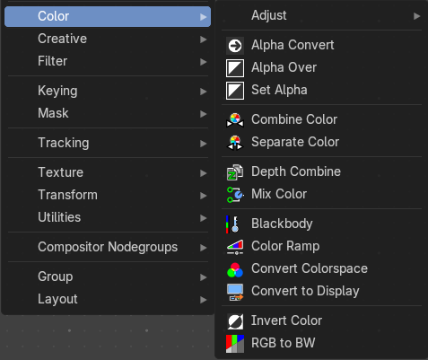

Here you find color related nodes.

### Alpha Convert

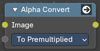

This node converts the alpha channel interpretation of an image from pre-multiplied to straight or vice versa. With a straight alpha channel you might run into artifacts at the borders when the pixels in the semi transparent areas.

#### Inputs

##### Image

Data type: Color.

The input image.

##### Type

Data type: Menu.

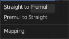

To Premultiplied converts straight alpha to premultiplied alpha. To Straight converts premultiplied alpha to straight alpha.

#### Outputs

##### Image

Data type: Color.

The image output.

### Alpha Over

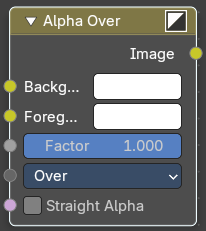

The Alpha Over node is used to layer images with an alpha channel on top of one another.

Where the foreground image pixels have an alpha greater than 0, the background image will be overlaid.

#### Inputs

##### Background

Data type: Color.

Input for the background image.

##### Foreground

Data type: Color.

Input for the foreground image.

##### Factor

Data type: Float (factor).

Controls the amount of foreground image. A factor less than 1 will make the foreground more transparent.

##### Type

Data type: Menu.

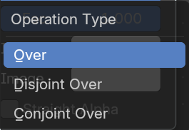

How the foreground goes over the background.

###### Over

The foreground goes over the background according to the alpha of the foreground.

###### Disjoint Over

The foreground goes over the background according to the alpha of the foreground while assuming the background is being held out by the foreground.

###### Conjoint Over

The foreground goes over the background according to the alpha of the foreground. But the foreground completely covers the background if it is more opaque but not necessarily completely opaque.

##### Straight Alpha

Data type: Boolean.

Defines whether the foreground is in straight alpha form, which is necessary to know for proper alpha compositing. Images in the compositor are in premultiplied alpha form by default. So it should be off in most cases. But if, and only if, the foreground was converted to straight alpha form for some reason, this should be on.

#### Outputs

##### Image

Data type: Color.

Image output.

### Set Alpha

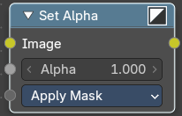

The Set Alpha Node adds an alpha channel to an image.

#### Inputs

##### Image

Data type: Color.

Standard image input.

##### Alpha

Data type: Float.

The amount of Alpha can be set for the whole image by using the input field or per pixel by connecting to the socket.

##### Type

Data type: Menu.

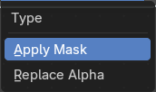

How the Alpha input is used.

###### Apply Mask

Multiply the RGBA channels of the input image by the alpha input value.

###### Replace Alpha

Replace the alpha channel of the input image by the alpha input value.

#### Outputs

##### Image

Data type: Color.

The image output.

### Combine Color

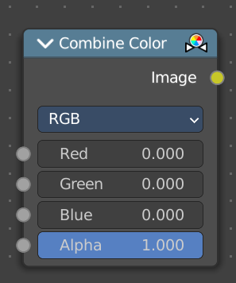

Combine single RGBA floating point channels into a single image.

#### Inputs

##### Red

Data type: Float (factor).

The red channel. In HSV and HSL mode this input is called Hue. In YCbCr and YUV mode it is called Y (luminance).

##### Green

Data type: Float (factor).

The green channel. In HSV and HSL mode this input is called Saturation. In YCbCr mode it is called Cb (chrominance blue), in YUV mode U.

##### Blue

Data type: Float (factor).

The blue channel. In HSV mode this input is called Value, in HSL mode Lightness. In YCbCr mode it is called Cr (chrominance red), in YUV mode V.

##### Alpha

Data type: Float (factor).

The alpha channel.

#### Properties

##### Mode

- **RGB** colour processing
- **HSV** colour processing
- **HSL** colour processing
- **YcbCr** converts an YCbCrA image to RGBA color space and unions the channels.
 - Y: Luminance, 0=black, 1=white
 - Cb: Chrominance Blue, 0=Blue, 1=Yellow
 - Cr: Chrominance Red, 0=Red, 1=Yellow
- YUV converts an YUVA image to RGBA color space. Note that U and V values range
    from -0.5 to +0.5.

##### Color Space

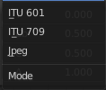

The encoding standard for the YCbCrA color space: ITU 601, ITU 709 or JPEG. Only visible when Mode is YCbCr.

#### Outputs

##### Image

Data type: Color.

The output image.

### Separate Color

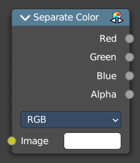

Separates the single RGBA channels from a single image.

#### Inputs

##### Image

Data type: Color.

The image to split into channels.

#### Properties

##### Mode

- **RGB** colour processing
- **HSV** colour processing
- **HSL** colour processing
- **YcbCr** converts an YCbCrA image to RGBA color space and unions the channels.
 - Y: Luminance, 0=black, 1=white
 - Cb: Chrominance Blue, 0=Blue, 1=Yellow
 - Cr: Chrominance Red, 0=Red, 1=Yellow
- YUV converts an YUVA image to RGBA color space. Note that U and V values range
    from -0.5 to +0.5.

##### Color Space

The encoding standard for the YCbCrA color space: ITU 601, ITU 709 or JPEG. Only visible when Mode is YCbCr.

#### Outputs

##### Red

Data type: Float.

The red channel. In HSV and HSL mode this output is called Hue. In YCbCr and YUV mode it is called Y (luminance).

##### Green

Data type: Float.

The green channel. In HSV and HSL mode this output is called Saturation. In YCbCr mode it is called Cb (chrominance blue), in YUV mode U.

##### Blue

Data type: Float.

The blue channel. In HSV mode this output is called Value, in HSL mode Lightness. In YCbCr mode it is called Cr (chrominance red), in YUV mode V.

##### Alpha

Data type: Float.

The alpha channel.

### Depth Combine

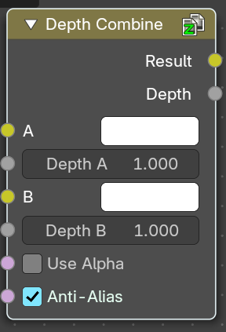

The Depth Combine node combines two images based on their Z-depth maps. It overlays the images using the provided Z values to detect which parts of one image are in front of the other.

#### Inputs

##### A

Data type: Color.

The background image.

##### Depth A

Data type: Float.

Z depth of the background image.

##### B

Data type: Color.

The foreground image.

##### Depth B

Data type: Float.

Z depth of the foreground image.

##### Use Alpha

Data type: Boolean.

The chosen Image pixel alpha channel is also carried over. If a pixel is partially or totally transparent, the result of the Z Combine will also be partially transparent; in which case the background image will show through the foreground (chosen) pixel.

##### Anti-Alias

Data type: Boolean.

Applies Anti-Aliasing to avoid artifacts at sharp edges or areas with a high contrast.

#### Outputs

##### Result

Data type: Color.

If both Z values are equal, it will use the foreground image. Whichever Z value is less decides which image pixel is used. See Z-buffer.

##### Depth

Data type: Float.

The combined Z depth, which allows to thread multiple Z-combines together.

### Mix Color

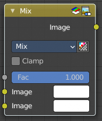

The Mix Node mixes images by working on the individual and corresponding pixels of the two input images. Called “MixRGB” in the shader and texture context.

#### Inputs

##### Factor

Data type: Float (factor).

Controls the amount of influence the node exerts on the output image.

##### A

Data type: Color.

Usually the background image. The image size and resolution sets the dimensions of the output image.

##### B

Data type: Color.

Usually the foreground image.

#### Properties

##### Data Type

The type of data to mix. Color for this node. Other types turn it into a Mix node for that type.

##### Blending Mode

Choose the different blending modes. Mix, Darken, Multiply, Color Burn, Lighten, Screen, Color Dodge, Add, Overlay, Soft Light, Linear Light, Difference, Exclusion, Subtract, Divide, Hue, Saturation, Color, Value.

##### Clamp Result

Limit the highest color value to not exceed 1.

##### Clamp Factor

Limit the Factor to the range 0 to 1.

#### Outputs

##### Result

Data type: Color.

The mixed image.

### Blackbody

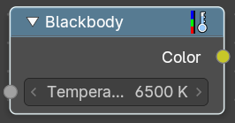

Convert a blackbody temperature to a rgb value.

#### Inputs

##### Temperature

Data type: Float (color temperature).

The blackbody temperature, in Kelvin.

#### Outputs

##### Color

Data type: Color.

The output RGB color.

### Color Ramp

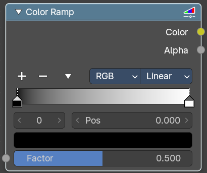

The Color Ramp Node is used for mapping values to colors with the use of a gradient.

#### Inputs

##### Factor

Data type: Float (factor).

The Factor input is used as an index for the color ramp.

#### Properties

##### Color Ramp

Color Ramps enables the user to specify a range of colors based on color stops. The color between the color stops gets interpolated.

###### Controls

- **+**: Add a stop to your color ramp. The stop will be added after the selected one, in the middle to the next one.
- **-**: Deletes the selected color stop from the list.

###### Tools menu

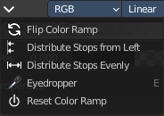

- **Flip Color Ramp**: Flips the gradient, inverting the values of the color ramp.
- **Distribute Stops from Left**: Rearrange the stops so that every step has the same space to the right.
- **Distribute Stops Evenly**: Space between all neighboring stops becomes equal.
- **Eyedropper (pipette icon) E**: An Eyedropper to sample a color or gradient from the interface to be used in the color ramp.

###### Reset Color Ramp

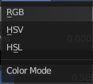

Resets the color ramp to its default state.

###### Color Mode

- **RGB**: Blends color by mixing each color channel and combining.
- **HSV/HSL**: Blends colors by first converting to HSV or HSL, mixing, then combining again. This has the advantage of maintaining saturation between different hues, where RGB would de-saturate, this allows for a richer gradient.

###### Interpolation

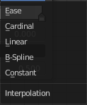

- **Ease**: Uses an Ease Interpolation for the color stops.
- **Cardinal**: Uses a Cardinal Interpolation for the color stops.
- **Linear**: Uses a Linear Interpolation for the color stops.
- **B-Spline**: Uses a B-Spline Interpolation for the color stops.
- **Constant**: Uses a Constant Interpolation for the color stops.

###### Color Ramp

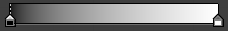

The color band. A click at one of the color stops makes it the active one. You can move the color stops by clicking at them and dragging them around.

###### Active Color Stop elements

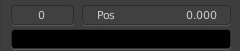

Adjust the active color stop.

- **Choose active color stop**: Choose the color stop by index.
- **Pos**: The position of the active color stop. The range goes from 0.000 to 1.000

#### Outputs

##### Color

Data type: Color.

The color output.

##### Alpha

Data type: Float.

Alpha channel output.

### Convert Colorspace

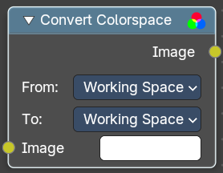

Convert between color spaces.

Note that the conversion is skipped when converting between the same color spaces or to or from data spaces.

#### Inputs

##### Image

Data type: Color.

The input image.

#### Properties

##### From

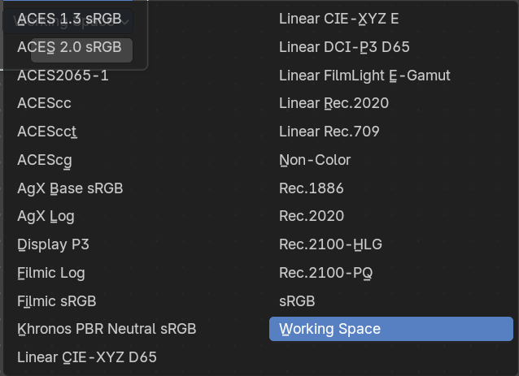

The current color space.

##### To

The destination color space.

#### Outputs

##### Image

Data type: Color.

The image output.

### Convert to Display

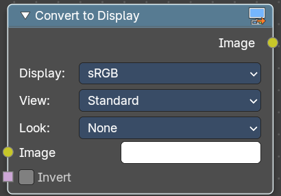

Transforms an image from **scene-linear color space** into a **display-referred format**, using Blender’s color management pipeline. This is essential when working with raw data, custom view transforms, or prepping visuals for final output.

#### Inputs

##### Image

Data type: Color.

The input image in scene-linear space—typically the result of render layers, raw file input, or procedural compositing.

##### Invert

Data type: Boolean.

Reverses the display transform—useful for decoding display-referred images back to linear.

#### Properties

##### Display

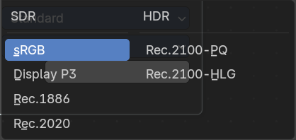

Selects the target display device (e.g. **sRGB**, **Rec.709**, **Display P3**).  
Determines how the image is mapped for viewing on screens.

##### View

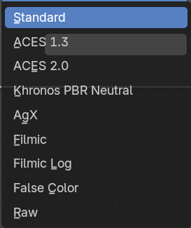

Applies a tone mapping curve (e.g. **Standard**, **Filmic**, **Raw**).  
Controls contrast, highlight rolloff, and perceptual brightness.

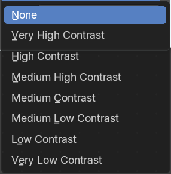

##### Look

Optional artistic adjustment layer (e.g. **Medium Contrast**, **High Contrast**, **None**).  
Adds stylized tweaks on top of the view transform.

#### Outputs

##### Image

Data type: Color.

The display-referred result, ready for preview, export, or further compositing.

### Invert Color

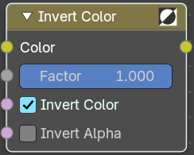

The Invert Node inverts the colors in the input image, producing a negative.

#### Inputs

##### Color

Data type: Color.

Standard input.

##### Factor

Data type: Float (factor).

Controls the amount of influence the node exerts on the output image.

##### Invert Color

Data type: Boolean.

Invert the RGB values.

##### Invert Alpha

Data type: Boolean.

Invert the Alpha values.

#### Outputs

##### Color

Data type: Color.

Standard image output.

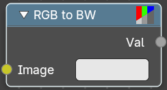

### RGB to BW

The RGB to BW Node converts an RGB color image to a gray-scale image based at its luminance.

#### Inputs

##### Image

Data type: Color.

Color image input.

#### Outputs

##### Val

Data type: Float.

Gray-scale value output.

# Adjust

## Add menu - Color - Adjust

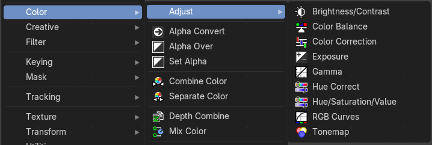

Here you find color related nodes.

### Brightness/Contrast

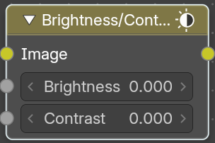

Adjust the brightness and contrast.

#### Inputs

##### Image

Data type: Color.

The image input

##### Brightness

Data type: Float.

An additive-type factor by which to increase the overall brightness of the image. Use a negative number to darken an image.

##### Contrast

Data type: Float.

A scaling type factor by which to make brighter pixels brighter, but keeping the darker pixels dark. Higher values make details stand out. Use a negative number to decrease the overall contrast in the image.

#### Outputs

##### Image

Data type: Color.

Standard output.

> **Note:** It is possible that this node will put out a value set that has values beyond the normal range, i.e. values greater than one and less than zero. If you will be using the output to mix with other images in the normal range, you should clamp the values using the Map Value node (with the Min and Max enabled), or put through a Color Ramp node (with all normal defaults).

### Color Balance

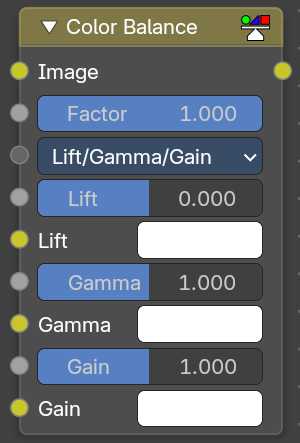

The Color Balance node can adjust the color and values of an image.

#### Inputs

##### Image

Data type: Color.

Standard image input.

##### Factor

Data type: Float (factor).

Controls the amount of influence the node exerts on the output image.

##### Type

Data type: Menu.

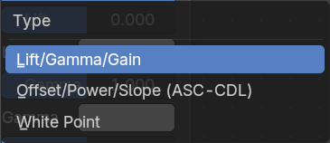

You can choose between different formulas.

###### Lift/Gamma/Gain

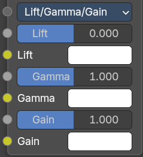

Shows the Lift, Gamma and Gain inputs.

###### Offset/Power/Slope (ASC-CDL)

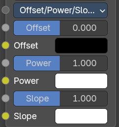

The ASC-CDL standard color correction. Shows the Offset, Power and Slope inputs.

###### White Point

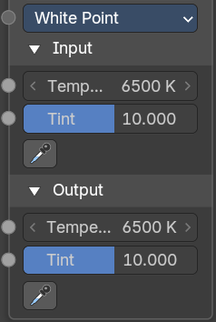

Chromatic adaption from a different white point. Shows the Input and Output panels.

##### Lift

Data type: Float (factor) and Color.

Increases the value of dark colors. There are two Lift inputs: a value and a color. The value is added to each channel of the color. Only visible when Type is Lift/Gamma/Gain.

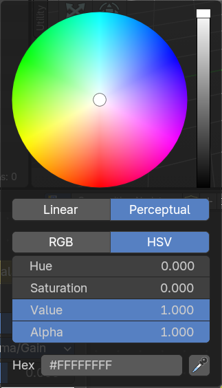

When you click at one of the colors then you will call a color wheel where you can adjust the colors.

##### Gamma

Data type: Float (factor) and Color.

Will adjust mid tones. Like Lift, it has a value and a color input. Only visible when Type is Lift/Gamma/Gain.

##### Gain

Data type: Float (factor) and Color.

Adjusts highlights. Like Lift, it has a value and a color input. Only visible when Type is Lift/Gamma/Gain.

##### Offset

Data type: Float (factor) and Color.

Summand. (Adjusts the overall brightness.) There are two Offset inputs: a value and a color. The value is added to each channel of the color, which also allows a negative offset. Only visible when Type is Offset/Power/Slope (ASC-CDL).

##### Power

Data type: Float (factor) and Color.

Over-all exponent. (Adjusts the mid tones.) Like Offset, it has a value and a color input. Only visible when Type is Offset/Power/Slope (ASC-CDL).

##### Slope

Data type: Float (factor) and Color.

Multiplier. (Adjusts the highlights.) Like Offset, it has a value and a color input. Only visible when Type is Offset/Power/Slope (ASC-CDL).

##### Input

The white point of the input. The panel also has a picker to pick the input white point: the color that gets mapped to white. Only visible when Type is White Point.

###### Temperature

Data type: Float (color temperature).

Color temperature of the input white point.

###### Tint

Data type: Float (factor).

Color tint of the input white point. The default of 10 matches daylight.

##### Output

The white point of the output. The panel also has a picker to pick the output white point: the color that white gets mapped to. Only visible when Type is White Point.

###### Temperature

Data type: Float (color temperature).

Color temperature of the output white point.

###### Tint

Data type: Float (factor).

Color tint of the output white point. The default of 10 matches daylight.

#### Outputs

##### Image

Data type: Color.

The output image.

#### Advanced

##### The Offset/Power/Slope Formula

out = (i × s + o)p

where:

out: The color graded pixel code value.

i: The input pixel code value (0 to 1) (black to white).

s: Slope (any number 0 or greater, nominal value is 1.0).

o: Offset (any number, the nominal value is 0).

p: Power (any number greater than 0, nominal value is 1.0).

### Color Correction

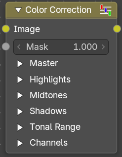

With the Color Correction node you can adjust the color of an image. Separated in several tonal ranges (highlights, mid tones and shadows) and only affect the necessary RGB channels.

#### Inputs

##### Image

Data type: Color.

Image Input.

##### Mask

Data type: Float.

Input a mask to cover parts of the image so that they are affected.

##### Master

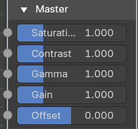

###### Saturation

Data type: Float (factor).

Adjusts the image’s saturation.

###### Contrast

Data type: Float (factor).

Adjust image contrast.

###### Gamma

Data type: Float (factor).

Exponential gamma correction, affecting the whole image. (Works like Power in the Color Balance node.)

###### Gain

Data type: Float (factor).

Multiplier, stronger influence on the whole image. (Works like Slope in the Color Balance node.)

###### Offset

Data type: Float (factor).

Controls the offset of the entire image.

##### Highlights

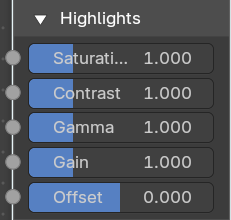

###### Saturation

Data type: Float (factor).

Adjusts the saturation of the highlights.

###### Contrast

Data type: Float (factor).

Adjust image contrast of the highlights.

###### Gamma

Data type: Float (factor).

Exponential gamma correction, affecting the highlights of the image. (Works like Power in the Color Balance node.)

###### Gain

Data type: Float (factor).

Multiplier, stronger influence on the highlights. (Works like Slope in the Color Balance node.)

###### Offset

Data type: Float (factor).

Controls the offset of the highlights.

##### Midtones

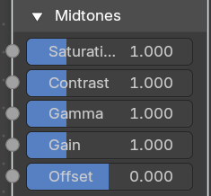

###### Saturation

Data type: Float (factor).

Adjusts the saturation of the midtones.

###### Contrast

Data type: Float (factor).

Adjust image contrast of the midtones.

###### Gamma

Data type: Float (factor).

Exponential gamma correction, affecting the midtones of the image. (Works like Power in the Color Balance node.)

###### Gain

Data type: Float (factor).

Multiplier, stronger influence on the midtones. (Works like Slope in the Color Balance node.)

###### Offset

Data type: Float (factor).

Controls the offset of the midtones.

##### Shadows

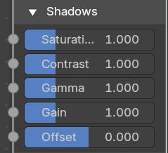

###### Saturation

Data type: Float (factor).

Adjusts the saturation of the shadows.

###### Contrast

Data type: Float (factor).

Adjust image contrast of the shadows.

###### Gamma

Data type: Float (factor).

Exponential gamma correction, affecting the shadows of the image. (Works like Power in the Color Balance node.)

###### Gain

Data type: Float (factor).

Multiplier, stronger influence on the shadows. (Works like Slope in the Color Balance node.)

###### Offset

Data type: Float (factor).

Controls the offset of the shadows.

##### Tonal Range

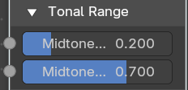

###### Midtones Start

Data type: Float (factor).

The luminance where the midtones start and the shadows end. Together with Midtones End it divides the whole tonal range into highlights, midtones and shadows (there is also a smooth transition between the ranges of width 0.2 units).

###### Midtones End

Data type: Float (factor).

The luminance where the midtones end and the highlights start.

##### Channels

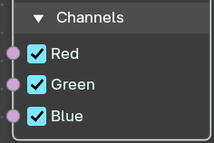

###### Red

Data type: Boolean.

When on, the correction is applied to the red channel.

###### Green

Data type: Boolean.

When on, the correction is applied to the green channel.

###### Blue

Data type: Boolean.

When on, the correction is applied to the blue channel.

#### Outputs

##### Image

Data type: Color.

The image output.

### Exposure

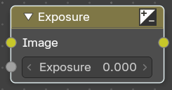

The Exposure Node node allows you to make areas of an image brighter or dimmer.

#### Inputs

##### Image

Data type: Color.

Standard image input.

##### Exposure

Data type: Float.

The scalar factor to adjust the exposure of the image.

#### Outputs

##### Image

Data type: Color.

Standard image output.

### Gamma

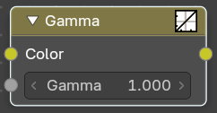

Use this node to apply a gamma correction.

#### Inputs

##### Color

Data type: Color.

Image input.

##### Gamma

Data type: Float.

An exponential brightness factor.

#### Outputs

##### Color

Data type: Color.

Image output.

### Hue Correct

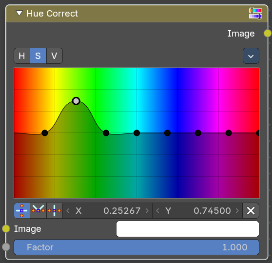

With the Hue Correct Node you can adjust the Hue, Saturation, and Value of an image with an input curve.

#### Inputs

##### Image

Data type: Color.

Standard image input.

##### Factor

Data type: Float (factor).

Controls the amount of influence the node exerts on the output image.

#### Properties

##### Level

**H** (Hue), **S** (Saturation), **V** (Value). Choose which curve you want to modify.

##### Tools menu

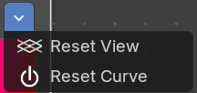

###### Reset View

Resets the view. This menu item is here dysfunctional, you cannot view in or out.

###### Reset Curve

Resets the curve to defaults.

###### Auto Handle

Sets the handle for the curve points to Auto Handle.

###### Vector Handle

Sets the handle for the curve points to Vector Handle.

###### Auto Clamped

Sets the handle for the curve points to Auto Clamped.

###### X / Y

The x and y position of the currently selected curve point.

###### Delete Points

Deletes the currently selected curve point.

#### Outputs

##### Image

Data type: Color.

Image Output

### Hue/Saturation/Value

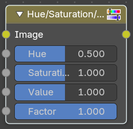

The Hue Saturation Node applies a color transformation in the HSV color space. Called “Hue Saturation Value” in shader and texture context.

#### Inputs

The inputs also work as properties when nothing is connected.

##### Image

Data type: Color.

Plug in an image.

##### Hue

Data type: Float (factor).

Specifies the hue rotation of the image. 360° are mapped to (0 to 1). The hue shifts of 0 (-180°) and 1 (+180°) have the same result.

##### Saturation

Data type: Float (factor).

A saturation of 0 removes hues from the image, resulting in a gray scale image. A shift greater than 1.0 increases saturation.

##### Value

Data type: Float (factor).

Value is the overall brightness of the image. De/Increasing values shift an image darker/lighter.

##### Factor

Data type: Float (factor).

Controls the amount of influence the node exerts on the output image.

#### Outputs

##### Image

Data type: Color.

Standard output.

#### Hue/Saturation Tips

Some things to keep in mind that might help you use this node better:

Hues are vice versa

A blue image, with a Hue setting at either end of the spectrum (0 or 1), is output as yellow (recall that white, minus blue, equals yellow). A yellow image, with a Hue setting at 0 or 1, is blue.

Hue and Saturation work together.

So, a Hue of 0.5 keeps the blues the same shade of blue, but Saturation can deepen or lighten the intensity of that color.

Gray & White are neutral hues

A gray image, where the RGB values are equal, has no hue. Therefore, this node can only affect it with Value. This applies to all shades of gray, from black to white; wherever the values are equal.

Changing the effect over time

The Hue and Saturation values can be animated with a Time Node or by animating the property.

### RGB Curves

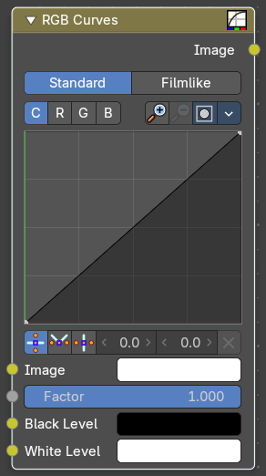

The RGB Curves Node allows color corrections for each color channel and levels adjustments in the compositing context.

#### Inputs

##### Image

Data type: Color.

Standard image input.

##### Factor

Data type: Float (factor).

Controls the amount of influence the node exerts on the output image.

##### Black Level

Data type: Color.

Defines the input color that is (linear) mapped to black.

##### White Level

Data type: Color.

Defines the input color that is (linear) mapped to white.

#### Properties

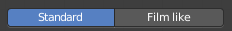

##### Tone

What tone mapping to use. Standard or Film like.

##### Curve Field

##### Channel buttons

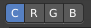

Clicking on one of the channels displays the curve for each.

C (Combined RGB), R (Red), G (Green), B (Blue).

##### Navigation elements

They are described from left to right.

##### Zoom in and out

The two buttons with the magnifying glass at it zooms in and out in the curve window.

##### Clipping

Clipping options. Set up clipping for the stroke.

##### Tools

Tools is a menu where you can find some curve related tools.

###### Reset View

Resets the curve windows zoom.

###### Extend horizontal

Extends the curve before the first curve point and behind the last curve point horizontally.

###### Extend extrapolated

Extends the curve before the first curve point and behind the last curve point extrapolated.

###### Reset Curve

Resets the curve to the initial shape.

###### Curve edit field

Create and tweak a Bezier curve that varies the input levels (X axis) to produce an output level (Y axis).

###### Selecting Points

> This setting uses the **curve widget**: click to add points, drag to move them. See **[Curve Widget](../../../../interface/properties.md#curve-widget)** in the Interface chapter.

###### Adding Points

###### Curve point settings

When you have a point selected then you will reveal further settings at the bottom.

- **Vector Handle**: Set handle type to Vector.
- **Auto Handle**: Set handle type to Auto.
- **Auto Clamped Handle**: Set handle type to Auto Clamped.

#### Outputs

##### Image

Data type: Color.

Standard output.

### Tonemap

Tone mapping is a technique used in image processing and computer graphics to map one set of colors to another in order to approximate the appearance of high dynamic range images in a medium that has a more limited dynamic range.

Tone mapping addresses the problem of strong contrast reduction from the scene values (radiance) to the displayable range, while preserving the image details and color appearance. This is important to appreciate the original scene content.

#### Inputs

##### Image

Data type: Color.

Plug in the HDR image.

##### Type

Data type: Menu.

There are two methods of tone mapping: Rh Simple and R/D Photoreceptor.

###### Rh Simple

A simpler photographic algorithm by Reinhard. Shows the Key, Balance and Gamma inputs.

###### R/D Photoreceptor

A more advanced algorithm based on the human eye, by Reinhard and Devlin. Shows the Intensity, Contrast, Light Adaptation and Chromatic Adaptation inputs.

##### Key

Data type: Float.

The value the average luminance is mapped to. It is usually set to the middle gray value. Only visible when Type is Rh Simple.

##### Balance

Data type: Float.

Normally always 1, but can be used as an extra control to alter the brightness curve. Lower values show more detail in the shadows, higher values compress the highlights more smoothly. Only visible when Type is Rh Simple.

##### Gamma

Data type: Float.

Gamma correction applied after tone mapping. If not used, set to 1. Only visible when Type is Rh Simple.

##### Intensity

Data type: Float.

A value smaller than zero darkens image. A value greater than zero makes it brighter. Only visible when Type is R/D Photoreceptor.

##### Contrast

Data type: Float.

Set to 0 to use estimate from input image. Only visible when Type is R/D Photoreceptor.

##### Light Adaptation

Data type: Float (factor).

If 0, global; if 1, based on pixel intensity. Values in between blend both. Only visible when Type is R/D Photoreceptor.

##### Chromatic Adaptation

Data type: Float (factor).

If 0, same for all channels (luminance); if 1, each channel is independent. Values in between blend both. Only visible when Type is R/D Photoreceptor.

#### Outputs

##### Image

Data type: Color.

The Image output.
