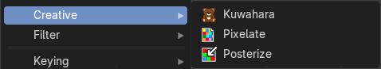
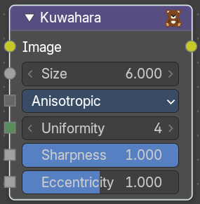
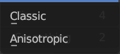
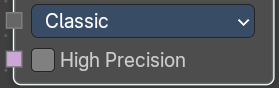
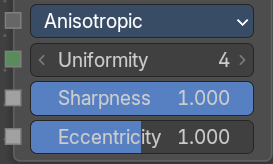
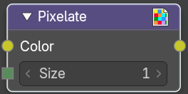
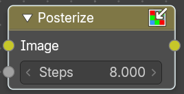

## Add menu - Creative

### Kuwahara

Kuwahara is a filter that converts a realistic image into a stylized image.

#### Inputs

##### Image

Data type: Color.

Standard image input.

##### Size

Data type: Float.

The size of the kuwahara filter in pixels.

##### Type

Data type: Menu.

Chooses the Kuwahara variation. There are two: Classic and Anisotropic.

###### Classic

Fast but less accurate. Shows the High Precision input.

###### Anisotropic

Accurate but slower. Shows the Uniformity, Sharpness and Eccentricity inputs.

##### Uniformity

Data type: Integer.

Controls the uniformity of the direction of the filter. Higher values give more uniform directions. Only visible when Type is Anisotropic.

##### Sharpness

Data type: Float (factor).

Controls the sharpness of the filter. 0 is completely smooth, while 1 is completely sharp. Only visible when Type is Anisotropic.

##### Eccentricity

Data type: Float (factor).

Controls how directional the filter is. 0 means the filter works the same in all directions. 2 means it follows the edges of the image as much as possible. Only visible when Type is Anisotropic.

##### High Precision

Data type: Boolean.

Uses a more precise but slower method. Use it if the output shows unwanted noise. Only visible when Type is Classic.

#### Outputs

##### Image

Data type: Color.

Standard image output.

### Pixelate

Add this node in front of a Scale node to get a pixelated (non-smoothed) image from the resultant upscaled image.

#### Inputs

##### Color

Data type: Color.

Standard image input.

##### Size

Data type: Integer.

The number of pixels that become one output pixel.

#### Outputs

##### Color

Data type: Color.

Image output.

### Posterize

The Posterize node reduces the number of colors in the image to a palette. The exact number of output colors is not to set. Just a number of steps to reduce the existing colors.

#### Inputs

##### Image

Data type: Color.

The image to reduce the colors of.

##### Steps

Data type: Float.

The number of steps to perform a color reduction.

#### Outputs

##### Image

Data type: Color.

Standard image output.
