## Add menu - Filter

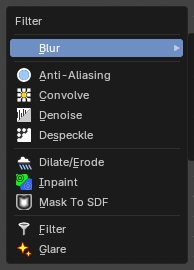

The Filter add menu contains multiple filters you can use on image data, including blurs and other lens effects.

### Anti-Aliasing

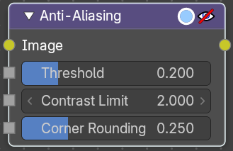

Adds antialiasing to edges in an image.

#### Inputs

##### Image

Data type: Color.

Standard image input.

##### Threshold

Data type: Float (factor).

Threshold to detect edges.

##### Contrast Limit

Data type: Float.

How much to eliminate suspicious edges to avoid artifacts.

##### Corner Rounding

Data type: Float (factor).

How much sharp corners will be rounded.

#### Outputs

##### Image

Data type: Color.

Standard image output.

### Convolve

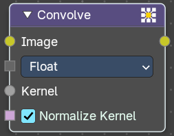

Applies a **custom convolution kernel** to an image, enabling advanced filtering effects like blurring, sharpening, edge detection, embossing, and more. This node gives artists direct control over pixel-level transformations.

#### Inputs

##### Image

Data type: Color.

The source image to be processed. Accepts any RGBA input.

##### Kernel Data Type

Data type: Menu.

Which data type to use for the Kernel input. Float convolves the same kernel with all channels of the image. Color convolves each channel of the kernel with the matching channel of the image.

##### Kernel

Data type: follows the Kernel Data Type setting.

A matrix of values that defines the convolution operation. Can be manually defined or procedurally generated. Operates per-channel (R, G, B, A) unless separated beforehand.

##### Normalize Kernel

Data type: Boolean.

When enabled, the kernel values are normalized to prevent brightness shifts.

#### Outputs

##### Image

Data type: Color.

The result of the convolution operation as an image.

### Denoise

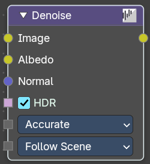

The Denoise node is used to denoise renders from Cycles and other ray tracing renderers. This helps to significantly reduce render time by rendering with fewer samples.

It is uses Open Image Denoise, which transforms noisy images into clean images with machine learning.

#### Inputs

##### Image

Data type: Color.

Noise image input.

##### Albedo

Data type: Color.

Optional Albedo render pass to better preserve detail. For Cycles, it is recommended to use the Denoising Albedo render pass, which is available when enabling the Denoising Data passes.

##### Normal

Data type: Vector.

Optional normal render pass to better preserve detail. For Cycles, it is recommended to use the Denoising Normal render pass, which is available when enabling the Denoising Data passes.

##### HDR

Data type: Boolean.

Preserve colors outside the 0 to 1 range.

##### Prefilter

Data type: Menu.

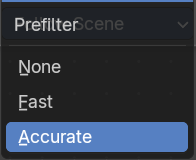

Allows users to apply a prefiltering step before denoising, which can improve the denoising result.

###### None

No prefiltering applied.

###### Fast

Applies a quick prefiltering step to improve denoising with minimal processing time.

###### Accurate

Applies a detailed prefiltering step for the best denoising result, but takes more processing time.

##### Quality

Data type: Menu.

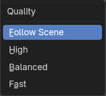

Defines the quality level of the denoising process:

###### Follow Scene

Uses the quality set in the scene settings, allowing quick switching between different quality modes for all nodes.

###### High

Highest quality, but longest processing time.

###### Balanced

Slightly lower quality, but halves processing time compared to High.

###### Fast

Further reduced quality for a small increase in speed over Balanced.

#### Outputs

##### Image

Data type: Color.

Denoised image output.

### Despeckle

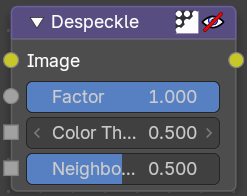

The Despeckle node is used to smooth areas of an image in which noise is noticeable, while leaving complex areas untouched.

This works by the standard deviation of each pixel and its neighbors is calculated to determine if the area is one of high complexity or low complexity. If the complexity is lower than the threshold then the area is smoothed using a simple mean filter.

#### Inputs

##### Image

Data type: Color.

Standard image input.

##### Factor

Data type: Float (factor).

Controls the amount the filter effects the image.

##### Color Threshold

Data type: Float.

The threshold to control high/low complexity.

##### Neighbor Threshold

Data type: Float (factor).

The threshold to control the number of pixels that must match.

#### Outputs

##### Image

Data type: Color.

Standard image output.

### Dilate/Erode

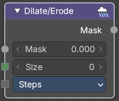

The Dilate/Erode node provides a morphology (mathematical shape analysis) filter.

#### Inputs

##### Mask

Data type: Float.

Single color channel (or a black-and-white image) input.

##### Size

Data type: Integer.

The filter radius. A positive value of Distance dilates (expands) the influence of a pixel on its surrounding pixels. A negative value erodes (shrinks) its influence.

##### Type

Data type: Menu.

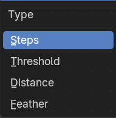

There are four different dilate / erode modes: Steps, Threshold, Distance and Feather.

##### Falloff Size

Data type: Float.

The size of the falloff from the edges, in pixels. If it is less than two pixels, the edges are anti-aliased. Only visible when Type is Threshold.

##### Falloff

Data type: Menu.

The shape of the falloff at the edges. Only visible when Type is Feather.

#### Outputs

##### Mask

Data type: Float.

The filtered mask output.

### Inpaint

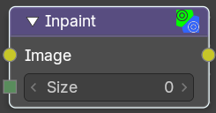

The Inpaint node is used to extend borders of an image into transparent or masked regions. This can be useful to solve problems like “wire removal” and holes created during chroma keying.

#### Inputs

##### Image

Data type: Color.

Standard image input.

##### Size

Data type: Integer.

The size of the inpaint in pixels.

#### Outputs

##### Image

Data type: Color.

Standard image output.

### Mask To SDF

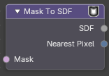

Turns a black and white mask into a distance map. Every pixel is given its distance to the nearest edge of the mask. Use it to grow or shrink a mask smoothly, to make soft glows that follow a shape, or to make outlines of any width. Pixels outside the shape get positive values that grow the further away they are. Pixels inside get negative values that grow the deeper they are. The edge sits at zero.

#### Inputs

##### Mask

Data type: Boolean.

The mask to measure. White (true) pixels are inside the shape.

#### Outputs

##### SDF

Data type: Float.

The distance of each pixel to the edge, in pixels.

##### Nearest Pixel

Data type: Integer Vector.

The position of the nearest pixel of the shape, as two whole numbers.

#### How to use Mask To SDF

The output is a distance, not a picture, so it is used as a ruler: compare it, remap it or run it through a curve to turn the distance into a shape.

##### Example: distance bands around a shape

A chain that shows what the distance looks like. A heart shape goes in as the mask. The SDF is multiplied by `0.01` and the result is wrapped with Floored Modulo, so the value restarts every 100 pixels.

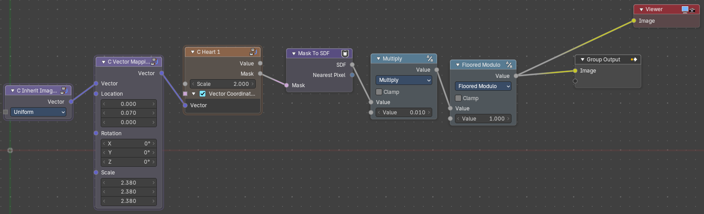

1. The mask comes from a group that draws a heart. Any mask works here.
2. **Mask To SDF** measures the distance of every pixel to the edge of the heart.
3. A **Math** node set to **Multiply** scales that distance by `0.01`, so 100 pixels become `1.0`.
4. A **Math** node set to **Floored Modulo** with a value of `1.0` keeps only the part after the decimal point. The value climbs from 0 to 1, then starts again.
5. The result goes to a Viewer.

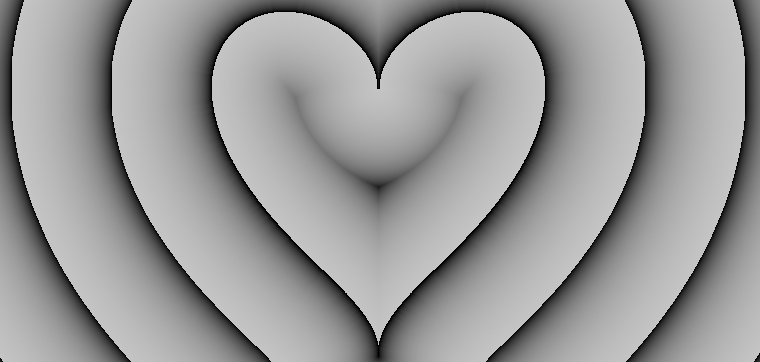

Each band is 100 pixels wide and follows the outline of the heart. The bands also repeat inside the shape, because pixels inside have negative distances and Floored Modulo wraps them the same way. Change the Multiply value to make the bands wider or narrower.

##### Grow or shrink a mask by a set number of pixels

1. Connect any mask to **Mask**. A Box Mask or an Ellipse Mask works. Anything above zero counts as inside.
2. Connect **SDF** to the **A** input of a **Compare** node (Add > Utilities > Math > Compare).
3. Set the operation to **Less Than** and type the amount in **B**. A value of `10` grows the mask by 10 pixels. A value of `-10` shrinks it by 10 pixels.
4. The Compare result is the new mask. Plug it into a Set Alpha, a Mix or a Viewer.

##### Make an outline of any width

1. Plug **SDF** into a **Math** node set to **Absolute**, so inside and outside distances both become positive.
2. Compare the result with **Less Than** and a width of `3`. You get a ring 3 pixels to each side of the original edge.

##### Make a soft glow that follows the shape

1. Plug **SDF** into a **Map Range** node. Set From Min to `0`, From Max to the glow size in pixels (say `60`), To Min to `1` and To Max to `0`, and turn on **Clamp**.
2. The result is white at the edge and fades to black 60 pixels away. Use it as a Mix factor over a glow colour.

> **Tip:** The distance is measured in pixels of the image you are working on, so the same values give a different look at 1080p and at 4K. Scale the numbers if you change the resolution.

### Filter

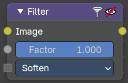

The Filter node implements various common image enhancement filters.

#### Inputs

##### Image

Data type: Color.

Standard image input.

##### Factor

Data type: Float (factor).

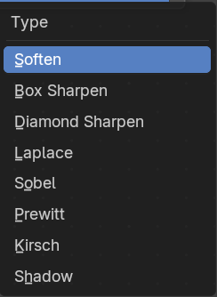

Controls the amount of influence the node exerts on the output image.

##### Type

Data type: Menu.

The available filter types. Soften, Laplace, Sobel, Prewitt and Kirsch all perform edge detection (in slightly different ways) based on vector calculus and set theory equations.

###### Soften

Slightly blurs the image.

###### Box Sharpen

Increases the contrast, especially at edges.

###### Diamond Sharpen

A moderate sharpening filter

###### Laplace

Softens around edges.

###### Sobel

Creates a negative image that highlights edges.

###### Prewitt

Tries to do Sobel one better.

###### Kirsch

Giving a better blending than Sobel or Prewitt, when approaching an edge.

###### Shadow

Performs a relief, emboss effect, darkening outside edges.

#### Outputs

##### Image

Data type: Color.

Standard image output.

### Glare

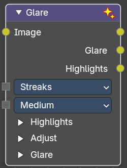

The Glare node is used to add bloom, lens flares, fog, glows around exposed parts of an image and much more.

#### Inputs

##### Image

Data type: Color.

Standard image input.

##### Type

Data type: Menu.

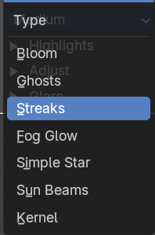

The glare type. It decides which inputs the Glare panel shows.

###### Bloom

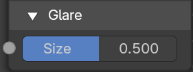

Creates a bloom effect.

###### Ghosts

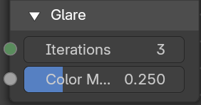

Creates a haze over the image.

###### Streaks

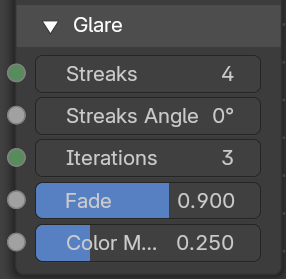

Creates bright streaks used to simulate lens flares.

###### Fog Glow

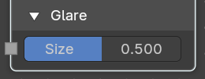

Looks similar to Ghost. However, it is much smaller in size and gives more of an atmospheric haze or “glow” around the image.

###### Simple Star

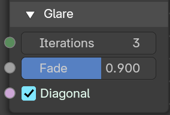

Works similar to Streaks but gives a simpler shape looking like a star.

###### Sun Beams

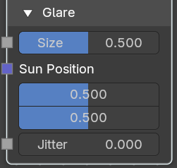

Creates sun beams.

###### Kernel

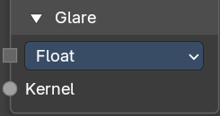

A custom kernel convolution mode. It allows you for example to generate the glare aura of a candle flame.

##### Quality

Data type: Menu.

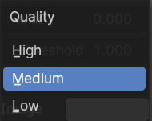

If not set to High, the glare effect is only applied to a low resolution copy of the image. This can be helpful to save render times while only doing preview renders.

##### Highlights

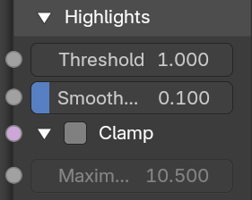

This panel holds the settings that pick the bright parts of the image. It is closed by default.

###### Threshold

Data type: Float.

Pixels brighter than this value will be affected by the glare filter.

###### Smoothness

Data type: Float (factor).

The smoothness of the extracted highlights.

###### Clamp

Data type: Boolean.

Clamp bright highlights to a maximum value. In the Clamp panel inside the Highlights panel. This is the checkbox in the panel header.

###### Maximum

Data type: Float.

The maximum brightness of the highlights when Clamp is on. In the Clamp panel inside the Highlights panel.

##### Adjust

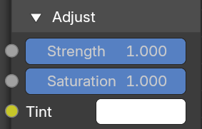

This panel holds the settings that change the look of the glare.

###### Strength

Data type: Float (factor).

Adjusts the brightness of the glare. Soft range of `[0`, `1]`, can be boosted beyond 1. Serves the same function as a Mix option but offers better control.

###### Saturation

Data type: Float (factor).

Adjusts the intensity of the colors in the glare effect. A higher value results in more vivid colors, while a lower value will desaturate the colors, making them appear more muted.

###### Tint

Data type: Color.

Applies a color tint to the glare effect. This allows you to add a specific hue to the glare, giving you creative control over the color balance and overall mood of the effect. For a more accurate tint, lower the Saturation first.

##### Glare

This panel holds the settings of the chosen glare type. Each input is only visible for some types.

###### Size

Data type: Float (factor).

The size of the glare relative to the image. 1 means the glare covers the entire image, 0.5 means it covers half the image. Only visible when Type is Bloom, Fog Glow or Sun Beams.

###### Streaks

Data type: Integer.

The number of streaks. Only visible when Type is Streaks.

###### Streaks Angle

Data type: Float (angle).

The angle of the first streak to the horizontal axis. Only visible when Type is Streaks.

###### Iterations

Data type: Integer.

The number of ghosts for Ghosts, or the quality and spread of the glare for Streaks and Simple Star. Higher values take longer to compute. Only visible when Type is Ghosts, Streaks or Simple Star.

###### Fade

Data type: Float (factor).

Controls how fast the streaks fade out. A higher fade value means the effect will dissipate more smoothly and subtly over a larger area, whereas a lower fade value will keep the glare more concentrated and abrupt. Only visible when Type is Streaks or Simple Star.

###### Color Modulation

Data type: Float (factor).

Changes the colors of streaks and ghosts for a spectral dispersion effect. Johannes Itten describes this effect, Color Modulation, as subtle variations in tones and chroma. Only visible when Type is Ghosts or Streaks.

###### Diagonal

Data type: Boolean.

Align the star diagonally. Only visible when Type is Simple Star.

###### Sun Position

Data type: Vector (factor).

The position of the source of the rays in normalized coordinates. 0 means lower left corner. 1 means upper right corner. Only visible when Type is Sun Beams.

###### Jitter

Data type: Float (factor).

The amount of jitter when computing rays. Higher jitter can be faster but can give grainy or noisy results. Only visible when Type is Sun Beams.

###### Kernel Data Type

Data type: Menu.

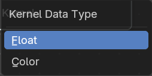

What data to compute for the kernel: Float or Color. Only visible when Type is Kernel.

###### Kernel

Data type: follows the Kernel Data Type setting.

The kernel input. Only visible when Type is Kernel.

#### Outputs

##### Image

Data type: Color.

The image with the generated glare added.

##### Glare

Data type: Color.

The generated glare only.

##### Highlights

Data type: Color.

The highlights that were extracted from the image to make the glare.

# Blur

## Add menu - Filter - Blur

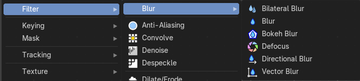

The Filter add menu contains multiple filters you can use on image data, including blurs and other lens effects.

### Bilateral Blur

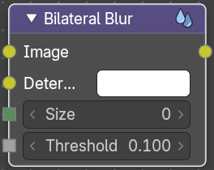

The Bilateral Blur node performs a high-quality adaptive blur on the source image, allowing to blur images while retaining their sharp edges.

It can be used for various purposes like: smoothing noisy render passes to avoid longer computation times in example ray-traced ambient occlusion, blurry refraction's/reflections, soft shadows, or to make non-photo realistic compositing effects.

#### Inputs

##### Image

Data type: Color.

Standard image input. If only the image input is connected, the node blurs the image depending on the edges present in the source image.

##### Determinator

Data type: Color.

Which is non-obligatory and if the Determinator is connected, it serves as the source for defining edges/borders for the blur in the image. This has great advantage in case the source image is too noisy, but normals in combination with Z-buffer can still define exact borders/edges of objects.

##### Size

Data type: Integer.

The size of the blur in pixels.

##### Threshold

Data type: Float.

The threshold of the blur area. Pixels are considered to be in the blur area if the average difference between their determinator of the center pixels is less than this threshold.

#### Outputs

##### Image

Data type: Color.

Standard image output.

### Blur

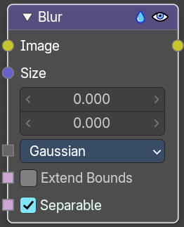

The Blur node provides several blur modes to blur an image. The icon top right allows you to collapse and show the image part of the node.

#### Inputs

##### Image

Data type: Color.

Standard image input.

##### Size

Data type: Vector (2d).

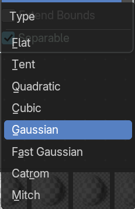

The optional Size input will be multiplied with the X and Y blur radius values. It accepts also a value image, to control the blur radius with a mask. The values should be mapped between (0 to 1) for an optimal effect.

##### Type

Data type: Menu.

The different blur types.

###### Flat

Simply blurs everything uniformly.

###### Tent

Preserves the high and the lows better by making a linear falloff.

###### Quadratic

Looks similar to Gaussian but can be a little faster but slightly worse looking.

###### Cubic

Preserve the highs, but give an almost out-of-focus blur while smoothing sharp edges.

###### Gaussian

Gives the best looking results but tends to be the slowest.

###### Fast Gaussian

An approximation of the Gaussian that is much faster and looks almost the same. This is the default type.

###### Catrom

A Catmull-Rom filter. It keeps sharp contrast edges crisp.

###### Mitch

Preserve the highs, but give an almost out-of-focus blur while smoothing sharp edges.

##### Extend Bounds

Data type: Boolean.

Allows the image, that is being blurred, to extend past its original dimension.

##### Separable

Data type: Boolean.

Blur along the horizontal and vertical directions independently. This method is faster.

#### Outputs

##### Image

Data type: Color.

Standard image output.

### Bokeh Blur

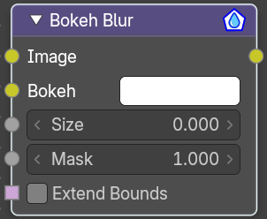

The Bokeh Blur node generates a bokeh type blur similar to Defocus. Unlike defocus an in-focus region is defined in the Compositor.

Several performance optimizations are also available such as OpenCL support, calculation area restriction and masking.

#### Inputs

##### Image

Data type: Color.

Standard image input.

##### Bokeh

Data type: Color.

This is an input for the Bokeh Image node.

##### Size

Data type: Float.

Size controls the amount of blur. Size can either be a single value across the entire image or a variable value controlled by an input image. In order to use the latter, the Variable Size option must be selected. See the examples section below for more on how to use this.

##### Mask

Data type: Float.

Here you can input a Box Mask matte node or a Mask input node to restrict the area of the image the blur is applied to. This could be helpful, for example, when developing a node system by allowing only a small area of the image to be filtered thus saving composite time each time adjustments are made.

##### Extend Bounds

Data type: Boolean.

Extend the bounds of the input image to fully fit the blurred image.

#### Outputs

##### Image

Data type: Color.

Image output.

### Defocus

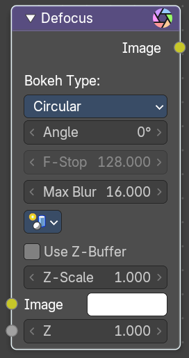

It is typically used to emulate depth of field (DOF) using a post-processing method with a Z-buffer input. But also allows to blur images that are not based on Z depth too.

#### Inputs

##### Image

Data type: Color.

Standard image input.

##### Z

Data type: Float.

Z-buffer input, but could also be a (greyscale) image used as a mask, or a single value input.

#### Properties

##### Bokeh Type

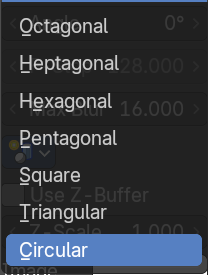

The number of iris blades of the virtual camera’s diaphragm.

Disk (to emulate a perfect circle) or Triangle (3 blades), Square (4 blades), Pentagon (5 blades), Hexagon (6 blades), Heptagon (7 blades) or Octagon (8 blades).

###### Angle

This button is deactivated, if the Bokeh Type is set to Disk. It can be used to add a rotation offset to the Bokeh shape. The value is the angle in degrees.

###### F-Stop

This option controls the amount of focal blur in the same way as a real camera. It simulates the aperture f of a real lens’ iris, without modifying the luminosity of the picture. The default value 128 is assumed to be infinity: everything is in perfect focus. Half the value will double the amount of blur. This button is deactivated, if No Z-buffer is enabled.

###### Max Blur

This value limits the amount of blur by setting a maximum blur radius. Could be used to optimize the performance. The default value of 0 means no limit.

##### Scene

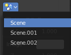

Select the linked scene. Scenes can be created in the properties editor in the Scene properties tab in the Scene panel.

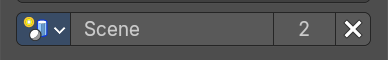

###### Use Z-buffer

Should be activated for a non Z-buffer in the Z input. No Z-buffer will be enabled automatically whenever a node that is not image based is connected to the Z input.

###### Z Scale

Only active when No Z-buffer is enabled. When No Z-buffer is used, the input is used directly to control the blur radius (similar to F-Stop when using the Z-buffer). This parameter can be used to scale the range of the Z input.

#### Outputs

##### Image

Data type: Color.

Image output.

### Directional Blur

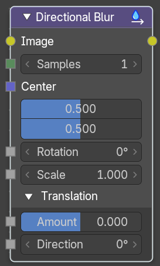

Blurs an image in a specified direction and magnitude. Can be used to fake motion blur.

#### Inputs

##### Image

Data type: Color.

Standard image input.

##### Samples

Data type: Integer.

The number of samples to compute the blur.

##### Center

Data type: Vector (factor).

Sets the position where the blur center is. This makes a difference if Rotation or Scale are used. 0 is the lower left corner and 1 is the upper right corner of the image.

##### Rotation

Data type: Float (angle).

Rotates the image each iteration to create a spin effect, from the center point.

##### Scale

Data type: Float.

Scales the image each iteration, creating the effect of a zoom.

##### Translation

This panel holds the settings that move the blur in one direction. It is open by default.

###### Amount

Data type: Float (factor).

The translation amount relative to the size of the image. Negative values move in the opposite direction.

###### Direction

Data type: Float (angle).

The translation direction.

#### Outputs

##### Image

Data type: Color.

Image output.

### Vector Blur

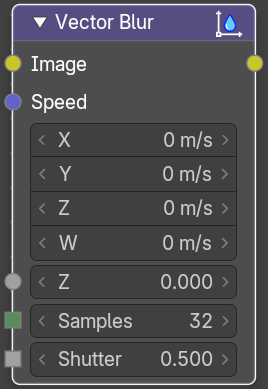

The Vector Blur node is a fast method for simulating Motion blur in compositing. It uses the vector speed render pass to blur the image pixels in 2D.

#### Inputs

##### Image

Data type: Color.

Image input, to be linked to the “Combined” render pass.

##### Speed

Data type: Vector (velocity).

Input for the “Vector” render pass. See Cycles render passes.

##### Depth

Data type: Float.

Z depth, to be linked to the “Depth” render pass.

##### Samples

Data type: Integer.

Quality factor.

##### Shutter

Data type: Float.

Time between open and close the shutter.

#### Outputs

##### Image

Data type: Color.

Motion blurred image output.

