## Add menu - Input

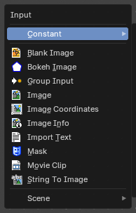

The Input menu contains Input node types.

The content is the same for all three sub modes. Note that you need to tick Use Nodes to activate the menu items when you are in Line Style sub mode.

### Blank Image

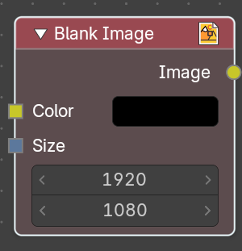

The Blank Image node generates a solid image of a chosen size and color. It is used as a base layer, background plate, or placeholder in compositing workflows, allowing to create flat color fields or masks without importing external images.

#### Inputs

##### Color

Data type: Color.

Defines the fill color of the image. Chosen through a swatch or color picker, supporting any RGB value. Determines the visual appearance of the generated blank image.

##### Size

Data type: Integer Vector.

Specifies the resolution of the image in pixels. Allows matching render dimensions or creating custom aspect ratios.

#### Outputs

##### Image

Data type: Color.

Produces a standard image that can be connected to other compositor nodes. This can be layered with Mix or Alpha Over, processed with filters, or used as a mask source.

### Bokeh Image

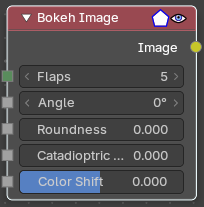

The Bokeh Image node generates a special input image for use with the Bokeh Blur filter node.

The Bokeh Image node is designed to create a reference image which simulates optical parameters such as aperture shape and lens distortions which have important impacts on bokeh in real cameras.

#### Inputs

The first three settings simulate the aperture of the camera.

##### Flaps

Data type: Integer.

Sets an integer number of blades for the cameras iris diaphragm.

##### Angle

Data type: Float (angle).

Gives these blades an angular offset relative to the image plane.

##### Roundness

Data type: Float (factor).

Sets the curvature of the blades with (0 to 1) from straight to bringing them to a perfect circle.

##### Catadioptric Size

Data type: Float (factor).

Provides a type of distortion found in mirror lenses and some telescopes. This can be useful to produce a visual complex bokeh.

##### Color Shift

Data type: Float (factor).

Introduces chromatic aberration into the blur such as would be caused by a tilt-shift lens.

#### Outputs

##### Image

Data type: Color.

The generated bokeh image.

### Image

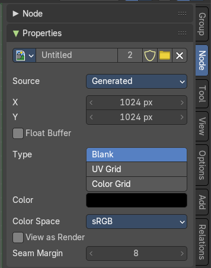

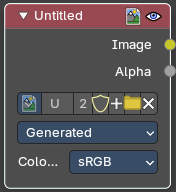

Image input. For further image settings see also the Properties Panel in the Node Tab in the Sidebar. It contains the same settings than the image types in the image and uv editor.

#### Properties

##### Image Property

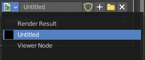

This property contains the list of loaded images. When no image is loaded then it displays the New and Open Buttons. When an image exists then it displays the name of the currently selected image.

From left to right ...

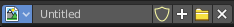

###### List of images in the scene

This is a list of the images in the scene. This list allows you to switch to other images.

##### Search form

Search for specific images.

###### Image Edit Box

Read the name of the currently selected image. And you can rename the image here too.

###### Number of Fake Users

In case this file has a fake user assigned, then this number displays the number of fake users.

###### Fake User

Wit this button you assign a fake user to this selected image. Data, like images, that is not longer linked to anything else gets removed when you save and reload a scene. Bforartists has the concept of fake users to go around this behavior. An image with a fake user is in fact linked to something. And so it is not lost when you save and reload the scene.

###### Open

Open a new image.

###### New

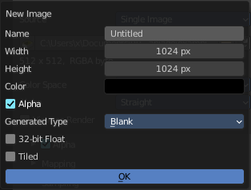

Create a new image.

Creates a new image. You will get a dialog where you can define settings for the new image.

###### Name

The name of the new image

###### Width

The width of the new image.

###### Height

The height of the new image.

###### Color

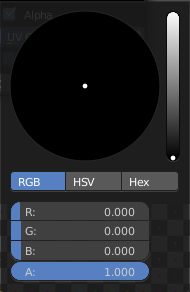

Adjust the color of the new image. A click will call a color picker.

###### Alpha

Check this checkbox if the new image should have an alpha channel.

###### Generated Type

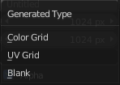

Here you can define what kind of texture you want to create.

Blank is one plain color.

UV Grid is a checker texture in black and white.

Color Grid is a colored checker texture.

###### 32 Bit Float

Check this checkbox if the image should be in 32 Bit floating point bit depth per channel. Else it is in 8 bit per channel.

###### Tiled

Create a tiled image.

##### Source

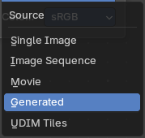

What kind of source image to use.

###### Single Image

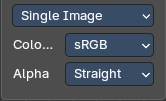

###### Color Space

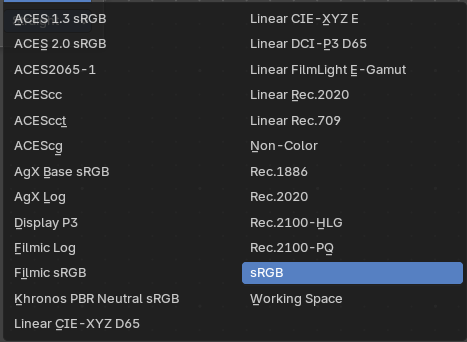

The color space for the image.

###### Alpha

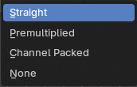

The alpha channel mode.

###### Image Sequence + Movie

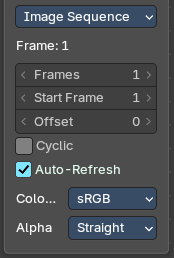

###### Frames

Number of images to use

###### Start Frame

The start frame

###### Offset

Offset the nubmer of the frame to use in the animation.

###### Cyclic

Cycle the images in the image sequence / Movie.

###### Auto-Refresh

Always refresh images on frame changes.

###### Color Space

The color space for the image.

###### Alpha

The alpha channel mode.

###### Generated

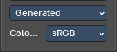

###### Color Space

The color space for the image.

###### UDIM Tiles

###### Color Space

The color space for the image.

###### Alpha

The alpha channel mode.

#### Outputs

##### Image

Data type: Color.

The image.

##### Alpha

Data type: Float.

The alpha channel of the image. A multilayer OpenEXR image gives one output for each of its layers and passes instead.

### Image Info

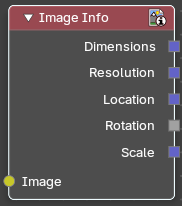

Returns informations about an image.

#### Inputs

##### Image

Data type: Color.

The input image.

#### Outputs

##### Dimensions

Data type: Integer Vector.

The dimensions of the image in pixels, with transformations applied.

##### Resolution

Data type: Integer Vector.

The original resolution of the image in pixels, before any transformations.

##### Pixel Size

Data type: Vector (2d).

The size of a pixel relative to its original size, for a proxy or an anamorphic image. For example, a 50% proxy image has a pixel size of 0.5.

##### Location

Data type: Vector (2d).

The locations output value.

##### Rotation

Data type: Float.

The rotation output value.

##### Scale

Data type: Vector (2d).

The scale output value.

### Image Coordinates

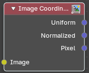

Returns the coordinates of the pixles of an image

#### Inputs

##### Image

Data type: Color.

The input image.

#### Outputs

##### Uniform

Data type: Vector (2d).

Zero centered coordinates normalizes along the larger dimension for uniform scaling.

##### Normalized

Data type: Vector (2d).

Normalized coordinates with half pixels offset.

##### Pixel

Data type: Integer Vector.

Integer pixel coordinates.

### Mask

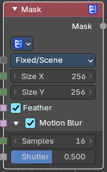

The Mask node can be used to select a Mask data. This node can be used with other nodes, for example to Invert, Multiply or Mix, or used as a factor input.

Masks can be created in the Image and Movie Clip editors, by changing the mode to Mask in the header. So you first need to create one in one of those editors.

#### Inputs

##### Size Source

Data type: Menu.

The source where the size of the mask comes from. Scene Size uses the render size of the scene. Fixed uses the Size X and Size Y inputs in pixels. Fixed/Scene uses the Size X and Size Y inputs, scaled by the render percentage of the scene.

##### Size X

Data type: Integer.

The resolution of the mask in the X direction. Only visible when Size Source is Fixed or Fixed/Scene.

##### Size Y

Data type: Integer.

The resolution of the mask in the Y direction. Only visible when Size Source is Fixed or Fixed/Scene.

##### Feather

Data type: Boolean.

Use or ignore feather points defined for splines see Mask Feathers for more details.

##### Motion Blur

This panel holds the motion blur settings. It is closed by default.

###### Motion Blur

Data type: Boolean.

For animated masks, creating a motion blurred mask from the surrounding frames, with a given number of samples (higher gives better quality), and a camera shutter time. This is the checkbox in the panel header.

###### Samples

Data type: Integer.

The number of motion blur samples.

###### Shutter

Data type: Float (factor).

Exposure for motion blur as a factor of frames per second.

#### Properties

##### Masks

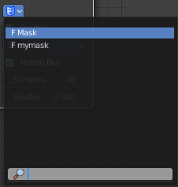

The available mask data. If the label is left blank, the mask name will be set.

#### Outputs

##### Mask

Data type: Float.

The black-and-white output of the mask.

### Movie Clip

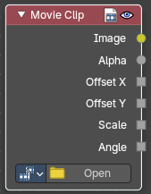

This node is a special node that uses some of the values taken from footage cameras and trackings and links them to the output. It is possible to load image sequences, but only Image and Alpha values will be available, because the other outputs will not have any values associated with them. When a tracked clip is chosen, Bforartists will fulfill the outputs using internal values taken from the tracking. So the controls for start and end frames will be defined at the Movie Clip editor.

#### Properties

##### Movie Clip

Select the movie clip.

Once loaded you will see a preview image of the movie. Scrolling through the timeline will display the corresponding frame in this preview image.

###### File browser

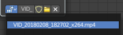

Choose an already loaded video.

###### Name

Read and edit the name of the video.

###### Fake User

Assign a fake user to this video. Fake users is an odd concept to keep data in the scene even if it has no user somewhere. The fake user is then a dummy user so that the object is not deleted when saving the scene.

###### Load File

Load a new video.

###### Delete File

Delete this video.

#### Outputs

##### Image

Data type: Color.

Outputs the entire image at the specified color space.

##### Alpha

Data type: Float.

The alpha value taken from the movie or image.

##### Offset X

Data type: Float.

The X offset value from the footage camera or tracking.

##### Offset Y

Data type: Float.

The Y offset value from the footage camera or tracking.

##### Scale

Data type: Float.

The scale of the image taken from the footage camera or tracking.

##### Angle

Data type: Float.

The lens angle taken from the footage camera or tracking.

### Sequencer Strip Info

Reads where a strip of the Video Sequencer sits. This node only appears when the compositor is used as a strip effect in the Sequencer. Use it to make an effect follow the strip it is applied to, for example a title that moves with the strip.

#### Outputs

##### Start Frame

Data type: Integer.

The first frame of the strip.

##### End Frame

Data type: Integer.

The last frame of the strip.

##### Location

Data type: Vector (2d).

The strip's position in the frame.

##### Rotation

Data type: Float.

The strip's rotation.

##### Scale

Data type: Vector (2d).

The strip's scale.

### String To Image

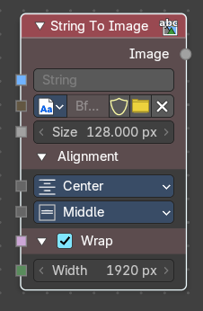

Converts a text string into an image buffer directly inside the compositor. Useful for overlaying text, generating procedural titles, or integrating dynamic labels into compositing workflows without external text objects.

#### Inputs

##### String

Data type: String.

Input field for the text content. Accepts plain text or dynamic string inputs. Can be used for captions, labels, or procedural text overlays.

##### Font

Data type: Font.

The font to use. Supports internal packed fonts and external font files. Ensures consistent typography across compositing setups.

##### Size

Data type: Float.

The height of each line of text in pixels. Larger values give bigger text.

##### Alignment

This panel holds the alignment settings. It is closed by default.

###### Horizontal Alignment

Data type: Menu.

The horizontal placement of the text: Left, Center or Right.

###### Vertical Alignment

Data type: Menu.

The vertical placement of the text: Top, Top Baseline, Middle, Bottom Baseline or Bottom.

##### Wrap

This panel holds the word wrap settings. It is closed by default.

###### Wrap

Data type: Boolean.

Enable word wrapping. When enabled, text flows into multiple lines based on the width. Useful for paragraphs or captions. This is the checkbox in the panel header.

###### Width

Data type: Integer.

The maximum width of each line in pixels. Longer lines are wrapped into new lines. Only used when **Wrap** is enabled.

#### Outputs

##### Image

Data type: Float.

Produces an **Image output** containing the rendered text as a float black and white image at the dimensions of the text.

This then can be connected to compositing nodes (e.g., Mix, Alpha Over) for integration into final renders. Supports color grading, masking, and blending like any other image input.

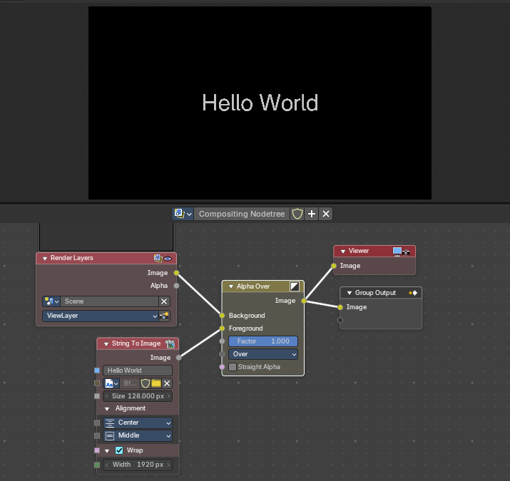

# Constant

## Add menu - Input - Constant

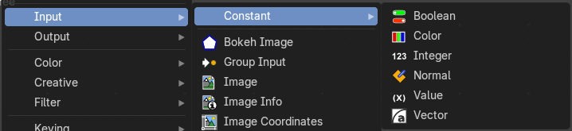

### Boolean

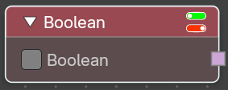

Provide a true / false value.

#### Properties

##### Boolean

The boolean toggle.

#### Outputs

##### Boolean

Data type: Boolean.

The state of the toggle.

### Color

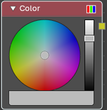

Set a color.

#### Properties

The RGB node uses the color picker widget.

#### Outputs

##### Color

Data type: Color.

A single RGBA color value.

### Font

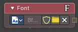

Provides a font. Use it to give the String to Image node a typeface without picking it inside that node.

#### Properties

##### Font

The font to use. Pick one from the font browser.

#### Outputs

##### Font

Data type: Font.

The chosen font.

### Integer

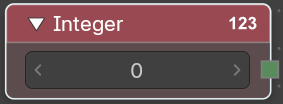

Provides an integer value.

#### Properties

##### Integer

The value.

#### Outputs

##### Integer

Data type: Integer.

The output value.

### Integer Vector

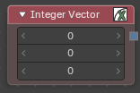

Provides a vector of whole numbers. Use it for values that have to stay whole, such as pixel positions or counts in two or three directions.

#### Properties

##### Dimensions

How many values the vector has.

##### Vector

The values of the vector.

#### Outputs

##### Vector

Data type: Integer Vector.

The integer vector.

### Menu

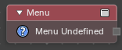

Provides a choice from a menu, for nodes that have a menu socket, for example the Operation of Match String. Use it to set one choice for several nodes.

#### Properties

##### Menu

The list of choices and the one that is picked.

#### Outputs

##### Menu

Data type: Menu.

The picked choice.

### Normal

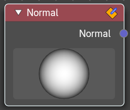

Input normalized normal values to the other nodes in the tree.

#### Properties

##### Input Value

Here you can adjust the directory of the light to see how the normals behaves.

#### Outputs

##### Normal

Data type: Vector (direction).

The output value.

### Object

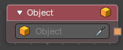

Provides a scene object. Use it to point several nodes, such as Object Info and Camera Info, at the same object.

#### Properties

##### Object

The object to provide. Pick one from the list.

#### Outputs

##### Object

Data type: Object.

The chosen object.

### Rotation

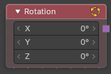

Provides a rotation that you type in as angles. Use it to feed a fixed turn into the Rotation nodes.

#### Properties

##### Rotation

The angles around X, Y and Z.

#### Outputs

##### Rotation

Data type: Rotation.

The rotation.

### String

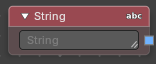

Provides a piece of text. Use it to type a name or a label once and use it in several places.

#### Properties

##### String

The text.

#### Outputs

##### String

Data type: String.

The text you typed.

### Value

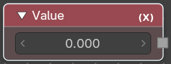

Provides a float value.

#### Properties

##### Value

The float value.

#### Outputs

##### Value

Data type: Float.

The output value.

### Vector

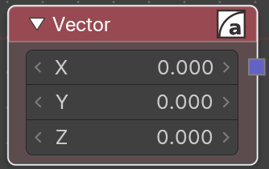

Provides a vector 3 value.

#### Properties

##### Vector

The single values of the vector 3.

#### Outputs

##### Vector

Data type: Vector.

The output vector.

# Scene

## Add menu - Input - Scene

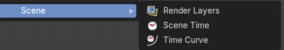

### Active Camera

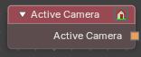

Gives you the camera the scene is currently using. Use it with Camera Info to read the camera's settings without picking the camera by name, so the node tree keeps working when you switch cameras.

#### Outputs

##### Active Camera

Data type: Object.

The scene's active camera, as an object.

### Bone Info

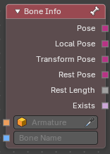

Reads the position of a bone of an armature. Use it to let a bone drive something in the compositor, for example a mask that follows a hand.

#### Inputs

##### Armature

Data type: Object.

The armature object that holds the bone.

##### Bone Name

Data type: String.

The name of the bone to read.

#### Properties

##### Transform Space

**Original** gives the bone's matrices in the armature's own space. **Relative** gives them relative to the object that uses the node.

#### Outputs

##### Pose

Data type: Matrix.

The bone's pose, as a matrix.

##### Local Pose

Data type: Matrix.

The pose relative to the parent bone.

##### Transform Pose

Data type: Matrix.

The pose with the bone's own transform removed.

##### Rest Pose

Data type: Matrix.

The bone in its rest position.

##### Rest Length

Data type: Float.

The length of the bone at rest.

##### Exists

Data type: Boolean.

On when a bone with that name exists.

##### Envelope

This panel holds the envelope outputs. It is closed by default.

###### Envelope Distance

Data type: Float.

The original envelope distance of the bone.

###### Radius Head

Data type: Float.

The original radius of the head of the bone.

###### Radius Tail

Data type: Float.

The original radius of the tail of the bone.

### Camera Info

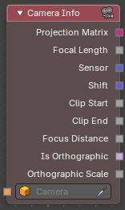

Reads the settings of a camera: its lens, sensor, clipping and projection. Use it to match an effect to the real camera, for example to scale a blur by the focal length or to feed the Projection Matrix to Project Point.

#### Inputs

##### Camera

Data type: Object.

The camera object to read.

#### Outputs

##### Projection Matrix

Data type: Matrix.

The matrix that turns a point of the scene into a position in the camera's picture.

##### Focal Length

Data type: Float.

The lens length in millimetres.

##### Sensor

Data type: Vector (2d).

The width and height of the sensor.

##### Shift

Data type: Vector (2d).

The lens shift in X and Y.

##### Clip Start

Data type: Float.

The nearest distance the camera sees.

##### Clip End

Data type: Float.

The farthest distance the camera sees.

##### Focus Distance

Data type: Float.

The distance that is in focus.

##### Is Orthographic

Data type: Boolean.

On for an orthographic camera.

##### Orthographic Scale

Data type: Float.

The size of the view of an orthographic camera.

### Is Viewport

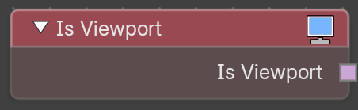

The Is Viewport node tells you whether the compositor is running in the 3D View viewport, rather than in the node editor or in a final render. Use it with a Switch node to keep a heavy effect out of the viewport so it stays fast, and show the full effect in the final render.

#### Outputs

##### Is Viewport

Data type: Boolean.

On (true) when the node tree is evaluated by the viewport compositor, off (false) in the node editor and in a final render.

### Object Info

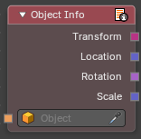

Reads where an object is, how it is turned and how big it is. Use it to let an object in the scene steer the compositor, for example to move a glow to the place of a lamp.

#### Inputs

##### Object

Data type: Object.

The object to read.

#### Properties

##### Transform Space

**Original** reads the object as it is. **Relative** reads it relative to the object that uses the node.

#### Outputs

##### Transform

Data type: Matrix.

The object's transform, as a matrix.

##### Location

Data type: Vector.

The location.

##### Rotation

Data type: Rotation.

The rotation. Use Rotate Vector or Rotation to Euler to work with it.

##### Scale

Data type: Vector.

The size along each axis.

### Render Layers

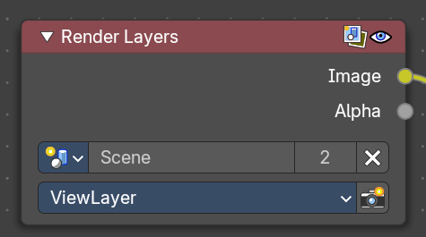

Inputs the available render layers.

This node is the starting place for getting a picture of your scene into the compositing node map.

The input happens through the properties.

#### Properties

##### Scene

Usually you don't need to select anything here when you work with just one Scene file. But in Bforartists you can work with more than one scene in a blend file. The scene information taken is the raw footage (pre-compositing and pre-sequencing).

> Note: To use composited footage from another scene, it has to be rendered into a multi-layer frame set (e.g. OpenEXR) as an intermediate file store and then imported with Image input node again.

###### View layer

A list of available View Layers.

###### Render

The render button allows you to re-render the active scene with one click.

#### Outputs

##### Image

Data type: Color.

The rendered image.

##### Alpha

Data type: Float.

The Alpha channel.

##### Render passes sockets

Data type: follows the render pass (Color, Float or Vector).

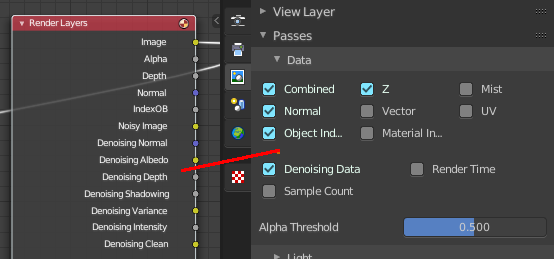

Depending on the Render passes that are enabled, other sockets are available. See Cycles and Eevee render passes. The Workbench renderer does not have extra render passes sockets. It just provides Image and Alpha output.

##### Depth

Data type: Float.

The Z depth pass. By default this pass is enabled.

### Scene Time

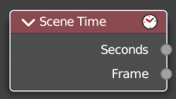

Gives you the time of the scene: the current frame and the time in seconds. Use it to animate an effect with the timeline without keyframes, for example to fade a vignette in over the first two seconds. The Frame output is a decimal number so effects such as motion blur can use sub-frame times.

#### Outputs

##### Seconds

Data type: Float.

The scene time in seconds.

##### Frame

Data type: Float.

The current frame, as a decimal number.

### Time Curve

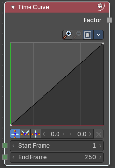

The Time node generates a factor value that changes according to the curve as time progresses through the Timeline. The range goes from 0.0 to 1.0. The default is a linear line from 0.0 to 1.0. But the curve can be adjusted.

#### Inputs

##### Start Frame

Data type: Integer.

The first frame of the range of time that the output lasts. This range becomes the X axis of the graph. To reverse the time, set a start frame greater than the end frame.

##### End Frame

Data type: Integer.

The last frame of the range of time that the output lasts.

#### Properties

##### Navigation elements

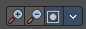

The navigation elements for the curve. They are described from left to right.

##### Zoom in and out

The two buttons with the magnifying glass at it zooms in and out in the curve window.

##### Clipping

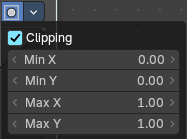

Clipping options. Set up clipping for the stroke.

##### Tools

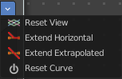

Tools is a menu where you can find some curve related tools.

###### Reset View

Resets the curve windows zoom.

###### Extend Horizontal

Extends the curve horizontally before the first point and behind the last point.

###### Extend Extrapolated

Extends the curve extrapolated before the first point and behind the last point.

###### Reset Curve

Resets the curve to the initial shape.

##### Curve window

Tweak and adjust the falloff curve by clicking at a curve point and dragging it around.

Double click adds a new point.

Holding down ctrl activates temporary snapping.

Holding down shift enables slower movement, which allows more accurate setting.

##### Selecting Points

> This setting uses the **curve widget**: click to add points, drag to move them. See **[Curve Widget](../../../../interface/properties.md#curve-widget)** in the Interface chapter.

##### Adding Points

You can add new curve points by simply left clicking at the curve. Move the mouse to position them where you need it.

###### Vector Handle

Set handle type to Vector.

###### Auto Handle

Set handle type to Auto.

###### Auto Clamped Handle

Set handle type to Auto Clamped.

###### X and Y value edit box

The X and Y value for the currently selected curve point.

###### Delete Points

Deletes selected curve points.

#### Outputs

##### Factor

Data type: Float.

A speed of time factor (from 0.00 to 1.00) relative to the frame rate defined in the Render Dimensions Panel. The factor changes according to the defined curve.

> Note: By using curves it is possible that the Time node may output a number larger than one or less than zero. To be safe, you should use the Min/Max clamping function of the Map Value node to limit output.

