## Add menu - Keying

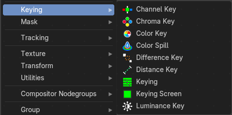

These nodes give you the essential tools for creating a Matte or keying for images that do not already have their own Alpha Channel. One usage scenario is blue-screen or green-screen footage, where live action is shot in front of a blue or green backdrop for replacement by a matte painting or virtual background.

In general, hook up these nodes to a viewer, set your Image Editor to show the Viewer node, and play with the sliders in real-time using a sample image from the footage, to get the settings right. In some cases, small adjustments can eliminate artifacts or foreground image degradation. Taking out too much green can result in foreground actors looking flat or blueish/purplish.

You can and should chain these nodes together, improving your masking and color correction in successive refinements, using each node’s strengths to operate on the previous node’s output. Keying Node is the closest to a “does-it-all” node for green screens, but the best results stem from a combination of techniques.

> **Note:** 

Garbage Matte is not a node, but a technique selecting what to exclude from an image. It is a Mask used to identify content to be removed from an image that cannot be removed by an automatic process like chroma keying. It is used either to select specific content to be removed, or it is the inverse of a rough selection of the subject; removing everything else.

Some nodes accept a garbage matte directly. For those that don’t, you can still apply one by subtracting the garbage matte from the matte generated by the node.

Simple garbage mattes can be created with the Box Mask or the Ellipse Mask. More complicated matte shapes using a Double Edge Mask or using a Mask.

### Channel Key

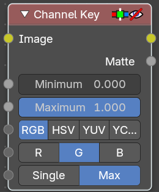

The Channel Key node determines background objects from foreground objects by the difference in the selected channel’s levels.

For example in YUV color space, this is useful when compositing stock footage of explosions (very bright) which are normally shot against a solid, dark background.

#### Inputs

##### Image

Data type: Color.

Standard image input.

##### Minimum

Data type: Float (factor).

Channel values lower than this minimum are keyed. It determines the lowest values that are considered foreground. (Which is supposed to be – relatively – high values: from this value to 1.0.)

##### Maximum

Data type: Float (factor).

Channel values higher than this maximum are not keyed. It determines the highest values that are considered to be background objects. (Which is supposed to be – relatively – low values: from 0.0 to this value.)

##### Color Space

Data type: Menu.

Selects what color space the channels will represent: RGB, HSV, YUV or YCbCr. It decides which of the Key Channel and Limit Channel inputs is visible.

##### RGB Key Channel

Data type: Menu.

The channel to use to determine the matte: R, G or B. Only visible when Color Space is RGB.

##### HSV Key Channel

Data type: Menu.

The channel to use to determine the matte: H, S or V. Only visible when Color Space is HSV.

##### YUV Key Channel

Data type: Menu.

The channel to use to determine the matte: Y, U or V. Only visible when Color Space is YUV.

##### YCbCr Key Channel

Data type: Menu.

The channel to use to determine the matte: Y, Cb or Cr. Only visible when Color Space is YCbCr.

##### Limit Method

Data type: Menu.

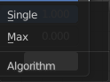

How to limit the matte. Single limits by a single channel that you choose. Max limits by the maximum of the other channels.

##### RGB Limit Channel

Data type: Menu.

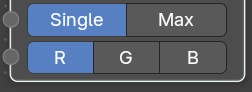

The channel to limit by: R, G or B. Only visible when Limit Method is Single and Color Space is RGB.

##### HSV Limit Channel

Data type: Menu.

The channel to limit by: H, S or V. Only visible when Limit Method is Single and Color Space is HSV.

##### YUV Limit Channel

Data type: Menu.

The channel to limit by: Y, U or V. Only visible when Limit Method is Single and Color Space is YUV.

##### YCbCr Limit Channel

Data type: Menu.

The channel to limit by: Y, Cb or Cr. Only visible when Limit Method is Single and Color Space is YCbCr.

#### Outputs

##### Image

Data type: Color.

Image with an alpha channel adjusted for the keyed selection.

##### Matte

Data type: Float.

A black-and-white alpha mask of the key.

### Chroma Key

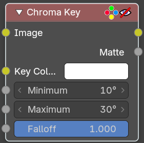

The Chroma Key node determines if a pixel is a foreground or background (and thereby should be transparent) based on its chroma values.

Use this, for example, to composite images that have been shot in front of a green or blue screen.

#### Inputs

##### Image

Data type: Color.

Standard image input.

##### Key Color

Data type: Color.

The background color, usually picked with the color picker from the original image.

##### Minimum

Data type: Float (angle).

If the angle between the color and the key color in CrCb space is less than this minimum angle, the color is keyed.

##### Maximum

Data type: Float (angle).

If the angle between the color and the key color in CrCb space is larger than this maximum angle, the color is not keyed.

##### Falloff

Data type: Float (factor).

Increase to make nearby pixels partially transparent, for a smoother blend along the edges. 0 is completely sharp and 1 is completely smooth.

#### Outputs

##### Image

Data type: Color.

Image with its alpha channel adjusted for the keyed selection.

##### Matte

Data type: Float.

A black-and-white alpha mask of the key.

### Color Key

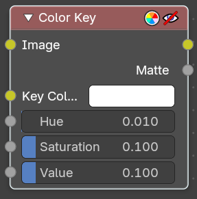

The Color Key node creates a matte based on a specified color of the input image.

#### Inputs

##### Image

Data type: Color.

Standard image input.

##### Key Color

Data type: Color.

The color to key.

##### Hue

Data type: Float (factor).

If the difference in hue between the color and the key color is less than this threshold, the color is keyed. Higher values add a wider range of colors to the matte.

##### Saturation

Data type: Float (factor).

If the difference in saturation between the color and the key color is less than this threshold, the color is keyed.

##### Value

Data type: Float (factor).

If the difference in value (brightness) between the color and the key color is less than this threshold, the color is keyed.

#### Outputs

##### Image

Data type: Color.

Image with its alpha channel adjusted for the keyed selection.

##### Matte

Data type: Float.

A black-and-white alpha mask of the key.

### Color Spill

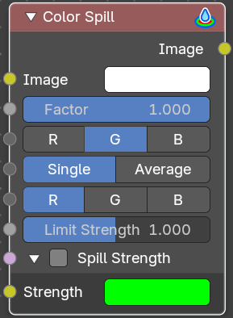

The Color Spill node reduces one of the RGB channels so that it is not greater than any of the others.

This is common when compositing images that were shot in front of a green or blue screen. In some cases, if the foreground object is reflective, it will show the green or blue color; that color has “spilled” onto the foreground object. If there is light from the side or back, and the foreground actor is wearing white, it is possible to get “spill” green (or blue) light from the background onto the foreground objects, coloring them with a tinge of green or blue. To remove the green (or blue) light, you use this fancy node.

#### Inputs

##### Image

Data type: Color.

Standard image input.

##### Factor

Data type: Float (factor).

Standard Factor.

##### Spill Channel

Data type: Menu.

The color channel that has the spill: R, G or B.

##### Limit Method

Data type: Menu.

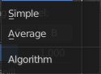

How to limit the spill. Single limits by a single channel that you choose. Average limits by the average of the other two channels.

##### Limit Channel

Data type: Menu.

The channel to limit by: R, G or B. Only visible when Limit Method is Single.

##### Limit Strength

Data type: Float (factor).

Specifies the limiting strength of the limit channel.

##### Spill Strength

This panel holds the spill strength settings. It is closed by default.

###### Use Spill Strength

Data type: Boolean.

Allows you to specify the spill strength for each color channel. If disabled, the spill channel will have a unit scale, while the other channels will be zero. This is the checkbox in the panel header.

###### Strength

Data type: Color.

Specifies the spilling strength of each color channel.

#### Outputs

##### Image

Data type: Color.

The image with the corrected channels.

### Difference Key

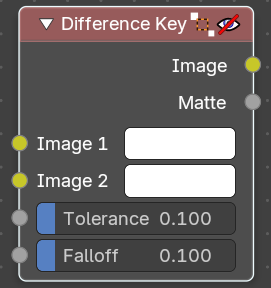

This node produces a matte that isolates foreground content by comparing it with a reference background image.

#### Inputs

##### Image 1

Data type: Color.

Contains foreground content against the background that is to be removed.

##### Image 2

Data type: Color.

The reference background image.

##### Tolerance

Data type: Float (factor).

Where pixels match the reference background to within the specified threshold, the matte is made transparent.

##### Falloff

Data type: Float (factor).

Increase to make nearby pixels partially transparent, for a smoother blend along the edges.

#### Outputs

##### Image

Data type: Color.

Image with its alpha channel adjusted for the keyed selection.

##### Matte

Data type: Float.

A black-and-white alpha mask of the key.

### Distance Key

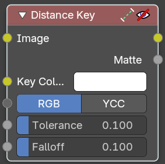

The Distance Key node determines a pixel’s alpha value based on the three-dimensional distance between the image pixel color and the key color in a 3D color space.

This key works well when trying to single out a specific color in a background (not necessarily green).

#### Inputs

##### Image

Data type: Color.

Standard image input.

##### Key Color

Data type: Color.

The color that is to be keyed.

##### Color Space

Data type: Menu.

The color space to measure the distance in: RGB or YCC. It is also possible to work with YCbCr color space, but only the Cb and Cr channels are taken into consideration for determining the distance between the foreground and background pixels.

##### Tolerance

Data type: Float (factor).

A threshold what the node considers a match between the key color and the foreground pixel. The tolerance affects how close a pixel needs to be to the background pixel to be considered an absolute match.

##### Falloff

Data type: Float (factor).

When the Falloff value is high, pixels that are close to the Key Color are more transparent than pixels that are not as close to the Key Color (but still considered close enough to be keyed). When the Falloff value is low, it does not matter how close the pixel color (Image) is to the Key Color, it is transparent.

#### Outputs

##### Image

Data type: Color.

The image with an alpha channel adjusted for the keyed selection.

##### Matte

Data type: Float.

A black-and-white alpha mask of the key.

### Keying

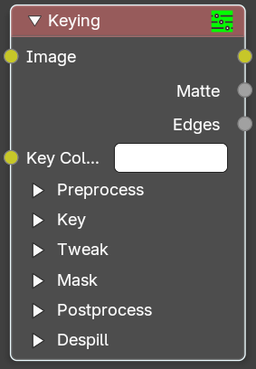

The Keying node is a one-stop-shop for “green screen” / “blue screen” removal. It performs both chroma keying to remove the backdrop and despill to correct color cast from the backdrop. Additionally, you can perform common operations used to tweak the resulting matte.

#### Inputs

##### Image

Data type: Color.

Standard image input.

##### Key Color

Data type: Color.

The color of content to be removed. This may be a single color, or a reference image such as generated by the Keying Screen Node.

##### Preprocess

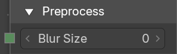

This panel holds the settings that prepare the image before keying. It is closed by default.

###### Blur Size

Data type: Integer.

Reduce the effects of color noise in the image by blurring only color by the given amount, leaving luminosity intact. This will affect matte calculation only, not the result image.

##### Key

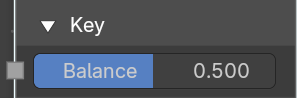

This panel holds the key settings. It is closed by default.

###### Balance

Data type: Float (factor).

This is the balance between color channels compared with the key color. 0.5 will average the other channels (red and blue in the case of a green screen).

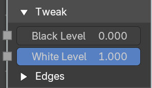

This may be tweaked in tandem with Black Level and White Level while checking the Matte output to create a mask with optimal separation.

##### Tweak

This panel holds the settings to tweak the matte. It is closed by default. It also contains the Edges panel.

###### Black Level

Data type: Float (factor).

This sets the threshold for what becomes fully transparent in the output (black in the matte). It should be set as low as possible. Uneven backdrops will require this value to be increased. Use of the Keying Screen Node can help keep this value low. You may also use a Garbage Matte to exclude problematic areas.

This value does not impact areas detected as edges to ensure edge detail is preserved.

###### White Level

Data type: Float (factor).

This sets the threshold for what becomes fully opaque in the output (white in the matte). It should be set as high as possible. Colors close to green in the foreground may require reducing this value and/or adjusting the Balance. Particularly problematic parts can be fixed with a Core Matte instead of a low White Level.

This value does not impact areas detected as edges to ensure edge detail is preserved.

###### Size

Data type: Integer.

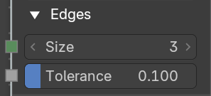

Size of the search window to find edges. In the Edges panel inside the Tweak panel.

###### Tolerance

Data type: Float (factor).

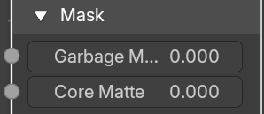

The tolerance in the color difference in which a pixel is considered to be part of the edge. In the Edges panel inside the Tweak panel.

##### Mask

This panel holds optional masks. It is closed by default.

###### Garbage Matte

Data type: Float (factor).

An optional mask of area(s) to always exclude from the output. This is removed from the chroma key generated matte.

###### Core Matte

Data type: Float (factor).

An optional mask of area(s) to always include in the output. This is merged with the chroma key generated matte.

##### Postprocess

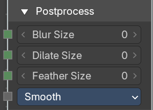

This panel holds the settings that change the matte after keying. It is closed by default.

###### Blur Size

Data type: Integer.

Blur the matte with the given size.

###### Dilate Size

Data type: Integer.

Dilate or erode the matte with the given size. A negative value means erosion, a positive value means dilate.

###### Feather Size

Data type: Integer.

Dilate or erode the matte using an inverse distance operation with the given size. A negative value means erosion, a positive value means dilate.

###### Feather Falloff

Data type: Menu.

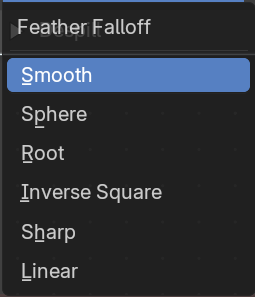

The rate of the falloff at the edges of the matte when feathering, to manage edge detail.

##### Despill

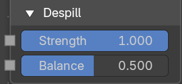

This panel holds the despill settings. It is closed by default.

###### Strength

Data type: Float (factor).

Controls how much color bleed from the key color is removed from the input image: 0 means no despilling, 1 means all possible spilling will be removed. The underlying implementation is the same as adjusting the Unspill amount of the Color Spill Node.

###### Balance

Data type: Float (factor).

This controls how the color channels are compared when computing spill, affecting the hue and shade of the corrected colors. It is similar to setting the Limit Channel in the Color Spill Node.

#### Outputs

##### Image

Data type: Color.

The image with the backdrop removed and the spill corrected.

##### Matte

Data type: Float.

A black-and-white alpha mask of the key.

##### Edges

Data type: Float.

Shows the pixels that the node identified as edges. Use it to check the Size and Tolerance settings.

### Keying Screen

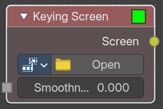

The Keying Screen node creates plates for use as a color reference for keying nodes. It generates gradients from sampled colors on motion tracking points on movie clips. It can be used to deal with uneven colors of green screens.

Note that you need to have a motion tracking project loaded. This gives you the Camera then.

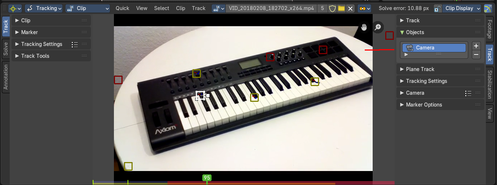

#### Inputs

##### Smoothness

Data type: Float (factor).

The smoothness of the keying screen.

#### Properties

##### Movie Clip

The movie clip whose tracking points give the gradient colors. Pick a clip that is already loaded from the dropdown.

###### Open

Loads a new movie clip right from the node, so you don't have to load it in the Movie Clip Editor first.

##### Tracking Object

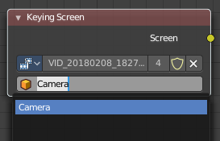

Tracking Object to generate the gradient. You will probably want to create new a tracking object in the Object panel, because tracks used for gradients can not actually be used for camera/object tracking. After this tracks might be placed in places where gradient colors should be sampled. These tracks could be tracked or moved manually, so gradients would be updating automatically along the movie. Tracks might have an offset for easier tracking of feature-less screens.

#### Outputs

##### Screen

Data type: Color.

Gradient image output.

### Luminance Key

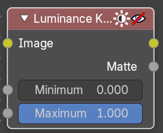

The Luminance Key node determines background objects from foreground objects by the difference in the luminance (brightness) levels.

Stock footage of explosions, smoke or debris are normally shot against a solid, dark background rather than a green screen. This node can separate the foreground effect from the background. It can also be used for sky replacement for overexposed or gray skies that aren’t suitable for chroma keying.

Tip

When compositing footage of something that emits light and has a dark background, like fire, a Mix Node using a Screen or Add operator will produce better results.

#### Inputs

##### Image

Data type: Color.

Standard image input.

##### Minimum

Data type: Float (factor).

Determines the lowest values that are considered foreground. (Which is supposed to be – relatively – light: from this value to 1.0.)

##### Maximum

Data type: Float (factor).

Determines the highest values that are considered to be background objects. (Which is supposed to be – relatively – dark: from 0.0 to this value.) Note. Brightness levels between the two values form a gradient of transparency between foreground and background objects.

#### Outputs

##### Image

Data type: Color.

Image with an alpha channel adjusted for the keyed selection.

##### Matte

Data type: Float.

A black-and-white alpha mask of the key.
