## Add menu - Tracking

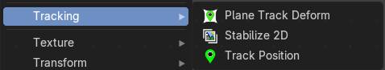

The Tracking menu contains nodes for tracking motion data.

### Plane Track Deform

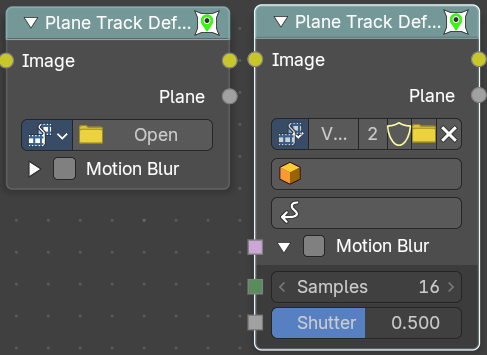

The Plane Track Deform Node is used to incorporate the special “plane track” in your composite by checking areas which are planes, and replacing their footage with some other image.

Before using this node, plane track for the footage should be made in the Movie Clip Editor.

#### Inputs

##### Image

Data type: Color.

Image to put in place of the plane track, and thus, override that area in the movie clip.

##### Motion Blur

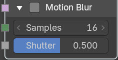

This panel holds the motion blur settings. It is closed by default.

###### Motion Blur

Data type: Boolean.

Use blur caused by the motion of the plane track. This is the checkbox in the panel header.

###### Samples

Data type: Integer.

The number of samples to take for each frame. The higher this number, the smoother the blur effect, but the longer the render, as each virtual intermediate frame has to be rendered. Note: Samples are taken only from the next frame, not the previous one. Therefore the blurred object will appear to be slightly ahead of how it would look without motion blur.

###### Shutter

Data type: Float (factor).

Time (in frames) the shutter is open. If you are rendering at 24 fps, and the Shutter is set to 0.5, the time in between frames is 41.67 ms, so the shutter is open for half that, 20.83 ms.

#### Properties

##### Movie Clip

Used to select the movie clip whose plane track to use. For controls see Data-Block Menu.

##### Object

Used to select the object to which the plane track is linked.

##### Plane Track

Used to select the plane track to use.

#### Outputs

##### Image

Data type: Color.

The output by perspective wrapping the image to that plane track.

##### Plane

Data type: Float.

Produces a black-and-white mask of the plane track.

### Stabilize 2D

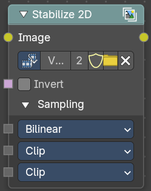

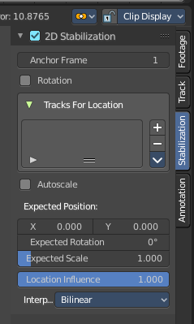

The Stabilize 2D node stabilizes the footage according to the settings set in Movie Clip Editor in the Sidebar in the Stabilization tab in the 2D Stabilization panel. For more information, see the chapter there.

#### Inputs

##### Image

Data type: Color.

Standard image input.

##### Frame

Data type: Integer.

The frame to get the stabilization data at. By default this is the current scene frame.

##### Invert

Data type: Boolean.

Invert the stabilization. If the stabilization calculated is to move the movie clip up by 5 units, this will move the movie clip down by 5 units.

##### Sampling

This panel holds the sampling settings. It is closed by default.

###### Interpolation

Data type: Menu.

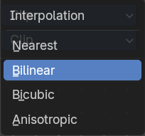

Filter methods for the stabilization.

###### Extension X

Data type: Menu.

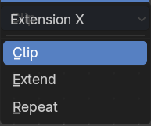

How to extend the image in X direction.

###### Extension Y

Data type: Menu.

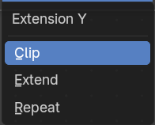

How to extend the image in Y direction.

#### Properties

##### Movie Clip

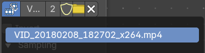

The movie clip whose stabilization to use.

###### Clip browser

The available loaded clips

###### Name

The name of the active clip.

###### Number of users

How much users this clip has.

###### Fake User

Keep it in the scene even if it has no users.

###### Open Clip

Open a new clip.

###### Remove Clip

Remove the active clip. The clip will remain in the scene, and will be removed when you close Bforartists and it has no user anymore. See Fake User.

#### Outputs

##### Image

Data type: Color.

Standard image output.

### Track Position

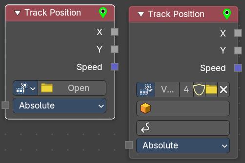

The Track Position node is used to return information about a tracking marker to the Compositor. You need a tracking project here.

#### Inputs

##### Mode

Data type: Menu.

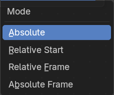

Which marker position to use for output.

###### Absolute

Outputs an absolute position of a marker.

###### Relative Start

Outputs the positions of a marker relative to the first marker of a track.

###### Relative Frame

Outputs the positions of a marker relative to the markers of the given Frame.

###### Absolute Frame

Outputs the absolute positions of a marker at the given Frame.

##### Frame

Data type: Integer.

The frame to use as reference. Only visible when Mode is Relative Frame or Absolute Frame.

#### Properties

##### Movie Clip browser

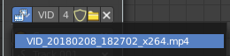

Choose a loaded movie file.

##### Open

Open a movie file.

###### Name

Read and edit the name of the video.

###### Fake User

Assign a fake user to this video. Fake users is an odd concept to keep data in the scene even if it has no user somewhere. The fake user is then a dummy user so that the object is not deleted when saving the scene.

###### Load File

Load a new video.

###### Delete File

Delete this video.

###### Tracking Object

Camera object to get track information from.

###### Track Name

The name of the track to get track information from.

#### Outputs

##### X

Data type: Float.

The marker’s X location.

##### Y

Data type: Float.

The marker’s Y location.

##### Speed

Data type: Vector (velocity).

The velocity of the marker, measured in pixels per frame. This could be used to fake effects like motion blur by connecting it to the Vector Blur Node.
