## Add menu - Utilities

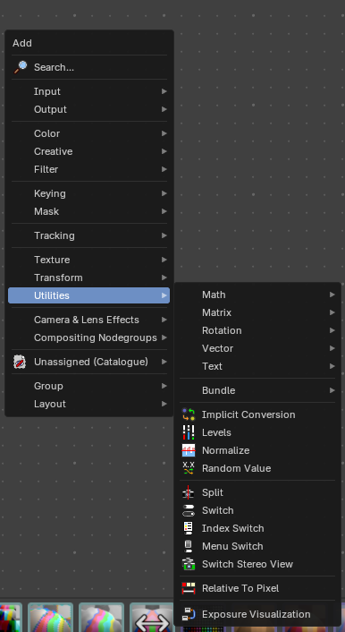

Here you find nodes that are used as utilities.

### Implicit Conversion

Changes a value from one socket type to another, the same way Bforartists does it by itself when you connect sockets of different types. Use it to make the conversion visible and to choose the target type yourself, for example from a color to a single number.

#### Inputs

##### Value

Data type: follows the Data Type setting.

The value to convert.

#### Properties

##### Data Type

The type to convert to.

#### Outputs

##### Value

Data type: follows the Data Type setting.

The converted value.

### Levels

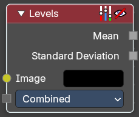

The Levels Node reads the inputs color channels and outputs analytical values. It’s useful for evaluating image brightness and contrast, and for driving effects based on image intensity.

#### Inputs

##### Image

Data type: Color.

The image input.

#### Properties

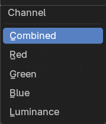

##### Channel

The Red, Green, Blue or Luminance channels

##### Outputs

1D values based on the levels of an image.

##### Mean

The mean is the average value of all image pixels in specified channel (combined, red, green, blue, luminance). It tells you how dark or bright the image is and can be used as such for setups that depend on how is input “bright” or “dark”.

##### Standard Deviation

How much those pixel values differ from the mean. A low standard deviation indicates that the pixel values tend to be very close to the mean. A high standard deviation indicates that the values are spread out over a large range of values. The visualization of such data is just a gray rectangle.

### Normalize

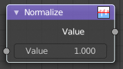

Find the minimum and maximum values of a single channel. Then map the values to a range of 0 and 1.

#### Inputs

##### Value

Data type: Float.

Standard value input.

#### Outputs

##### Value

Data type: Float.

Standard value output.

### Random Value

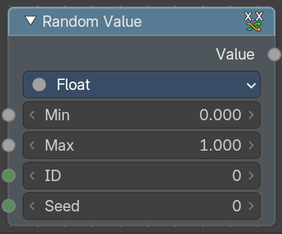

The Random Value node gives a random value for each ID. Use it to vary an effect between images or between values. The same ID and seed always give the same result. Every input can be an image or a single value, and images are processed pixel by pixel.

#### Inputs

##### Min

Data type: follows the Data Type setting.

The lowest value that can be returned (default 0). It appears for Float, Integer and Vector.

##### Max

Data type: follows the Data Type setting.

The highest value that can be returned (default 1.0 for Float, 1.0 on each axis for Vector, 100 for Integer). It appears for Float, Integer and Vector.

##### Probability

Data type: Float (factor).

The chance that the result is true, from 0.0 to 1.0 (default 0.5). It replaces Min and Max for Boolean.

##### ID

Data type: Integer.

Gives each value its own random number (default 0). In the Compositor it is a plain value input. Connect an image here, for example one with IDs, to get a different random value per pixel.

##### Seed

Data type: Integer.

Changes the whole set of random values at once (default 0).

#### Properties

##### Data Type

The type of the random value: Float, Integer, Boolean or Vector.

#### Outputs

##### Value

Data type: follows the Data Type setting.

The random value, in the chosen data type.

### Repeat

Adds a repeat zone: a **Repeat Input** and a **Repeat Output** node with a zone between them. The nodes in the zone run again and again, as many times as **Iterations** says, and each round starts with the result of the round before. Use it to apply an effect several times, for example to blur or grow a mask step by step, without copying the same nodes.

You add the sockets that pass through the zone yourself by connecting them to the empty socket. The **Iteration** output tells which round is running, starting at 0. The repeat zone works like the one in Geometry Nodes: see [Repeat](../../../geometry-node-editor/header/add-menu/utilities.md#repeat).

### Split

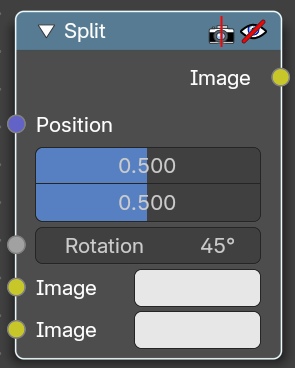

Allows to combine two images horizontally or vertically

#### Inputs

##### Position

Data type: Vector (factor).

Line position where the image should be split.

##### Rotation

Data type: Float (angle).

Line angle where the image should be split.

##### Image

Data type: Color.

The first image.

##### Image

Data type: Color.

The second image.

#### Outputs

##### Image

Data type: Color.

Image output.

### Switch

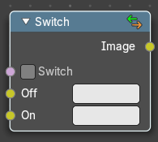

The Switch node is akin to a boolean, where you can use a toggle to choose what is shown with on or off.

#### Properties

##### Switch

The toggle that turns the switch on or off resulting in the final output being whatever is in the on or off input.

#### Inputs

##### Off

Data type: Color.

The image that is shown when the toggle is off.

##### On

Data type: Color.

The image that is shown when the toggle is on.

##### Image

Standard RGB image output.

### Index Switch

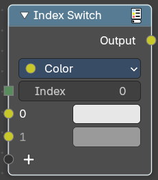

Choose between an arbitrary number of values with an index.

#### Properties

##### Data Type

What data type to evaluate.

#### Inputs

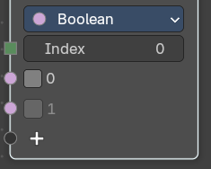

The content changes. dependant of the data type.

##### Index

Data type: Integer.

The index input value.

##### 0

Data type: follows the Data Type setting.

The 0 value

##### 1

Data type: follows the Data Type setting.

The 1 value

#### Output

##### Output

Data type: follows the Data Type setting.

The output index value.

### Menu Switch

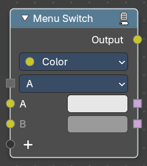

Select from multiple inputs by name.

#### Properties

##### Data Type

What data type to evaluate.

#### Inputs

The content changes. dependant of the data type.

##### Menu input

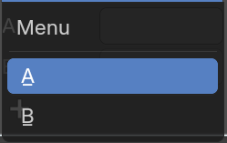

The default menu.

###### A

The A input.

###### B

The B input.

#### Output

##### Outputs

The output string.

##### A

Data type: Boolean.

The A output

##### B

Data type: Boolean.

The B output

### Switch Stereo View

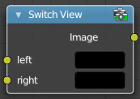

The Switch View node combines the views (left and right) into a single Stereo 3D output. This can be useful if for example, you need to treat the view as separate images by combining each of the views.

#### Inputs

##### Left

Left-eye image input.

##### Right

Right-eye image input.

#### Outputs

##### Image

Stereo 3D image output.

### Relative to Pixel

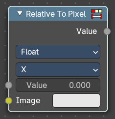

The **Relative to Pixel** node converts values expressed as **relative factors** (e.g., percentages of image size) into **absolute values**. This is especially useful when working with nodes that require pixel-based inputs, such as filters or masks, while still allowing for resolution-independent setups.

Example: Converting a Value of 10 Using “Per Dimension”

Let’s say you’re working with an image that’s 1920 pixels wide and 1080 pixels tallwith the following input value and properties.

- **Mode**: Per Dimension
- **Input Value**: *10%* (or *0.10* as a relative value)
- **Value Type**: 2D Vector *(0.10, 0.10)*

Using **Per Dimension **type, each component of the vector is multiplied by its respective X and Y image dimension:

- **X = 0.10 × 1920 = 192 pixels**
- **Y = 0.10 × 1080 = 108 pixelsResulting Pixel Value:** *(192, 108)*

#### Inputs

##### Value

Data type: follows the Data Type setting.

The input float value to convert. This would be your absolute value.

##### Image

Data type: Color.

The reference image used to determine pixel dimensions. If not connected, the active compositing image is used.

#### Properties

##### Data Type

Specifies whether the input is a **Float** or a **Vector**. This affects how the conversion is applied.

##### Reference Dimension

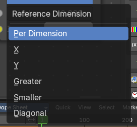

Determines how the relative value is interpreted.

**Per Dimension**: Converts each component (X and Y) relative to its corresponding image dimension.

**X**: Converts the value relative to the image width.

**Y**: Converts the value relative to the image height.

**Greater**: Uses the larger of the image’s width or height as the reference.

**Smaller**: Uses the smaller of the image’s width or height.

**Diagonal**: Uses the diagonal length of the image as the reference.

#### Outputs

##### Value

Data type: follows the Data Type setting.

The converted float value, based on the selected mode and input type.

# Closure

## Add menu - Utilities - Closure

Closures let you pass a piece of node logic into a node group, like a small function. Build the logic in a **Closure** zone, then run it somewhere else with **Evaluate Closure**. They work like the closures in Geometry Nodes: see [Closure](../../../geometry-node-editor/header/add-menu/utilities.md#closure).

### Closure

Adds a closure zone: a **Closure Input** and a **Closure Output** node. The nodes in the zone are not run where they are; the **Closure** output carries them as one value that you can connect to a node group or to Evaluate Closure.

### Evaluate Closure

Runs the logic of a closure with the inputs you give it, and outputs its result. The input and output sockets must have the same names and types as the ones in the closure zone.

# Math

## Add menu - Utilities - Math

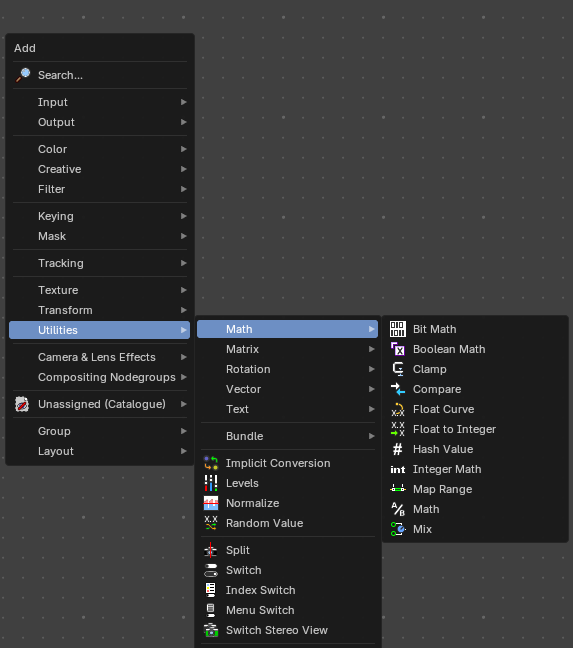

### Bit Math

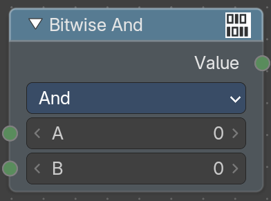

The Bit Math node works on the individual bits of whole numbers (32-bit integers). It is useful for packing flags into a single number or for building masks from ID values. Every input can be an image or a single value. Images are processed pixel by pixel, so you can use this node on a whole image at once.

#### Inputs

##### A

Data type: Integer.

The integer to work on (default 0).

##### B

Data type: Integer.

The second integer (default 0). It is not shown for Not, Shift and Rotate.

##### Shift

Data type: Integer.

How many bits to shift or rotate A by, from -31 to 31 (default 0). It only appears for Shift and Rotate.

#### Properties

##### Operation

Chooses the bit operation.

- **And**: A bit is set when it is set in both A and B.
- **Or**: A bit is set when it is set in A or in B.
- **Exclusive Or**: A bit is set when it is set in only one of A and B.
- **Not**: Flips every bit of A. In decimal this is the same as -A - 1.
- **Shift**: Moves the bits of A by the Shift amount. Positive values shift left, negative values shift right.
- **Rotate**: Like Shift, but the bits that fall off one end come back in at the other end. Positive values rotate left, negative values rotate right.

#### Outputs

##### Value

Data type: Integer.

The resulting integer.

### Boolean Math

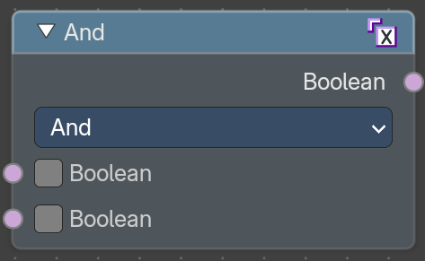

The Boolean Math node combines true and false values with a logical operation. Use it to combine masks or conditions, for example to switch an effect on only when two conditions are both true. Every input can be an image or a single value. Images are processed pixel by pixel, so you can use this node on a whole image at once.

#### Inputs

##### First Boolean

Data type: Boolean.

The first true or false value (default false).

##### Second Boolean

Data type: Boolean.

The second true or false value (default false). It is not shown for Not.

#### Properties

##### Operation

Chooses the logical operation.

- **And**: True when both inputs are true.
- **Or**: True when at least one input is true.
- **Not**: The opposite of the input.
- **Not And**: True when at least one input is false.
- **Nor**: True when both inputs are false.
- **Equal**: True when both inputs are the same.
- **Not Equal**: True when the inputs are different.
- **Imply**: True unless the first input is true and the second is false.
- **Subtract**: True when the first input is true and the second is false.

#### Outputs

##### Boolean

Data type: Boolean.

The result of the operation.

### Clamp

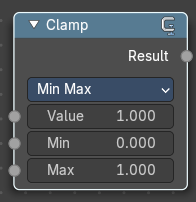

The **Clamp** node restricts a value to lie within a specified range. It’s commonly used in compositing to prevent values from exceeding a desired minimum or maximum, which helps avoid unwanted brightness spikes or clipping in image processing.

#### Inputs

##### Value

Data type: Float.

Standard Value input. (Value refers to each vector in the set.)

#### Properties

##### Clamp Type

A dropdown that determines how the clamping is applied: Min / Max or Range.

##### Min / Max

The minimum and maximum allowed value. Any input lower or higher than this will be lowered or raised to this value.

#### Outputs

##### Value

Data type: Float.

Standard value output.

### Compare

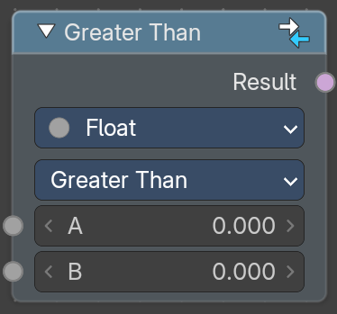

The Compare node compares two values and outputs true or false. Use it to turn a value into a mask, for example everything brighter than a limit. Every input can be an image or a single value. Images are processed pixel by pixel, so you can use this node on a whole image at once.

#### Inputs

##### A

Data type: follows the Input Type setting.

The first value. Its type follows the Input Type property.

##### B

Data type: follows the Input Type setting.

The second value. Its type follows the Input Type property.

##### C

Data type: Float.

The value that the dot product of A and B is compared against (default 0.9). It only appears for Vector inputs in Dot Product mode.

##### Angle

Data type: Float (angle).

The angle that the angle between A and B is compared against (default 5 degrees). It only appears for Vector inputs in Direction mode.

##### Epsilon

Data type: Float.

How close two values must be to count as equal (default 0.001). It only appears for Equal and Not Equal with Float, Vector and Color inputs.

#### Properties

##### Input Type

The type of the values to compare. In the Compositor you can choose Float, Integer, Vector, Color, String, Object or Font.

##### Mode

Only for Vector inputs. It decides what part of the vectors is compared.

- **Element-Wise**: Compares each of the three elements. The result is true only when the comparison holds for all of them.
- **Length**: Compares the lengths of the vectors.
- **Average**: Compares the average of the elements of each vector.
- **Dot Product**: Compares the dot product of A and B with C.
- **Direction**: Compares the angle between A and B with Angle.

##### Operation

Chooses the comparison. The choices depend on the Input Type.

- **Less Than**: True when A is smaller than B. For Float, Integer and Vector.
- **Less Than or Equal**: True when A is smaller than B or equal to it. For Float, Integer and Vector.
- **Greater Than**: True when A is greater than B. For Float, Integer and Vector.
- **Greater Than or Equal**: True when A is greater than B or equal to it. For Float, Integer and Vector.
- **Equal**: True when both inputs are equal. Float, Vector and Color values only need to be approximately equal, within Epsilon. Available for every type.
- **Not Equal**: True when the inputs are not equal. Available for every type.
- **Brighter**: True when A is brighter than B. For Color only.
- **Darker**: True when A is darker than B. For Color only.

#### Outputs

##### Result

Data type: Boolean.

True or false.

### Float Curve

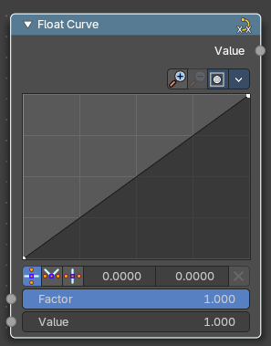

The Float Curves node maps an input value to a curve.

#### Inputs

##### Factor

Data type: Float (factor).

Input factor.

#### Value

Standard float value input.

#### Properties

##### Curve edit field

Create and tweak a Bezier curve that varies the input levels (X axis) to produce an output level (Y axis).

##### Selecting Points

> This setting uses the **curve widget**: click to add points, drag to move them. See **[Curve Widget](../../../../interface/properties.md#curve-widget)** in the Interface chapter.

##### Adding Points

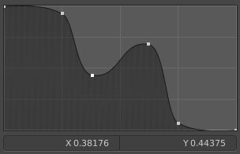

You can add new curve points by simply left clicking at the curve. Move the mouse to position them where you need it.

###### Zoom in and out

The two buttons with the magnifying glass at it zooms in and out in the curve window.

###### Tools

Tools is a menu where you can find some curve related tools.

###### Reset View

Resets the curve windows zoom.

###### Extend horizontal

Extends the curve before the first curve point and behind the last curve point horizontally.

###### Extend extrapolated

Extends the curve before the first curve point and behind the last curve point extrapolated.

###### Reset Curve

Resets the curve to the initial shape.

##### Clipping Options

##### Use Clipping

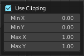

Clipping options. Set up clipping for the stroke.

##### Delete Points

Deletes selected curve points.

##### Vector Handle

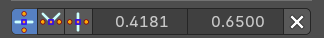

Set handle type to Vector.

###### Auto Handle

Set handle type to Auto.

###### Auto Clamped Handle

Set handle type to Auto Clamped.

###### X / Y value

The position of the selected curve point.

###### Delete

Deletes the selected curve point.

#### Outputs

##### Value

Data type: Float.

Standard float value output.

### Float to Integer

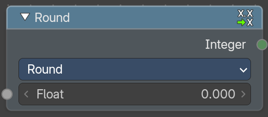

The Float to Integer node turns a number with decimals into a whole number. You choose how it rounds. Every input can be an image or a single value. Images are processed pixel by pixel, so you can use this node on a whole image at once.

#### Inputs

##### Float

Data type: Float.

The number to convert (default 0.0).

#### Properties

##### Rounding Mode

How the decimals are removed.

- **Round**: Rounds up or down to the nearest integer.
- **Floor**: Rounds down to the next smaller integer.
- **Ceiling**: Rounds up to the next larger integer.
- **Truncate**: Rounds to the closest integer in the direction of zero. That is floor for positive values and ceiling for negative values.

#### Outputs

##### Integer

Data type: Integer.

The whole number.

### Hash Value

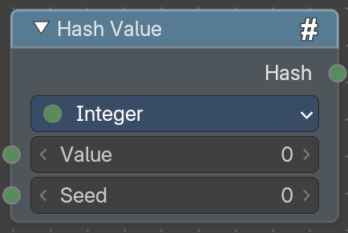

The Hash Value node turns any value into a random-looking whole number. The same value and seed always give the same number, so it is handy for giving each ID, pixel value or name its own stable random number. Every input can be an image or a single value. Images are processed pixel by pixel, so you can use this node on a whole image at once.

#### Inputs

##### Value

Data type: follows the Data Type setting.

The value to hash. Its type follows the Data Type property.

##### Seed

Data type: Integer.

Changes the result without changing the value (default 0).

#### Properties

##### Data Type

The type of the Value input. You can choose Float, Integer, Vector, Color, Rotation, Matrix or String. The default is Integer.

#### Outputs

##### Hash

Data type: Integer.

The random-looking integer.

### Integer Math

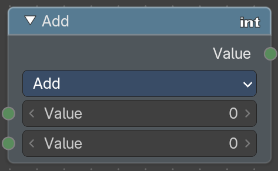

The Integer Math node performs math operations on whole numbers. The result is always a whole number. Every input can be an image or a single value. Images are processed pixel by pixel, so you can use this node on a whole image at once.

#### Inputs

##### First Value

Data type: Integer.

The first number. It is called Base for Power.

##### Second Value

Data type: Integer.

The second number (default 0). It is called Multiplier for Multiply Add and Exponent for Power. It is not shown for Absolute, Negate and Sign. For Multiply, Divide, Multiply Add, the Divide variants and both Modulo operations, a node added from the menu starts with 1.

##### Third Value

Data type: Integer.

The third number, called Addend. It only appears for Multiply Add.

#### Properties

##### Operation

Chooses the operation.

- **Add**: A + B.
- **Subtract**: A - B.
- **Multiply**: A * B.
- **Divide**: A / B.
- **Multiply Add**: A * B + C.
- **Absolute**: The non-negative value of A.
- **Negate**: -A.
- **Power**: A to the power of B.
- **Minimum**: The smaller of A and B.
- **Maximum**: The larger of A and B.
- **Sign**: The sign of A: -1, 0 or 1.
- **Divide Round**: Divides and rounds the result toward zero.
- **Divide Floor**: Divides and rounds down to the largest integer that is smaller than or equal to the result.
- **Divide Ceiling**: Divides and rounds up to the smallest integer that is greater than or equal to the result.
- **Floored Modulo**: A modulo that repeats the same way for negative and positive numbers.
- **Modulo**: The remainder of A / B.
- **Greatest Common Divisor**: The largest positive integer that divides both A and B. For example GCD(8, 12) = 4.
- **Least Common Multiple**: The smallest positive integer that both A and B divide. For example LCM(6, 10) = 30.

#### Outputs

##### Value

Data type: Integer.

The resulting integer.

### Map Range

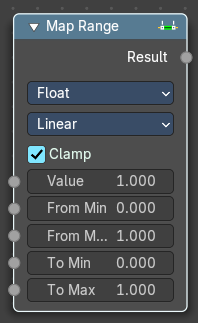

This node allows to convert (map) an input value range into a destination range. By default, values outside the specified input range will be proportionally mapped as well. This node is similar to Map Value node but provides a more intuitive way to specify the desired output range.

#### Usage

One important use case is to easily map the original range of the Z-depth channel to a more usable range (i.e: 0.0 - 1.0) for use as a matte for colorization or filtering operations.

#### Inputs

This chapter deals with the input type Float. The same node exists in the Vector menu too. With preselected type Vector.

##### Value

Data type: Float.

Standard value input.

##### From Min/Max

Data type: follows the Data Type setting.

Start/End of the input value range.

##### To Min/Max

Data type: follows the Data Type setting.

Start/End of the destination range.

##### Steps

Data type: Float.

The amount of steps. **Note:** *Only shows when using the Stepped Linear interpolation type.*

#### Properties

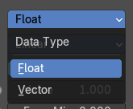

##### Data Type

Selects between float or vector values to map the range.

##### Interpolation Type

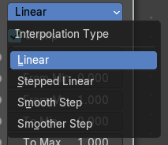

Selects between a linear, stepped linear, smooth step or smoother step interpolation types.

##### Clamp

Clamps values to Min/Max of the destination range.

#### Outputs

##### Value

Standard value output.

### Math

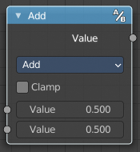

The Math Node performs math operations.

#### Inputs

##### Value

Data type: Float.

First numerical value. The trigonometric functions accept values in radians.

##### Value

Data type: Float.

Second numerical value. This value is not used in functions that accept only one parameter like the trigonometric functions, Round and Absolute.

#### Properties

##### Operation

Here you can choose what mathematical operation to perform.

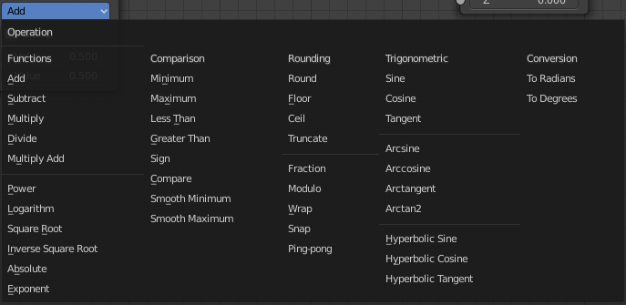

##### Clamp

Limits the output to the range (0 to 1). See clamp.

#### Outputs

##### Value

Data type: Float.

Numerical value output.

### Mix

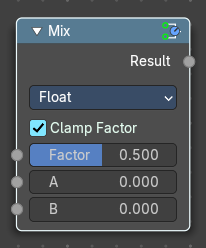

The Mix Node mixes float values by working on the individual and corresponding pixels of the two input values. Called “Mix” in the shader, Geometry Nodes and texture context.

#### Inputs

##### Factor

Data type: Float (factor).

Controls the amount of influence the node exerts on the output Value.

##### Value A

The back value.

##### Value B

The top value.

#### Properties

##### Clamp Factor

Limit the highest color value to not exceed 1.

#### Outputs

##### Result

Data type: follows the Data Type setting.

Value output.

# Matrix

## Add menu - Utilities - Matrix

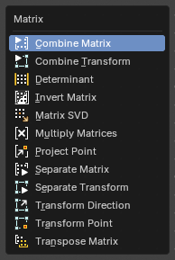

A matrix is a grid of four by four numbers that stores a transform: where something is, how it is turned and how big it is, all in one value. The Matrix nodes build these values, take them apart and combine them. They are the same nodes as in the Geometry Node editor.

### Combine Matrix

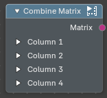

Builds a matrix from sixteen separate numbers. Use it when you worked the numbers out yourself, from other nodes or a formula, and need them as one matrix. The numbers fill the matrix column by column: four columns with four rows each.

#### Inputs

##### Column 1 to Column 4

Data type: Float.

Each column is a collapsible panel with four values, **Row 1** to **Row 4**.

#### Outputs

##### Matrix

Data type: Matrix.

The finished matrix.

### Combine Transform

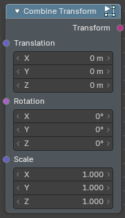

Builds a matrix from a location, a rotation and a scale. This is the easy way to make a transform: say where it is, how it is turned and how big it is, and the node does the matrix math.

#### Inputs

##### Translation

Data type: Vector (translation).

The location, as a vector.

##### Rotation

Data type: Rotation.

The rotation.

##### Scale

Data type: Vector (XYZ).

The size along each axis. 1 keeps the original size.

#### Outputs

##### Transform

Data type: Matrix.

The matrix that holds all three.

### Matrix Determinant

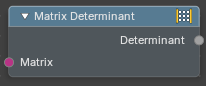

Calculates one number from a matrix, its determinant, which tells how the matrix changes volume. A value of 0 means the matrix squashes space flat and cannot be undone; a negative value means it mirrors. Use it to check a matrix before you invert it.

#### Inputs

##### Matrix

Data type: Matrix.

The matrix to measure.

#### Outputs

##### Determinant

Data type: Float.

The determinant as a single value.

### Invert Matrix

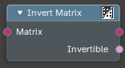

Gives the matrix that undoes the input matrix. If a matrix moves, turns and scales a point, its inverse puts the point back. Use it to go from world space to local space and back.

#### Inputs

##### Matrix

Data type: Matrix.

The matrix to invert.

#### Outputs

##### Matrix

Data type: Matrix.

The inverted matrix.

##### Invertible

Data type: Boolean.

On when the matrix could be inverted. A matrix that flattens space has no inverse.

### Matrix SVD

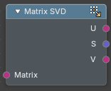

Splits a matrix into three parts: a rotation **U**, a scale **S** and a second rotation **V**. Multiplying them back together gives the original matrix. Use it to analyse what a matrix does, for example how much it stretches along each axis.

#### Inputs

##### Matrix

Data type: Matrix.

The matrix to split.

#### Outputs

##### U

Data type: Matrix.

The first rotation, as a matrix.

##### S

Data type: Vector.

The scale along each axis, as a vector.

##### V

Data type: Matrix.

The second rotation, as a matrix.

### Multiply Matrices

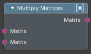

Joins two transforms into one. The result does the same as applying one matrix and then the other. The order matters: swapping the two inputs gives a different result.

#### Inputs

##### Matrix

Data type: Matrix.

The first matrix.

##### Matrix (second)

Data type: Matrix.

The second matrix.

#### Outputs

##### Matrix

Data type: Matrix.

The combined matrix.

### Project Point

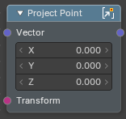

Moves a point through a matrix and then divides by the depth, the way a camera turns a 3D point into a position on its picture. Use it with the Projection Matrix of the Camera Info node to find where a point of the scene lands in the frame.

#### Inputs

##### Vector

Data type: Vector (XYZ).

The point to project.

##### Transform

Data type: Matrix.

The projection matrix.

#### Outputs

##### Vector

Data type: Vector (XYZ).

The projected point.

### Separate Matrix

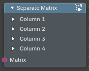

The opposite of Combine Matrix: reads the sixteen numbers out of a matrix. Use it when you need one value of a transform, for example its location, which sits in the fourth column.

#### Inputs

##### Matrix

Data type: Matrix.

The matrix to read.

#### Outputs

##### Column 1 to Column 4

Data type: Float.

Each column holds four values, **Row 1** to **Row 4**.

### Separate Transform

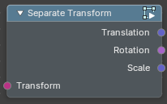

The opposite of Combine Transform: reads the location, rotation and scale out of a matrix. Use it to get a clean location or size from a transform that came from an object or a camera.

#### Inputs

##### Transform

Data type: Matrix.

The matrix to read.

#### Outputs

##### Translation

Data type: Vector (translation).

The location, as a vector.

##### Rotation

Data type: Rotation.

The rotation.

##### Scale

Data type: Vector (XYZ).

The size along each axis.

### Transform Direction

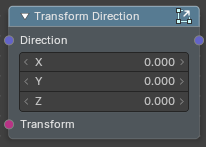

Turns and scales a direction with a matrix, but ignores the matrix's location. A direction has no position, so moving it would be wrong. Use it to bring a direction such as a normal into another space.

#### Inputs

##### Direction

Data type: Vector (XYZ).

The direction to transform.

##### Transform

Data type: Matrix.

The matrix to apply.

#### Outputs

##### Direction

Data type: Vector (XYZ).

The transformed direction.

### Transform Point

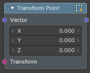

Moves a point with a matrix: it is turned, scaled and moved. Use it to place a position into another space, for example from an object's local space into world space.

#### Inputs

##### Vector

Data type: Vector (XYZ).

The point to transform.

##### Transform

Data type: Matrix.

The matrix to apply.

#### Outputs

##### Vector

Data type: Vector (XYZ).

The transformed point.

### Transpose Matrix

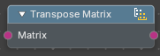

Swaps the rows and columns of a matrix. For a matrix that only rotates, the transpose is also its inverse, and it is cheaper to calculate.

#### Inputs

##### Matrix

Data type: Matrix.

The matrix to transpose.

#### Outputs

##### Matrix

Data type: Matrix.

The transposed matrix.

# Rotation

## Add menu - Utilities - Rotation

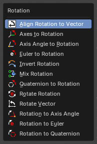

A rotation value holds a turn in 3D without fixing how it is written: as angles around X, Y and Z (Euler), as an axis with an angle, or as a quaternion. The Rotation nodes convert between these forms and combine rotations. They are the same nodes as in the Geometry Node editor.

### Align Rotation to Vector

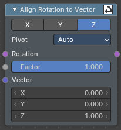

Turns a rotation so that one of its axes points along a vector. Use it to make something face a direction, for example a spotlight aimed at a target. The pivot decides which way the rotation swings to get there.

#### Inputs

##### Rotation

Data type: Rotation.

The rotation to start from.

##### Factor

Data type: Float (factor).

How much of the alignment is applied. 0 keeps the original rotation, 1 aligns fully.

##### Vector

Data type: Vector (XYZ).

The direction to point at.

#### Properties

##### Axis

The axis of the rotation that is turned towards the vector: X, Y or Z.

##### Pivot

The axis the rotation turns around while it aligns. **Auto** picks the shortest turn; X, Y or Z keep that axis fixed.

#### Outputs

##### Rotation

Data type: Rotation.

The aligned rotation.

### Axes to Rotation

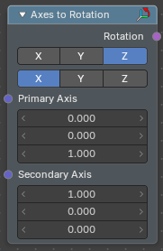

Builds a rotation from two directions. The primary axis is followed exactly, and the secondary axis is followed as closely as it can be while staying at a right angle. Use it when you know where two axes of a thing should point.

#### Inputs

##### Primary Axis

Data type: Vector.

The direction the primary axis points to.

##### Secondary Axis

Data type: Vector.

The direction the secondary axis should lean towards.

#### Properties

##### Primary Axis

Which axis of the rotation follows the primary direction: X, Y or Z.

##### Secondary Axis

Which axis follows the secondary direction. It has to differ from the primary axis.

#### Outputs

##### Rotation

Data type: Rotation.

The rotation that matches the two directions.

### Axis Angle to Rotation

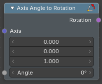

Makes a rotation from an axis and an angle: turn this far around this line. It is the easiest way to describe a single turn around an arbitrary direction.

#### Inputs

##### Axis

Data type: Vector.

The direction of the line to turn around.

##### Angle

Data type: Float (angle).

How far to turn.

#### Outputs

##### Rotation

Data type: Rotation.

The rotation.

### Euler to Rotation

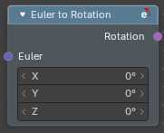

Makes a rotation from three angles, one around each of the X, Y and Z axes. This is the way rotations are shown in most fields of the interface.

#### Inputs

##### Euler

Data type: Vector (euler).

The angles around X, Y and Z.

#### Outputs

##### Rotation

Data type: Rotation.

The rotation.

### Invert Rotation

Gives the opposite rotation, the one that turns back what the input turned. Use it to undo a rotation.

#### Inputs

##### Rotation

Data type: Rotation.

The rotation to invert.

#### Outputs

##### Rotation

Data type: Rotation.

The inverted rotation.

### Mix Rotation

Blends between two rotations. This is the Mix node set to the Rotation type, so the blend follows the shortest turn from one rotation to the other. Use it to ease from one orientation to another.

#### Inputs

##### Factor

Data type: Float (factor).

How far to blend. 0 gives A, 1 gives B.

##### A

Data type: Rotation.

The first rotation.

##### B

Data type: Rotation.

The second rotation.

#### Properties

##### Clamp Factor

Keeps the factor between 0 and 1.

#### Outputs

##### Result

Data type: Rotation.

The blended rotation.

### Quaternion to Rotation

Makes a rotation from the four numbers of a quaternion. Use it when your rotation comes from software or a file that stores quaternions.

#### Inputs

##### W

Data type: Float.

The scalar part.

##### X

Data type: Float.

The X part of the vector.

##### Y

Data type: Float.

The Y part of the vector.

##### Z

Data type: Float.

The Z part of the vector.

#### Outputs

##### Rotation

Data type: Rotation.

The rotation.

### Rotate Rotation

Turns a rotation by another rotation. Use it to add a turn to one that already exists, for example a small tilt on top of an orientation.

#### Inputs

##### Rotation

Data type: Rotation.

The rotation to turn.

##### Rotate By

Data type: Rotation.

The turn to add.

#### Properties

##### Rotation Space

**Global** turns around the world axes. **Local** turns around the axes of the rotation itself.

#### Outputs

##### Rotation

Data type: Rotation.

The combined rotation.

### Rotate Vector

Turns a vector by a rotation. Use it to point a direction the way an object is facing.

#### Inputs

##### Vector

Data type: Vector.

The vector to turn.

##### Rotation

Data type: Rotation.

The rotation to apply.

#### Outputs

##### Vector

Data type: Vector.

The turned vector.

### Rotation to Axis Angle

Reads a rotation as an axis and an angle. The opposite of Axis Angle to Rotation.

#### Inputs

##### Rotation

Data type: Rotation.

The rotation to read.

#### Outputs

##### Axis

Data type: Vector.

The line the rotation turns around.

##### Angle

Data type: Float (angle).

How far it turns.

### Rotation to Euler

Reads a rotation as three angles around X, Y and Z. Use it to show or edit a rotation in the familiar way.

#### Inputs

##### Rotation

Data type: Rotation.

The rotation to read.

#### Outputs

##### Euler

Data type: Vector (euler).

The angles around X, Y and Z.

### Rotation to Quaternion

Reads a rotation as the four numbers of a quaternion. Use it to hand a rotation to something that works with quaternions.

#### Inputs

##### Rotation

Data type: Rotation.

The rotation to read.

#### Outputs

##### W

Data type: Float.

The scalar part.

##### X

Data type: Float.

The X part of the vector.

##### Y

Data type: Float.

The Y part of the vector.

##### Z

Data type: Float.

The Z part of the vector.

# Text

## Add menu - Utilities - Text

Text nodes work with strings, pieces of text. In the compositor they build file names and paths, and they make the text for the String to Image node. They are the same nodes as in the Geometry Node editor.

### Format String

Builds a text from a template with gaps in it. Write the fixed words in the format and put a name in curly brackets wherever a value should go, for example *Shot {number}*. Each name becomes an input socket. Use it for labels and file names that contain numbers.

#### Inputs

##### Format

Data type: String.

The template. Names in curly brackets become inputs.

##### +

Data type: String.

Adds another value to fill in.

#### Outputs

##### String

Data type: String.

The finished text.

### Match String

Checks a text against a key and tells you whether it fits. Use it to choose a path in the node tree by the name of something.

#### Inputs

##### String

Data type: String.

The text to check.

##### Operation

Data type: Menu.

How to compare: **Starts With**, **Ends With** or **Contains**.

##### Key

Data type: String.

The text to look for.

#### Outputs

##### Result

Data type: Boolean.

On when the text matches.

### Replace String

Swaps every occurrence of one piece of text for another. Use it to clean up a name or to change part of a path.

#### Inputs

##### String

Data type: String.

The text to change.

##### Find

Data type: String.

The part to look for.

##### Replace

Data type: String.

What to put in its place.

#### Outputs

##### String

Data type: String.

The changed text.

### Reverse String

Writes a text backwards. Use it for the odd case where the end of a name matters more than the start.

#### Inputs

##### String

Data type: String.

The text to reverse.

#### Outputs

##### String

Data type: String.

The reversed text.

### Set String Case

Changes a text to all capitals or all small letters. Use it to make names consistent before you compare them.

#### Inputs

##### String

Data type: String.

The text to change.

##### Case

Data type: Menu.

**Uppercase** or **Lowercase**.

#### Outputs

##### String

Data type: String.

The changed text.

### Slice String

Cuts a piece out of a text. You say where the piece starts and how long it is. Use it to take a prefix or a number out of a file name.

#### Inputs

##### String

Data type: String.

The text to cut from.

##### Position

Data type: Integer.

The place where the piece starts, counted from 0.

##### Length

Data type: Integer.

How many characters to keep.

#### Outputs

##### String

Data type: String.

The piece of text.

### Trim String

Removes unwanted characters from the start or the end of a text. Use it to strip spaces or a separator from a name.

#### Inputs

##### String

Data type: String.

The text to trim.

##### Characters

Data type: String.

The characters to remove.

##### Whitespace

Data type: Boolean.

Also removes spaces, tabs and line breaks.

##### Start

Data type: Boolean.

Trims the start of the text.

##### End

Data type: Boolean.

Trims the end of the text.

#### Outputs

##### String

Data type: String.

The trimmed text.

### Find in String

Looks for a piece of text inside another and tells you where it is and how often it occurs. Use it to test whether a name contains a tag, or to find where to cut it.

#### Inputs

##### String

Data type: String.

The text to search in.

##### Search

Data type: String.

The text to look for.

##### Mode

Data type: Menu.

Where to start looking: **From Start** or from the end.

#### Outputs

##### First Found

Data type: Integer.

The position of the first match, counted from 0.

##### Count

Data type: Integer.

How many times the text was found.

### String Length

Counts the characters in a text. Use it to check that a name is long enough, or to know how much to cut.

#### Inputs

##### String

Data type: String.

The text to measure.

#### Outputs

##### Length

Data type: Integer.

The number of characters.

### String to Value

Reads a number from a text. Use it to turn a frame number in a file name back into a value you can calculate with.

#### Inputs

##### String

Data type: String.

The text to read.

##### Base

Data type: Integer.

The number base, 10 for normal numbers.

#### Properties

##### Data Type

Reads the number as a **Float** or as an **Integer**.

#### Outputs

##### Value

Data type: follows the Data Type setting.

The number that was read.

##### Length

Data type: Integer.

How many characters of the text were used.

### Value to String

Writes a number as text. Use it to put a frame number or a value into a label or a file name.

#### Inputs

##### Value

Data type: follows the Data Type setting.

The number to write.

##### Decimals

Data type: Integer.

How many digits to show after the decimal point.

##### Base

Data type: Integer.

The number base, 10 for normal numbers.

##### Padding

Data type: Integer.

The minimum number of digits. Shorter numbers get zeros in front.

#### Properties

##### Data Type

Writes a **Float** or an **Integer**.

#### Outputs

##### String

Data type: String.

The number as text.

### Special Characters

Gives you characters that are hard to type into a text field: a line break and a tab. Use it with Format String to build text over several lines.

#### Outputs

##### Line Break

Data type: String.

A character that starts a new line.

##### Tab

Data type: String.

A tab character.

# Vector

## Add menu - Utilities - Vector

Here you find mainly nodes for vector data manipulation.

### Combine XYZ

Same as with Combine RGB node. It combines color values. But instead combining rgb values, which are in the range of 0 to 255, it uses values in the range from 0 to 1.

#### Inputs

##### X Y and Z

Data type: Float.

X, Y and Z values.

#### Outputs

##### Color

Color output.

### Map Range

This node allows to convert (map) an input value range into a destination range. By default, values outside the specified input range will be proportionally mapped as well. This node is similar to Map Value node but provides a more intuitive way to specify the desired output range.

#### Usage

One important use case is to easily map the original range of the Z-depth channel to a more usable range (i.e: 0.0 - 1.0) for use as a matte for colorization or filtering operations.

#### Inputs

This chapter deals with the input type Float. The same node exists in the Math menu too. With preselected type Float.

##### Vector

Data type: Vector.

Standard vector input.

##### From Min/Max

Data type: follows the Data Type setting.

Vector 3 of the Start/End of the input value range.

##### To Min/Max

Data type: follows the Data Type setting.

Vector 3 of the Start/End of the destination range.

##### Steps

Data type: Float.

The amount of steps. **Note:** *Only shows when using the Stepped Linear interpolation type.*

#### Properties

##### Data Type

Selects between float or vector values to map the range.

##### Interpolation Type

Selects between a linear, stepped linear, smooth step or smoother step interpolation types.

##### Clamp

Clamps values to Min/Max of the destination range.

#### Outputs

##### vector

Data type: Vector.

Standard value output.

### Mix Vector

The **Mix Vector** node blends two vector inputs using a specified factor. It’s useful for compositing tasks that involve **motion vectors, directional effects, or spatial blending**, offering precise control over how two sets of vector data are combined

#### Inputs

##### Factor

Data type: Float (factor).

Controls the amount of influence the node exerts on the output result.

##### Value A

The back value.

##### Value B

The top value.

##### Properties

##### Data Type

Set to **Vector**, indicating the node mixes vector values.

##### Factor Mode

The method of mixing.

- **Uniform**: A single float controls the mix across all vector components.
- **Non-Uniform**: A vector input controls the mix per component (X, Y, Z).

##### Clamp Factor

Limit the highest color value to not exceed 1.

#### Outputs

##### Result

Data type: Vector.

Vector output.

### Separate XYZ

Same as with Separate RGB node. It separates color values. But instead separating rgb values, which are in the range of 0 to 255, it uses a vector with the values in the range from 0 to 1.

#### Inputs

##### Vector

Data type: Vector.

The Input vector.

#### Outputs

##### X, Y and Z

Data type: Float.

The output vectors for X, Y and Z

### Radial Tiling

Transform coordinate system for radial tiling.

#### Inputs

##### Vector

Data type: Vector.

Vector 2 input

##### Sides

Data type: Float.

Number of angular segments for tiling. A non integer value results in an irrgeluar segment.

##### Roundness

Data type: Float (factor).

Roundness of the segment coordindates system.

#### Properties

##### Normalize

Normalize the X coordinate of the segment coordinates output to a `[` 0 / 1 `]` interval and offset the Y coordinate into a `[0`, `infinity]` interval. This stretches the textures to fit into each angular segment. Else they are cropped.

### Vector Curves

The Vector Curves node maps an input vector components to a curve.

#### Inputs

In the shader context the node also has an additional Factor property.

##### Vector

Data type: Vector.

Standard vector 3 input.

#### Properties

##### Channel

##### Channel buttons

X, Y, Z. Clicking on one of the channels displays the curve for each.

##### Curve edit field

Create and tweak a Bezier curve that varies the input levels (X axis) to produce an output level (Y axis).

##### Selecting Points

You can select curve points. This reveals two edit boxes for the x and y coordinate of this point.

Selected points can be moved around. Left click at them, hold the mouse button down and move them to a new location.

##### Adding Points

You can add new curve points by simply left clicking at the curve. Move the mouse to position them where you need it.

###### Zoom in and out

The two buttons with the magnifying glass at it zooms in and out in the curve window.

##### Clipping options

Clipping options. Set up clipping for the stroke.

##### Tools

Tools is a menu where you can find some curve related tools.

###### Reset View

Resets the curve windows zoom.

###### Extend horizontal

Extends the curve before the first curve point and behind the last curve point horizontally.

###### Extend extrapolated

Extends the curve before the first curve point and behind the last curve point extrapolated.

###### Reset Curve

Resets the curve to the initial shape.

##### Vector Handle

Set handle type to Vector.

###### Auto Handle

Set handle type to Auto.

###### Auto Clamped Handle

Set handle type to Auto Clamped.

###### X / Y position

The x y coordinate of the selected curve point. The range goes from -1 to +1

###### Delete Points

Deletes selected curve points.

#### Outputs

##### Vector

Data type: Vector.

Standard vector 3 output.

### Vector Math

The Vector Math Node performs math operations.

#### Inputs

##### Vector

Data type: Vector.

First numerical value. The trigonometric functions accept values in radians.

##### Vector

Data type: Vector.

Second numerical value. This value is not used in functions that accept only one parameter like the trigonometric functions, Round and Absolute.

#### Properties

##### Operation

Here you can choose what mathematical operation to perform.

#### Outputs

##### Value

Data type: Float.

Numerical value output.

### Vector Rotate

The **Vector Rotate** node rotates a vector around a specified axis and center point. It’s useful for compositing tasks involving **directional transformations**, such as rotating motion vectors, normals, or custom vector fields

#### Inputs

##### Vector

Data type: Vector.

The input vector to be rotated.

##### Center

Data type: Vector.

The pivot point around which the vector is rotated.

##### Axis

Data type: Vector.

The axis of rotation, defined as am XYZ based 3D vector

##### Angle

Data type: Float (angle).

The amount of rotation in **degrees**.

#### Properties

##### Type

Determines the rotation method.

- **Axis Angle**: Rotates around a custom axis by a specified angle.
- **X/**Y/Z** Axis: **Rotates the vector around the X/Y/Z-axis.
- **Euler: **Applies rotation using Euler angles in XYZ order.

##### Invert

When enabled, reverses the direction of the rotation.

#### Outputs

##### Vector

Data type: Vector.

The rotated vector result.
