## Add menu - Utilities - Color

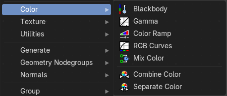

Here you find mainly nodes to convert color values.

### Blackbody

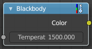

The Blackbody node converts a blackbody temperature to RGB value. This can be useful for materials that emit light at natural occurring frequencies.

#### Inputs

##### Temperature

Data type: Float (color temperature).

The temperature in Kelvin.

#### Outputs

##### Color

Data type: Color.

The RGB color of the temperature.

### Gamma

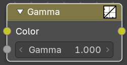

Apply a gamma correction.

#### Inputs

##### Color

Data type: Color.

The RGB color input.

##### Gamma

Data type: Float.

The gamma correction value. 1 is unchanged.

#### Outputs

##### Color

Data type: Color.

The corrected RGB color.

### Color Ramp

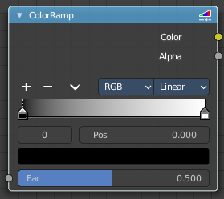

The Color Ramp Node is used for mapping values to colors with the use of a gradient.

#### Inputs

##### Factor

Data type: Float (factor).

The Factor input is used as an index for the color ramp.

#### Properties

##### Color Ramp

Color Ramps enables the user to specify a range of colors based on color stops. The color between the color stops gets interpolated.

###### Controls

- **+**: Add a stop to your color ramp. The stop will be added after the selected one, in the middle to the next one.
- **-**: Deletes the selected color stop from the list.

###### Tools menu

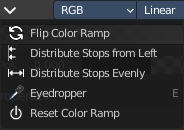

- **Flip Color Ramp**: Flips the gradient, inverting the values of the color ramp.
- **Distribute Stops from Left**: Rearrange the stops so that every step has the same space to the right.
- **Distribute Stops Evenly**: Space between all neighboring stops becomes equal.
- **Eyedropper (pipette icon) E**: An Eyedropper to sample a color or gradient from the interface to be used in the color ramp.

###### Reset Color Ramp

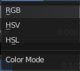

Resets the color ramp to its default state.

###### Color Mode

- **RGB**: Blends color by mixing each color channel and combining.
- **HSV/HSL**: Blends colors by first converting to HSV or HSL, mixing, then combining again. This has the advantage of maintaining saturation between different hues, where RGB would de-saturate, this allows for a richer gradient.

###### Interpolation

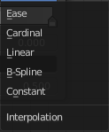

- **Ease**: Uses an Ease Interpolation for the color stops.
- **Cardinal**: Uses a Cardinal Interpolation for the color stops.
- **Linear**: Uses a Linear Interpolation for the color stops.
- **B-Spline**: Uses a B-Spline Interpolation for the color stops.
- **Constant**: Uses a Constant Interpolation for the color stops.

###### Color Ramp

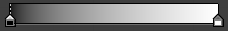

The color band. A click at one of the color stops makes it the active one. You can move the color stops by clicking at them and dragging them around.

###### Active Color Stop elements

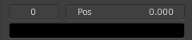

Adjust the active color stop.

- **Choose active color stop**: Choose the color stop by index.
- **Pos**: The position of the active color stop. The range goes from 0.000 to 1.000

#### Outputs

##### Color

Data type: Color.

The color from the color ramp at the Factor position.

##### Alpha

Data type: Float.

The alpha value from the color ramp at the Factor position.

### RGB Curves

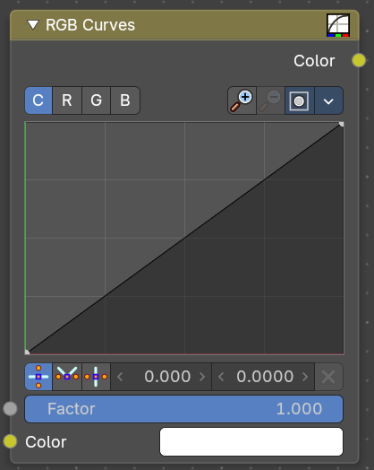

Adjust the RGB channels by curves.

#### Inputs

##### Factor

Data type: Float (factor).

The blend factor.

##### Color

Data type: Color.

The input color.

#### Properties

##### C R G B

The color channels.

###### Selecting Points

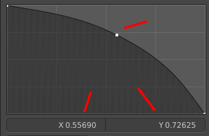

You can select curve points. This reveals two edit boxes for the x and y coordinate of this point.

Selected points can be moved around. Left click at them, hold the mouse button down and move them to a new location.

###### Adding Points

> This setting uses the **curve widget**: click to add points, drag to move them. See **[Curve Widget](../../../../interface/properties.md#curve-widget)** in the Interface chapter.

###### Navigation elements

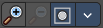

- **Zoom in**: Zooms in.
- **Zoom out**: Zooms out.

###### Clipping options

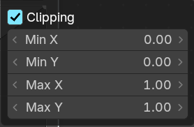

Set up clipping for the stroke.

###### Tools

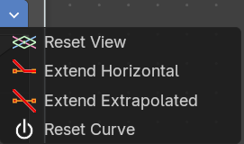

Tools is a menu where you can find some curve related tools.

- **Reset View**: Resets the curve windows zoom.
- **Extend Horizontal**: Extend the curve before the first and after the last point horizontal.
- **Extend Extrapolated**: Extend the curve before the first and after the last point extrapolated.
- **Reset Curve**: Resets the curve to the initial shape.

###### Handles

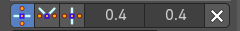

You can choose between Auto handle, Vector Handle and Auto Clamped.

- **Position X / Y**: The position of the selectedc curve point.
- **Delete Points**: Deletes the selected curve point.

#### Outputs

##### Color

Data type: Color.

The rgb output.

### Mix Color

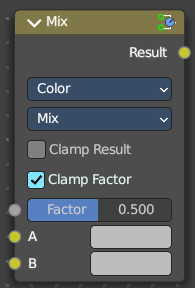

The mix Color node is in real the Mix node in Color mode. It is shared across editors.

The Mix node is meant to mix values. This can be colors, or also a vector or a single value.

Note that the Mix Color node does not start in Color mode when you insert it from the sidebar due a techical limitation in the Blender Python api. Here you have to manually switch to the color mode.

#### Inputs

##### Factor

Data type: Float (factor).

Controls the amount of influence the node exerts on the output image.

##### A

Data type: follows the Data Type setting.

The first value. A Factor of 0 gives this value.

##### B

Data type: follows the Data Type setting.

The second value. A Factor of 1 gives this value.

#### Properties

##### Data Type

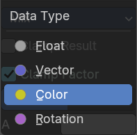

The mode in which the node works.

##### Blending Mode

###### Mix

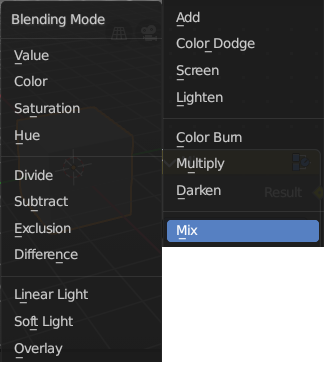

Choose the different blending modes.

Add, Subtract, Multiply, Screen, Divide, Difference, Darken, Lighten, Overlay, Color Dodge, Color Burn, Hue, Saturation, Value, Color, Soft Light, Linear Light.

- **Clamp Result**: Clamp the result to 0, 1 range.
- **Clamp Factor**: Clamp the factor to 0, 1 range.

#### Outputs

##### Result

Data type: follows the Data Type setting.

The mixed value.

### Combine Color

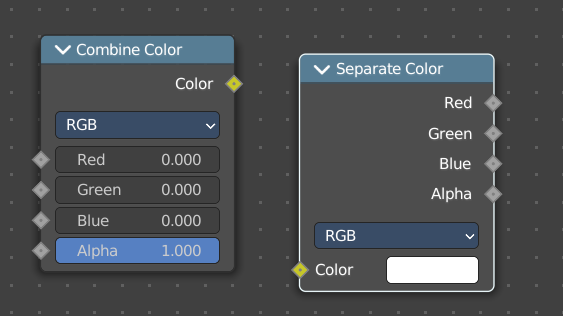

Combine the single RGBA channels into a single image.

#### Inputs

##### Red

Data type: Float (factor).

The red channel. In HSV and HSL mode this socket is called Hue.

##### Green

Data type: Float (factor).

The green channel. In HSV and HSL mode this socket is called Saturation.

##### Blue

Data type: Float (factor).

The blue channel. In HSV mode this socket is called Value, in HSL mode Lightness.

##### Alpha

Data type: Float (factor).

The alpha channel.

#### Properties

##### Mode

- **RGB** colour processing
- **HSV** colour processing
- **HSL** colour processing

#### Outputs

##### Color

Data type: Color.

The rgba output color.

### Separate Color

Split a color into its single channels.

#### Inputs

##### Color

Data type: Color.

The color to split into channels.

#### Properties

##### Mode

- **RGB** colour processing
- **HSV** colour processing
- **HSL** colour processing

#### Outputs

##### Red

Data type: Float.

The red channel. In HSV and HSL mode this socket is called Hue.

##### Green

Data type: Float.

The green channel. In HSV and HSL mode this socket is called Saturation.

##### Blue

Data type: Float.

The blue channel. In HSV mode this socket is called Value, in HSL mode Lightness.

##### Alpha

Data type: Float.

The alpha channel.
