# Read

## Add - Curve - Read

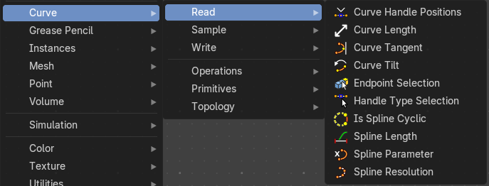

Here you find curve related nodes.

### Curve Handle Positions

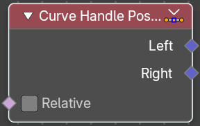

Get the position of the left or right handle of a curve point.

#### Inputs

##### Relative

Data type: Boolean.

Output the handle positions relative to the corresponding control point instead of the local space of the geometry.

#### Outputs

##### Left

Data type: Vector.

The left handle of the curve point.

##### Right

Data type: Vector.

The right handle of the curve point.

### Curve Length

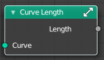

Retreives the length of all splines added together.

#### Inputs

##### Curve

Data type: Geometry.

The input curve.

#### Outputs

##### Length

Data type: Float.

The length of the curve.

### Curve Tangent

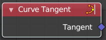

Retreive the tangent direction of a curve. The output values are normalized vectors.

Note that for NURBS and Bézier spline curves the value retrieved from this node is the value at every control point, which may not correspond to the visible evaluated points. For NURBS splines the difference may be even more pronounced and the result may not be as expected. A Resample Curve Node node can be used to create a poly spline, where there is a control point for every evaluated point.

#### Outputs

##### Tangent

Data type: Vector.

The vector of the tangent.

### Curve Tilt

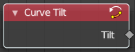

Outputs the angle used to turn the curve normal around the direction of the curve tangent in its evaluated points.

The output is per control point. For NURBS and Bézier splines, the values will be interpolated to the final evaluated points.

#### Outputs

##### Tilt

Data type: Float.

The tilt angle for the normal in radians.

### Endpoint Selection

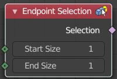

The Endpoint Selection node allows for the Selection of an aribitrary  
number of endpoints from each spline in a curve. The start and end  
inputs are evaluated on the spline domain. The result is outputted  
as a boolean field on the point domain.

#### Inputs

##### Start Size

Data type: Integer.

The start point of the spline.

##### End Size

Data type: Integer.

The end point of the spline.

#### Outputs

##### Selection

Data type: Boolean.

Selection output.

### Handle Type Selection

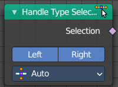

Creates a selection based on the handle types of the control points.

#### Properties

##### Left / Right

Wether to check for the type of handles.

##### Handle Type

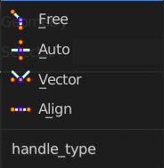

What handle type to compare.

#### Outputs

##### Selection

Data type: Boolean.

The selection.

### Is Spline Cyclic

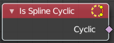

Retreive if the curve is set to cyclic.

#### Outputs

##### Cyclic

Data type: Boolean.

If the spline is cyclic or not.

### NURBS Order

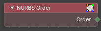

Reads the order of each NURBS spline. The order is how many control points pull on each point of the curve: a higher order gives a smoother, stiffer curve, a low order follows the control points more closely. Use it to find out how a NURBS curve is built, or to select the splines that have a certain order.

#### Outputs

##### Order

Data type: Integer.

The order of the spline. The value is meaningful for NURBS splines only.

### NURBS Weight

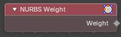

Reads the weight of each control point of a NURBS spline. The weight sets how strongly a control point pulls the curve toward itself: a point with a high weight draws the curve closer, a point with a low weight lets it drift away. Use it to read the weights you set on a curve, or to select points by their pull.

#### Outputs

##### Weight

Data type: Float.

The weight of each control point. The value is meaningful for NURBS splines only.

### Spline Length

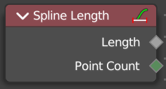

Retreive the total length of each spline in a curve.

#### Outputs

##### Length

Data type: Float.

The length of each spline in the curve.

##### Point Count

Data type: Integer.

Integer Field input of the number of control points on each spline in the spline domain. Or in the point domain, it is the number of points on the spline that contains the given control point.

### Spline Parameter

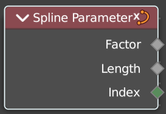

The Curve Parameter node outputs how far along each spline a control point is, with a value between zero and one. The output is different from dividing the index by the total number of control points, because the control points might not be equally spaced along the curve.

The first value is zero, so the output corresponds to the length at the control point rather than including the length of the following segment.

When used on the spline domain, the node outputs the portion of the total length of the curve (including all splines) has been traversed at the start of each spline. The order of the curve’s splines is visible in the Spreadsheet Editor.

Note that for NURBS and Bézier spline curves the value retrieved from this node is the value at every control point, which may not correspond to the visible evaluated points. For NURBS splines the difference may be even more pronounced and the result may not be as expected. A Resample Curve Node node can be used to create a poly spline, where there is a control point for every evaluated point.

#### Outputs

##### Factor

Data type: Float.

The factor of the curve.

##### Length

Data type: Float.

The length of the curve.

##### Index

Data type: Integer.

The index of the curve.

### Spline Resolution

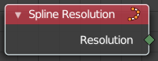

Retreive the curve resolution. Means the number of spline points.

#### Outputs

##### Resolution

Data type: Integer.

The spline resolution.

# Sample

## Add - Curve - Sample

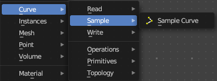

Here you find curve related nodes.

### Sample Curve

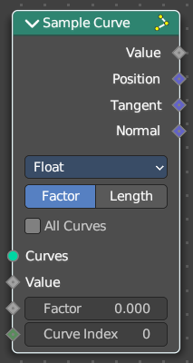

Calculates a point on a curve at a certain distance from the start of the curve, specified by the length or factor inputs. It also outputs data retrieved from that position on the curve.

The sampled values are linearly interpolated from the values at the evaluated curve points at each side of the sampled point.

In case that the curve contains multiple splines, the sample position is found based on the total accumulated length, including the lengths of all previous splines. The order of the splines is the same order as displayed in the Spreadsheet Editor.

#### Inputs

##### Curves

Data type: Geometry.

The curves to sample positions on.

##### Value

Data type: follows the Data Type setting.

The value to sample on the curves.

##### Factor

Data type: Float (factor).

Where to sample, as a factor of the curve length. Only in Factor mode.

##### Length

Data type: Float (distance).

Where to sample, as a length from the start of the curve. Only in Length mode.

##### Curve Index

Data type: Integer.

The index of the curve to sample. Not when All Curves is on.

#### Properties

##### Data Type

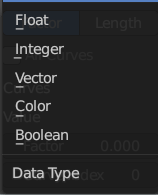

What data to calculate.

##### Mode

How to calculate the curve. By a factor, or by its length.

##### All Curves

Sample lengths based on the length of all curves.

#### Outputs

##### Value

Data type: follows the Data Type setting.

Output Value.

##### Position

Data type: Vector.

The position at the sample along the spline.

##### Tangent

Data type: Vector.

The normalized curve tangent at the sample.

##### Normal

Data type: Vector.

The normalized curve normal at the sample.

# Write

## Add - Curve - Write

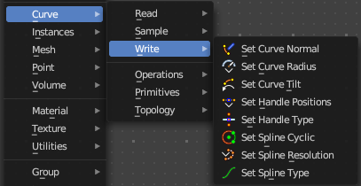

Here you find curve related nodes.

### Set Curve Normal

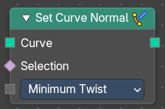

Set the evaluation mode for curve normals.

#### Inputs

##### Curve

Data type: Geometry.

The input curve.

##### Selection

Data type: Boolean.

A selection of the input curve.

##### Mode

Data type: Menu.

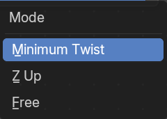

The evaluation mode for the curve normals.

##### Normal

Data type: Vector (XYZ).

The custom normal for each point. Only in Free mode.

#### Outputs

##### Curve

Data type: Geometry.

The curve output.

### Set Curve Radius

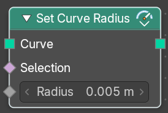

Set the curve radius.

#### Inputs

##### Curve

Data type: Geometry.

The input curve.

##### Selection

Data type: Boolean.

A selection of the input curve.

##### Radius

Data type: Float (distance).

The radius to set.

#### Outputs

##### Curve

Data type: Geometry.

Standard geometry output.

### Set Curve Tilt

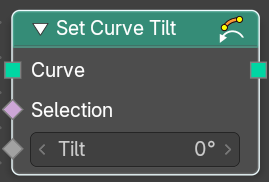

Controls the tilt angle at each curve control point.

#### Inputs

##### Curve

Data type: Geometry.

The input curve.

##### Selection

Data type: Boolean.

Whether or not to change the value on each control point. True values mean the value will be changed, false values mean the value will remain the same.

##### Tilt

Data type: Float (angle).

The tilt rotation.

#### Outputs

##### Curve

Data type: Geometry.

Standard geometry output.

### Set Handle Positions

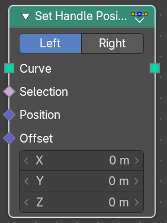

Set the handle positions of bezier curves

#### Inputs

##### Curve

Data type: Geometry.

The input curve.

##### Selection

Data type: Boolean.

A selection of the input curve.

##### Position

Data type: Vector.

The position of the handle.

##### Offset

Data type: Vector (translation).

A vector 3 offset for the handles.

#### Properties

##### Mode

Left or right handles.

#### Outputs

##### Curve

Data type: Geometry.

Standard geometry output.

### Set Handle Type

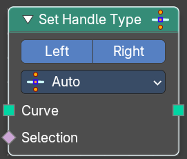

Sets a handle type for the curve points of a bezier curve. Handle types determines how the interpolation before and after the curve point happens.

#### Inputs

##### Curve

Data type: Geometry.

The input curve.

##### Selection

Data type: Boolean.

A selection of the input curve.

#### Properties

##### Mode

Left or right handles.

##### Handle Type

The different available handle types.

###### Free

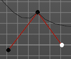

The handles can be adjusted individually.

###### Auto

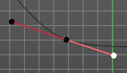

The left and the right handle will always point to each other. The length of the handles will start in equal size.

###### Vector

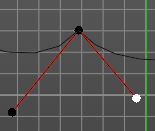

The handles can be adjusted individually.

###### Aligned

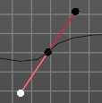

The left and the right handle will always point to each other.

#### Outputs

##### Curve

Data type: Geometry.

Standard geometry output.

### Set Spline Cyclic

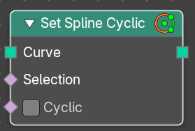

Sets the spline cyclic. Means looping.

#### Inputs

##### Curve

Data type: Geometry.

The input curve.

##### Selection

Data type: Boolean.

A selection of the input curve.

##### Cyclic

Data type: Boolean.

Cyclic or not

#### Outputs

##### Curve

Data type: Geometry.

Standard geometry output.

### Set Spline Resolution

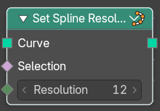

Sets the resolution of the spline. Means how many evaluated points should be generated on the curve for each control point.

#### Inputs

##### Curve

Data type: Geometry.

The input curve.

##### Selection

Data type: Boolean.

A selection of the input curve.

##### Resolution

Data type: Integer.

The resolution of the spline.

#### Outputs

##### Curve

Data type: Geometry.

Standard geometry output.

### Set Spline Type

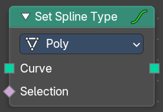

Change the curve spline type.

#### Inputs

##### Curve

Data type: Geometry.

The input curve.

##### Selection

Data type: Boolean.

A selection of the input curve.

#### Properties

##### Spline Type

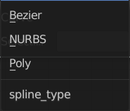

The spline type to set the curve to.

Note that when converting from a NURBS spline to a Bézier spline, at least six points are needed. When the number of points is not a multiple of three a full conversion is not possible and the spline has to be truncated.

#### Outputs

##### Curve

Data type: Geometry.

Standard geometry output.

# Operations

## Add - Curve

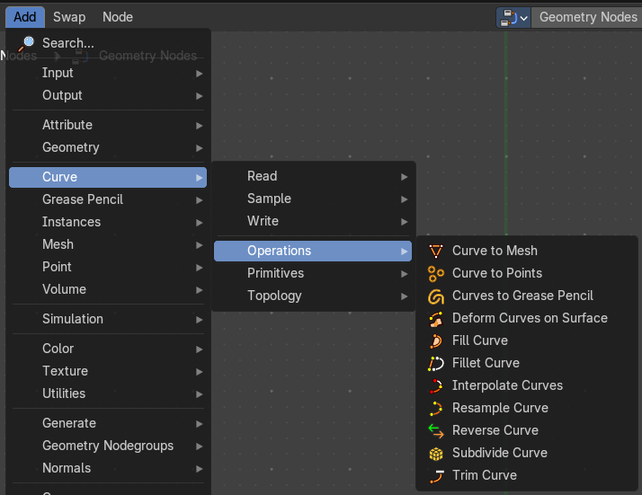

Here you find curve related nodes.

### Curve to Mesh

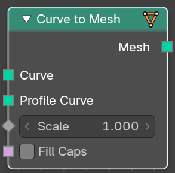

Converts a curve object to a mesh object. Optionally, a profile curve can be provided to give the curve a custom shape.

#### Inputs

##### Curve

Data type: Geometry.

The input curve.

##### Profile Curve

Data type: Geometry.

If a profile curve is provided, it will be extruded along all splines. Otherwise the generated mesh will just be a chain of edges.

##### Scale

Data type: Float.

Scale of the profile at each point.

##### Fill Caps

Data type: Boolean.

For cyclic profile curve. Fill the ends of the generated mesh for each spline combination with an N-gon. The resulting mesh is Manifold, the two new faces for each spline are simply connected to existing edges.

##### Miter Scale

A panel that is closed by default. Its checkbox is the Miter Scale input.

###### Miter Scale

Data type: Boolean.

Scales the profile along the axis of the turn at the corners, so that the width looks the same everywhere.

###### Miter Scale Limit

Data type: Float (angle).

The angle at which the miter scale stops increasing.

#### Outputs

##### Mesh

Data type: Geometry.

Standard mesh output.

### Curve to Points

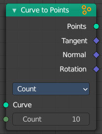

Converts a curve object to a Point cloud.

#### Inputs

##### Curve

Data type: Geometry.

The input curve.

##### Count

Data type: Integer.

The number of points to distribute along each spline. Only in Count mode.

##### Length

Data type: Float (distance).

The length of the single segments. Only in Length mode.

#### Properties

##### Mode

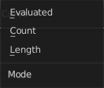

How to generate points from the input curve.

###### Evaluated

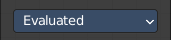

Create points from the evaluation points of the curve. This is based on the resolution attribute for nurbs and bezier splines.

###### Count

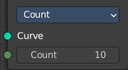

Sample each spline by evenly distributing the specified number of points along the spline.

###### Length

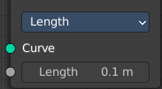

Sample each spline by splitting the spline into segments by the specified length.

#### Outputs

##### Points

Data type: Geometry.

Generated point cloud.

##### Tangent

Data type: Vector.

The normalized curve tangent at the sampled position, or the direct evaluated normal in Evaluated mode.

##### Normal

Data type: Vector.

The normal value from the evaluated curve at each result point. This is the same value from the Normal Node at those positions.

##### Rotation

Data type: Rotation.

The rotation built from the Tangent and Normal outputs.

### Curves to Grease Pencil

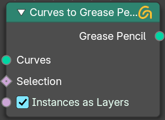

Converts a curve object to a mesh object. Optionally, a profile curve can be provided to give the curve a custom shape.

#### Inputs

##### Curves

Data type: Geometry.

The input curves.

##### Selection

Data type: Boolean.

A selection of the curve

##### Instances as Layers

Data type: Boolean.

Create separate layers for each instance.

#### Outputs

##### Grease Pencil

Data type: Geometry.

The new grease pencil geometry.

### Deform Curves on Surface

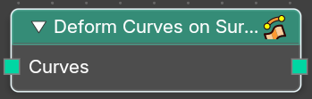

Curves that are attached to a surface can follow the surface at modification.

#### Inputs

##### Curves

Data type: Geometry.

The input curve.

#### Outputs

##### Curves

Data type: Geometry.

The output curve.

### Fill Curve

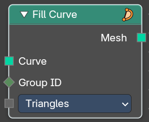

Fills the curve with mesh geometry. The mesh is only generated flat with a local Z of 0.

#### Inputs

##### Curve

Data type: Geometry.

The input curve.

##### Group ID

Data type: Integer.

An index used to group curves together. Filling is done separately for each group.

##### Mode

Data type: Menu.

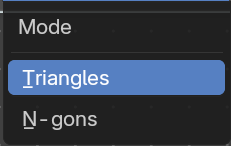

Fill the curve with either triangles, or use N-Gon geometry.

##### Fill Rule

Data type: Menu.

The rule that decides which regions are inside and which are outside.

- **Even-Odd**: Inside and outside alternate each time a curve is crossed.
- **Non-Zero**: Overlapping curves with the same winding direction are filled as a union.

#### Outputs

##### Mesh

Data type: Geometry.

The output as mesh.

### Fillet Curve

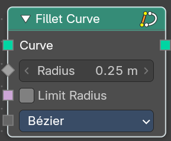

The Fillet Curve rounds corners on curve control points, similar to the effect of the Bevel Modifier on a 2D mesh.

A key difference is that the rounded portions created by the Fillet Curve node are always portions of a circle.

#### Inputs

##### Curve

Data type: Geometry.

The input curve.

##### Radius

Data type: Float (distance).

The radius of the arc

##### Limit Radius

Data type: Boolean.

Prevent overlapping when the defined radius exceeds the maximum possible radius for a given point.

##### Mode

Data type: Menu.

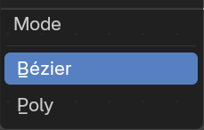

- **Bézier**: Creates a circular arc at vertices by changing handle lengths (applicable only for Bézier splines).
- **Poly**: Creates a circular arc by creating vertices (as many as defined by the Count fields input) along the arc (applicable for all spline types).

##### Count

Data type: Integer.

Define the number of vertices that are created. Only in Poly mode.

#### Outputs

##### Curve

Data type: Geometry.

Standard geometry input with a curve component.

### Interpolate Curves

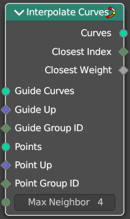

Generates new curve parts by interpolating between existing curves.

#### Inputs

##### Guide Curves

Data type: Geometry.

The base curves to interpolate from.

##### Guide Up

Data type: Vector.

An optional up vector that is typically a surface normal. Providing this up vector can improve the quality of the interpolation. This up direction can be retrieved with a combination of the Sample UV Surface Node using the same geometry that the points were distributed on, and the Normal Node.

##### Guide Group ID

Data type: Integer.

Splits guides into separate groups. New curves interpolate existing curves from a single group.

##### Points

Data type: Geometry.

The positions of the first root control points of the newly generated interpolated curves.

##### Point Up

Data type: Vector.

Optional up vector that is typically a surface normal.

##### Point Group ID

Data type: Integer.

The curve group to interpolate in.

##### Max Neighbors

Data type: Integer.

Maximum amount of close guide curves that are taken into account for interpolation.

#### Outputs

##### Curves

Data type: Geometry.

The new curve.

##### Closest Index

Data type: Integer.

Index of the closest guide curve for each generated curve. Note that internally this node mixes the data from multiple guide curves, with the maximum number of sources depending on the Max Neighbors input. This output is only the index of the curve with the largest weight.

##### Closest Weight

Data type: Float.

Weight of the closest guide curve for each generated curve.

### Resample Curve

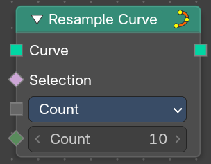

Creates a poly spline for each input spline. In the Count and Length modes, the control points of the new poly splines will have uniform spacing.

#### Inputs

##### Curve

Data type: Geometry.

The input geometry.

##### Selection

Data type: Boolean.

A selection of the input geometry

##### Mode

Data type: Menu.

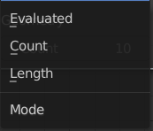

The resample mode.

- **Evaluated**: Use the resolution attribute for spline and bezier curves.
- **Count**: Use the count of the curve points.
- **Length**: Use the length of the curve.

##### Count

Data type: Integer.

The number of control points on the new splines. Only in Count mode.

##### Length

Data type: Float (distance).

The approximate length between the control points of the new splines. Only in Length mode.

#### Outputs

##### Curve

Data type: Geometry.

Standard geometry output.

### Reverse Curve

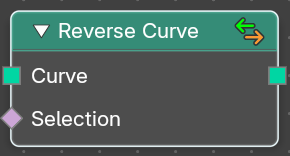

Reverses the direction of the spline. The start point becomes the end point and vice versa. The shape of the spline is not modified.

#### Inputs

##### Curve

Data type: Geometry.

The input curve.

##### Selection

Data type: Boolean.

An optional selection attribute to determine which part of the spline should be reversed.

#### Outputs

##### Curve

Data type: Geometry.

Standard geometry output.

### Subdivide Curve

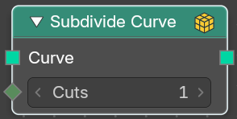

Subdivides the curve. The shape is not changed.

#### Inputs

##### Curve

Data type: Geometry.

The input curve.

##### Cuts

Data type: Integer.

The number of cuts per segment.

#### Outputs

##### Curve

Data type: Geometry.

Standard geometry output.

### Trim Curve

The Curve Trim node shortens each spline in the curve by removing sections at the start and end of each spline.

Bézier splines will still output as Bézier splines. The first and last control point and its handles will be moved as necessary to preserve the shape. But NURBS splines will be transformed into poly splines in order to be trimmed.

Cyclic splines are currently not supported.

Note that if the Start input is larger than the End, then the resulting spline will have a single point, located at the sample location of the Start value.

#### Inputs

##### Curve

Data type: Geometry.

The input curve.

##### Selection

Data type: Boolean.

A selection of the curve.

##### Start

Data type: follows the Mode setting.

The start point of the spline, as a factor or as a length.

##### End

Data type: follows the Mode setting.

The end point of the spline, as a factor or as a length.

#### Properties

##### Mode

How to find endpoint positions for the trimmed spline.

###### Factor

The endpoint positions of each spline’s length is determined by a factor. The input values should be between 0 or 1.

###### Length

The endpoint positions of each spline is determined by a length from the start of each spline. The input values should be between 0 and the length of the splines.

#### Outputs

##### Curve

Data type: Geometry.

Standard geometry output.

# Primitives

## Add menu - Curve Primitives

Add curve primitives in different shapes.

### Arc

Adds a bezier curve segment in the shape of an arc

#### Inputs

##### Resolution

Data type: Integer (unsigned).

The number of points on the arc.

##### Start

Data type: Vector (translation).

The start point of the arc. Only in Points mode.

##### Middle

Data type: Vector (translation).

The middle point of the arc. Only in Points mode.

##### End

Data type: Vector (translation).

The end point of the arc. Only in Points mode.

##### Radius

Data type: Float (distance).

The radius of the arc. Only in Radius mode.

##### Start Angle

Data type: Float (angle).

The start angle of the arc. Only in Radius mode.

##### Sweep Angle

Data type: Float (angle).

The length of the arc, as an angle. Only in Radius mode.

##### Offset Angle

Data type: Float (angle).

The offset angle of the arc. Only in Points mode.

##### Connect Center

Data type: Boolean.

Connect the start and endpoins to the center.

##### Invert Arc

Data type: Boolean.

Inverts the arc.

#### Properties

##### Mode

Point or Radius mode.

Radius mode (default): Generates a fixed radius arc on XY plane with controls for Angle, Sweep and Invert.

Points mode: Generates a three point curve arc from Start to End via Middle with an Angle Offset and option to invert the arc. There are also outputs for arc center, radius and normal direction relative to the Z-axis.

#### Outputs

##### Curve

Data type: Geometry.

Curve output.

##### Center

Data type: Vector.

The center of the circle described by the three points. Only in Points mode.

##### Normal

Data type: Vector.

The normal direction of the plane of the three points, pointing towards the positive Z axis. Only in Points mode.

##### Radius

Data type: Float.

The radius of the circle described by the three points. Only in Points mode.

### Bézier Segment

Adds a bezier curve segment.

#### Inputs

##### Resolution

Data type: Integer (unsigned).

The number of edges on the curve.

##### Start

Data type: Vector (translation).

The position of the start control point of the curve.

##### Start Handle

Data type: Vector (translation).

The position of the handle at the start, used to define the shape of the curve.

##### End Handle

Data type: Vector (translation).

The position of the handle at the end, used to define the shape of the curve.

##### End

Data type: Vector (translation).

The position of the end control point of the curve.

#### Properties

##### Mode

###### Position

The handle inputs are the absolute positions of the handles in 3D space.

###### Offset

The handle positions are relative to the control point on the curve. The handle inputs give the offset from the control points.

#### Outputs

##### Curve

Data type: Geometry.

Bezier spline generated from the inputs.

### Curve Circle

Adds a curve in circle shape.

#### Inputs

##### Resolution

Data type: Integer.

Number of edges on the circle.

##### Radius

Data type: Float (distance).

The radius of the circle. Only in Radius mode.

##### Point 1

Data type: Vector (translation).

The first of three points on the circle. Only in Points mode. The order of the points determines the direction (clockwise or counterclockwise) of the circle.

Note that because of the finite resolution, the three points do not necessarily lie on the generated curve.

##### Point 2

Data type: Vector (translation).

The second point on the circle. Only in Points mode.

##### Point 3

Data type: Vector (translation).

The third point on the circle. Only in Points mode.

#### Properties

##### Mode

###### Points

The position and radius of the circle is defined by three points. The center of the circle is also given as an output. If the three points lie on one line, no geometry is generated.

###### Radius

The circle is defined by the radius.

#### Outputs

##### Curve

Data type: Geometry.

Poly spline generated from the inputs.

##### Center

Data type: Vector.

Appears when you change the method to Points. The center of the circle defined by the three points.

### Curve Line

Adds a curve in the shape of a straight line.

#### Inputs

##### Start

Data type: Vector (translation).

The start point of the curve.

##### End

Data type: Vector (translation).

The end point of the curve. Only in Points mode.

##### Direction

Data type: Vector.

The direction the line goes in. The length of this vector does not matter. Only in Direction mode.

##### Length

Data type: Float (distance).

The length of the curve. Only in Direction mode.

#### Properties

##### Mode

###### Points

Calculates the curve by a start and end point.

###### Direction

Calculates the curve by a start point, a direction vector and the length of the curve.

#### Outputs

##### Curve

Data type: Geometry.

The created curve.

### Spiral

Adds a curve in spiral shape. By default the spiral twists clockwise.

#### Inputs

##### Resolution

Data type: Integer (unsigned).

Number of edges for each full rotation.

##### Rotations

Data type: Float.

Number of times the spiral makes a full rotation.

##### Start Radius

Data type: Float (distance).

Radius of the start point of the spiral. The radius of the spiral changes linearly between the start and end radius over the whole spiral.

##### End Radius

Data type: Float (distance).

Radius of the end point of the spiral.

##### Height

Data type: Float (distance).

Height of the spiral.

##### Reverse

Data type: Boolean.

Boolean value that changes the direction from clockwise to counterclockwise when turned on.

#### Outputs

##### Curve

Data type: Geometry.

Poly spline generated from the inputs.

### Quadratic Bézier

Adds a curve from the given control points. The generated shape is a parabola.

#### Inputs

##### Resolution

Data type: Integer (unsigned).

The number of edges on the curve.

##### Start

Data type: Vector (translation).

The position of the first control point. The generated curve passes through the two end points, and is tangent to the lines between the middle point and the two end points.

##### Middle

Data type: Vector (translation).

The position of the middle control point.

##### End

Data type: Vector (translation).

The position of the last control point.

#### Outputs

##### Curve

Data type: Geometry.

Poly spline generated from the inputs.

### Quadrilateral

Adds a curve in different geometric shapes.

Note that the names does not necessarily fit to the generated geometry.

#### Inputs

The inputs change with the Mode setting. Each input below says in which modes it is shown.

##### Width

Data type: Float (distance).

The size of the shape along the X axis. In Rectangle, Parallelogram and Kite mode.

##### Height

Data type: Float (distance).

The size of the shape along the Y axis. In Rectangle, Parallelogram and Trapezoid mode.

##### Offset

Data type: Float (distance).

For Parallelogram, the X difference between the top and bottom sides. For Trapezoid, how far the top side moves along the positive X axis. In Parallelogram and Trapezoid mode.

##### Bottom Width

Data type: Float (distance).

The width of the bottom side. Only in Trapezoid mode.

##### Top Width

Data type: Float (distance).

The width of the top side. Only in Trapezoid mode.

##### Bottom Height

Data type: Float (distance).

The distance between the bottom point and the X axis. Only in Kite mode.

##### Top Height

Data type: Float (distance).

The distance between the top point and the X axis. Only in Kite mode.

##### Point 1

Data type: Vector (translation).

The exact location of the first point. Only in Points mode.

##### Point 2

Data type: Vector (translation).

The exact location of the second point. Only in Points mode.

##### Point 3

Data type: Vector (translation).

The exact location of the third point. Only in Points mode.

##### Point 4

Data type: Vector (translation).

The exact location of the fourth point. Only in Points mode.

#### Properties

##### Mode

###### Rectangle

Creates a rectangle from a width and a height.

###### Parallelogram

Creates a parallelogram. The top side is moved along the X axis by the offset.

###### Trapezoid

Creates a trapezoid with a separate width for the bottom and the top side.

###### Kite

Creates a kite. The top and bottom points are separately adjustable.

###### Points

Creates a shape from four points. Each point is independently adjustable in x, y and z position.

#### Outputs

##### Curve

Data type: Geometry.

The generated curve.

### Star

Adds a curve in star shape.

This is done by connecting alternating points of two circles. The points on the inner circle are offset by a rotation so that they lie in between the points on the outer circle. This offset can be changed with the twist input.

#### Inputs

##### Points

Data type: Integer (unsigned).

Number of points on each of the circles.

##### Inner Radius

Data type: Float (distance).

Radius of the inner circle. It can be bigger than the outer radius.

##### Outer Radius

Data type: Float (distance).

Radius of the outer circle. It can be smaller than the inner radius.

##### Twist

Data type: Float (angle).

Angle offset of the inner circle. The twist value rotates the points on the circle corresponding with the inner radius counterclockwise by the given angle.

#### Outputs

##### Curve

Data type: Geometry.

Poly spline generated from the inputs.

##### Outer Points

Data type: Boolean.

A selection of the outer points of the star.

# Topology

## Add menu - Curve Topology

Curve topology related nodes.

### Curve of Point

Retrieve the curve of which the control point is part of.

#### Inputs

##### Point Index

Data type: Integer.

The point index of the curve.

#### Outputs

##### Curve Index

Data type: Integer.

The curve of which the control point is part of.

##### Index in Curve

Data type: Integer.

How far along the curve the control point is.

### Offset Point in Curve

Offset a control point index in the curve.

#### Inputs

##### Point Index

Data type: Integer.

The point index of the curve.

##### Offset

Data type: Integer.

Offset of the point index.

#### Outputs

##### Is Valid Offset

Data type: Boolean.

Outputs true if the evaluated controlpoint plus the offset is a valid index.

##### Point Index

Data type: Integer.

The index of the control point plus the offset.

### Points of Curve

Retreive a point index within a curve.

#### Inputs

##### Curve Index

Data type: Integer.

The curve to retreive the data from

##### Weights

Data type: Float.

Values to sort the curve points.

##### Sort Index

Data type: Integer.

The point to output.

#### Outputs

##### Point Index

Data type: Integer.

The output point.

##### Total

Data type: Integer.

The number of points in the curve.

# Curve

## Add menu - Curve

### Construct Curves

Builds curves from raw point data. You give it one list with the positions of all points, and one list that tells where each curve starts. All curves it creates are Poly curves.

#### Inputs

##### Positions

Data type: Vector list.

A list with the positions of the points of all curves, one curve after the other.

##### Curve Offsets

Data type: Integer list.

A list that says which point each curve starts at. It is one entry longer than the number of curves. It holds the index of the first point of each curve, followed by the total number of points.

For example, two curves with 3 and 2 points use the offsets 0, 3, 5.

The first offset must be 0, the last offset must be the number of points, and every curve needs at least one point. If the lists do not fit, the node shows an error and outputs no curves.

#### Outputs

##### Curves

Data type: Geometry.

The new curves. If a list is missing or invalid, the output is empty.
