## Add menu - Instances

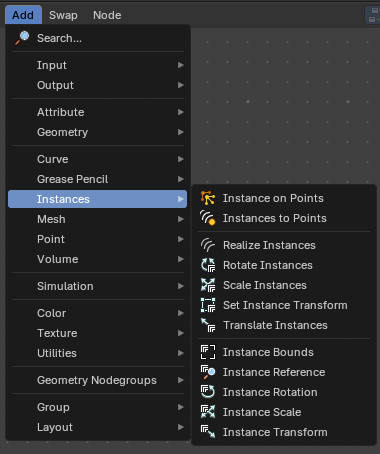

### Instance on Points

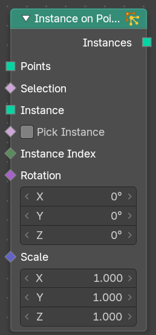

Instances geometry on points.

#### Inputs

##### Points

Data type: Geometry.

The points to put the instances on.

##### Selection

Data type: Boolean.

Only the selected points get an instance.

##### Instance

Data type: Geometry.

The geometry that is instanced on the points.

##### Pick Instance

Data type: Boolean.

When on, each point picks one instance from the Instance input instead of using the whole geometry.

##### Instance Index

Data type: Integer.

The index of the instance to use for each point. It is only used when Pick Instance is on. By default the point index is used.

##### Rotation

Data type: Rotation.

The rotation of the instances.

##### Scale

Data type: Vector (XYZ).

The scale of the instances.

#### Outputs

##### Instances

Data type: Geometry.

The instances on the points.

### Instances to Points

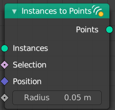

This node takes a geometry set with instances as input, and outputs  
points located on the origins of the top level of instances in the  
geometry set (not nested instances). It also has position and radius  
inputs to allow overriding the default, and a selection input to only  
generate points for some instances.

#### Inputs

##### Instances

Data type: Geometry.

The instances to convert to points.

##### Selection

Data type: Boolean.

Only the selected instances create a point.

##### Position

Data type: Vector.

The position of the new points. By default this is the position of the instance.

##### Radius

Data type: Float (distance).

The radius of the new points.

#### Outputs

##### Points

Data type: Geometry.

The point cloud with one point for each selected instance.

### Realize Instances

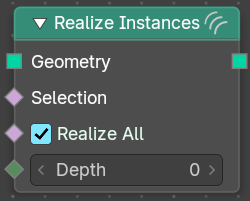

Makes the instances in the geometry input real. This means each instance becomes its own object with unique mesh data. This node is useful to realize instances either on everything or to a level of instance depth.

#### Inputs

##### Geometry

Data type: Geometry.

The geometry with the instances to realize.

##### Selection

Data type: Boolean.

Which top-level instances to realize.

##### Realize All

Data type: Boolean.

Realizes all levels of nested instances for each top-level instance. This overrides the value of the Depth input.

##### Depth

Data type: Integer.

The number of levels of nested instances to realize for each top-level instance. **Note:** *Only relevant when Realize All is toggled off.*

##### Preserve Normals

Data type: Boolean.

Keeps the visible face orientation of mirrored mesh instances.

#### Outputs

##### Geometry

Data type: Geometry.

The geometry with the realized instances.

### Rotate Instances

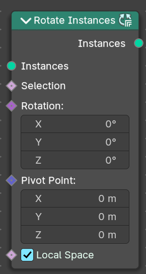

Rotates the instances of a geometry.

#### Inputs

##### Instances

Data type: Geometry.

The instances to rotate. Each instance rotates on its own.

##### Selection

Data type: Boolean.

Only the selected instances are rotated.

##### Rotation

Data type: Rotation.

The rotation to add to the instances.

##### Pivot Point

Data type: Vector (translation).

The pivot point position to rotate around.

##### Local Space

Data type: Boolean.

When on, the instances rotate in their own local space. When off, they rotate in world space.

#### Outputs

##### Instances

Data type: Geometry.

The rotated instances.

### Scale Instances

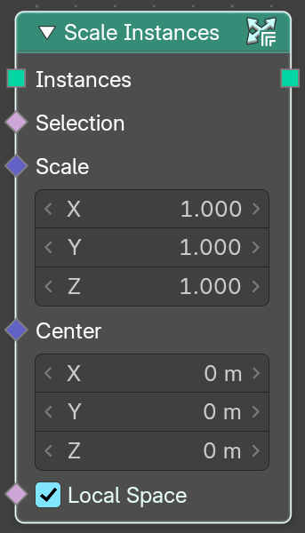

Scales the instances of a geometry.

#### Inputs

##### Instances

Data type: Geometry.

The instances to scale. Each instance scales on its own.

##### Selection

Data type: Boolean.

Only the selected instances are scaled.

##### Scale

Data type: Vector (XYZ).

The scale factor on each axis.

##### Center

Data type: Vector (translation).

The pivot point position to scale around.

##### Local Space

Data type: Boolean.

When on, the instances scale in their own local space. When off, they scale in world space.

#### Outputs

##### Instances

Data type: Geometry.

The scaled instances.

### Translate Instances

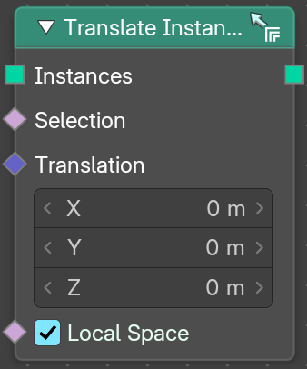

Moves the instances of a geometry.

#### Inputs

##### Instances

Data type: Geometry.

The instances to move. Each instance moves on its own.

##### Selection

Data type: Boolean.

Only the selected instances are moved.

##### Translation

Data type: Vector (translation).

The amount to move.

##### Local Space

Data type: Boolean.

When on, the instances move in their own local space. When off, they move in world space.

#### Outputs

##### Instances

Data type: Geometry.

The moved instances.

### Set Instance Transform

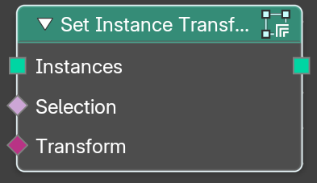

This node allows replacing the transformation of every instance by providing a matrix.

#### Inputs

##### Instances

Data type: Geometry.

The input instances.

##### Selection

Data type: Boolean.

Only the selected instances get the new transform.

##### Transform

Data type: Matrix.

The transform matrix that you want to apply to every instance.

#### Outputs

##### Instances

Data type: Geometry.

The output instances.

### Instance Bounds

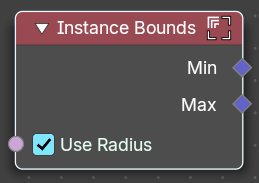

Calculate position bounds of the geometry set of each instance.

#### Inputs

##### Use Radius

Data type: Boolean.

For curves, point clouds and Grease Pencil. Takes the radius attribute into account when computing the bounds.

#### Outputs

##### Min

Data type: Vector.

The minimum corner of the bounding box of each instance.

##### Max

Data type: Vector.

The maximum corner of the bounding box of each instance.

### Instance Reference

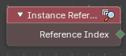

Gives the reference index of each instance: which of the instanced objects or geometries it shows. When you instance a collection on points with Pick Instance, every point picks one of the collection's children, and this index tells you which one. Use it to give each kind of instance its own color, scale or rotation.

#### Outputs

##### Reference Index

Data type: Integer.

The index of the geometry or object that the instance refers to, per instance.

### Instance Transform

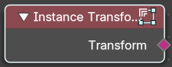

Retrieves the transform of the instances.

#### Outputs

##### Transform

Data type: Matrix.

The transform matrix of each instance.

### Instance Rotation

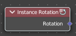

Retrieves the rotation of the instances.

#### Outputs

##### Rotation

Data type: Rotation.

The rotation of each instance.

### Instance Scale

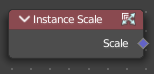

Retrieves the scale of an instances.

#### Outputs

##### Scale

Data type: Vector.

The scale of each instance.
