# Read

## Add menu - Mesh - Read

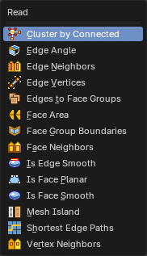

Nodes to modify the mesh geometry.

### Cluster by Connected

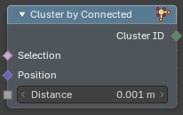

Sorts the vertices of a mesh into groups, but only joins vertices that are connected by an edge and are close together. It works like Cluster by Distance, with the extra rule that two vertices must also share an edge. Use it when nearby vertices of different parts of a mesh must stay apart, for example the tips of two fingers that almost touch.

#### Inputs

##### Selection

Data type: Boolean.

Which vertices are put into clusters.

##### Position

Data type: Vector.

The position used to measure the distance.

##### Distance

Data type: Float (distance).

Connected vertices that are closer than this value belong to the same cluster.

#### Outputs

##### Cluster ID

Data type: Integer.

The number of the cluster of each vertex. The number is the index of the first vertex of the cluster.

#### How to use

With the five points of the Cluster by Distance example and edges between points 0 and 1, 1 and 2, and 3 and 4, the Cluster ID is 0, 0, 2, 3, 3. Points 1 and 2 are connected but 0.0015 apart, which is more than the Distance of 0.001, so they do not share a cluster.

### Edge Angle

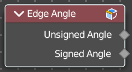

Calculates the angle in radians between two faces that meet at an edge. Without two faces on the edge, the angle will be 0.

#### Outputs

##### Unsigned Angle

Data type: Float.

The unsigned output angle. The shortest angle will be picked.

##### Signed Angle

Data type: Float.

The signed angle between the two faces, where Convex angles are positive and Concave angles are negative. This calculation is slower than the unsigned angle.

### Edge Neighbors

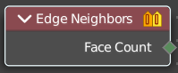

Outputs the number of faces connected to each edge.

#### Outputs

##### Face Count

Data type: Integer.

The number of faces.

### Edge Vertices

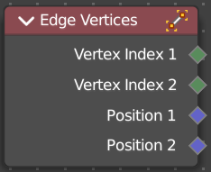

Outputs the index and position of the two vertices that defines an edge. Index outputs an integer. Position a vector.

#### Outputs

##### Vertex Index 1

Data type: Integer.

The index of the first vertice.

##### Vertex Index 2

Data type: Integer.

The index of the second vertice.

##### Position 1

Data type: Vector.

The position of the first vertice.

##### Position 2

Data type: Vector.

The position of the second vertice.

### Edges to Face Groups

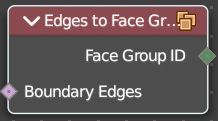

Group Faces into regions, surrounded by the selected boundary edges.

#### Inputs

##### Boundary Edges

Data type: Boolean.

The edges that make the borders of the face groups.

#### Outputs

##### Face Group ID

Data type: Integer.

The output face group.

### Face Area

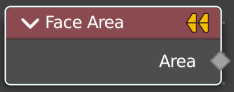

Gives each face area a unique id. Which can be used in a capture attribute for example, to create instances of other geometry to this now unique face areas.

#### Outputs

##### Area

Data type: Float.

The face area output.

### Face Group Boundaries

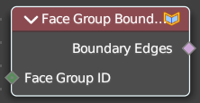

Find edges on the boundaries between face sets

#### Inputs

##### Face Group ID

Data type: Integer.

The face groups to calculate the boundaries from. An index value for each face.

#### Outputs

##### Boundary Edges

Data type: Boolean.

The edges that lie on the boundaries between the different face groups.

### Face Neighbors

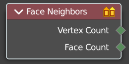

Outputs the number of vertices or faces connected to each face.

#### Outputs

##### Vertex Count

Data type: Integer.

The vertex count for the face neighbors.

##### Face Count

Data type: Integer.

The face count for the face neighbors.

### Is Face Planar

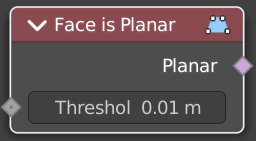

Returns true if all of the points of the evaluated face are on the same plane.

#### Inputs

##### Threshold

Data type: Float (distance).

The threshold to consinder the points to be at the same plane.

#### Outputs

##### Planar

Data type: Boolean.

True if the face is planar.

### Is Face Smooth

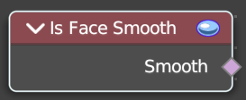

Retreives if the face is shaded smooth.

#### Outputs

##### Smooth

Data type: Boolean.

Smooth output.

### Is Edge Smooth

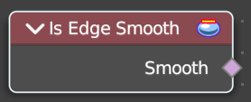

Retreives if the edge is shaded smooth.

#### Outputs

##### Smooth

Data type: Boolean.

Smooth output.

### Mesh Island

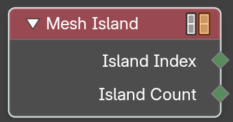

Outputs a separate index for each mesh island. The indices are based on the order of the lowest-numbered vertex in each island.

#### Outputs

##### Island Index

Data type: Integer.

The index of the mesh island of each element.

##### Island Count

Data type: Integer.

The count output.

### Shortest Edge Paths

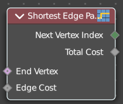

Calculates the shortest path from multiple start points.

#### Inputs

##### End Vertex

Data type: Boolean.

The last point of the path.

##### Edge Cost

Data type: Float.

The amount of calculation to find the shortest path.

#### Outputs

##### Next Vertex Index

Data type: Integer.

The vertices index of the shortest path.

##### Total Cost

Data type: Float.

The calculation amount.

### Vertex Neighbors

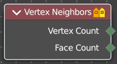

Outputs the number of vertices or faces connected to each vertex.

#### Outputs

##### Vertex Count

Data type: Integer.

The vertex count for the vertex neighbors.

##### Face Count

Data type: Integer.

The face count for the vertex neighbors.

# Sample

## Add menu - Mesh - Sample

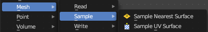

Nodes to modify the mesh geometry.

### Sample Nearest Surface

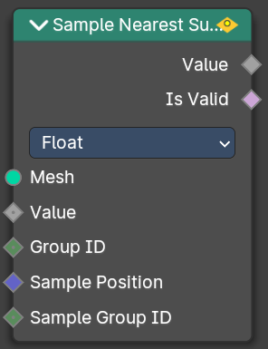

Calculate the interpolated value of a mesh attribute on the closest point of its surface.

#### Inputs

##### Mesh

Data type: Geometry.

Input mesh.

##### Value

Data type: follows the Data Type setting.

The value to calculate.

##### Group ID

Data type: Integer.

Is evaluated on the face domain, and splits the input mesh into multiple parts, each with its own id.

##### Sample Position

Data type: Vector.

The sample position to calculate.

##### Sample Group ID

Data type: Integer.

Determines in which group the closest nearest surface is detected.

#### Properties

##### Data Type

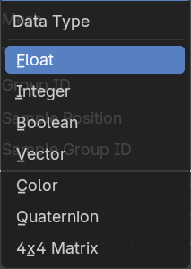

Which data to calculate.

#### Outputs

##### Value

Data type: follows the Data Type setting.

The output value.

##### Is Valid

Data type: Boolean.

Wether the sampling was successful. It is false when the sampled group is empty.

### Sample UV Surface

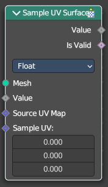

Calculate the interpolated value of a mesh attribute at a UV coordinate.

#### Inputs

##### Mesh

Data type: Geometry.

Input mesh.

##### Value

Data type: follows the Data Type setting.

The value to calculate.

##### UV Map

Data type: Vector.

The UV map of the mesh to sample with.

##### Sample UV

Data type: Vector.

The sample position to calculate.

#### Properties

##### Data Type

Which data to calculate.

#### Outputs

##### Value

Data type: follows the Data Type setting.

The output value.

##### Is Valid

Data type: Boolean.

Wether the node could find a single face to sample at the uv coordinate.

# Write

## Add menu - Mesh - Write

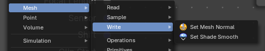

These are nodes for working with Mesh data.

### Set Mesh Normal

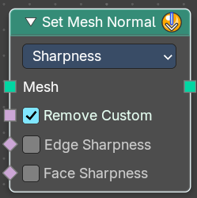

The **Set Mesh Normal** node is used to modify custom normals on a mesh, providing control over shading smoothness and surface appearance. This is useful for adjustingnormalsmoothness, sharp edges, and tangent-based effects

#### Inputs

##### Mesh

Data type: Geometry.

Input mesh.

##### Remove Custom

Data type: Boolean.

Removes **custom normals** previously set by the user on the original mesh data when enabled. Only in Sharpness mode.

##### Edge Sharpness

Data type: Boolean.

Sets the normal sharpness to the edge domain to “flat”. Only in Sharpness mode.

##### Face Sharpness

Data type: Boolean.

Sets the normal sharpness to the face domain to “flat”. Only in Sharpness mode.

##### Custom Normal

Data type: Vector (XYZ).

The new custom normal. It is a vector field. Only in Free and Tangent Space mode.

#### Properties

##### Mode

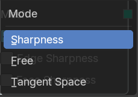

###### Sharpness

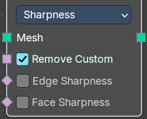

Store the sharpness of each face or edge. Similar to the "Shade Smooth" and "Shade Flat" operators.

###### Free

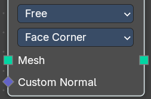

Allows direct manipulation of normals as **free vectors,** rather than constrained by geometry. Useful for custom shading effects and non-destructive normal adjustments.

###### Tangent Space

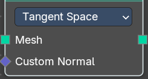

Adjusts normals relative to the surface tangentto store the source meshes normals.Storesnormals in a deformation dependent custom transformation space.

> **Note:** This method is slower, but can be better when subsequent operations change the mesh without handling normals specifically.

##### Domain

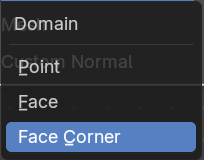

Attribute domain to store the free custom normals. Only in Free mode.

- Point
- Face
- Face Corner

> **Note:** Default object normals are stored to Facecorner, this will “pass-through” the normal data. Face normals will make “flat” sharp edges.

#### Outputs

##### Mesh

Data type: Geometry.

The mesh with the new normals.

### Set Shade Smooth

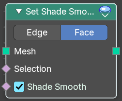

Sets the smooth or flat shading of the faces or edges of a mesh.

#### Inputs

##### Mesh

Data type: Geometry.

Input mesh.

##### Selection

Data type: Boolean.

A selection of the input mesh.

##### Shade Smooth

Data type: Boolean.

Set the shading to smooth.

#### Properties

##### Domain

###### Edge

Set Edge to smooth.

###### Face

Set Face to smooth

#### Outputs

##### Mesh

Data type: Geometry.

The mesh with the new shading.

# Operations

## Add menu - Mesh - Operations

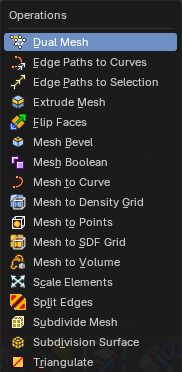

Nodes to modify the mesh geometry.

### Dual Mesh

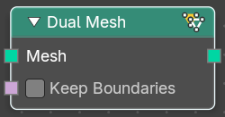

The Dual Mesh node calculates the dual of the input mesh. This means that faces get replaced with vertices and vertices with faces.

#### Inputs

##### Mesh

Data type: Geometry.

The input mesh.

##### Keep Boundaries

Data type: Boolean.

Keep the (non-manifold) boundaries of the mesh intact.

#### Outputs

##### Dual Mesh

Data type: Geometry.

The output mesh.

### Edge Paths to Curves

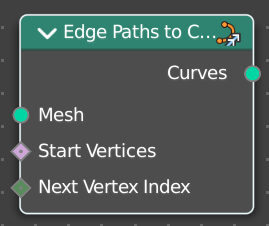

Converts Edge Paths to Curves.

#### Inputs

##### Mesh

Data type: Geometry.

The input mesh.

##### Start Vertices

Data type: Boolean.

The start vertices of the edge path.

##### Next Vertex Index

Data type: Integer.

The edge path by index.

#### Outputs

##### Curves

Data type: Geometry.

The output curve.

### Edge Paths to Selection

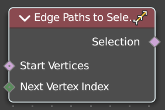

Calculates an edge path, and converts it to a selectoin

#### Inputs

##### Start Vertices

Data type: Boolean.

The start vertices of the edge path.

##### Next Vertex Index

Data type: Integer.

The edge path by index.

#### Outputs

##### Selection

Data type: Boolean.

The selection

### Extrude Mesh

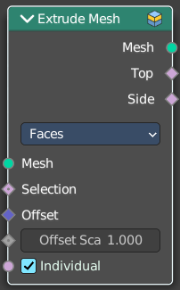

Extrudes out geometry at the selection by a given amount.

#### Inputs

##### Mesh

Data type: Geometry.

The input mesh.

##### Selection

Data type: Boolean.

A selection of the mesh.

##### Offset

Data type: Vector (translation).

The offset amount.

##### Offset Scale

Data type: Float.

The offset scale. Without an offset this is equal the amount.

##### Individual

Data type: Boolean.

Just Faces mode. Extrude out individual faces.

#### Properties

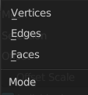

##### Mode

What kind of elements to extrude out. Vertices, Edges or Faces.

#### Outputs

##### Mesh

Data type: Geometry.

The output mesh.

##### Top

Data type: Boolean.

The top elements of the extrusion.

##### Side

Data type: Boolean.

The side elements of the extrusion.

### Flip Faces

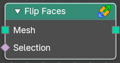

Flips the winding order of the selected faces.

Blender developers decided not to call it Flip Normals. Since "normals are  
derived data, changing them is only a side effect." However, what the node does is in fact to flip the normals.

#### Inputs

##### Mesh

Data type: Geometry.

The input mesh.

##### Selection

Data type: Boolean.

A selection of the input mesh.

#### Outputs

##### Mesh

Data type: Geometry.

The output mesh.

### Mesh Bevel

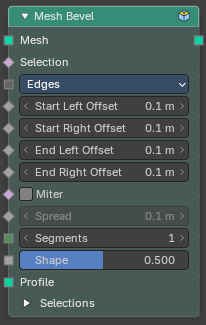

Rounds off the sharp edges or corners of a mesh. A bevel cuts a small slope or curve into the edge so that it catches light and looks less like a computer-made corner. This is useful on hard-surface models such as furniture, machines and buildings. The node works only on the edges or vertices you select, so you can bevel just the outer edges and leave the rest sharp.

#### Inputs

##### Mesh

Data type: Geometry.

The mesh to bevel.

##### Selection

Data type: Boolean.

Which elements are affected. Elements that are not selected are left as they are.

##### Affect Kind

Data type: Menu.

What is beveled: **Edges** rounds the selected edges. **Vertices** rounds the selected corners.

##### Start Left Offset

Data type: Float (distance).

Edges only. How far the bevel reaches into the face on the left of the edge, measured at the start of the edge.

##### Start Right Offset

Data type: Float (distance).

Edges only. The same for the face on the right of the edge.

##### End Left Offset

Data type: Float (distance).

Edges only. How far the bevel reaches on the left side at the end of the edge.

##### End Right Offset

Data type: Float (distance).

Edges only. The same for the right side at the end of the edge. Use different start and end values to make a bevel that changes width along the edge, and different left and right values to make it lopsided.

##### Offset

Data type: Float (distance).

Vertices only. How far the bevel reaches along the edges that meet at the corner.

##### Miter

Data type: Boolean.

On: where several beveled edges meet, the outer edges of the bevel are carried on to a sharp corner instead of being rounded off.

##### Spread

Data type: Float (distance).

How far the mitered corner reaches. It only has an effect when Miter is on.

##### Segments

Data type: Integer.

How many faces the bevel is made of. 1 gives a flat slope. Higher values give a smoother curve.

##### Shape

Data type: Float (factor).

The profile of the bevel. 0.5 is a circular arc. Move the value away from 0.5 to bow the profile in or out.

##### Profile

Data type: Geometry.

Optional. A curve that replaces the Shape setting with a profile you draw yourself.

#### Outputs

##### Mesh

Data type: Geometry.

The beveled mesh.

##### Vertex Face

Data type: Boolean.

Selection of the new faces that were made at beveled corners.

##### Edge Face

Data type: Boolean.

Selection of the new faces that were made along beveled edges.

##### Outer Edge

Data type: Boolean.

Selection of the edges on the outer border of the bevel.

##### Mid Edge

Data type: Boolean.

Selection of the edges that run along the middle of the bevel.

#### How to use

Connect a mesh, for example a Cube node, to Mesh and connect the Mesh output to the Group Output. With the defaults all edges are beveled by 0.1 m with one segment. Raise **Segments** to make the bevel round. Plug a Compare node or an Edge Angle node into **Selection** to bevel only the sharp edges.

A default cube shows the effect on the number of mesh elements:

- Edges, 1 segment: 24 vertices and 26 faces.
- Edges, 3 segments: 96 vertices and 98 faces.
- Vertices, 1 segment: 24 vertices and 14 faces.

Use the four selection outputs to add detail only to the new geometry, for example to give the Edge Face selection a different material with Set Material.

### Mesh Boolean

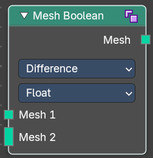

The Boolean Node allows you to cut, subtract, and join the geometry of two inputs. This node offers the same operations as the Boolean modifier.

#### Inputs

##### Mesh 1

Data type: Geometry.

The mesh to cut from. Only in Difference mode.

##### Mesh 2

Data type: Geometry.

The meshes to cut away from Mesh 1. You can connect more than one mesh. Only in Difference mode.

##### Mesh

Data type: Geometry.

The meshes to combine. You can connect more than one mesh. Only in Intersect and Union mode.

##### Self Intersection

Data type: Boolean.

Allow self intersection. Only with the Exact solver.

##### Hole Tolerant

Data type: Boolean.

Allow holes. Only with the Exact solver.

#### Properties

##### Operation

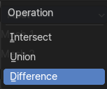

The boolean operation.

###### Intersect

Produce a new geometry containing only the volume inside of both geometry 1 and geometry 2.

###### Union

The two input pieces of geometry are joined, then any interior elements are removed.

###### Difference

Geometry 2 is subtracted from geometry 1 (everything outside of geometry 2 is kept).

##### Solver

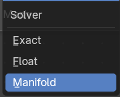

###### Float

Simple solver for the best performance. Does not support overlapping geometry.

###### Exact

Exact solver for the most accurate result.

###### Manifold

Fastest solver with best result, but only works on manifold meshes.

#### Outputs

##### Mesh

Data type: Geometry.

The result of the boolean operation.

##### Intersecting Edges

Data type: Boolean.

Outputs the intersecting edges. Only with the Exact and Manifold solver.

### Mesh to Curve

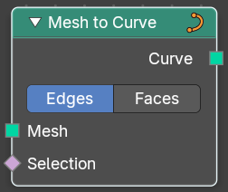

Converts a mesh geometry to a curve geometry.

#### Inputs

##### Mesh

Data type: Geometry.

Input mesh.

##### Selection

Data type: Boolean.

A selection of the input mesh.

#### Properties

##### Mode

Edges or Faces.

#### Outputs

##### Curve

Data type: Geometry.

Standard curve output.

### Mesh to Density Grid

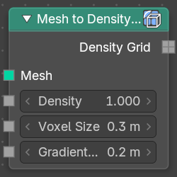

Creates a filled volume grid from a mesh.

#### Inputs

##### Mesh

Data type: Geometry.

Input mesh.

##### Density

Data type: Float.

Mesh density.

##### Voxel Size

Data type: Float (distance).

The voxel size.

##### Gradient Width

Data type: Float (distance).

The width of the gradient inside of the mesh.

#### Outputs

##### Density Grid

Data type: Float.

Density Grid output.

### Mesh to Points

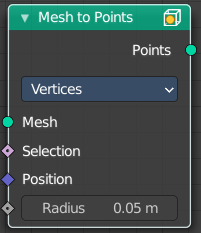

Converts a mesh geometry to a point geometry.

#### Inputs

##### Mesh

Data type: Geometry.

Input mesh.

##### Selection

Data type: Boolean.

A selection of the input mesh.

##### Position

Data type: Vector.

The position of the points.

##### Radius

Data type: Float (distance).

The radius of the points

#### Properties

##### Mode

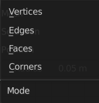

What geometry to convert to points.

#### Outputs

##### Points

Data type: Geometry.

The new point cloud.

### Mesh to SDF Grid

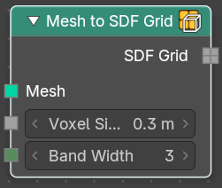

Creates a signed distance volume grid from a mesh.

#### Inputs

##### Mesh

Data type: Geometry.

Input mesh.

##### Voxel Size

Data type: Float (distance).

The voxel size.

##### Band Width

Data type: Integer.

The width of the active voxel surface, in voxels.

#### Outputs

##### SDF Grid

Data type: Float.

The signed distance field grid.

### Mesh to Volume

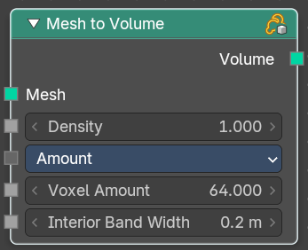

Converts a mesh geometry to a Volume.

#### Inputs

##### Mesh

Data type: Geometry.

Input mesh.

##### Density

Data type: Float.

The density of the volume

##### Resolution Mode

Data type: Menu.

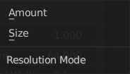

How to calculate the volume. Based of the size or based at the amount.

##### Voxel Size

Data type: Float (distance).

The size of one voxel. Only in Size mode.

##### Voxel Amount

Data type: Float.

The number of voxels along one axis. Only in Amount mode.

##### Interior Band Width

Data type: Float (distance).

The width of the gradient inside of the mesh.

#### Outputs

##### Volume

Data type: Geometry.

The volume output.

### Scale Elements

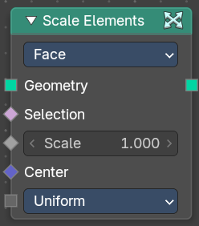

Allows to scale the selected elements.

#### Inputs

##### Geometry

Data type: Geometry.

Standard geometry input.

##### Selection

Data type: Boolean.

A selection of the geometry.

##### Scale

Data type: Float.

The scale factor

##### Center

Data type: Vector (translation).

The center of the scaling.

##### Scale Mode

Data type: Menu.

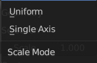

Uniform scales uniformly in all three world coordinates.

Single Axis scales separately in the single axis.

##### Axis

Data type: Vector.

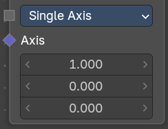

Scale Mode Single axis only. Scale the selection separately along its single axis.

#### Properties

##### Domain

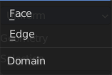

What kind of elements to scale.

#### Outputs

##### Geometry

Data type: Geometry.

The output geometry.

### Split Edges

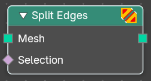

Splits the edges of the geometry.

Note that splitting edges breaks the mesh topology.

#### Inputs

##### Mesh

Data type: Geometry.

Input mesh.

##### Selection

Data type: Boolean.

A selection of the input mesh.

#### Outputs

##### Mesh

Data type: Geometry.

Standard Mesh output.

### Subdivide Mesh

Subdivides the geometry by a simple division.

#### Inputs

##### Mesh

Data type: Geometry.

The input mesh.

##### Level

Data type: Integer.

To which degree the geometry will be deformed.

#### Outputs

##### Mesh

Data type: Geometry.

The subdivided mesh.

### Subdivision Surface

The Subdivision Surface node subdivides the geometry using Catmull-Clark deformation.

#### Inputs

##### Mesh

Data type: Geometry.

Standard geometry input.

##### Level

Data type: Integer.

To which degree the geometry will be deformed.

##### Edge Crease

Data type: Float (factor).

Control how smooth edges should be with Weighted Edge Creases.

##### Vertex Crease

Data type: Float (factor).

Control how smooth edges should be with Weighted Vertex Creases.

##### Limit Surface

Data type: Boolean.

Place the vertices at the surface as if it would be infinite subdivided. This results in the smoothest possible shape.

##### Quality

Data type: Integer.

The accuracy of the vertex positions. A lower value is faster but less precise.

##### UV Smooth

Data type: Menu.

The methbod to deal with smoothing the UV.

##### Boundary Smooth

Data type: Menu.

Controls if open boundaries and corners are smooth.

#### Outputs

##### Mesh

Data type: Geometry.

The subdivided mesh.

### Triangulate

The Triangulate node triangulates all faces in a mesh.

#### Inputs

##### Mesh

Data type: Geometry.

The input mesh.

##### Selection

Data type: Boolean.

Only the selected faces are triangulated.

##### Quad Method

Data type: Menu.

How quads are split into triangles. A quad is a polygon with four edges.

- **Beauty**: Split the quads in nice triangles, slower method.
- **Fixed**: Split the quads on their 1st and 3rd vertices.
- **Fixed Alternate**: Split the quads on their 2nd and 4th vertices.
- **Shortest Diagonal**: Split the quads based on the shortest diagonal distance between their vertices.
- **Longest Diagonal**: Split the quads based on the longest diagonal distance between their vertices.

##### N-gon Method

Data type: Menu.

How n-gons are split into triangles. N-gons are faces with more than four edges.

- **Beauty**: Arrange the new triangles nicely, slower method.
- **Clip**: Split the polygons using an ear-clipping algorithm (gives similar results to the tessellation used for the viewport rendering).

#### Outputs

##### Mesh

Data type: Geometry.

The triangulated mesh.

# Primitives

## Add menu - Mesh - Primitives

Nodes to modify the mesh geometry.

### Cone

Cone creates a Cone mesh.

#### Inputs

##### Vertices

Data type: Integer.

Number of vertices.

##### Side Segments

Data type: Integer.

Adjust the number of segments at the side.

##### Fill Segments

Data type: Integer.

Adjust the number of segments at the fill faces. Not when Fill Type is None.

##### Radius Top

Data type: Float (distance).

The initial radius at the top.

##### Radius Bottom

Data type: Float (distance).

The initial radius at the bottom.

##### Depth

Data type: Float (distance).

The initial height.

#### Properties

##### Fill Type

Defines how the Circle mesh is filled.

###### None

pure edge geometry.

###### N-Gon

The circle face is a N-Gon face.

###### Triangles

The circle face is triangulated.

#### Outputs

##### Mesh

Data type: Geometry.

Mesh output.

##### Top

Data type: Boolean.

Top radius output.

##### Bottom

Data type: Boolean.

Bottom radius output.

##### Side

Data type: Boolean.

The depth output

##### UV Map

Data type: Vector.

UV map output.

### Cube

Cube creates a Cubeoid mesh.

#### Inputs

##### Size

Data type: Vector (translation).

The initial size in X , Y and Z dimensions

##### Vertices X

Data type: Integer.

How many vertices the cube has along X. This allows to subdivide the cube.

##### Vertices Y

Data type: Integer.

How many vertices the cube has along Y. This allows to subdivide the cube.

##### Vertices Z

Data type: Integer.

How many vertices the cube has along Z. This allows to subdivide the cube.

#### Outputs

##### Mesh

Data type: Geometry.

Mesh output.

##### UV Map

Data type: Vector.

UV map output.

### Cylinder

Cylinder creates a Cylinder mesh.

#### Inputs

##### Vertices

Data type: Integer.

Number of vertices.

##### Side Segments

Data type: Integer.

Adjust the number of segments at the side.

##### Fill Segments

Data type: Integer.

Adjust the number of segments at the fill faces. Not when Fill Type is None.

##### Radius

Data type: Float (distance).

The initial radius.

##### Depth

Data type: Float (distance).

The initial height.

#### Properties

##### Fill Type

Defines how the Circle mesh is filled.

###### None

pure edge geometry.

###### N-Gon

The circle face is a N-Gon face.

###### Triangles

The circle face is triangulated.

#### Outputs

##### Mesh

Data type: Geometry.

Mesh output.

##### Top

Data type: Boolean.

Top radius output.

##### Side

Data type: Boolean.

The side faces.

##### Bottom

Data type: Boolean.

Bottom radius output.

##### UV Map

Data type: Vector.

UV map output.

### Grid

Grid creates a grid mesh.

#### Inputs

##### Size X

Data type: Float (distance).

The initial size in X direction.

##### Size Y

Data type: Float (distance).

The initial size in Y direction.

##### Vertices X

Data type: Integer.

The initial number of vertices in X direction.

##### Vertices Y

Data type: Integer.

The initial number of vertices in Y direction.

#### Outputs

##### Mesh

Data type: Geometry.

Mesh output.

##### UV Map

Data type: Vector.

UV map output.

### Ico Sphere

Ico Sphere creates a ico Sphere mesh.

#### Inputs

##### Radius

Data type: Float (distance).

The initial radius.

##### Subdivisions

Data type: Integer.

The initial subdivisions.

#### Outputs

##### Mesh

Data type: Geometry.

Mesh output.

##### UV Map

Data type: Vector.

UV map output.

### Mesh Circle

Circle creates a Circle mesh.

#### Inputs

##### Vertices

Data type: Integer.

Number of vertices.

##### Radius

Data type: Float (distance).

The initial radius.

#### Properties

##### Fill Type

Defines how the Circle mesh is filled.

###### None

pure edge geometry.

###### N-Gon

The circle face is a N-Gon face.

###### Triangles

The circle face is triangulated.

#### Outputs

##### Mesh

Data type: Geometry.

Mesh output.

### Mesh Line

Line creates a line mesh.

#### Inputs

##### Count

Data type: Integer.

The number of vertices on the line. Not in End Points mode with Count Mode set to Resolution.

##### Resolution

Data type: Float (distance).

The length of each edge. Only in End Points mode with Count Mode set to Resolution.

##### Start Location

Data type: Vector (translation).

The initial location.

##### Offset

Data type: Vector (translation).

In Offset mode, the distance from one vertex to the next. In End Points mode this socket is called End Location, and it is the position of the last vertex.

#### Properties

##### Mode

- **Offset**: Specify the offset from one vertex to the next.
- **End Points**: Specify the line start and endpoints.

##### Count Mode

Only in End Points mode.

- **Count**: Specify the number of total vertices.
- **Resolution**: Specify the distance between the vertices.

#### Outputs

##### Mesh

Data type: Geometry.

Mesh output.

### UV Sphere

UV Sphere creates a uv sphere mesh.

#### Inputs

##### Segments

Data type: Integer.

The initial number of segments.

##### Rings

Data type: Integer.

The initial number of edgerings.

##### Radius

Data type: Float (distance).

The initial radius.

#### Outputs

##### Mesh

Data type: Geometry.

Mesh output.

##### UV Map

Data type: Vector.

UV map output.

# Topology

## Add menu - Mesh - Topology

Mesh topology related nodes.

### Corners of Edge

Retreive the corners that makes up a edge.

#### Inputs

##### Edge Index

Data type: Integer.

The edge to get the data from. By default this is the edge from the context.

##### Weights

Data type: Float.

Values used to sort the corners attached to the edge.

##### Sort Index

Data type: Integer.

Which of the corners to output.

#### Outputs

##### Corner Index

Data type: Integer.

The output corner.

##### Total

Data type: Integer.

The number of faces or corners connected to each edge.

### Corners of Face

Retreive the corners that makes up a face.

#### Inputs

##### Face Index

Data type: Integer.

The face to get the data from.

##### Weights

Data type: Float.

Values used to sort the corners of the face.

##### Sort Index

Data type: Integer.

Which of the corners to output.

#### Outputs

##### Corner Index

Data type: Integer.

The output corner.

##### Total

Data type: Integer.

The number of corners in the face.

### Corners of Vertex

Retreive face corners connected to vertices.

#### Inputs

##### Vertex Index

Data type: Integer.

The vertice to get the data from.

##### Weights

Data type: Float.

Values used to sort the corners attached to the vertice.

##### Sort Index

Data type: Integer.

Which of the corners to output.

#### Outputs

##### Corner Index

Data type: Integer.

The output corner.

##### Total

Data type: Integer.

The number of corners connected to each vertice.

### Edges of Corner

Retreive the edges of both sides of a corner.

#### Inputs

##### Corner Index

Data type: Integer.

The corner to retreive the data from.

#### Outputs

##### Next Edge Index

Data type: Integer.

The edge behind the corner.

##### Previous Edge Index

Data type: Integer.

The edge before the corner.

### Edges of Vertex

Retreive the edges connected to each vertex.

#### Inputs

##### Vertex Index

Data type: Integer.

The vertice to get the data from.

##### Weights

Data type: Float.

Values used to sort the edges attached to the vertice.

##### Sort Index

Data type: Integer.

Which of the edges to output.

#### Outputs

##### Edge Index

Data type: Integer.

The output edge.

##### Total

Data type: Integer.

The number of edges connected to each vertice.

### Face of Corner

Retreive the faces connected to each corner.

#### Inputs

##### Corner Index

Data type: Integer.

The corner to get the data from.

#### Outputs

##### Face Index

Data type: Integer.

The output faces.

##### Index in Face

Data type: Integer.

The index of the corner, starting from the first corner in the face.

### Offset Corner in Face

Retreive corners within the same face as another

#### Inputs

##### Corner Index

Data type: Integer.

The corner to get the data from.

##### Offset

Data type: Integer.

The numbers of corners to move around the face before getting the result. It circles around the start of the face if necessary.

#### Outputs

##### Corner Index

Data type: Integer.

The index of the offset corner.

### Vertex of Corner

Retreive the vertex each corner is attached to.

#### Inputs

##### Corner Index

Data type: Integer.

The corner to get the data from.

#### Outputs

##### Vertex Index

Data type: Integer.

The vertex each corner is attached to.

# UV

## Add menu - UV

Here you find nodes to modify the UV mapping.

### Pack UV Islands

Pack the UV islands to get the most out of the UV mapping.

#### Inputs

##### UV

Data type: Vector.

The input UV geometry.

##### Selection

Data type: Boolean.

A selection of the UV geometry.

##### Margin

Data type: Float.

How big the gap between the single UV patches should be.

##### Rotate

Data type: Boolean.

Rotate island for best fit.

##### Method

Data type: Menu.

Method used for packing UV Islands.

##### Bottom Left

Data type: Vector (2d).

Bottom left corner of packing bounds.

##### Top Right

Data type: Vector (2d).

Top right corner of packing bounds.

#### Outputs

##### UV

Data type: Vector.

The output UV geometry.

### UV Tangent

Generate tangent directions based on a UV map.

#### Inputs

##### Method

Data type: Menu.

Exact or fast calculation.

##### UV

Data type: Vector (2d).

x and y values of the UV space.

#### Outputs

##### Tangent

Data type: Vector.

The output UV geometry.

### UV Unwrap

Unwrap the mesh to give it an UV mapping.

#### Inputs

##### Selection

Data type: Boolean.

Which faces of the mesh should be unwrapped.

##### Seam

Data type: Boolean.

Mark edges as a seam for unwrapping.

##### Margin

Data type: Float.

How big the gap between the single UV patches should be.

##### Fill Holes

Data type: Boolean.

Virtually fill holes before unwrapping the mesh. This preserves symmetry and can avoids overlaps.

##### Method

Data type: Menu.

The unwrap method.

##### Iterations

Data type: Integer.

The number of iterations to run the SLIM solver for. Only in Minimum Stretch mode.

##### No Flip

Data type: Boolean.

Prevents flipping UVs. Only in Minimum Stretch mode.

#### Outputs

##### UV

Data type: Vector.

The output UV geometry.
