# Geometry

## Add menu - Geometry nodes - Geometry

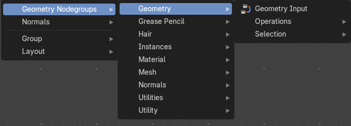

The nodes in this submenu are node groups. They use the regular single nodes under the hood.

It is virtually impossible to document these nodes in detail. So we will just list them.

When you double click the header, then you will enter the first level of the group. When you then press tab, or click again at the header, then you will reach the single nodes.

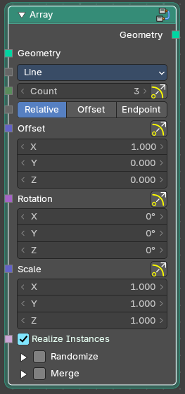

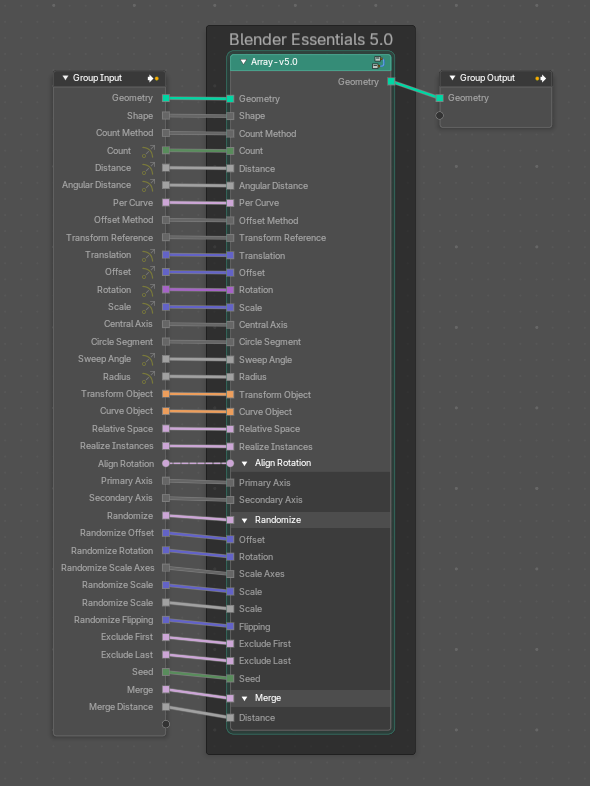

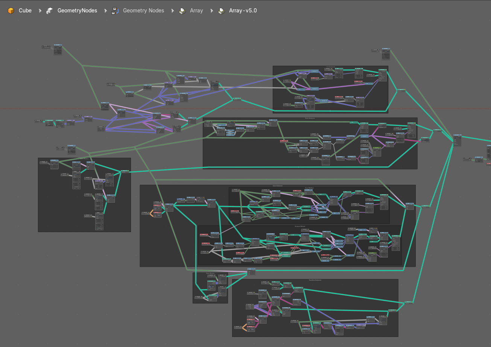

To leave the group you can use the breadcrumb up left in the header. These breadcrumbs are clickable. Or the Parent Node Tree button up right in the header.

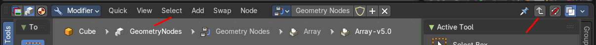

### Geometry Input

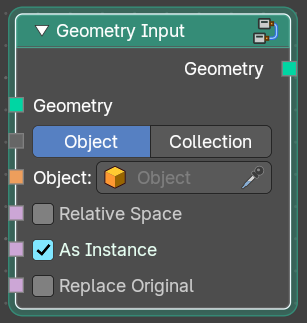

Geometry input

# Geometry › Operations

## Add menu - Geometry nodes - Geometry - Operations

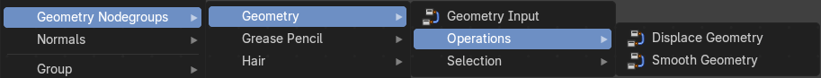

The nodes in this submenu are node groups. They use the regular single nodes under the hood.

It is virtually impossible to document these nodes in detail. So we will just list them.

When you double click the header, then you will enter the first level of the group. When you then press tab, or click again at the header, then you will reach the single nodes.

To leave the group you can use the breadcrumb up left in the header. These breadcrumbs are clickable. Or the Parent Node Tree button up right in the header.

### Displace Geometry

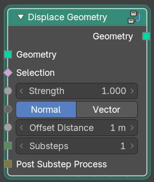

Displaces the geometry.

### Smooth Geometry

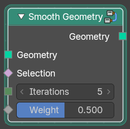

Smoothens the geometry.

# Geometry › Selection

## Add menu - Geometry nodes - Geometry - Selection

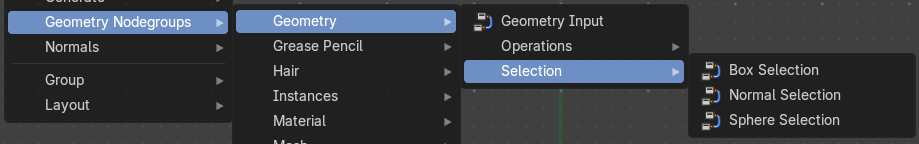

The nodes in this submenu are node groups. They use the regular single nodes under the hood.

It is virtually impossible to document these nodes in detail. So we will just list them.

When you double click the header, then you will enter the first level of the group. When you then press tab, or click again at the header, then you will reach the single nodes.

To leave the group you can use the breadcrumb up left in the header. These breadcrumbs are clickable. Or the Parent Node Tree button up right in the header.

### Box Selection

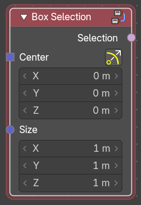

Box select geometry.

### Normal Selection

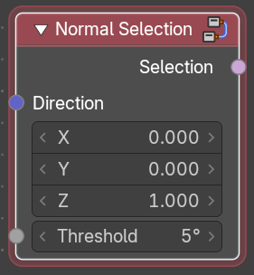

Select geometry by the normals direction.

### Sphere Selection

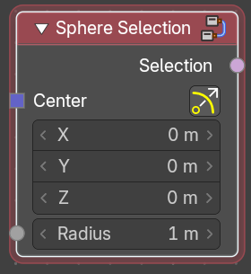

Select geometry by a sphere shape.

# Grease Pencil › Operations

## Add menu - Geometry nodes - Grease Pencil - Operations

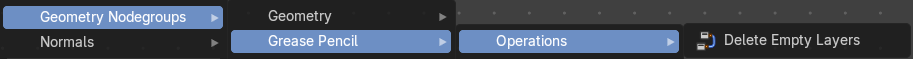

The nodes in this submenu are node groups. They use the regular single nodes under the hood.

It is virtually impossible to document these nodes in detail. So we will just list them.

When you double click the header, then you will enter the first level of the group. When you then press tab, or click again at the header, then you will reach the single nodes.

To leave the group you can use the breadcrumb up left in the header. These breadcrumbs are clickable. Or the Parent Node Tree button up right in the header.

### Delete Empty Layers

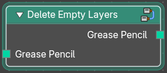

Deletes empty grease pencil layers

# Grease Pencil › Read

## Add menu - Geometry nodes - Grease Pencil - Read

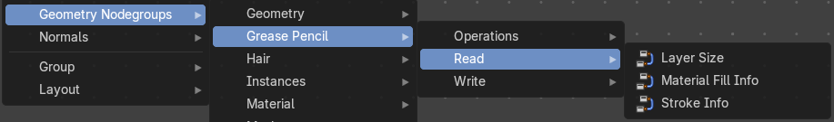

The nodes in this submenu are node groups. They use the regular single nodes under the hood.

It is virtually impossible to document these nodes in detail. So we will just list them.

When you double click the header, then you will enter the first level of the group. When you then press tab, or click again at the header, then you will reach the single nodes.

To leave the group you can use the breadcrumb up left in the header. These breadcrumbs are clickable. Or the Parent Node Tree button up right in the header.

### Layer Size

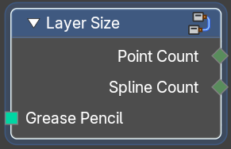

Retreive the point count and spline count of a grease pencil layer.

### Material Fill Info

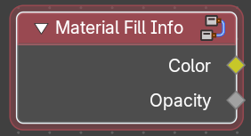

Retreive the color and opacity of a grease pencil layer.

### Stroke Info

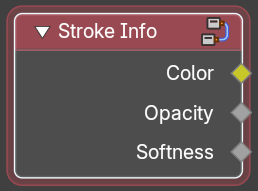

Retreive the color, opacity and softness of a grease pencil stroke.

# Grease Pencil › Write

## Add menu - Geometry nodes - Grease Pencil - Write

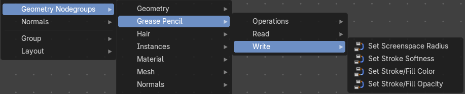

The nodes in this submenu are node groups. They use the regular single nodes under the hood.

It is virtually impossible to document these nodes in detail. So we will just list them.

When you double click the header, then you will enter the first level of the group. When you then press tab, or click again at the header, then you will reach the single nodes.

To leave the group you can use the breadcrumb up left in the header. These breadcrumbs are clickable. Or the Parent Node Tree button up right in the header.

### Set Screenspace Radius

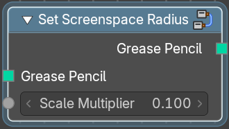

Set the screenspace radius of the grease pencil.

### Material Fill Info

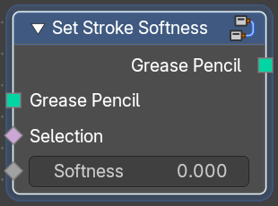

Set the stroke softness of the grease pencil.

### Set Stroke / Fill Color

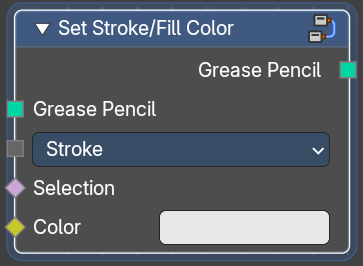

Set the stroke fill color of the grease pencil.

### Set Stroke / Fill Opacity

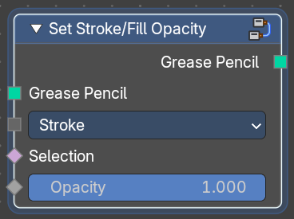

Set the stroke fill opacity of the grease pencil.

# Hair › Deformation

## Add menu - Hair - Deformation

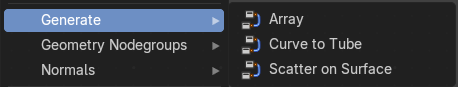

The nodes in this submenu are node groups. They use the regular single nodes under the hood.

It is virtually impossible to document these nodes in detail. So we will just list them.

When you double click the header, then you will enter the first level of the group. When you then press tab, or click again at the header, then you will reach the single nodes.

To leave the group you can use the breadcrumb up left in the header. These breadcrumbs are clickable. Or the Parent Node Tree button up right in the header.

### Blend Hair Curves

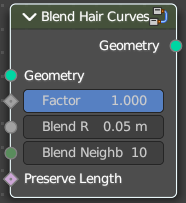

Blends the shape between multiple hair curves in a certain radius together.

#### Input

**Geometry**: The input geometry. · **Factor**: Factor to blend overall effect. · **Blend Radius**: Radius to select neighbors for blending. · **Blend Neighbours**: Amount of neighbors used for blending. · **Preserve Length**: Preserve the length of each curve during deformation.

#### Output

**Geometry**: The output geometry.

### Displace Hair Curves

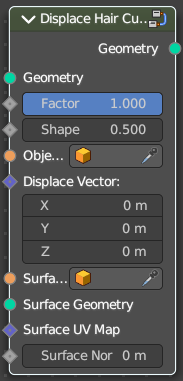

Displaces hair curves by a vector based on options.

#### Input

##### Geometry

Data type: Geometry.

The input geometry.

##### Factor

Data type: Float (factor).

Factor to blend overall effect.

##### Shape

Data type: Float.

Shape of the influence along curves. 0 means constant. 0.5 means linear.

##### Object

The object to determine the displacement space.

##### Displace Vector

Data type: Vector (translation).

The vector for the displacement.

##### Surface Object

Surface object used to sample the normal for displacement.

##### Surface Geometry

Surface geometry used to sample the normal for displacement.

##### Surface UV Map

Data type: Vector.

Surface UV Map used to sample the normal for displacement.

##### Surface Normal Displacement

Amount of displacement along the surface normals.

#### Output

##### Geometry

Data type: Geometry.

The output geometry.

### Frizz Hair Curves

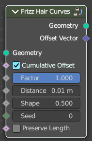

Deforms hair curves using a random vector per point to frizz them.

#### Input

**Geometry**: The input geometry. · **Cumulative Offset**: Apply offset cumulatively. · **Factor**: Factor to blend overall effect. · **Distance**: Overall distance factor for the deformation. · **Shape**: Shape of the influence along curves. 0 means constant. 0.5 means linear. · **Seed**: Random seed for the operation. · **Preserve Length**: Preserve the length of each curve during deformation.

#### Output

**Geometry**: The output geometry. · **Offset Vector**: The vector by which each point was offset during deformation.

### Hair Curves Noise

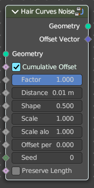

Deforms hair curves using noise texture.

#### Input

##### Geometry

Data type: Geometry.

The input geometry.

##### Cumulative Offset

Data type: Boolean.

Apply offset cumulatively.

##### Factor

Data type: Float (factor).

Factor to blend overall effect.

##### Distance

Data type: Float (distance).

Overall distance factor for the deformation.

##### Shape

Data type: Float.

Shape of the influence along curves. 0 means constant. 0.5 means linear.

##### Scale

Data type: Float.

Scale of the noise texture by root position.

##### Scale along Curve

Data type: Float.

Scale of the noise texture along the curve.

##### Offset per curve

Data type: Float.

—

##### Seed

Data type: Integer.

Random seed for the operation.

##### Preserve Length

Data type: Boolean.

Preserve the length of each curve during deformation.

#### Output

##### Geometry

Data type: Geometry.

The output geometry.

##### Offset Vector

Data type: Vector.

The vector by which each point was offset during deformation.

### Roll Hair Curves

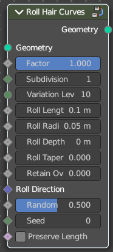

Rolls up hair curves, starting from their tips.

#### Input

##### Factor

Data type: Float (factor).

Factor to blend overall effect.

##### Subdivision

Data type: Integer.

Subdivision level applied before deformation.

##### Variation Level

Data type: Integer.

Level of smoothing on the roll path to include shape variation.

##### Roll Lenght

Length of each curve to be rolled

##### Roll Radius

Data type: Float (distance).

Radius of the rolls.

##### Roll Depth

Data type: Float (distance).

Depth offset of the rolls.

##### Roll Taper

Data type: Float (factor).

Taper of the roll.

##### Retain Overall Shape

Data type: Float (factor).

Offset the roll along the original curve to retain shape.

##### Roll Direction

Data type: Vector.

The axis around each curve is rolled.

##### Random Orientation

Data type: Float (factor).

Amount of randomization of the direction of the roll.

##### Seed

Data type: Integer.

Random seed for the operation.

##### Preserve Length

Data type: Boolean.

Preserve the length of each curve during deformation.

#### Output

##### Geometry

Data type: Geometry.

The output geometry.

### Rotate Hair Curves

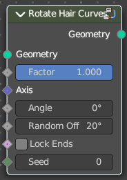

Rotates each hair curve around an axis.

#### Input

**Geometry**: The input geometry. · **Factor**: Factor to blend overall effect. · **Axis**: Rotation Axis. The default is tangent at root. · **Angle**: Angle of rotation · **Random Off**: Random offset to the rotation angle per curve. · **Lock Ends**: Lock rotation to the axis between the curve ends. · **Seed**: Random seed for the operation.

#### Output

**Geometry**: The output geometry.

### Shrinkwrap Hair Curves

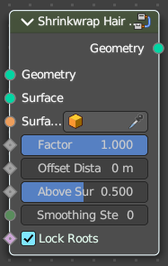

Shrinkwrap hair curves to a mesh surface from below and optionally from above.

#### Input

**Geometry**: The input geometry. · **Surface**: Surface geometry used for shrinkwrap. · **Surface Object**: A surface object used for shrinkwrap. · **Factor**: Factor to blend overall effect. · **Offset Distance**: Distance of the surface to shrinkwrap. · **Above Surface**: Blend shrinkwrap for points above the surface. · **Smoothing Steps**: The steps of Smoothing applied after shrinkwrap. · **Lock Roots**: Lock the position of root points.

#### Output

**Geometry**: The output geometry.

### Smooth Hair Curves

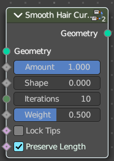

Smoothes the shape of hair curves.

#### Input

**Geometry**: The input geometry. · **Amount**: Amount of smoothing. · **Shape**: Shape of the influence along curves. 0 means constant. 0.5 means linear. · **Iterations**: Amount of smoothing steps. · **Weight**: Smoothing weight. · **Lock Tip**: Lock the position of tip points. · **Preserve Length**: Preserve the length of each curve during deformation.

#### Output

**Geometry**: The output geometry.

### Straighten Hair Curves

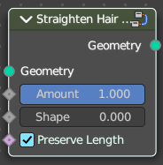

Straighten hair curves between root and tip.

#### Input

**Geometry**: The input geometry. · **Amount**: Amount of smoothing. · **Shape**: Shape of the influence along curves. 0 means constant. 0.5 means linear. · **Preserve Length**: Preserve the length of each curve during deformation.

#### Output

**Geometry**: The output geometry.

### Trim Hair Curves

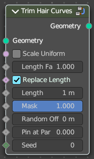

Trims or scales hair curves to a certain length.

#### Input

##### Geometry

Data type: Geometry.

The input geometry.

##### Scale Uniform

Data type: Boolean.

Scale each curve uniformly to reach the target length.

##### Length Factor

Data type: Float.

Multiply the original length by a factor

##### Replace Length

Data type: Boolean.

Use the length input to fully replace the original length.

##### Length

Data type: Float (distance).

Target length for the operation.

##### Mask

Data type: Float (factor).

Mask to blend overall effect.

##### Random Offset

Data type: Float (distance).

Trim hair curves randomly up to a certain amount.

##### Pin at parameter

Data type: Float (factor).

Pin each curve at a certain point for the operation.

##### Seed

Data type: Integer.

Random seed for the operation.

#### Output

##### Geometry

Data type: Geometry.

The output geometry.

# Hair › Generation

## Add menu - Hair - Generation

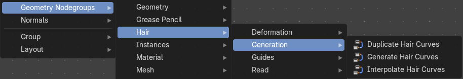

The nodes in this submenu are node groups. They use the regular single nodes under the hood.

It is virtually impossible to document these nodes in detail. So we will just list them.

When you double click the header, then you will enter the first level of the group. When you then press tab, or click again at the header, then you will reach the single nodes.

To leave the group you can use the breadcrumb up left in the header. These breadcrumbs are clickable. Or the Parent Node Tree button up right in the header.

### Duplicate Hair Curves

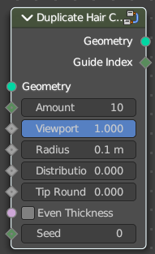

Duplicates hair curves a certain amouunt of times in the given radius.

#### Input

**Geometry**: The input geometry. · **Amount**: Amount of duplication per curve. · **Viewport Amount**: How much percent is used in the viewport. · **Radius**: The radius in which the duplicate curves are offset from the guides. · **Distribution Shape**: Shape of distriubution from center to the edge aroudn the guide. · **Tip Roundness**: Offset of the curves to round the tip. · **Even Thickness**: Keep an even thickness of the distribution of duplicates. · **Seed**: Random seed for the operation.

#### Output

**Geometry**: The output geometry. · **Guide Index**: The guide index map that was used for the operation.

### Generate Hair Curves

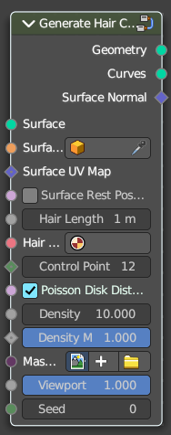

Generates new hair curves on a surface mesh.

#### Input

##### Surface

Data type: Object.

The surface to generate the hairs on.

##### Surface Object

A surface object to generate the hairs on.

##### Surface UV map

Data type: Vector.

Surface UV map used for attachment.

##### Surface Rest Position

Set the surface mesh into its rest position before attachment.

##### Hair Length

Data type: Float (distance).

Length of the generated hair curves.

##### Hair Material

Data type: Material.

The material for the hair curves.

##### Control Points

Data type: Integer.

Amount of control points for the generated hair curves.

##### Poisson Disk Distribution

Use Poisson Disk distribution to keep a minimum distance between the hair curves.

##### Density

Data type: Float.

How dense the generated hair curves are.

##### Density Mask

Data type: Float (factor).

Factor for the density of generated hair curves.

##### Mask Texture

Data type: Image.

Discard points based on a mask texture after distribution. This mask can be loaded here.

##### Viewport Amount

Data type: Float (factor).

How dense the generated hair curves are displayed in the viewport.

##### Seed

Data type: Integer.

Random seed for operation.

#### Output

##### Geometry

Data type: Geometry.

The output geometry.

##### Curves

Data type: Geometry.

The output curves.

##### Surface Normal

Data type: Vector.

The surface normals.

### Interpolate Hair Curves

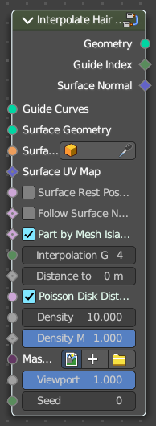

Interpolates existing guide curves on a surface.

#### Input

##### Guide Curves

Input guide curves.

##### Surface Geometry

The surface geometry to generate the hairs on.

##### Surface Object

A surface object to generate the hairs on.

##### Surface UV map

Surface UV map used for attachment.

##### Surface Rest Position

Set the surface mesh into its rest position before attachment.

##### Follow Surface Normal

Data type: Boolean.

Align the interpolated curves to the surface normal.

##### Part by Mesh Islands

Data type: Boolean.

Use mesh islands of the surface geometry for painting.

##### Interpolation Guides

Data type: Integer.

Amount of guides to be used for interploation per curve.

##### Distance to Guides

Data type: Float (distance).

Distance aorund each guide to spawn interpollated curves.

##### Poisson Disk Distribution

Use Poisson Disk distribution to keep a minimum distance between the hair curves.

##### Density

Data type: Float.

How dense the generated hair curves are.

##### Density Mask

Data type: Float (factor).

Factor for the density of generated hair curves.

##### Mask Texture

Data type: Image.

Discard points based on a mask texture after distribution. This mask can be loaded here.

##### Viewport Amount

Data type: Float (factor).

How dense the generated hair curves are displayed in the viewport.

##### Seed

Data type: Integer.

Random seed for operation.

#### Output

##### Geometry

Data type: Geometry.

The output geometry.

##### Guide Index

Data type: Integer.

The output curves.

##### Surface Normal

Data type: Vector.

The surface normals.

# Hair › Guides

## Add menu - Hair - Guides

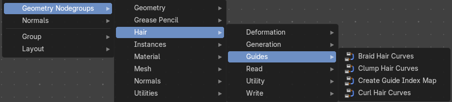

The nodes in this submenu are node groups. They use the regular single nodes under the hood.

It is virtually impossible to document these nodes in detail. So we will just list them.

When you double click the header, then you will enter the first level of the group. When you then press tab, or click again at the header, then you will reach the single nodes.

To leave the group you can use the breadcrumb up left in the header. These breadcrumbs are clickable. Or the Parent Node Tree button up right in the header.

### Braid Hair Curves

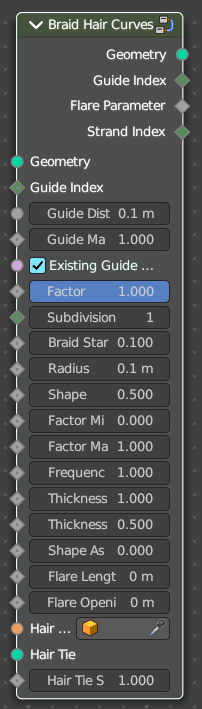

Deforms existing hair curves into braids.

#### Input

##### Geometry

Data type: Geometry.

The input geometry.

##### Guide Index

Data type: Integer.

Index map input. This input has priority.

##### Guide Distance

Data type: Float (distance).

Minimum distance between two guides for new guide map.

##### Guide Mask

Data type: Float.

Mash for which curve are eligible to be selected as guides.

##### Existing Guide Map

Data type: Boolean.

Use the existing guide map attribute if available

##### Factor

Data type: Float (factor).

Factor to blend overall effect.

##### Subdivision

Data type: Integer.

Subdivision level applied before deformation.

##### Braid Start

Data type: Float.

Where to start to blend deformation in percent from the root.

##### Radius

Data type: Float (distance).

Overall radius of the braids.

##### Shape

Data type: Float.

Shape of the braid radius along each curve.

##### Factor Min

Data type: Float.

Minimum radius of the braid.

##### Factor Max

Data type: Float.

Maximum radius of the braid.

##### Frequency

Data type: Float.

Frequency factor of the braids.

##### Thickness

Data type: Float.

Thickness of the braids.

##### Thickness Shape

Data type: Float.

Shape adjsutment of the strand thickness for the braids.

##### Shape Assymetry

Asymetry of the shape adjustment of the strand thickness.

##### Flare Length

Data type: Float (distance).

Length of the flare at the end of the braid.

##### Flare Opening

Data type: Float (distance).

Opening radius of the flare at the tip of the braid.

##### Hair Tie Object

Object used for the hair tie instance.

##### Hair Tie

Geometry used for the hair tie instance. This has priority.

##### Hair Tie Scale

Data type: Float.

Scale of the hair tie instance.

#### Output

##### Geometry

Data type: Geometry.

The output geometry.

##### Guide Index

Data type: Integer.

The guide index map that was used for the operation.

##### Flare Parameter

Data type: Float.

Parameter between 0 and 1 along the flare.

##### Strand Index

Data type: Integer.

Index of the strand within a braid that each curve belongs to.

### Clump Hair Curves

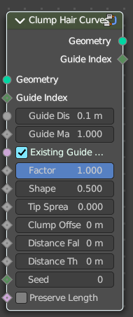

Clumps together existing hair curves.

#### Input

##### Geometry

Data type: Geometry.

The input geometry.

##### Guide Index

Data type: Integer.

Index map input. This input has priority.

##### Guide Distance

Data type: Float (distance).

Minimum distance between two guides for new guide map.

##### Guide Mask

Data type: Float.

Mash for which curve are eligible to be selected as guides.

##### Existing Guide Map

Data type: Boolean.

Use the existing guide map attribute if available.

##### Factor

Data type: Float (factor).

Factor to blend overall effect.

##### Shape

Data type: Float.

Shape of the influence along curves. 0 means constant. 0.5 means linear.

##### Tip Spread

Data type: Float.

Distance of random sread at the curve tips

##### Clump Offset

Data type: Float (distance).

Offset of clump in a random direction.

##### Distance Falloff

Data type: Float (distance).

Falloff distance for the clumping effect. 0 means no falloff.

##### Distance Threshold

Data type: Float (distance).

Distance threshold for the clumping effect. 0 means no falloff.

##### Preserve Length

Data type: Boolean.

Preserve the length of each curve during deformation.

#### Output

##### Geometry

Data type: Geometry.

The output geometry.

##### Guide Index

Data type: Integer.

The guide index map that was used for the operation.

### Create Guide Index Map

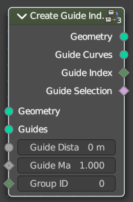

Creates an attribute that maps each curve to its nearest guide via index.

#### Input

**Geometry**: The input geometry. · **Guides**: Index map input. This input has priority. · **Guide Distance**: Minimum distance between two guides for new guide map. · **Guide Mask**: Mash for which curve are eligible to be selected as guides. · **Group ID**: The id that is used to group curves togethert for guide map creation.

#### Output

**Geometry**: The output geometry. · **Guide Curves**: The output guides · **Guide Index**: The guide index map that was used for the operation. · **Guide Selection**: The output guide selection.

### Curl Hair Curves

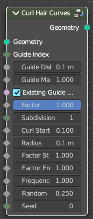

Deform existing hair curves into curls.

#### Input

##### Geometry

Data type: Geometry.

The input geometry.

##### Guide Index

Data type: Integer.

Index map input. This input has priority.

##### Guide Distance

Data type: Float (distance).

Minimum distance between two guides for new guide map.

##### Guide Mask

Data type: Float.

Mash for which curve are eligible to be selected as guides.

##### Existing Guide Map

Data type: Boolean.

Use the existing guide map attribute if available.

##### Factor

Data type: Float (factor).

Factor to blend overall effect.

##### Subdivision

Data type: Integer.

Subdivision level applied before deformation.

##### Curl start

Data type: Float.

—

##### Radius

Data type: Float (distance).

—

##### Factor Start

Data type: Float.

Form where to blend deformation in percent, starting from the root.

##### Factor End

Data type: Float.

Factor for the radius at the curl end.

##### Frequency

Data type: Float.

Frequency factor of the curls.

##### Random Offset

Data type: Float.

Amount of random offset per curve.

##### Seed

Data type: Integer.

Random seed for the operation.

#### Output

##### Geometry

Data type: Geometry.

The output geometry.

# Hair › Read

## Add menu - Hair - Read

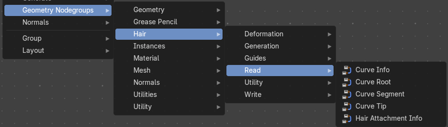

The nodes in this submenu are node groups. They use the regular single nodes under the hood.

It is virtually impossible to document these nodes in detail. So we will just list them.

When you double click the header, then you will enter the first level of the group. When you then press tab, or click again at the header, then you will reach the single nodes.

To leave the group you can use the breadcrumb up left in the header. These breadcrumbs are clickable. Or the Parent Node Tree button up right in the header.

### Curve Info

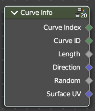

Reads information about each curve.

#### Output

##### Curve Index

Data type: Integer.

Index of each curve.

##### Curve ID

Data type: Integer.

ID of each curve.

##### Length

Data type: Float.

Length of each curve.

##### Direction

Data type: Vector.

Direction of each curve.

##### Random

Data type: Float.

Random Vector of each curve.

##### Surface UV

Data type: Vector.

Attachment surface UV coordinate of each curve.

### Curve Root

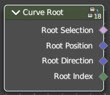

Reads information about the root point of each curve.

#### Output

##### Root Selection

Data type: Boolean.

Boolean selection of curve root points.

##### Root Position

Data type: Vector.

The position of a root point of a curve.

##### Root Direction

Data type: Vector.

Direction of the root segment of a curve.

##### Root Index

Data type: Integer.

Index of the root point of a curve.

### Curve Segment

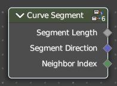

Reads the information of the curve segment before the current point.

#### Output

—

#### Segment Length

Length of the segment

#### Segment Direction

Direction of the segment

#### Neighbor Index

Index of the neighbouring point on segment.

### Curve Tip

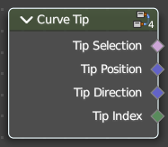

Reads information about the tip point of each curve.

#### Output

—

#### Tip Selection

Boolean selection of the tip points.

#### Tip Position

Position of the tip point of a curve.

#### Tip Direction

Direction of the segment of the tip point of a curve.

#### Tip Index

Index of the tip point of a curve.

### Hair Attachment Info

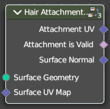

Reads attatchment information regarding a surface mesh.

#### Input

**Surface Geometry**: Surface geometry of the curve attachment. · **Surface UV Map**: Surface UV map used for attachment.

#### Output

**Attachment UV**: Surface attachment UV coordinate stored on each curve. · **Attachment is Valid**: Is the attached UV coordinate valid? · **Surface Normal**: The normal direction of the surface mesh at the attachment point.

# Hair › Utility

## Add menu - Hair - Utility

The nodes in this submenu are node groups. They use the regular single nodes under the hood.

It is virtually impossible to document these nodes in detail. So we will just list them.

When you double click the header, then you will enter the first level of the group. When you then press tab, or click again at the header, then you will reach the single nodes.

To leave the group you can use the breadcrumb up left in the header. These breadcrumbs are clickable. Or the Parent Node Tree button up right in the header.

### Attach Hair Curves to Surface

Attaches hair curves to a surface mesh.

#### Input

##### Geometry

Data type: Geometry.

The input geometry.

##### Surface Object

Data type: Object.

A surface object to attach to. It needs to have matching transforms.

##### Surface

Surface geometry to attach hair curves to.

##### Surface UV Map

Data type: Vector.

Surface UV Map used to attach hairs to.

##### Surface Rest Position

Set the surface into rest position before attachment.

##### Sample Attachment UV

Sample the surface UV mapp at the attachment point.

##### Snap to Surface

Data type: Boolean.

Snap the root of the curve to the closest surface point.

##### Align to Surface Normal

Data type: Boolean.

Align the curves to surface normals. Needs a guide as reference.

##### Blend along Curve

Data type: Float (factor).

Blend deformation along eacah curve from the root.

#### Output

##### Geometry

Data type: Geometry.

The output geometry.

##### Surface UV Coordinate

Data type: Vector.

Surface UV Coordinate at the attachment point.

##### Surface Normal

Data type: Vector.

Surface Normal at the attachment point.

### Redistribute Curve Points

Redistributes existing control points evenly along each curve.

#### Input

**Curves**: The input curve. · **Factor**: Factor to blend overall effect. · **Feature Awareness**: Use simple feature awareness to keep feature definition.

#### Output

**Curves**: The output curves.

### Restore Curve Segment Length

#### Input

**Curves**: The input curve. · **Selection**: A selection of the input curve. · **Factor**: Factor to blend overall effect. · **Reference Position**: Reference position before deformation. · **Pin at Parameter**: Pin each curve at a certain point for the operation.

#### Output

**Curves**: The output curves.

# Hair › Write

## Add menu - Hair - Write

The nodes in this submenu are node groups. They use the regular single nodes under the hood.

It is virtually impossible to document these nodes in detail. So we will just list them.

When you double click the header, then you will enter the first level of the group. When you then press tab, or click again at the header, then you will reach the single nodes.

To leave the group you can use the breadcrumb up left in the header. These breadcrumbs are clickable. Or the Parent Node Tree button up right in the header.

### Set Hair Curve Profile

Set the radius attribute of hair curces according to a profile shape.

#### Input

**Geometry**: The input geometry. · **Replace Radius**: Replace the original radius. · **Radius**: Base radius to be set when replace radius is enabled. · **Shape**: Shape of the radius along the curve. · **Factor Min**: Factor of the radius at the minimum. · **Factor Max**: Factor of the radius at the maximum.

#### Output

**Geometry**: The output geometry.

# Instances

## Add menu - Geometry nodes - Instances

The nodes in this submenu are node groups. They use the regular single nodes under the hood.

It is virtually impossible to document these nodes in detail. So we will just list them.

When you double click the header, then you will enter the first level of the group. When you then press tab, or click again at the header, then you will reach the single nodes.

To leave the group you can use the breadcrumb up left in the header. These breadcrumbs are clickable. Or the Parent Node Tree button up right in the header.

### Instance on Elements

Create copies of referenced geometry on geometry elements.

### Randomize Transforms

Randomize the transform of instances.

# Material

## Add menu - Geometry nodes - Material

The nodes in this submenu are node groups. They use the regular single nodes under the hood.

It is virtually impossible to document these nodes in detail. So we will just list them.

When you double click the header, then you will enter the first level of the group. When you then press tab, or click again at the header, then you will reach the single nodes.

To leave the group you can use the breadcrumb up left in the header. These breadcrumbs are clickable. Or the Parent Node Tree button up right in the header.

### Inherit Material

Applies an existing material from the source geometry at the target geometry.

# Mesh

## Add menu - Geometry nodes - Mesh

The nodes in this submenu are node groups. They use the regular single nodes under the hood.

It is virtually impossible to document these nodes in detail. So we will just list them.

When you double click the header, then you will enter the first level of the group. When you then press tab, or click again at the header, then you will reach the single nodes.

To leave the group you can use the breadcrumb up left in the header. These breadcrumbs are clickable. Or the Parent Node Tree button up right in the header.

### Mesh Lines and Silhouette

Creates a Inverses Hull lines with a mesh silhouette. This also contains overrides, randomizatoin and other settings.

# Mesh › Read

## Add menu - Geometry nodes - Mesh - Read

The nodes in this submenu are node groups. They use the regular single nodes under the hood.

It is virtually impossible to document these nodes in detail. So we will just list them.

When you double click the header, then you will enter the first level of the group. When you then press tab, or click again at the header, then you will reach the single nodes.

To leave the group you can use the breadcrumb up left in the header. These breadcrumbs are clickable. Or the Parent Node Tree button up right in the header.

### Edge Length

Returns the length of an edge.

### Face Corner Angle

Returns the angle between two edges.

### Is Edge Boundary

Returns a selection of boundary edges.

### Is Edge Loose

Returns a selection of loose edges.

### Is Edge Manifold

Returns a selection of manifold edges.

### Is UV Split

Returns a selection of seam edges at the border of UV patches.

# Normals

## Add menu - Geometry nodegroups - Normals

The nodes in this submenu are node groups. They use the regular single nodes under the hood.

It is virtually impossible to document these nodes in detail. So we will just list them.

When you double click the header, then you will enter the first level of the group. When you then press tab, or click again at the header, then you will reach the single nodes.

To leave the group you can use the breadcrumb up left in the header. These breadcrumbs are clickable. Or the Parent Node Tree button up right in the header.

### Inherit Smoothness

Passes normal smoothness of the parent object.

# Utilities

## Add menu - Geometry nodegroups - Utilities

The nodes in this submenu are node groups. They use the regular single nodes under the hood.

It is virtually impossible to document these nodes in detail. So we will just list them.

When you double click the header, then you will enter the first level of the group. When you then press tab, or click again at the header, then you will reach the single nodes.

To leave the group you can use the breadcrumb up left in the header. These breadcrumbs are clickable. Or the Parent Node Tree button up right in the header.

### Random Rotation

Returns a uniformly distributed random rotation

# Utilities › Vector

## Add menu - Geometry nodegroups - Utilities - Vector

The nodes in this submenu are node groups. They use the regular single nodes under the hood.

It is virtually impossible to document these nodes in detail. So we will just list them.

When you double click the header, then you will enter the first level of the group. When you then press tab, or click again at the header, then you will reach the single nodes.

To leave the group you can use the breadcrumb up left in the header. These breadcrumbs are clickable. Or the Parent Node Tree button up right in the header.

### Combined Cylindrical

Create a vector from its cylindrical components.

### Combined Spherical

Create a vector from its spherical components.

### Separate Cylindrical

Decompose into its cylindrical components.

### Separate Spherical

Decompose into its spherical components.

# Utility

## Add menu - Geometry nodegroups - Utility

The nodes in this submenu are node groups. They use the regular single nodes under the hood.

It is virtually impossible to document these nodes in detail. So we will just list them.

When you double click the header, then you will enter the first level of the group. When you then press tab, or click again at the header, then you will reach the single nodes.

To leave the group you can use the breadcrumb up left in the header. These breadcrumbs are clickable. Or the Parent Node Tree button up right in the header.

### G Index Mask U

Selects an indicy by using various functions.
