## Add menu - Texture

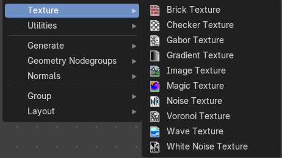

Texture nodes.

### Brick Texture

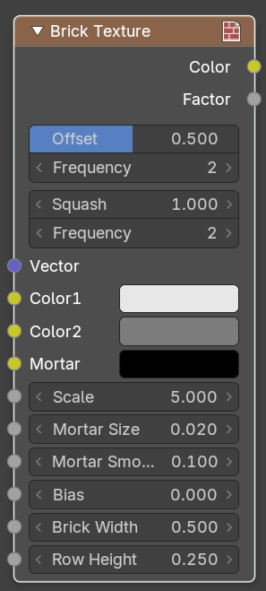

The Brick Texture node is used to add a procedural brick texture.

#### Inputs

**Color 1, Color 2 and Mortar**: Color of the bricks and mortar. · **Scale**: Overall texture scale. · **Mortar Size**: The size of the filling between the bricks known as “mortar”; 0 means no mortar. · **Mortar Smooth**: Blurs/softens the edge between the mortar and the bricks. This can be useful with a texture and displacement textures. · **Bias**: The color variation between Color 1/2. Values of -1 and 1 only use one of the two colors; values in between mix the colors. · **Brick Width**: The width of the bricks. · **Row Height**: The height of the brick rows.

#### Properties

**Offset**: Determines the brick offset of the various rows. · **Frequency**: Determines the offset frequency. A value of 2 gives an even/uneven pattern of rows. · **Squash**: Amount of brick squashing. · **Frequency**: Brick squashing frequency.

#### Outputs

**Color**: Texture color output. · **Factor**: Mortar mask (1 = mortar).

### Checker Texture

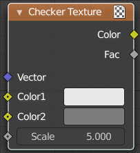

Adds a checker texture.

#### Inputs

**Vector**: Vector input. · **Color 1**: The first checker color. · **Color 2**: The second checker color. · **Scale**: The scale of the checker texture.

#### Output

**Color**: The checker texture output. · **Factor**: Factor output.

### Gabor Texture

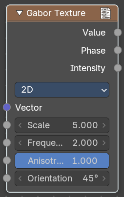

Adds a Gabor texture.

#### Properties

##### 2D Mode

Uses the X Y vector. Z value is ignored.

###### Vector

Vector input.

###### Scale

The scale of the gabor noise.

###### Frequency

The rate at which the gabor noise changes across space. The scale is global, the frequency relative to the current noise direction.

###### Anisotrophy

The directionality of gabor noise. A value of 1 is completely directional, while a value of 0 is omnidirectional.

###### Orientation

The direction of the anisotropic gabor noise. It is an angle, since it is 2d.

##### 3D Mode

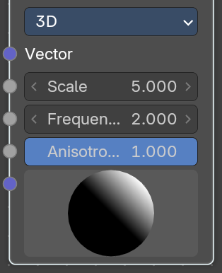

###### Scale

The scale of the gabor noise.

###### Frequency

The rate at which the gabor noise changes across space. The scale is global, the frequency relative to the current noise direction.

###### Anisotrophy

The directionality of gabor noise. A value of 1 is completely directional, while a value of 0 is omnidirectional.

###### Orientation

The direction of the anisotropic gabor noise. It is oriented in the 3d space. And can be adjusted with the 3d widget.

#### Output

##### Value

Data type: Float.

The sum of gabor phase and intensity.

##### Phase

Data type: Float.

The gabor phase.

##### Intensity

Data type: Float.

The gabor intensity.

### Gradient Texture

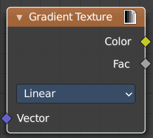

Add a gradient texture.

#### Inputs

##### Vector

Data type: Vector.

Vector input.

#### Properties

##### Gradient Type

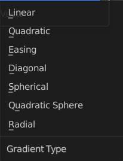

What gradient type to use.

#### Output

##### Factor

Data type: Float.

Factor output.

##### Color

Data type: Color.

Color output.

### Image Texture

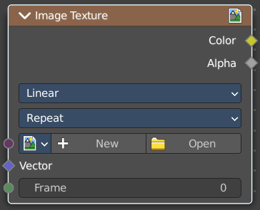

The Image Texture is used to add an image file as a texture.

#### Inputs

##### Image

Data type: Image.

The Image input. Open an image, choose an existing image, or generate a new image.

When you click at Open then a file browser opens up. When you click at New then a popup dialog opens. up where you can create a new image.

###### Image Browser

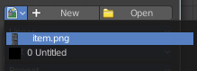

The image browser at the left allows you to pick an already existing texture.

- **New/Open**: Create a new image, or open an image.
- **Image Edit Box**: The name of the image.
- **Fake User**: Keep the texture in the blend file even if it is not used.

###### New Image

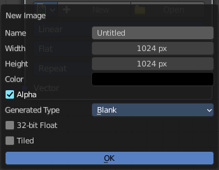

Create a new image.

The settings of this image can be further adjusted in the sidebar of the UV Editor.

- **Open Image**: Open an image.
- **Remove**: Remove the image. Note that it is still in the blend file as long as it has users, and as long as you haven't purged it. By saving and reloading the blend file for example.

- **Vector**: Texture coordinate for texture look-up. If this socket is left unconnected, UV coordinates from the active UV render layer are used.
- **Frame**: The frame of an image sequence, if available.

#### Properties

##### Interpolation

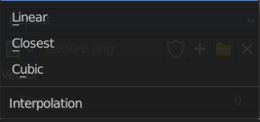

Method to scale images up or down for rendering.

###### Linear

Regular quality interpolation.

###### Closest

No interpolation, use only closest pixel for rendering pixel art.

###### Cubic

Smoother, better quality interpolation. For bump maps this should be used to get best results.

##### Extension

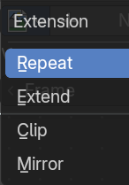

Extension defines how the image is extrapolated past the original bounds:

###### Repeat

Will repeat the image horizontally and vertically giving tiled-looking result.

###### Extend

Will extend the image by repeating pixels on its edges.

###### Clip

Clip to the original image size and set all the exterior pixels values to transparent black.

###### Mirror

Flip the image horizontally and vertically repeatedly.

#### Outputs

##### Color

Data type: Color.

RGB color from image. If the image has alpha, the color is premultiplied with alpha if the Alpha output is used, and unpremultiplied or straight if the Alpha output is not used.

##### Alpha

Data type: Float.

Alpha channel from image.

### Magic Texture

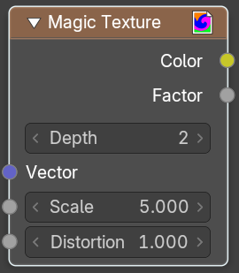

The Magic Texture node is used to add a procedural psychedelic color texture.

#### Inputs

**Vector**: Texture coordinate to sample texture at; defaults to Generated texture coordinates if the socket is left unconnected. · **Scale**: Scale of the texture. · **Distortion**: Amount of distortion.

#### Properties

**Depth**: Number of iterations.

#### Outputs

**Color**: Texture color output. · **Factor**: Texture intensity output.

### Noise Texture

The Noise Texture node evaluates a fractal Perlin noise at the input texture coordinates. This nodes allows great control over how noise octaves are combined.

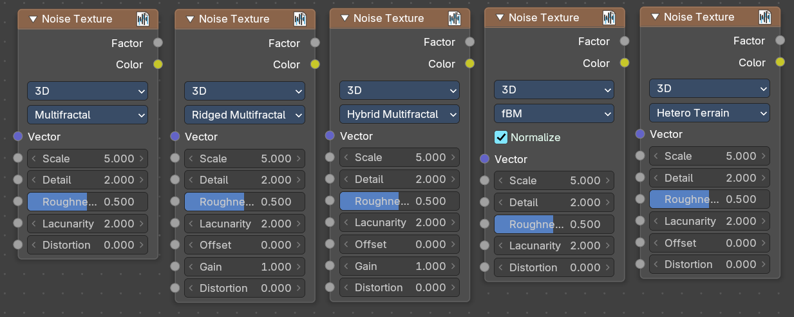

#### Inputs

The inputs are dynamic, they become available if needed depending on the node properties.

##### Vector

Data type: Vector.

Texture coordinate to evaluate the noise at; defaults to Generated texture coordinates if the socket is left unconnected.

##### Normalize

Normalize the output to the 0 - 1 range. · **W**: Texture coordinate to evaluate the noise at. Appears with 4 dimensions. · **Scale**: Scale of the base noise octave. · **Detail**: Number of noise octaves. The fractional part of the input is multiplied by the magnitude of the highest octave. Higher number of octaves corresponds to a higher render time. · **Roughness**: Adds a roughness noise. · **Lacunarity**: The scale of a perlin noise octave relative to the perlin noise octave from the previous octave. · **Offset**: An added offset to each octave, determines the level where the highest octave will appear. · **Gain**: An extra multiplier to tune the magnitude of octaves. · **Distortion**: Amount of distortion.

#### Properties

##### Dimensions

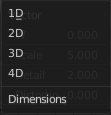

The dimensions of the space to evaluate the noise in.

###### 1D

Evaluate the noise in 1D space at the input W.

###### 2D

Evaluate the noise in 2D space at the input Vector. The Z component is ignored.

###### 3D

Evaluate the noise in 3D space at the input Vector.

###### 4D

Evaluate the noise in 4D space at the input Vector and the input W as the fourth dimension.

##### Type

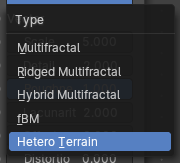

Type of the perlin noise texture.

###### Multifractal

The result is more uneven (varies with location), more similar to a real terrain. Uses a multiplicative cascade.

###### Ridged Multifractal

Creates sharp peaks. Calculates the absolute value of the noise, creating “canyons”, and then flips the surface upside down.

###### Hybrid Multifractal

Creates peaks and valleys with different roughness values, like real mountains rise out of flat plains. Combines the additive cascade with a multiplicative cascade.

###### fBM (fractal Brownian Motion)

Produces an unnatural homogeneous and isotropic result. Uses an additive cascade, the values are simply added together.

###### Hetero Terrain (Heterogeneous Terrain)

Similar to Hybrid Multifractal creates a heterogeneous terrain, but with the likeness of river channels.

#### Outputs

##### Factor

Data type: Float.

Value of fractal noise.

##### Color

Data type: Color.

Color with different fractal noise in each component.

### Voronoi Texture

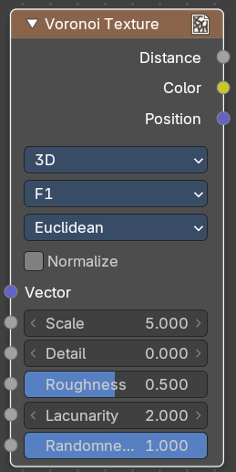

Add a voronoi texture.

#### Inputs

##### Vector

Data type: Vector.

Vector input.

##### W

Data type: Float.

The value w scale in 4 dimensions.

##### Scale

Data type: Float.

The scale of the voronoi texture.

##### Detail

Data type: Float.

The number ovf voronoi layers.

##### Roughness

Data type: Float (factor).

The influence of the voronoi layer relative to the previous layer.

##### Lacunacy

The scale of the voronoi layer relative to the previous layer.

##### Smoothness

Data type: Float (factor).

Smoothness of Smooth F1

##### Randomness

Data type: Float (factor).

The detail of the voronoi texture.

#### Properties

##### Dimensions

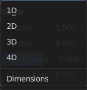

How many dimensions to use for the voronoi texture.

##### Feature Output

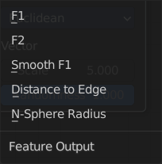

Feature output mode.

###### F1

Computes the distance to the closest point as well as its position and color.

###### F2

Computes the distance to the second closest point as well as its position and color.

###### Smooth F1

Smoothed version of F1.Weighted sum of neighbor voronoi cells.

###### Distance to Edge

Computes the distance to the edge of the voronoi cell.

###### N-Sphere Radius

Computes the radius of the n-sphere inscribed in the voronoi cell.

##### Distance Metric

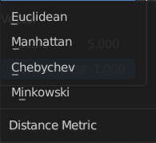

Distance calculation mode. The modes are different mathematical methods.

##### Normalize

Normalize the output distance to the 0.0 - 1.0 range.

#### Output

##### Factor

Factor output.

##### Color

Data type: Color.

Color output.

### Wave Texture

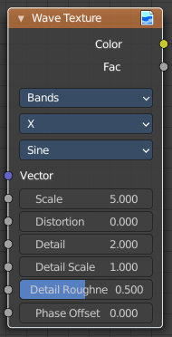

The Wave Texture node adds procedural bands or rings with noise distortion.

#### Inputs

##### Vector

Data type: Vector.

Texture coordinate to sample texture at; defaults to Generated texture coordinates if the socket is left unconnected.

##### Scale

Data type: Float.

Overall texture scale.

##### Distortion

Data type: Float.

Amount of distortion of the wave (similar to the Marble texture in Blender Internal).

##### Detail

Data type: Float.

Amount of distortion noise detail.

##### Detail Scale

Data type: Float.

Scale of distortion noise.

##### Detail Roughness

Data type: Float (factor).

Adds a roughness noise.

##### Phase Offset

Data type: Float.

Set an offset for the phase.

#### Properties

##### Wave Type

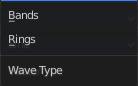

Bands or Rings shaped waves.

##### Bands direction

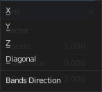

In which direction the bands should point.

#### Wave Profile

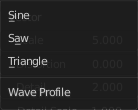

Controls the shape and look of the wave type.

##### Saw

Uses a saw tooth profile.

##### Sine

Uses the standard sine profile.

##### Triangle

Uses a triangle shape.

#### Outputs

##### Color

Data type: Color.

Texture color output.

##### Factor

Data type: Float.

Texture intensity output.

### White Noise Texture

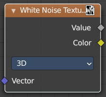

Add a white noise texture.

#### Inputs

##### Vector

Data type: Vector.

Vector input.

#### Properties

##### Dimensions

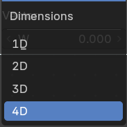

What gradient type to use.

#### Output

##### Vector

Factor output.

##### Color

Data type: Color.

Color output.
