# Read

## Add menu - Volume - Read

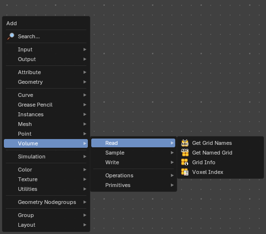

Here you find nodes to modify the volume.

### Get Grid Names

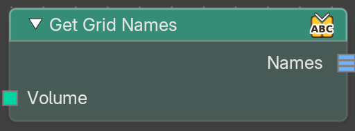

Lists the names of all grids stored in a volume. Use it to see what a volume contains, for example before you pick a grid with Get Named Grid.

#### Inputs

##### Volume

Data type: Geometry.

The volume to list the grid names of.

#### Outputs

##### Names

Data type: String list.

A list of the names of all grids in the volume, sorted alphabetically. If the geometry has no volume, the list is empty.

### Get Named Grid

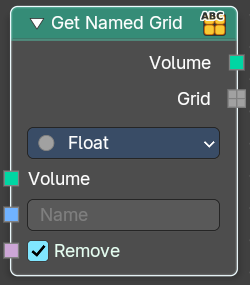

Get volume grid from a volume geometry with the specified name

#### Inputs

##### Volume

Data type: Geometry.

The input volume.

##### Name

Data type: String.

The name of the grid.

##### Remove

Data type: Boolean.

Removes the grid from the volume after it is read.

#### Properties

##### Data Type

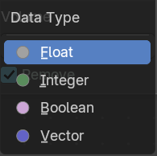

The type of data stored in the grid. It determines both, the expected data type of the **Grid** output, and how it can be used in subsequent nodes.

#### Outputs

##### Volume

Data type: Geometry.

The output volume.

##### Grid

Data type: follows the Data Type setting.

The extracted grid.

### Grid Info

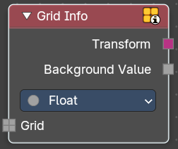

Retreive informations about a grid.

#### Inputs

##### Grid

Data type: follows the Data Type setting.

The grid to get the information of.

#### Properties

##### Data Type

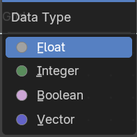

The data type to retreive.

#### Outputs

##### Transform

Data type: Matrix.

Transform from grid index space to object space.

##### Background Value

Data type: follows the Data Type setting.

Default value outside of grid voxels.

### Voxel Index

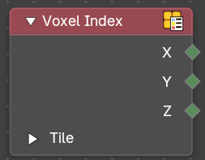

Retreive the integer coordinates of the voxel that the field is evaluated on.

#### Outputs

##### X

Data type: Integer.

The X coordinate of the voxel in index space, or the minimum X coordinate of a tile.

##### Y

Data type: Integer.

The Y coordinate of the voxel in index space, or the minimum Y coordinate of a tile.

##### Z

Data type: Integer.

The Z coordinate of the voxel in index space, or the minimum Z coordinate of a tile.

##### Tile

This panel is closed by default.

###### Is Tile

Data type: Boolean.

True when the field is evaluated on a tile, that is on many voxels at once. When it is false, the extent is always 1.

###### Extent X

Data type: Integer.

The number of voxels in the X direction of the tile, or 1 if the field is evaluated on a voxel.

###### Extent Y

Data type: Integer.

The number of voxels in the Y direction of the tile, or 1 if the field is evaluated on a voxel.

###### Extent Z

Data type: Integer.

The number of voxels in the Z direction of the tile, or 1 if the field is evaluated on a voxel.

# Sample

## Add menu - Volume

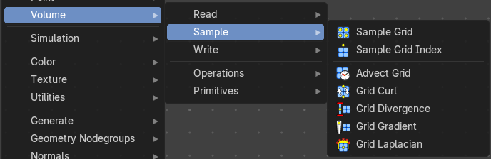

Here you find nodes to modify the volume.

### Sample Grid

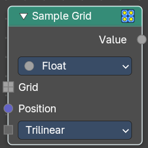

Retreive values from the specified volume grid.

#### Inputs

##### Grid

Data type: follows the Data Type setting.

The input grid

##### Position

Data type: Vector.

The position field.

##### Interpolation

Data type: Menu.

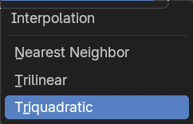

How to interpolate the values between neighbouring voxels.

#### Properties

##### Data Type

Which data type to calculate.

#### Outputs

##### Value

Data type: follows the Data Type setting.

The output value.

### Sample Grid Index

Retreive values from the specified volume grid at specific voxels.

#### Inputs

##### Grid

Data type: follows the Data Type setting.

The input grid

##### X

Data type: Integer.

The X index of the voxel to sample.

##### Y

Data type: Integer.

The Y index of the voxel to sample.

##### Z

Data type: Integer.

The Z index of the voxel to sample.

#### Properties

##### Data Type

Which data type to calculate.

#### Outputs

##### Value

Data type: follows the Data Type setting.

The output value.

### Advect Grid

Move grid values through a velocity field using numerical integration. Supports multiple intetgration schemes for different accuracy and performance trade-offs.

#### Inputs

##### Grid

Data type: follows the Data Type setting.

The input grid.

##### Velocity

Data type: Vector.

The velocity grid that moves the values.

##### Time Step

Data type: Float (time).

Time step for advection in seconds.

##### Integration Scheme

Data type: Menu.

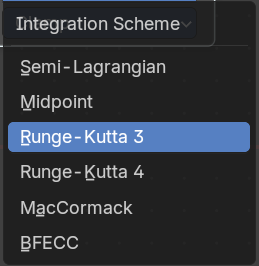

Numerical integration method for advection.

##### Limiter

Data type: Menu.

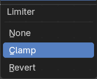

Limiting strategy to prevent numerical artifacts.

#### Properties

##### Data Type

The data type of the grid.

#### Outputs

##### Grid

Data type: follows the Data Type setting.

The output grid.

### Grid Curl

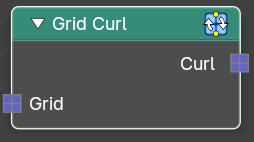

Calculate the magnitude and direction of ciruclation of a directional vector grid.

#### Inputs

##### Grid

Data type: Vector.

The input grid.

#### Outputs

##### Curl

Data type: Vector.

The output grid.

### Grid Divergence

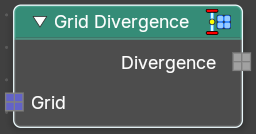

Calculate the flow into and out of each point of a directional vector grid.

#### Inputs

##### Grid

Data type: Vector.

The input grid.

#### Outputs

##### Divergence

Data type: Float.

The output grid.

### Grid Gradient

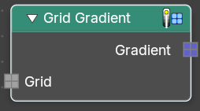

Calculate the direction and magnitude of the change in values of a scalar grid.

#### Inputs

##### Grid

Data type: Float.

The input grid.

#### Outputs

##### Gradient

Data type: Vector.

The output grid.

### Grid Laplacian

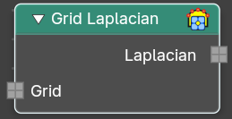

Compute the divergence of the gradient of the input grid.

#### Inputs

##### Grid

Data type: Float.

The input grid.

#### Outputs

##### Laplacian

Data type: Float.

The output grid.

### Grid Solve Poisson

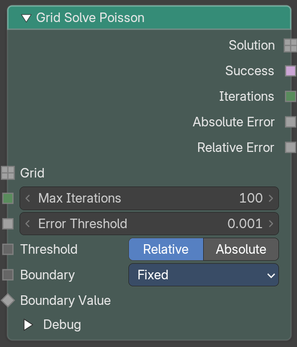

Solves the Poisson equation for a scalar grid. It computes a grid whose Laplacian is the input grid. Use the boundary settings to say what happens at the edge of the active voxels.

The solver works on grids with the same voxel size in all directions. If the voxel size is not uniform, the node shows a warning.

#### Inputs

##### Grid

Data type: Float.

The scalar grid on the right-hand side of the equation.

##### Max Iterations

Data type: Integer.

The most steps the solver may take. The default is 100. The value can be 1 to 10000.

##### Error Threshold

Data type: Float.

The solver stops when the error is below this value. The default is 0.001.

##### Threshold Mode

Data type: Menu.

How the error threshold is measured.

- Relative: the error is measured relative to the largest absolute value of the input grid. This is the default.
- Absolute: the error is measured as an absolute value in the units of the solution.

##### Boundary

Data type: Menu.

What happens at the boundary between active and inactive voxels.

- Fixed: you set the value of the solution for the voxels just outside the active ones. This is the default.
- Gradient: you set the gradient of the solution at the boundary.
- Mixed: you set both and blend between them with Boundary Factor.

##### Boundary Value

Data type: Float.

The value of the solution at the boundary. It is a field, so it can change from voxel to voxel. It is only shown for Fixed and Mixed.

##### Boundary Gradient

Data type: Vector.

The gradient of the solution at the boundary. It is a field. It is only shown for Gradient and Mixed.

##### Boundary Factor

Data type: Float (factor).

How much of the gradient is used instead of the value, from 0 to 1. At 0 the value is used, at 1 the gradient. It is a field. It is only shown for Mixed.

#### Outputs

##### Solution

Data type: Float.

The grid that solves the equation.

##### Success

Data type: Boolean.

True if the solver reached the error threshold.

##### Iterations

Data type: Integer.

How many steps the solver took.

##### Absolute Error

Data type: Float.

The absolute error of the solution at the end.

##### Relative Error

Data type: Float.

The relative error of the solution at the end.

##### Debug

A panel with three outputs. It is closed by default.

###### Debug Boundary Value

Data type: Float.

The grid of boundary values the solver used. It is only shown for Fixed and Mixed.

###### Debug Boundary Gradient

Data type: Vector.

The grid of boundary gradients the solver used. It is only shown for Gradient and Mixed.

###### Debug Boundary Factor

Data type: Float.

The grid of boundary factors the solver used. It is only shown for Mixed.

# Write

## Add menu - Volume

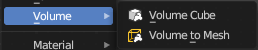

Here you find nodes to modify the volume.

### Set Grid Background

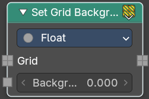

Set the background value used for inactive voxels and tiles.

#### Inputs

##### Grid

Data type: follows the Data Type setting.

The grid to change.

##### Background

Data type: follows the Data Type setting.

The new background value.

##### Update Inactive

Data type: Boolean.

Also replaces all values stored for inactive voxels with the new background value.

#### Properties

##### Data Type

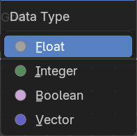

What data type to calculate.

#### Outputs

##### Grid

Data type: follows the Data Type setting.

The grid output.

### Set Grid Transform

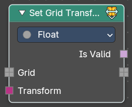

Set the transform for the grid from index space into object space.

#### Inputs

##### Grid

Data type: follows the Data Type setting.

The grid to change.

##### Transform

Data type: Matrix.

The input transform.

#### Properties

##### Data Type

What data type to calculate.

#### Outputs

##### Is Valid

Data type: Boolean.

If the new transform is successfully applied and working.

##### Grid

Data type: follows the Data Type setting.

The grid output.

### Store Named Grid

Stores a grid in a volume geometry under the given name.

#### Inputs

##### Volume

Data type: Geometry.

The volume to add the grid to.

##### Name

Data type: String.

The name of the grid.

##### Grid

Data type: follows the Data Type setting.

The grid to store.

#### Properties

##### Data Type

What data type to calculate.

#### Outputs

##### Volume

Data type: Geometry.

The volume with the stored grid.

# Operations

## Add menu - Volume - Operations

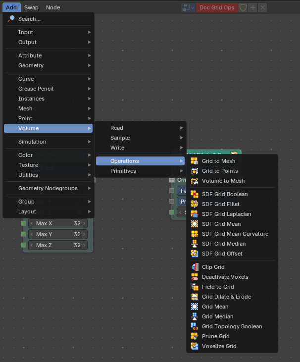

Here you find nodes to modify the volume.

### Grid Topology Boolean

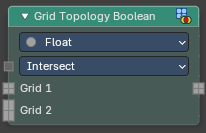

Combines the topology of two grids. The topology of a grid is the set of voxels that are active, in other words the shape of the grid and not the numbers stored in it. With this node you can merge two shapes, keep only where they overlap, or cut one out of the other. Use it to build a region for a simulation out of simple pieces, or to restrict one grid to the region of another.

#### Inputs

##### Operation

Data type: Menu.

How the shapes are combined: **Intersect** keeps the voxels that are active in both grids, **Union** keeps the voxels that are active in either grid and **Difference** keeps the voxels of Grid 1 that are not active in Grid 2.

##### Grid 1

Data type: follows the Data Type setting.

The first grid. Its values are used for the result.

##### Grid 2

Data type: follows the Data Type setting.

The second grid. Only its shape is used.

#### Outputs

##### Grid

Data type: follows the Data Type setting.

The grid with the combined shape.

#### How to use

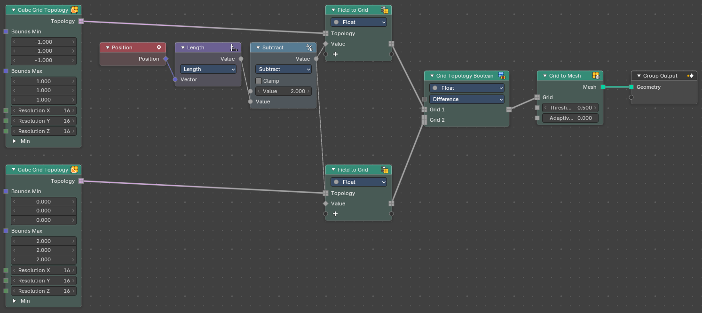

The example builds two grids and combines their shapes:

1. Each **Cube Grid Topology** node makes the shape of a box. The first box goes from -1 to 1, the second from 0 to 2.
2. Each **Field to Grid** node fills its shape with values. Here the value is `2 - Length(Position)`, which is high near the center of the world and falls off with distance.
3. **Grid Topology Boolean** combines the two grids. Change **Operation** to see how the result changes.
4. **Grid to Mesh** turns the result into a mesh, so you can see it.

A grid that is filled with one constant value has no surface inside, so Grid to Mesh shows nothing for it. Fill the grids with a value that changes, as in the example, when you want to look at the result as a mesh.

### Grid to Mesh

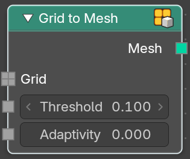

Generate a mesh on the surface of a volume grid.

#### Inputs

##### Grid

Data type: Float.

Standard grid input.

##### Threshold

Data type: Float.

Values larger than the threshold are inside the generated mesh.

##### Adaptivity

Data type: Float (factor).

The input radius

#### Outputs

##### Mesh

Data type: Geometry.

The generated mesh.

### Grid to Points

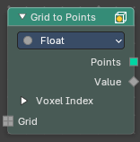

Turns the active voxels of a grid into a point cloud, one point per voxel. Good for scattering things where a volume has data, or for looking at a grid as points. Each point also carries the voxel's value and its index.

#### Inputs

##### Grid

Data type: follows the Data Type setting.

The grid to turn into points.

#### Properties

##### Data Type

The type of data the grid holds: Float, Integer, Boolean or Vector. The node's grid sockets follow this setting.

#### Outputs

##### Points

Data type: Geometry.

A point cloud with a point at each active voxel.

##### Value

Data type: follows the Data Type setting.

The grid value at each point.

##### Voxel Index

This panel is closed by default.

###### X

Data type: Integer.

The X coordinate of the voxel in index space, or the minimum X coordinate of a tile.

###### Y

Data type: Integer.

The Y coordinate of the voxel in index space, or the minimum Y coordinate of a tile.

###### Z

Data type: Integer.

The Z coordinate of the voxel in index space, or the minimum Z coordinate of a tile.

###### Is Tile

Data type: Boolean.

True when the point stands for a whole tile instead of a single voxel.

###### Extent

Data type: Integer.

The size of the tile, in voxels. For single voxels this is 1.

### Volume to Mesh

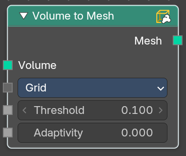

The Volume to Mesh node generates a mesh on the “surface” of a volume. The surface is defined by a threshold value. All voxels with a larger value than the threshold are considered to be outside.  
  
Note that currently this node only works on volumes generated using geometry nodes.

#### Inputs

##### Volume

Data type: Geometry.

The volume to convert to a mesh.

##### Resolution Mode

Data type: Menu.

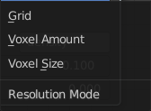

How the voxel size is set: from the grid, by the amount, or by the size.

##### Voxel Size

Data type: Float (distance).

The size of one voxel. Only in Size mode.

##### Voxel Amount

Data type: Float.

The number of voxels along one axis. Only in Amount mode.

##### Threshold

Data type: Float.

Values larger than the threshold are inside the generated mesh.

##### Adaptivity

Data type: Float (factor).

Reduces the number of faces in flat areas. 0 keeps all faces.

#### Outputs

##### Mesh

Data type: Geometry.

The generated mesh.

### SDF Grid Boolean

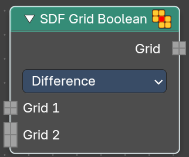

Bool multiple sdf grids with each other.

#### Inputs

##### Grid 1

Data type: Float.

The grid to cut from. Only in Difference mode.

##### Grid 2

Data type: Float.

The grids to cut away from Grid 1. You can connect more than one grid. Only in Difference mode.

##### Grid

Data type: Float.

The grids to combine. You can connect more than one grid. Only in Intersect and Union mode.

#### Properties

##### Operation

The bool method.

#### Outputs

##### Grid

Data type: Float.

The generated grid.

### SDF Grid Fillet

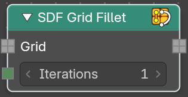

Round off concave internal corners in a signed distance field. Only affects areas with negataive principal curvature. This creates smoother transitions between surfaces.

#### Inputs

##### Grid

Data type: Float.

The input grid.

##### Iterations

Data type: Integer.

How often to run the algorithm.

#### Outputs

##### Grid

Data type: Float.

The generated grid.

### SDF Grid Laplacian

Apply laplacian flow smoothing to a signed distance field.

#### Inputs

##### Grid

Data type: Float.

The input grid.

##### Iterations

Data type: Integer.

How often to run the algorithm.

#### Outputs

##### Grid

Data type: Float.

The generated grid.

### SDF Grid Mean

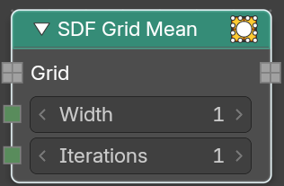

Apply mean (box) filter smoothing to a signed distance field. Fast separable averaging filter for general smoothing of the distance field.

#### Inputs

##### Grid

Data type: Float.

The input grid.

##### Width

Data type: Integer.

Filter kernel radius in voxel.

##### Iterations

Data type: Integer.

How often to run the algorithm.

#### Outputs

##### Grid

Data type: Float.

The generated grid.

### SDF Grid Mean Curvature

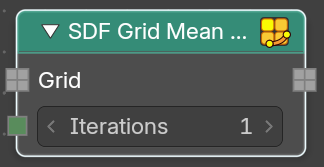

Applies mean curvature flow smoothing to a signed distance field. Evolves the surface based on its mean curvature. This smooths high curvature regions more than flat areas.

#### Inputs

##### Grid

Data type: Float.

The input grid.

##### Iterations

Data type: Integer.

How often to run the algorithm.

#### Outputs

##### Grid

Data type: Float.

The generated grid.

### SDF Grid Median

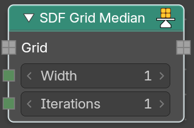

Apply median filter smoothing to a signed distance field. Reduces noise while preserving sharp features and edges in the distance field.

#### Inputs

##### Grid

Data type: Float.

The input grid.

##### Width

Data type: Integer.

Filter kernel radius in voxel.

##### Iterations

Data type: Integer.

How often to run the algorithm.

#### Outputs

##### Grid

Data type: Float.

The generated grid.

### SDF Grid Offset

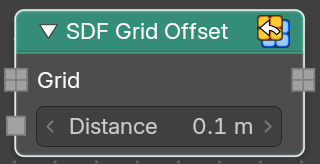

Offset a signed distance field surface by a world space distance. It dilates or erodes while maintaining the signed distance property.

#### Inputs

##### Grid

Data type: Float.

The input grid.

##### Distance

Data type: Float (distance).

Object space distance to offset the sdf surface.

#### Outputs

##### Grid

Data type: Float.

The generated grid.

### Clip Grid

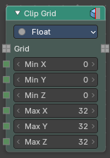

Keeps only the part of a grid inside a box of voxel coordinates. Voxels outside the box become inactive and get the background value. Use it to cut a volume down to a region, or to save memory.

#### Inputs

##### Grid

Data type: follows the Data Type setting.

The grid to clip.

##### Min X

Data type: Integer.

The lower corner of the box along X, in voxel coordinates.

##### Min Y

Data type: Integer.

The lower corner of the box along Y, in voxel coordinates.

##### Min Z

Data type: Integer.

The lower corner of the box along Z, in voxel coordinates.

##### Max X

Data type: Integer.

The upper corner of the box along X, in voxel coordinates.

##### Max Y

Data type: Integer.

The upper corner of the box along Y, in voxel coordinates.

##### Max Z

Data type: Integer.

The upper corner of the box along Z, in voxel coordinates.

#### Properties

##### Data Type

The type of data the grid holds: Float, Integer, Boolean or Vector. The node's grid sockets follow this setting.

#### Outputs

##### Grid

Data type: follows the Data Type setting.

The clipped grid.

### Deactivate Voxels

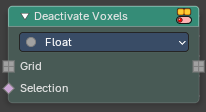

Turns selected voxels off. A volume grid is built from voxels, and only the active ones are stored and used. Deactivating voxels you do not need makes a grid smaller and faster to work with, and it also changes the shape of the grid, because nodes such as Grid to Mesh only see the active part. Use it to cut a hole into a grid or to throw away the part of a grid that is far from where you work.

#### Inputs

##### Grid

Data type: follows the Data Type setting.

The grid to change. The node works on any data type, set at the top of the node.

##### Selection

Data type: Boolean.

The voxels to deactivate. A boolean field, evaluated at every voxel. Voxels where it is true are turned off.

##### Set Background Value

Data type: Boolean.

When on, the deactivated voxels also get the background value of the grid.

#### Properties

##### Data Type

Data type, shown at the top of the node, is the type of the values in the grid: Float, Integer, Boolean or Vector.

#### Outputs

##### Grid

Data type: follows the Data Type setting.

The grid without the deactivated voxels.

### Field to Grid

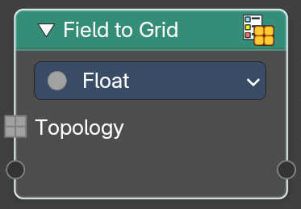

Create new grids by evaulating new values on an existing volume grid topology.

#### Inputs

##### Topology

Data type: follows the Data Type setting.

The input topology.

##### Fields

Data type: follows the Data Type setting of the item.

For each item you add, there is an input with its name. It is the field that is evaluated on the voxels of the topology. To add an item, connect a link to the empty socket at the bottom of the node, or use the Fields panel in the Node tab of the sidebar.

#### Properties

##### Data Type

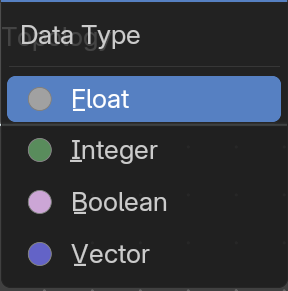

The data type to evaluate.

#### Outputs

##### Grids

Data type: follows the Data Type setting of the item.

For each item there is a grid output with the same name, with the field values evaluated on the topology.

### Grid Dilate & Erode

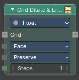

Grows or shrinks the active region of a grid by a number of voxel steps. It only changes which voxels are active, not their values. Use it to pad a volume before an operation, or to trim its outer layer.

#### Inputs

##### Grid

Data type: follows the Data Type setting.

The grid to dilate or erode.

##### Connectivity

Data type: Menu.

Which neighbor voxels count when the region grows or shrinks: **Face** (the 6 face neighbors), **Edge** (face and edge neighbors) or **Vertex** (all 26 neighbors). More neighbors give a rounder growth.

##### Tiles

Data type: Menu.

What happens to tiles, the big blocks of voxels that share one value.

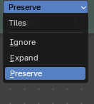

- **Ignore**: Leaves tiles out of the operation.
- **Expand**: Turns tiles into voxels first, so they grow or shrink too.
- **Preserve**: Keeps tiles as they are. This is the default.

##### Steps

Data type: Integer.

How many voxels to grow or shrink. Positive values dilate, negative values erode.

#### Properties

##### Data Type

The type of data the grid holds: Float, Integer, Boolean or Vector. The node's grid sockets follow this setting.

#### Outputs

##### Grid

Data type: follows the Data Type setting.

The grid with the new active region.

### Grid Mean

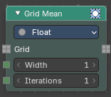

Smooths a grid with a box filter. Each voxel gets the average value of the voxels in a box around it. Good for softening noisy or blocky density.

#### Inputs

##### Grid

Data type: follows the Data Type setting.

The grid to smooth.

##### Width

Data type: Integer.

The radius of the box, in voxels.

##### Iterations

Data type: Integer.

How many times the filter runs. More iterations smooth more.

#### Properties

##### Data Type

The type of data the grid holds: Float, Integer, Boolean or Vector. The node's grid sockets follow this setting.

#### Outputs

##### Grid

Data type: follows the Data Type setting.

The smoothed grid.

### Grid Median

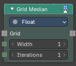

Smooths a grid with a median filter. Each voxel gets the middle value of the voxels in a box around it. Removes single noisy voxels while keeping sharper edges than Grid Mean.

#### Inputs

##### Grid

Data type: follows the Data Type setting.

The grid to smooth.

##### Width

Data type: Integer.

The radius of the box, in voxels.

##### Iterations

Data type: Integer.

How many times the filter runs.

#### Properties

##### Data Type

The type of data the grid holds: Float, Integer, Boolean or Vector. The node's grid sockets follow this setting.

#### Outputs

##### Grid

Data type: follows the Data Type setting.

The smoothed grid.

### Prune Grid

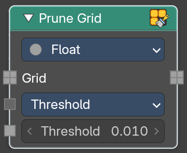

Makes the storage of a volume grid more efficient by collapsing data into tiles or inner nodes.

#### Inputs

##### Grid

Data type: follows the Data Type setting.

The input grid.

##### Mode

Data type: Menu.

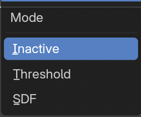

How to prune the grid.

- **Inactive**: Turn inactive voxels and tiles into inactive background tiles.
- **Threshold**: Turn regions where all voxels have the same value and active state into inactive background tiles. You will see a threshold slider.
- **SDF**: Replace inactive tiles with inactive nodes.

##### Threshold

Data type: follows the Data Type setting.

Voxels whose values differ by less than this value are seen as the same. Only in Threshold mode, and not for the Boolean data type.

#### Properties

##### Data Type

The data type to evaluate.

#### Outputs

##### Grid

Data type: follows the Data Type setting.

The generated grid.

### Voxelize Grid

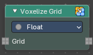

Makes a sparse grid dense: every active tile is split into single active voxels. Use it before nodes that need to work on each voxel, like Grid to Points or a field evaluation per voxel.

#### Inputs

##### Grid

Data type: follows the Data Type setting.

The grid to voxelize.

#### Properties

##### Data Type

The type of data the grid holds: Float, Integer, Boolean or Vector. The node's grid sockets follow this setting.

#### Outputs

##### Grid

Data type: follows the Data Type setting.

The voxelized grid.

# Primitives

## Add menu - Volume - Primitives

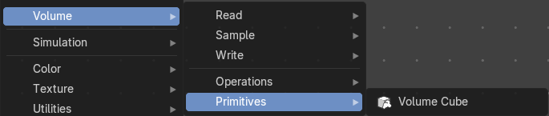

Here you find nodes to modify the volume.

### Cube Grid Topology

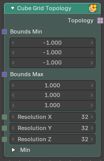

Makes the shape of a box of voxels, without any values in it. The output is only a topology, a set of active voxels, which you give to the Field to Grid node to fill it with a field. Use it as the starting point of a grid that you make from nodes, for example a density grid for a cloud, a signed distance field for a shape, or a region for a simulation.

#### Inputs

##### Bounds Min

Data type: Vector.

The corner of the box with the lowest coordinates.

##### Bounds Max

Data type: Vector.

The corner of the box with the highest coordinates.

##### Resolution X

Data type: Integer.

How many voxels the box has along X.

##### Resolution Y

Data type: Integer.

How many voxels the box has along Y.

##### Resolution Z

Data type: Integer.

How many voxels the box has along Z.

##### Min

This panel is closed by default.

###### Min X

Data type: Integer.

The index of the first voxel along X. It moves the box along the grid index space without changing its size.

###### Min Y

Data type: Integer.

The index of the first voxel along Y.

###### Min Z

Data type: Integer.

The index of the first voxel along Z.

#### Outputs

##### Topology

Data type: Boolean.

The shape of the box, as a boolean grid. Connect it to the Topology input of Field to Grid.

#### How to use

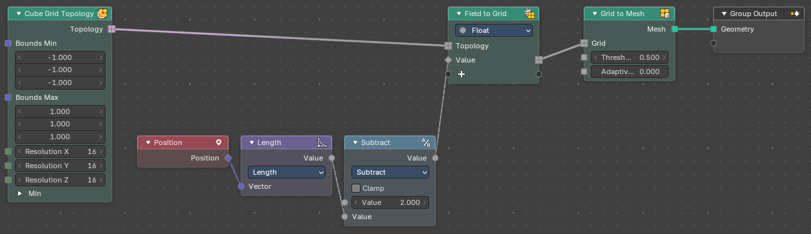

1. Add **Cube Grid Topology**. Set **Bounds Min** and **Bounds Max** to the size of the box and the resolutions to the detail you need. The voxel size is the box size divided by the resolution, so the same box with a resolution of 32 has voxels half the size of a resolution of 16.
2. Add **Field to Grid** and connect the Topology output to its Topology input. Add a value with the plus socket and connect a field to it. In the example the field is `2 - Length(Position)`.
3. Connect the grid to **Grid to Mesh** and set Threshold to 0.5. The mesh is a sphere-like surface where the value crosses 0.5, cut off by the box.

Keep the resolution low while you build. Every doubling of the resolution makes eight times as many voxels.

### Volume Cube

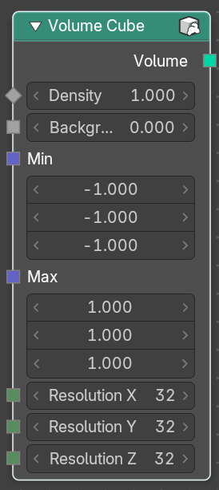

The Volume Cube node generates a voxel based volume cube primitive that can be used for volume conversion to mesh in conjunction with the Volume to Mesh node.

#### Inputs

##### Density

Data type: Float.

Volume density per voxel. Higher values makes it more dense.

##### Background

Data type: Float.

Value per voxel outside the cube domain.

##### Min

Data type: Vector.

Minimum boundary of the volume cube.

##### Max

Data type: Vector.

Maximum boundary of the volume cube.

##### Resolution X

Data type: Integer.

Number of volume voxels in the X axis.

##### Resolution Y

Data type: Integer.

Number of volume voxels in the Y axis.

##### Resolution Z

Data type: Integer.

Number of volume voxels in the Z axis.

#### Outputs

##### Volume

Data type: Geometry.

The new volume cube.

