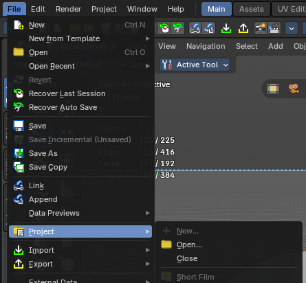
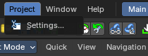
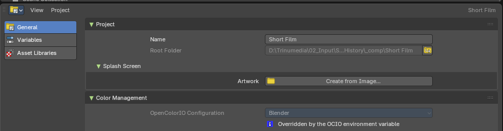
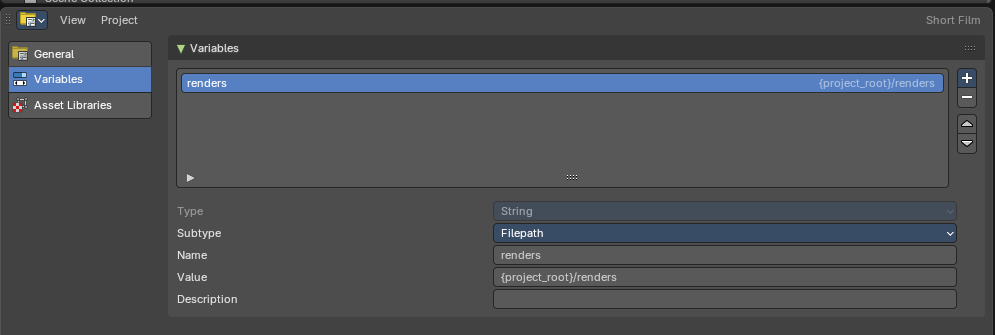
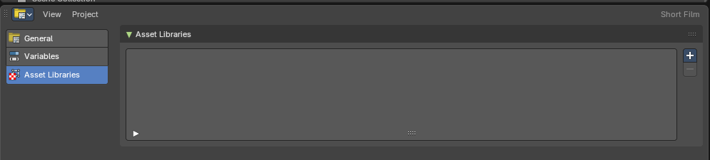

## Projects

A **project** is a folder that holds a whole production, for example a short film with many blend files. The project stores the settings that all those files share: path variables, asset libraries, the color management configuration and a splash image. Every blend file you open from inside the project folder uses them, so the whole team works with the same setup.

Bforartists keeps the project settings in a hidden `.blender_project` folder in the project's root folder.

## File > Project menu

### New

Creates a new project. You choose a name and the root folder. Everything inside that folder belongs to the project.

### Open

Opens a project and starts a new file in it.

### Close

Closes the active project and starts a new file.

### Recent projects

The projects you opened recently. Click one to open it.

### Clear Recent Projects List

Removes all projects from the recent list. The projects themselves are not changed.

> **Tip:** The splash screen has a Project dropdown with the same entries, and the recent files there are grouped by project.

## Project menu

While a project is open, the top bar shows a **Project** menu.

### Settings

Opens the Project Settings editor in its own window.

## Project Settings editor

The Project Settings editor shows the settings of the active project. Like the Preferences, it has a navigation sidebar on the left with three tabs: **General**, **Variables** and **Asset Libraries**. You can also show it in any area: change the editor type to **Project Settings**.

### Save & Load menu

#### Auto-Save Project

Saves the project settings automatically on exit, and when you save or switch blend files.

#### Save Project

Saves the project settings now.

## General tab

### Project panel

#### Name

The name of the project. It shows at the top right of the editor and in the menus.

#### Root Folder

The folder of the project. Read only: to move a project, move its folder.

### Splash Screen panel

#### Artwork

A custom image for the splash screen while this project is open. **Create from Image** picks an image file; Bforartists crops and scales it to 1000 × 500 pixels and stores it in the project folder. Use an image with a 2:1 shape for the best result. **Clear** removes the custom artwork again; the image file stays on disk.

### Color Management panel

#### OpenColorIO Configuration

The color management configuration the project uses, so every file of the production shows colors the same way.

- **Blender**: The standard configuration that ships with Bforartists.
- **ACES 2.0 Studio** / **ACES 1.3 Studio**: The ACES configurations used in film and VFX.
- **Path**: A configuration file of your own. Give the path to the `config.ocio` file; it can be relative to the project with `{project_root}`.

When the configuration changes, a message offers **Reload to Apply Changes**, which reloads the file with the new colors. If the configuration can't be loaded, a message says so. When the `OCIO` environment variable of your system sets a configuration, it wins over the project setting, and the panel tells you.

The active configuration and its path are also shown in **Render Properties > Color Management > Advanced**.

## Variables tab

Variables are names for values that the files of the project share, mostly paths. Use them in path fields as `{name}`, for example `{renders}/shot_010`, so the whole team writes to the same folders and the files keep working when the project moves.

### Variable list

The variables of the project. **+** adds a variable of the chosen type (String, Filepath, Integer or Float), **-** removes the selected one, and the arrows change the order.

### Type

The kind of value the variable holds. Read only after the variable is made.

### Subtype

How a String variable is used, for example **Filepath** for paths.

### Name

The name you type in braces to use the variable.

### Value

The value of the variable. `{project_root}` stands for the root folder of the project.

### Description

A note that explains what the variable is for.

## Asset Libraries tab

Asset libraries that belong to the project. They show in the Asset Browser under the **project libraries** group for every file of the project, so everyone uses the same assets. A project library can be a folder or a remote (online) library.

**+** adds a library and **-** removes the selected one.

> **Tip:** Libraries that you set in the Preferences are your own and work in every file; project libraries only work inside the project.
