## Collection Properties Tab

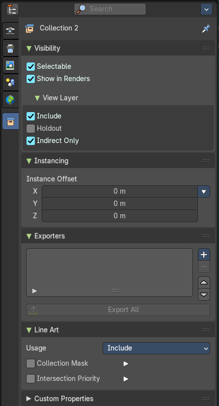

The collection tab provides you with collection related settings.

## Visibility Panel

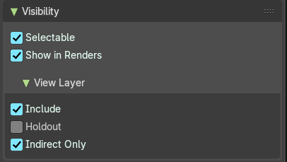

Set restrictions for the selected collection(s).

### Selectable

Make this collection and its content selectable.

### Show in Renders

Render the content of the collection.

### View Layer sub panel

**Include**: Include the collection in the scene. · **Holdout**: Mask out objects in collection from view layer. · **Indirect Only**: Make the objects in the collection just contribute indirectly. By light or shadow or reflections.

## Instancing panel

### Instance Offset

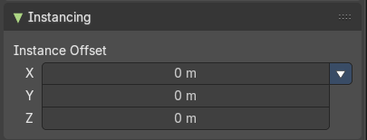

Adjust an offset from the origin when instancing the collection.

### Instance offset menu

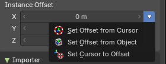

The arrow button next to Instance Offset opens this menu. The three entries use the same icons as the matching origin and cursor operators in the 3D View, so you can recognize them at a glance.

#### Set Offset from Cursor

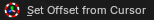

Set the offset used for collection instance based on cursor position.

#### Set Offset from Object

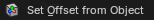

Set the offset used for collection instance based on the active object position.

#### Set Cursor to Offset

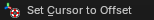

Set cursor position to the offset used for collection instances.

## Importer panel

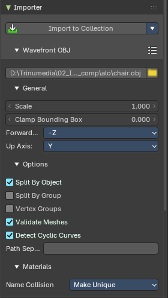

This panel links a collection to a file on disk, for example a glTF or OBJ file. The collection imports the content of the file, and you can import it again when the file changes. Each collection has one importer.

### Add Importer

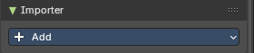

Adds an importer to the collection. Pick the file format, then the file. **Relative Path** stores the file path relative to the blend file.

### File Path

The file that the collection imports. Below the path you find the import settings of the chosen file format. These are the same settings as in the import dialog. See the import chapter in the File menu.

### Import to Collection

Imports the file into the collection with the current settings.

### Reload Importer

Clears the imported data, then imports the file again. Use it after the file changed on disk, or after you changed the import settings.

### Clear Importer

Deletes the imported data from the collection. The importer and its settings stay, so you can import again.

### Make Importer Local

Makes the imported data local to the blend file.

### Remove Importer

Removes the importer from the collection, and deletes the data it imported.

## Exporters panel

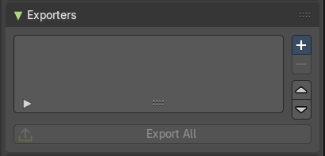

This panel contains the collection settings to assign an exporter per collection, where you can batch export collections in multiple file formats.

Collections where an exporter is added to shows the export symbol in the outliner.

> **Note:** You can also batch export collections from the Topbar File header menu.

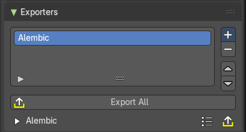

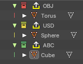

### Add

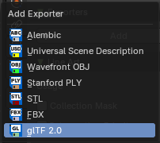

Adds an exporter operator to the collection. This will show an exporter icon on the collection in the outliner, and list the file format the collection will export to.

File Exporter Types:

- Alembic
- USD (Universal Scene Description)
- OBJ (Wavefront Object)
- Stanford PLY
- FBX
- glTF 2.0

### Export All

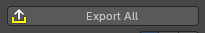

Exports all the collections with exporter operators assigned.

### Exporter Operators

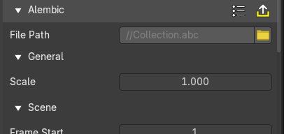

These settings comes from the chosen exporter. See chapter export in the File menu.

## Line Art Panel

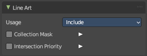

### Usage

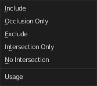

The method to display the line art in this collection.

#### Include

Generate feature lines for this collection.

#### Occlusion Only

Only use the collection to produce occlusion.

#### Exclude

Don't use this collection in line art.

#### Intersection only

Only generate intersection lines for this collection

#### No Intersection

Include this collection but do not generate intersection lines.

### Collection Mask

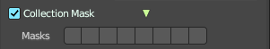

Use custom intersection masks for faces in this colllection.

#### Masks

You can use up to 8 masks, starting with value 0.

### Intersection Priority

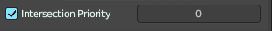

Assign intersection priority value for this collection.

#### Priority Value

The intersection line will be included into the object with the higher intersection priority value.

