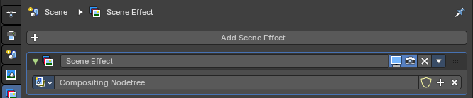
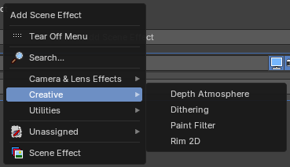
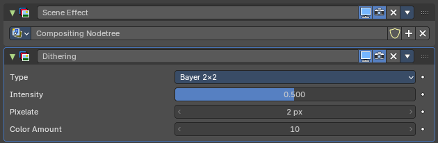
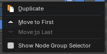

## Compositor tab

The **Compositor** tab holds the **scene effects** of the scene. A scene effect is a compositor node group that works on the rendered picture, for example to add a vignette, film grain or a color look. The effects form a stack, like the modifiers of an object: they work from top to bottom, and each effect gets the result of the one above it.

So you can build up a look from ready-made effects and tweak them here with a few values, without opening the Compositor editor at all. When you need more, each effect is a normal node group that you can open and change in the Compositor.

In a new file the stack has one effect, **Scene Effect**, that uses the **Compositing Nodetree** of the scene.

## Add Scene Effect

The **Add Scene Effect** button at the top opens a menu with the effects that you can add. A new effect goes to the bottom of the stack.

### Search...

Search all effects by name.

### Catalogs

The effects come from the compositor node group **assets** that are allowed as scene effects, sorted into their asset catalogs, such as **Camera & Lens Effects**, **Creative** and **Utilities**. **Unassigned** holds the assets that aren't in a catalog. Choose an asset to add it as an effect.

> **Tip:** Your own node groups can show here too. In the Compositor, open the node group, and in the **Group** tab of the sidebar, tick **Scene Effect** under **Usage**. Mark the node group as an asset to find it in this menu.

### Scene Effect

Adds an empty effect with a node group selector, so you can pick a node group of the file or create a new one.

## Scene effects

Each effect is a panel in the stack. Its header holds the buttons, and the panel shows the **inputs** of the node group as properties, like the Geometry Nodes modifier does. In the picture, the Dithering effect shows its Type, Intensity, Pixelate and Color Amount inputs. Inputs that the node group doesn't use with the current settings are hidden or greyed out.

### Header

From left to right:

#### Collapse

The arrow opens and closes the panel.

#### Effect icon

Click it to make the effect the **active** one. The active effect has a highlighted frame. The icon turns red when the effect has no node group, or its node group is missing.

#### Name

The name of the effect. Click to rename it.

#### Preview

Uses the effect in the preview while you work. Turn it off to see the picture without this effect, without removing it.

#### Render

Uses the effect when you render.

#### Remove

The **X** removes the effect from the stack.

#### Extra menu

The **▾** button at the end opens the extra menu of the effect. The X and the ▾ are in the same order as in the modifier and constraint stacks.

##### Duplicate

Adds a copy of the effect, with the same settings.

##### Move to First

Moves the effect to the top of the stack. Greyed out when it is already there.

##### Move to Last

Moves the effect to the bottom of the stack. Greyed out when it is already there.

##### Show Node Group Selector

Shows the node group selector in the panel, so you can change which node group the effect uses. An effect added from an asset hides it by default, to keep the panel short.

#### Reorder

Drag the grip at the right end of the header to move the effect up or down in the stack.

### Node group selector

The row with the node group of the effect, when it shows. Pick another node group from the list, keep it with the fake user (shield), make a new one with **+**, or unlink it with **X**.

## Order of the effects

The effects run from top to bottom, each one on the result of the one above it, and the last one gives the final picture. Effects with **Render** or **Preview** off are skipped for the render or the preview. Change the order with the grip, or with Move to First and Move to Last.
