## Add menu - Color

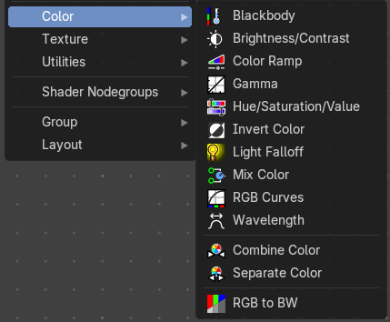

This sub menu contains color related nodes.

### Blackbody

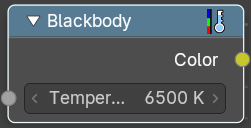

Convert a blackbody temperature to an RGB value.

#### Inputs

##### Temperature

Data type: Float (color temperature).

The temperature in Kelvin.

#### Outputs

##### Color

Data type: Color.

The color that matches the temperature.

### Brightness/Contrast

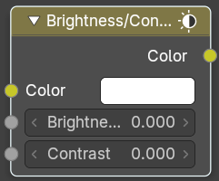

#### Inputs

##### Color

Data type: Color.

Standard input.

##### Brightness

Data type: Float.

An additive-type factor by which to increase the overall brightness of the image. Use a negative number to darken an image.

##### Contrast

Data type: Float.

A scaling type factor by which to make brighter pixels brighter, but keeping the darker pixels dark. Higher values make details stand out. Use a negative number to decrease the overall contrast in the image.

#### Outputs

##### Color

Data type: Color.

Standard output.

Note. It is possible that this node will put out a value set that has values beyond the normal range, i.e. values greater than one and less than zero. If you will be using the output to mix with other images in the normal range, you should clamp the values using the Map Value node (with the Min and Max enabled), or put through a Color Ramp node (with all normal defaults).

### Color Ramp

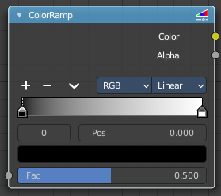

The Color Ramp Node is used for mapping values to colors with the use of a gradient.

#### Inputs

##### Factor

Data type: Float (factor).

The Factor input is used as an index for the color ramp.

#### Properties

##### Color Ramp

Color Ramps enables the user to specify a range of colors based on color stops. The color between the color stops gets interpolated.

###### Controls

- **+**: Add a stop to your color ramp. The stop will be added after the selected one, in the middle to the next one.
- **-**: Deletes the selected color stop from the list.

###### Tools menu

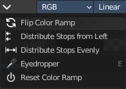

- **Flip Color Ramp**: Flips the gradient, inverting the values of the color ramp.
- **Distribute Stops from Left**: Rearrange the stops so that every step has the same space to the right.
- **Distribute Stops Evenly**: Space between all neighboring stops becomes equal.
- **Eyedropper (pipette icon) E**: An Eyedropper to sample a color or gradient from the interface to be used in the color ramp.

###### Reset Color Ramp

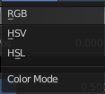

Resets the color ramp to its default state.

###### Color Mode

- **RGB**: Blends color by mixing each color channel and combining.
- **HSV/HSL**: Blends colors by first converting to HSV or HSL, mixing, then combining again. This has the advantage of maintaining saturation between different hues, where RGB would de-saturate, this allows for a richer gradient.

###### Interpolation

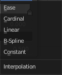

- **Ease**: Uses an Ease Interpolation for the color stops.
- **Cardinal**: Uses a Cardinal Interpolation for the color stops.
- **Linear**: Uses a Linear Interpolation for the color stops.
- **B-Spline**: Uses a B-Spline Interpolation for the color stops.
- **Constant**: Uses a Constant Interpolation for the color stops.

###### Color Ramp

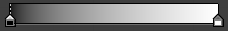

The color band. A click at one of the color stops makes it the active one. You can move the color stops by clicking at them and dragging them around.

###### Active Color Stop elements

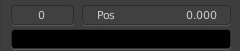

Adjust the active color stop.

- **Choose active color stop**: Choose the color stop by index.
- **Pos**: The position of the active color stop. The range goes from 0.000 to 1.000

#### Outputs

##### Color

Data type: Color.

The color at the position given by the Factor.

##### Alpha

Data type: Float.

Standard Alpha Output.

### Gamma

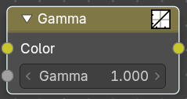

Use this node to apply a gamma correction.

#### Inputs

##### Color

Data type: Color.

The color on which the gamma correction is applied.

##### Gamma

Data type: Float.

An exponential brightness factor. It controls how bright the mid-tones are compared to full black and full white.

#### Outputs

##### Color

Data type: Color.

Standard output.

### Hue/Saturation/Value

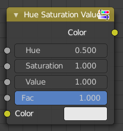

The Hue Saturation Node applies a color transformation in the HSV color space. Called “Hue Saturation Value” in shader and texture context.

#### Inputs

The inputs also work as properties when nothing is connected.

##### Hue

Data type: Float.

Specifies the hue rotation of the image. 360° are mapped to (0 to 1). The hue shifts of 0 (-180°) and 1 (+180°) have the same result.

##### Saturation

Data type: Float.

A saturation of 0 removes hues from the image, resulting in a greyscale image. A shift greater than 1.0 increases saturation.

##### Value

Data type: Float.

Value is the overall brightness of the image. De/Increasing values shift an image darker/lighter.

##### Factor

Data type: Float (factor).

Controls the amount of influence the node exerts on the output image.

##### Color

Data type: Color.

Standard input.

#### Outputs

##### Color

Data type: Color.

Standard output.

Hue/Saturation Tips

Some things to keep in mind that might help you use this node better:

Hues are vice versa

A blue image, with a Hue setting at either end of the spectrum (0 or 1), is output as yellow (recall that white, minus blue, equals yellow). A yellow image, with a Hue setting at 0 or 1, is blue.

Hue and Saturation work together.

So, a Hue of 0.5 keeps the blues the same shade of blue, but Saturation can deepen or lighten the intensity of that color.

Gray & White are neutral hues

A gray image, where the RGB values are equal, has no hue. Therefore, this node can only affect it with Value. This applies to all shades of gray, from black to white; wherever the values are equal.

Changing the effect over time

The Hue and Saturation values can be animated with a Time Node or by animating the property.

### Invert Color

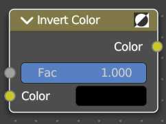

The Invert Node inverts the colors in the input image, producing a negative.

#### Inputs

##### Factor

Data type: Float (factor).

Controls the amount of influence the node exerts on the output image.

##### Color

Data type: Color.

Standard input.

#### Outputs

##### Color

Data type: Color.

Standard image output.

### Light Falloff

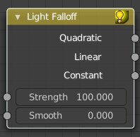

Cycles Only

The Light Falloff node allows you to manipulate how light intensity decreases over distance. In reality light will always fall off quadratically; however, it can be useful to manipulate as a non-physically-based lighting trick. Note that using Linear or Constant falloff may cause more light to be introduced with every global illumination bounce, making the resulting image extremely bright if many bounces are used.

#### Inputs

##### Strength

Data type: Float.

Light strength before applying falloff modification.

##### Smooth

Data type: Float.

Smooth intensity of light near light sources. This can avoid harsh highlights, and reduce global illumination noise. 0.0 corresponds to no smoothing; higher values smooth more. The maximum light strength will be strength/smooth.

#### Outputs

##### Quadratic

Data type: Float.

Quadratic light falloff; this will leave strength unmodified if smooth is 0.0 and corresponds to reality.

##### Linear

Data type: Float.

Linear light falloff, giving a slower decrease in intensity over distance.

##### Constant

Data type: Float.

Constant light falloff, where the distance to the light has no influence on its intensity.

### Mix Color

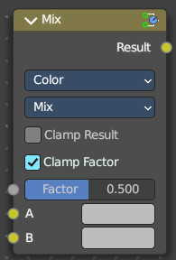

The mix Color node is in real the Mix node in Color mode. It is shared across editors.

The Mix node is meant to mix values. This can be colors, or also a vector or a single value.

Note that the Mix Color node does not start in Color mode when you insert it from the sidebar due a techical limitation in the Blender Python api. Here you have to manually switch to the color mode.

#### Inputs

##### Factor

Data type: Float (factor).

Controls the amount of mixing between the A and B inputs. In Vector mode with the Factor Mode set to Non-Uniform, this is a Vector with one factor per axis.

##### A

Data type: follows the Data Type setting.

The first value to mix. In Color mode this is usually the background color.

##### B

Data type: follows the Data Type setting.

The second value to mix. In Color mode this is usually the foreground color.

#### Properties

##### Data Type

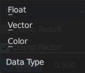

The mode in which the node works. It sets the data type of the A, B and Result sockets.

- **Float**: Mixes two single values.
- **Vector**: Mixes two vectors.
- **Color**: Mixes two colors with a blending mode. Called “MixRGB” in older versions.

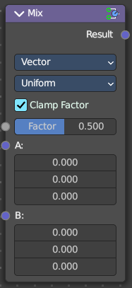

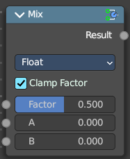

##### Blending Mode

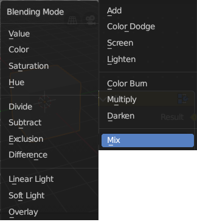

Only in Color mode. Choose the different blending modes.

Mix, Darken, Multiply, Color Burn, Lighten, Screen, Color Dodge, Add, Overlay, Soft Light, Linear Light, Difference, Exclusion, Subtract, Divide, Hue, Saturation, Color, Value.

##### Factor Mode

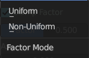

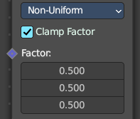

Only in Vector mode. Use a single factor for all values (Uniform), or a factor per value (Non-Uniform).

##### Clamp Result

Only in Color mode. Clamp the result to the 0 to 1 range.

##### Clamp Factor

Clamp the factor to the 0 to 1 range.

#### Outputs

##### Result

Data type: follows the Data Type setting.

The mixed value.

### RGB Curves

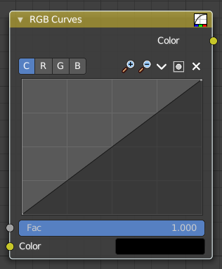

The RGB Curves Node allows color corrections for each color channel and levels adjustments in the compositing context.

#### Inputs

##### Factor

Data type: Float (factor).

Controls the amount of influence the node exerts on the output image.

##### Color

Data type: Color.

Standard image input.

#### Properties

##### Curve Field

###### Channel buttons

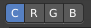

Clicking on one of the channels displays the curve for each.

C (Combined RGB), R (Red), G (Green), B (Blue).

###### Navigation elements

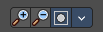

They are described from left to right.

###### Zoom in and out

The two buttons with the magnifying glass at it zooms in and out in the curve window.

###### Use Clipping

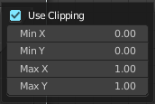

Clipping options. Set up clipping for the stroke.

###### Tools

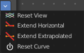

Tools is a menu where you can find some curve related tools.

- **Reset View**: Resets the curve windows zoom.
- **Extend horizontal**: Extends the curve before the first curve point and behind the last curve point horizontally.
- **Extend extrapolated**: Extends the curve before the first curve point and behind the last curve point extrapolated.
- **Reset Curve**: Resets the curve to the initial shape.

###### Curve edit field

Create and tweak a Bezier curve that varies the input levels (X axis) to produce an output level (Y axis).

###### Selecting Points

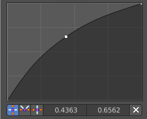

> This setting uses the **curve widget**: click to add points, drag to move them. See **[Curve Widget](../../../../interface/properties.md#curve-widget)** in the Interface chapter.

###### Adding Points

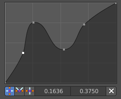

###### Curve point settings

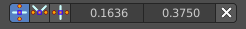

When you have a point selected then you will reveal further settings at the bottom.

- **Vector Handle**: Set handle type to Vector.
- **Auto Handle**: Set handle type to Auto.
- **Auto Clamped Handle**: Set handle type to Auto Clamped.

#### Outputs

##### Color

Data type: Color.

Standard output.

### Wavelength

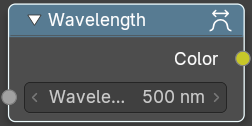

Convert a Wavelength value to a RGB value.

#### Inputs

##### Wavelength

Data type: Float (wavelength).

The wavelength of the light in nanometers.

#### Outputs

##### Color

Data type: Color.

The color that matches the wavelength.

### Combine Color

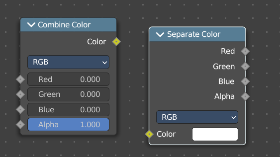

Combine the single RGBA channels into a single image.

#### Inputs

The names of the three inputs follow the Mode setting.

##### Red

Data type: Float (factor).

The red channel. Called Hue in HSV and HSL mode.

##### Green

Data type: Float (factor).

The green channel. Called Saturation in HSV and HSL mode.

##### Blue

Data type: Float (factor).

The blue channel. Called Value in HSV mode and Lightness in HSL mode.

#### Properties

##### Mode

- **RGB**: Combine the red, green and blue channels.
- **HSV**: Combine the hue, saturation and value channels.
- **HSL**: Combine the hue, saturation and lightness channels.

#### Outputs

##### Color

Data type: Color.

The combined output color.

### Separate Color

Combine the single RGBA channels into a single image.

#### Inputs

##### Color

Data type: Color.

The color to split into its channels.

#### Properties

##### Mode

- **RGB**: Split the color into red, green and blue channels.
- **HSV**: Split the color into hue, saturation and value channels.
- **HSL**: Split the color into hue, saturation and lightness channels.

#### Outputs

The names of the three outputs follow the Mode setting.

##### Red

Data type: Float.

The red channel. Called Hue in HSV and HSL mode.

##### Green

Data type: Float.

The green channel. Called Saturation in HSV and HSL mode.

##### Blue

Data type: Float.

The blue channel. Called Value in HSV mode and Lightness in HSL mode.

### RGB to BW

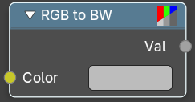

Convert a 24 bit RGB value to a 8 bit black and white value.

#### Inputs

##### Color

Data type: Color.

The color to convert.

#### Outputs

##### Val

Data type: Float.

The grayscale value, based on the luminance of the color.

### Shader to RGB

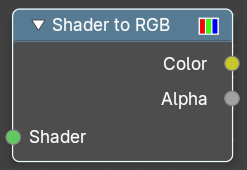

Convert rendering effects to RGB value. Eevee only.

#### Inputs

##### Shader

Data type: Shader.

The shader to convert.

#### Outputs

##### Color

Data type: Color.

Color output.

##### Alpha

Data type: Float.

Alpha channel output.
