## Add menu - Shader

The shader section contains the different shader nodes. The content is different for the sub modes Object, World and Line Style. And it is dependant of the chosen render engine.

Left Eevee, right Cycles and Workbench:

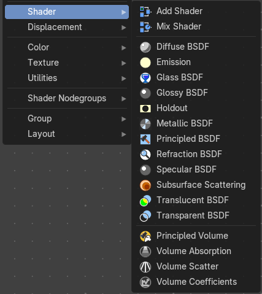

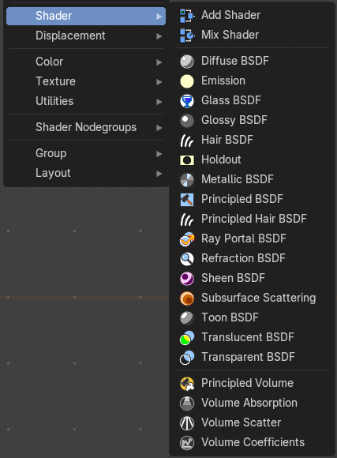

World / Line Art :

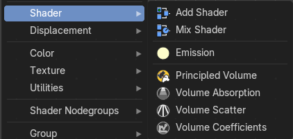

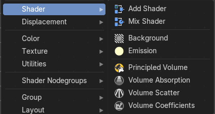

We will start with the Eevee shaders, and go through the other menus then.

### Eevee

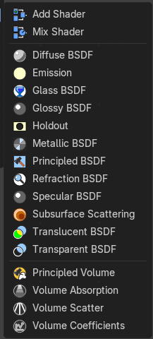

### Add Shader

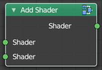

The Add node is used to add two Shaders together.

#### Inputs

##### Shader

Data type: Shader.

The first shader to add.

##### Shader

Data type: Shader.

The second shader to add.

#### Outputs

##### Shader

Data type: Shader.

Standard shader output.

### Mix Shader

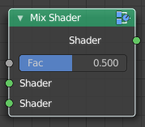

The Mix node is used to mix two shaders together. Mixing can be used for material layering, where the Factor input may, for example, be connected to a Blend Weight node.

#### Inputs

##### Factor

Data type: Float (factor).

Blend weight to use for mixing two shaders; at zero it uses the first shader entirely and at one the second shader.

##### Shader

Data type: Shader.

The first shader to mix. Incoming rays hit either shader with the probability set in the Factor socket.

##### Shader

Data type: Shader.

The second shader to mix.

#### Outputs

##### Shader

Data type: Shader.

Standard shader output.

### Diffuse BSDF

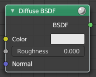

Shader Type Object

The Diffuse BSDF node is used to add Lambertian and Oren-Nayar diffuse reflection.

#### Inputs

##### Color

Data type: Color.

Color of the surface, or physically speaking, the probability that light is reflected or transmitted for each wavelength.

##### Roughness

Data type: Float (factor).

Cycles only. Surface roughness; 0.0 gives standard Lambertian reflection, higher values activate the Oren-Nayar BSDF.

##### Normal

Data type: Vector.

Normal used for shading; if nothing is connected the default shading normal is used.

#### Outputs

##### BSDF

Data type: Shader.

Standard shader output.

### Emission

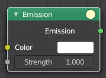

The Emission node emits light.

#### Inputs

##### Color

Data type: Color.

Color of the emitted light.

##### Strength

Data type: Float.

Strength of the emitted light. For point and area lights, the unit is Watts. For materials, a value of 1.0 will ensure that the object in the image has the exact same color as the Color input, i.e. make it ‘shadeless’.

#### Outputs

##### Emission

Data type: Shader.

The Emission shader output can both be plugged into the Surface Input as well as the Volume Input of the Material Output node.

### Glass BSDF

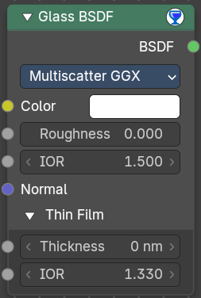

A glass shader.

#### Inputs

##### Color

Data type: Color.

Color of the surface, or physically speaking, the probability that light is transmitted for each wavelength.

##### Roughness

Data type: Float (factor).

Influences sharpness of the refraction; perfectly sharp at 0.0 and smoother with higher values.

##### Anisotropy

Data type: Float (factor).

Amount of anisotropy for specular reflection. Higher values give elongated highlights along the tangent direction.

##### Rotation

Data type: Float (factor).

Rotates the direction of anisotropy, with 1.0 going full circle.

##### IOR

Data type: Float.

Index of refraction (IOR) defining how much the ray changes direction. At 1.0 rays pass straight through like transparent; higher values give more refraction.

##### Normal

Data type: Vector.

Normal used for shading.

##### Tangent

Data type: Vector.

Tangent used for the direction of anisotropy.

##### Thin Film

Thin film is an optical effect where light interference in a very thin surface layer creates colorful, angle-dependent reflections (like soap bubbles or oil on water).

###### Thickness

Data type: Float (wavelength).

Thickness of the film in nanometers.

###### IOR

Data type: Float.

Index of refraction (IOR) of the thin film.

#### Properties

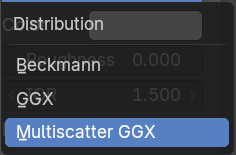

##### Distribution

The light scattering disribution model on rough surface.

#### Outputs

##### BSDF

Data type: Shader.

Standard shader output.

### Glossy BSDF

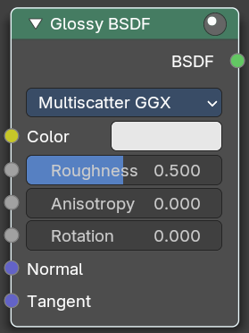

The Glossy BSDF node is used to add reflection with micro facet distribution, used for materials such as metal or mirrors.

#### Inputs

##### Color

Data type: Color.

Color of the surface, or physically speaking, the probability that light is reflected for each wavelength.

##### Roughness

Data type: Float (factor).

Input for the surface roughness resulting in sharp to blurry reflections.

##### Anisotropy

Data type: Float.

Anisotropy level

##### Rotation

Data type: Float (factor).

Rotation of the glossy map.

##### Normal

Data type: Vector.

Normal used for shading.

##### Tangent

Data type: Vector.

Tangent used for shading.

#### Properties

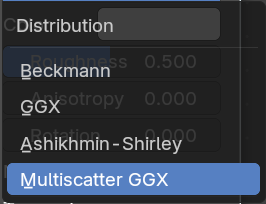

##### Distribution

Micro facet distribution to use.

##### Sharp

Results in perfectly sharp reflections like a mirror. The Roughness value is not used.

##### Beckmann

Beckmann micro facet distribution.

##### GGX

GGX micro facet distribution.

##### Ashikhmin-Shirley

Ashikhmin-Shirley micro facet distribution.

##### Multiscatter GCX

Multiscatter GGX micro facet distribution.

#### Outputs

##### BSDF

Data type: Shader.

Standard shader output.

### Holdout

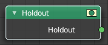

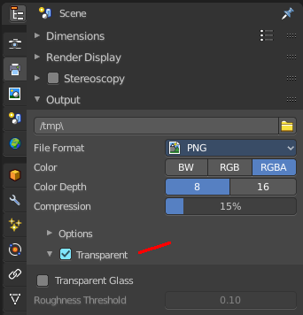

The Holdout shader node is used to create a “hole” in the image with zero alpha transparency, which is useful for compositing (see alpha channel).

Note that the holdout shader can only create alpha when Transparent is enabled. This can be found in the render settings. Properties &gt; Render &gt; Film &gt; Transparent is enabled. If it is disabled, the holdout shader will be black.

#### Outputs

##### Holdout

Data type: Shader.

Standard shader output.

### Light Accumulation

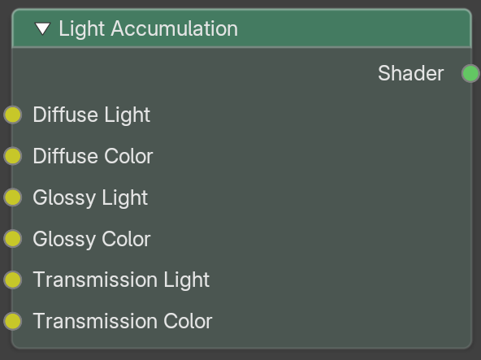

The Light Accumulation node adds up the result of all the lights in the scene and gives it back as a shader. Use it to replace EEVEE's built-in lighting with a lighting setup of your own, built from Light Info, Light Evaluation and Shadow Raycast nodes.

The nodes connected to its Light sockets are run once for every light. Each input is also stored in its own Compositing pass. This node only appears in the Add menu for object shaders when the render engine is EEVEE.

The final result is (Diffuse Light x Diffuse Color) + (Glossy Light x Glossy Color).

Lighting nodes (Light Info, Light Evaluation, Shadow Raycast) must reach the Material Output through a Light socket of this node. They cannot be connected to the Color sockets. A Shader to RGB node cannot evaluate a Light Accumulation node.

#### Inputs

##### Diffuse Light

Data type: Color.

The matte light that reaches the surface, from your lighting nodes (default black).

##### Diffuse Color

Data type: Color.

The color that tints the diffuse light (default white). Connect surface colors here, not lighting nodes.

##### Glossy Light

Data type: Color.

The shiny light that reaches the surface, from your lighting nodes (default black).

##### Glossy Color

Data type: Color.

The color that tints the glossy light (default white). Connect surface colors here, not lighting nodes.

##### Transmission Light

Data type: Color.

The light that passes through the surface, from your lighting nodes (default black).

##### Transmission Color

Data type: Color.

The color that tints the transmitted light (default white). Connect surface colors here, not lighting nodes.

#### Outputs

##### Shader

Data type: Shader.

The lit result, to connect to the Material Output.

### Metallic BSDF

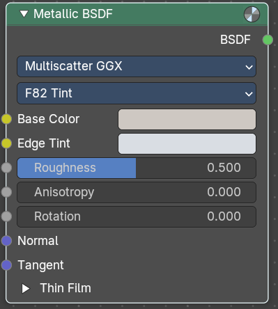

A metallic shader, which gives more realistic results than the glossy node.

#### Inputs

##### Base Color

Data type: Color.

The base color of the metal. Only with the F82 Tint fresnel type.

##### Edge Tint

Data type: Color.

The color of the reflection at grazing angles, near the edges. Only with the F82 Tint fresnel type.

##### IOR

Data type: Vector.

The refractive index for all three color channels. Mathematically called n. Only with the Physical Conductor fresnel type.

##### Extinction

Data type: Vector.

Imaginary part of the refractive index. Mathematically called k. Only with the Physical Conductor fresnel type.

##### Roughness

Data type: Float (factor).

The roughness of the surface. 0 is a perfect mirror reflection, 1 is completely rough.

##### Anisotropy

Data type: Float (factor).

Amount of anisotropy for reflection.

##### Rotation

Data type: Float (factor).

Rotates the direction of anisotropy, with 1.0 going full circle.

##### Normal

Data type: Vector.

Input normal.

##### Tangent

Data type: Vector.

Input tangent.

##### Thin Film

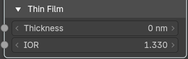

###### Thickness

Data type: Float (wavelength).

Thickness of the film in nanometers.

###### IOR

Data type: Float.

Index of Refraction of the Thin Film.

#### Properties

##### Distribution

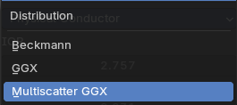

The available scatter methods. They all give a slighty differnt result.

##### Fresnel Type

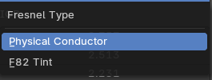

The fresnel type. Fresnel is a real life effect that adds a mirroring the more the angle diverts from the line of sight. At 90 degrees the mirroring is 100%.

- **F82 Tint**: Set the look with the Base Color and Edge Tint inputs.
- **Physical Conductor**: Set the look with the IOR and Extinction inputs.

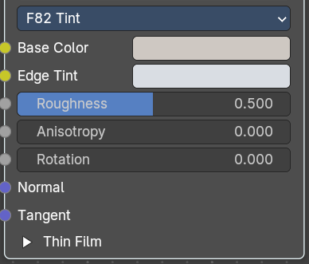

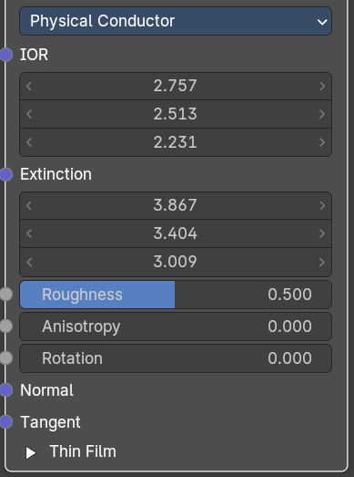

#### Outputs

##### BSDF

Data type: Shader.

Shader output.

### Principled BSDF

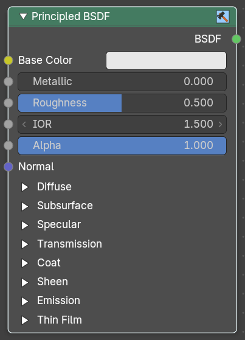

The Principled BSDF that combines multiple shader layers into a single easy to use node. It is based on the Disney principled model also known as the “PBR” shader, making it compatible with other software such as Pixar’s Renderman® and Unreal Engine®. Image textures painted or baked from software like Substance Painter® may be directly linked to the corresponding parameters in this shader.

This “Uber” shader includes multiple layers to create a wide variety of materials. The base layer is a user controlled mix between diffuse, metal, subsurface scattering and transmission. On top of that there is a specular layer, sheen layer and clear coat layer.

> **Note:** The emphasis on compatibility with other software means that it interprets certain input parameters differently from older Blender nodes.

#### Inputs

##### Base Color

Data type: Color.

Diffuse or metal surface color.

##### Metallic

Data type: Float (factor).

Blends between a non-metallic and metallic material model. A value of 1.0 gives a fully specular reflection tinted with the base color, without diffuse reflection or transmission. At 0.0 the material consists of a diffuse or transmissive base layer, with a specular reflection layer on top.

##### Roughness

Data type: Float (factor).

Specifies micro facet roughness of the surface for diffuse and specular reflection. Hint. When converting from the older Glossy BSDF node, use the square root of the original value.

##### IOR

Data type: Float.

Index of refraction (IOR) for specular reflection and transmission. For most materials the IOR is between 1.0 (vacuum and air) and 4.0 (germanium). The default value of 1.5 is a good value for glass.

##### Alpha

Data type: Float (factor).

Controls the transparency of the surface, with 1.0 fully opaque. Usually linked to the Alpha output of an Image Texture node.

##### Thin Wall

Data type: Boolean.

Treats the surface as a thin structure with the same material on both sides. Useful for thin objects such as windows, paper and leaves.

##### Normal

Data type: Vector.

Controls the normals of the base layers.

##### Diffuse

###### Roughness

Data type: Float (factor).

Microfacet roughness of the diffuse base. 0.0 is perfect Lambertian reflection, 1.0 is completely rough.

##### Subsurface

The Subsurface Method setting at the top of this panel is described under Properties.

###### Weight

Data type: Float (factor).

Mix between diffuse and subsurface scattering. Rather than being a simple mix between Diffuse and Subsurface Scattering, it acts as a multiplier for the Subsurface Radius.

###### Radius

Data type: Vector.

Average distance that light scatters below the surface. Higher radius gives a softer appearance, as light bleeds into shadows and through the object. The scattering distance is specified separately for the RGB channels, to render materials such as skin where red light scatters deeper. The X, Y and Z values are mapped to the R, G and B values, respectively. The value is multiplied with Scale. Not used when Thin Wall is enabled.

###### Scale

Data type: Float (distance).

Scale of the subsurface scattering, multiplied with Radius. Not used when Thin Wall is enabled.

###### IOR

Data type: Float (factor).

Index of refraction (IOR) for rays that enter the subsurface component. Only with the Random Walk (Skin) method.

###### Anisotropy

Data type: Float (factor).

The direction of the light scattering inside the material. 0 scatters evenly in all directions, positive values scatter more forward and negative values more backward. Skin has an anisotropy of about 0.8. Not used by the Christensen-Burley method, unless Thin Wall is enabled.

##### Specular

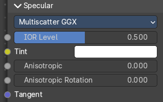

The Distribution setting at the top of this panel is described under Properties.

###### IOR Level

Data type: Float (factor).

Adjusts the IOR to make the specular reflection stronger or weaker. 0.5 means no change, 0 removes all reflections, and 1 doubles them when you look straight at the surface.

###### Tint

Data type: Color.

Tints the dielectric reflection when you look straight at the surface, for artistic control. For metals it tints the reflection at grazing angles, to simulate a complex index of refraction.

###### Anisotropy

Data type: Float (factor).

Amount of anisotropy for specular reflection. Higher values give elongated highlights along the tangent direction; negative values give highlights shaped perpendicular to the tangent direction.

###### Anisotropic Rotation

Data type: Float (factor).

Rotates the direction of anisotropy, with 1.0 going full circle. Hint. Compared to the Anisotropic BSDF node, the direction of highlight elongation is rotated by 90°. Add 0.25 to the value to correct.

###### Tangent

Data type: Vector.

Controls the tangent for the Anisotropic layer.

##### Transmission

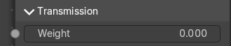

###### Weight

Data type: Float (factor).

Blend between transmission and other base layers.

###### Dispersion Scale

Data type: Float (factor).

Scales the amount of dispersion, where light splits into its colors like in a prism.

###### Dispersion Abbe Number

Data type: Float.

The Abbe number of the base material. A smaller number gives stronger dispersion.

##### Coat

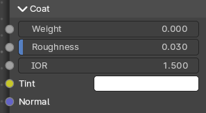

Extra white specular layer on top of others. This is useful for materials like car paint and the like.

###### Weight

Data type: Float (factor).

Controls the intensity of the coat layer. Both, the reflection and the tinting. For physically based materials this value should be zero or one.

###### Roughness

Data type: Float (factor).

Roughness of clear coat specular.

###### IOR

Data type: Float.

The index of refraction of the coat layer. It affects the reflectivity and the falloff of coat tinting.

###### Tint

Data type: Color.

The coat color. Saturation increases at shallower angles as the light travels farther through the medium.

###### Normal

Data type: Vector.

Controls the normals of the coat layer.

##### Sheen

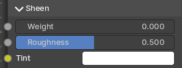

###### Weight

Data type: Float (factor).

Controls the intensity of the sheen layer, which simulates very small fibers on the surface.

###### Roughness

Data type: Float (factor).

Controls the roughness of the layer.

###### Tint

Data type: Color.

The color of the sheen reflection.

##### Emission

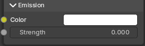

Light emission from the surface, like the Emission shader.

###### Color

Data type: Color.

The emission color.

###### Strength

Data type: Float.

The strength of the light emission.

##### Thin Film

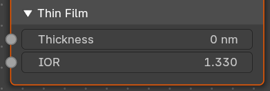

A thin film coating of a material with a normal angle of incidence.

> **Note:** Useful for bubbles, oil floating on water and other similar effects.

###### Thickness

Data type: Float (wavelength).

The thickness of the thin film in nanometers.

###### IOR

Data type: Float.

The index of refraction of the thin film layer. It affects the reflectivity and the falloff of thin film.

#### Properties

##### Distribution

In the Specular panel.

- **GGX**: A method that is faster than Multiscatter GGX but is less physically accurate.
- **Multiscatter GGX**: Takes multiple bounce (scattering) events between micro facets into account. This gives a more energy conserving results, which would otherwise be visible as excessive darkening.

##### Subsurface Method

In the Subsurface panel.

###### Christensen-Burley

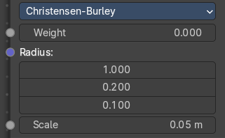

Christensen-Burley is an approximation to physically-based volume scattering. Gives less blurry results than Cubic and Gaussian functions.

###### Random Walk

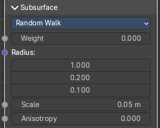

Random Walk Provides the most accurate results for thin and curved objects. This comes at the cost of increased render time or noise for more dense media like skin, but also better geometry detail preservation. Random Walk uses true volumetric scattering inside the mesh, which means that it works best for closed meshes. Overlapping faces and holes in the mesh can cause problems.

###### Random Walk (Skin)

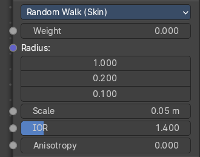

Like Random Walk, but the scattering radius is adjusted automatically to match color textures. Designed for skin shading. This method adds the IOR input.

###### Random Walk (Legacy)

The older Random Walk method, using the scattering radius as specified.

#### Outputs

##### BSDF

Data type: Shader.

Standard shader output.

### Refraction BSDF

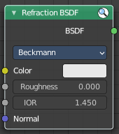

The Refraction BSDF is used to add glossy refraction with sharp or micro facet distribution, used for materials that transmit light. For best results this node should be considered as a building block and not be used on its own, but rather mixed with a glossy node using a Fresnel factor. Otherwise it will give quite dark results at the edges for glossy refraction.

#### Inputs

##### Color

Data type: Color.

Color of the surface, or physically speaking, the probability that light is refracted for each wavelength.

##### Roughness

Data type: Float (factor).

Influences sharpness of the refraction; perfectly sharp at 0.0 and smoother with higher values.

##### IOR

Data type: Float.

Index of refraction (IOR) defining how much the ray changes direction. At 1.0 rays pass straight through; higher values give more refraction.

##### Normal

Data type: Vector.

Normal used for shading; if nothing is connected the default shading normal is used.

#### Properties

##### Distribution

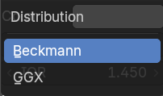

Micro facet distribution to use. Sharp results in perfectly sharp refraction, while Beckmann and GGX can use the Roughness input for blurry refraction.

#### Outputs

##### BSDF

Data type: Shader.

Standard shader output.

### Specular BSDF

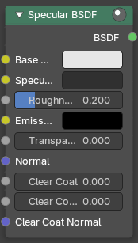

Eevee Only

The Specular BSDF combines multiple shader layers into a single easy to use node.

It is similar to the Principled BSDF node but uses the specular workflow instead of the metallic. It has far fewer parameters and supports less features. Both might be merged into one node in the future.

The specular workflow functions by specifying the facing (along normal) reflection color. The result may not be physically plausible because there is no energy conservation.

#### Inputs

##### Base Color

Data type: Color.

Diffuse surface color. For conductor materials (metals) it should be black.

##### Specular

Data type: Color.

Amount of specular reflection. Specifies facing (along normal) reflectivity. Conductor materials (metals) can have colored specular reflection. Hint. To compute this value for a realistic material with a known index of refraction, you may use this special case of the Fresnel formula: specular=((ior-1)/(ior+1))2 For example: water: ior = 1.33, specular = 0.25 glass: ior = 1.5, specular = 0.5 diamond: ior = 2.417, specular = 2.15

##### Roughness

Data type: Float (factor).

Specifies micro facet roughness of the surface for diffuse and specular reflection. Hint. When converting from the older Glossy BSDF node, use the square root of the original value.

##### Emissive Color

Data type: Color.

Color of the emitted light. This light is added to the BSDF result.

##### Transparency

Data type: Float (factor).

Transparency factor. This is the inverse of the alpha channel (1 - alpha) you find in an image. Use an Invert node to convert alpha to transparency. This will only have an effect if the material uses a blend mode other than opaque.

##### Normal

Data type: Vector.

Controls the normals of the base layers.

##### Clear Coat

Data type: Float (factor).

Extra white specular layer on top of others. This is useful for materials like car paint and the like.

##### Clear Coat Roughness

Data type: Float (factor).

Roughness of clear coat specular.

##### Clear Coat Normal

Data type: Vector.

Controls the normals of the Clear Coat layer.

#### Outputs

##### BSDF

Data type: Shader.

Standard shader output.

### Subsurface Scattering

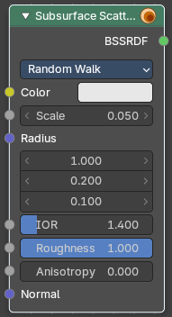

The Subsurface Scattering node is used to add simple subsurface multiple scattering, for materials such as skin, wax, marble, milk and others. For these materials, rather than light being reflect directly off the surface, it will penetrate the surface and bounce around internally before getting absorbed or leaving the surface at a nearby point.

How far the color scatters on average can be configured per RGB color channel. For example, for skin, red colors scatter further, which gives distinctive red-colored shadows, and a soft appearance.

#### Inputs

##### Color

Data type: Color.

Color of the surface, or physically speaking, the probability that light is reflected for each wavelength.

##### Scale

Data type: Float.

Global scale factor for the scattering radius.

##### Radius

Data type: Vector.

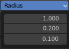

Average distance that light scatters below the surface. Higher radius gives a softer appearance, as light bleeds into shadows and through the object. The scattering distance is specified separately for the RGB channels, to render materials such as skin where red light scatters deeper. The X, Y and Z values are mapped to the R, G and B values, respectively.

##### IOR

Data type: Float (factor).

Refraction value. Only with the Random Walk and Random Walk (Skin) methods.

##### Roughness

Data type: Float (factor).

The roughness of the subsurface scattering. It controls how light reflects off the surface **before** and **after** it scatters inside. Only with the Random Walk method.

##### Anisotropy

Data type: Float (factor).

The anisotropy level of the subsurface scattering. Anisotropy controls the preferred direction in which light scatters **inside** the material rather than spreading evenly in all directions. Only with the Random Walk and Random Walk (Skin) methods.

##### Normal

Data type: Vector.

Normal used for shading; if nothing is connected the default shading normal is used.

#### Properties

##### Method

Method for rendering subsurface scattering.

###### Christensen-Burley

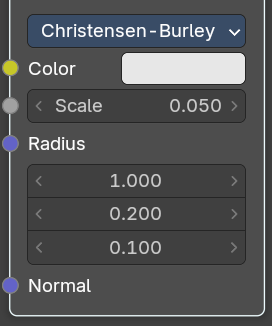

An approximation to physically based volume scattering. It uses the Color, Scale, Radius and Normal inputs.

###### Random Walk

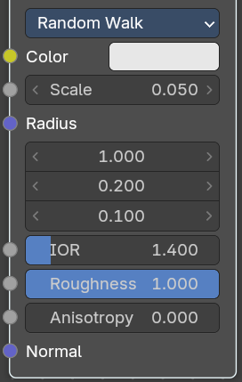

A volumetric approximation to physically based volume scattering, using the scattering radius as specified. It uses all inputs.

###### Random Walk (Skin)

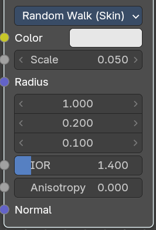

Like Random Walk, but the scattering radius is adjusted automatically to match color textures. Designed for skin shading. It has no Roughness input.

#### Outputs

##### BSSRDF

Data type: Shader.

BSSRDF shader output.

### Translucent BSDF

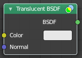

The Translucent BSDF is used to add Lambertian diffuse transmission.

#### Inputs

##### Color

Data type: Color.

Color of the surface, or physically speaking, the probability that light is transmitted for each wavelength.

##### Normal

Data type: Vector.

Normal used for shading; if nothing is connected the default shading normal is used.

#### Outputs

##### BSDF

Data type: Shader.

Standard shader output.

### Transparent BSDF

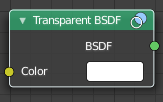

The Transparent BSDF is used to add transparency without refraction, passing straight through the surface, as if there were no geometry there. Useful with alpha maps, for example. This shader affects light paths somewhat differently than other BSDFs. Note that only pure white transparent shaders are completely transparent.

#### Inputs

##### Color

Data type: Color.

Color of the surface, or physically speaking, the probability for each wavelength that light is blocked or passes straight through the surface.

#### Outputs

##### BSDF

Data type: Shader.

Standard shader output.

### Principled Volume

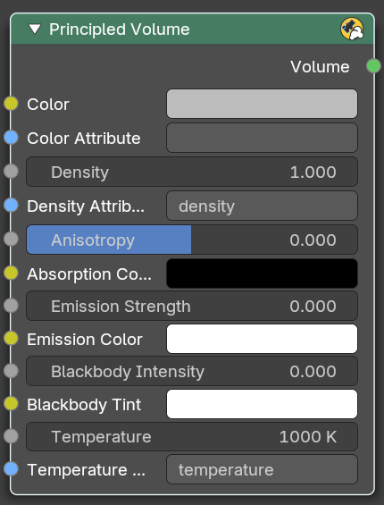

The Principled Volume shader combines all volume shading components into a single easy to use node. Volumes like smoke and fire can be rendered with a single shader node, which includes scattering, absorption and blackbody emission.

#### Inputs

##### Color

Data type: Color.

Volume scattering color.

##### Color Attribute

Data type: String.

Volume grid for coloring the volume. Use “color” for smoke simulations.

##### Density

Data type: Float.

Density of the volume.

##### Density Attribute

Data type: String.

Volume grid to define the density, typically “density”.

##### Anisotropy

Data type: Float (factor).

Backward or forward scattering direction.

##### Absorption Color

Data type: Color.

Volume shadow color tint.

##### Emission Strength

Data type: Float.

Amount of light to emit.

##### Emission Color

Data type: Color.

Emission color tint.

##### Blackbody Intensity

Data type: Float (factor).

Blackbody emission for fire. Set to 1 for physically accurate intensity.

##### Blackbody Tint

Data type: Color.

Color tint for blackbody emission.

##### Temperature

Data type: Float (color temperature).

Temperature in kelvin for blackbody emission, higher values emit more.

##### Temperature Attribute

Data type: String.

Volume grid attribute to define the temperature.

#### Outputs

##### Volume

Data type: Shader.

Standard shader output.

### Volume Absorption

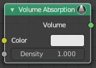

The Volume Absorption node allows light to be absorbed as it passes through the volume. Typical usage for this node would be water and colored glass.

#### Inputs

##### Color

Data type: Color.

Color of the volume.

##### Density

Data type: Float.

The density of the absorption effect.

#### Outputs

##### Volume

Data type: Shader.

The Volume Shader.

### Volume Scatter

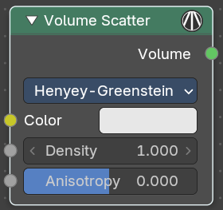

The Volume Scatter node allows light to be scattered as it passes through the volume. Typical usage would be to add fog to a scene. It can also be used with the Volume Absorption node to create smoke.

#### Inputs

##### Color

Data type: Color.

Color of the volume.

##### Density

Data type: Float.

The density of the scatter effect.

##### Anisotropy

Data type: Float (factor).

Controls the look of the scatter effect depending on the direction of the light passing through it. Zero scatters evenly, negative values scatter backward, positive values scatter forward. Only with the Henyey-Greenstein and Draine phases.

##### IOR

Data type: Float (factor).

The index of refraction of the scattering particles. Only with the Fournier-Forand phase.

##### Backscatter

Data type: Float (factor).

Fraction of light that is scattered backwards. Only with the Fournier-Forand phase.

##### Alpha

Data type: Float.

A shape parameter of the Draine phase function. Only with the Draine phase.

##### Diameter

Data type: Float.

Diameter of the water droplets in micrometers. Only with the Mie phase.

#### Properties

##### Phase

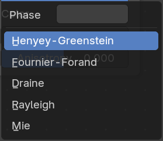

Phase function for the scattered light.

###### Henyey-Greenstein

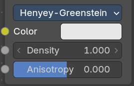

Common for biological tissues and fog. Uses the Anisotropy input.

###### Fournier-Forand

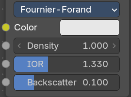

Suitable for underwater scattering. Uses the IOR and Backscatter inputs.

###### Draine

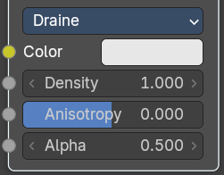

Models interstellar dust. Uses the Anisotropy and Alpha inputs.

###### Rayleigh

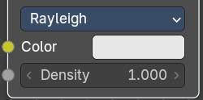

For small particles like atmospheric haze. Uses only Color and Density.

###### Mie

For large particles like clouds or mist. Uses the Diameter input.

#### Outputs

##### Volume

Data type: Shader.

The Volume Shader output must be plugged into the Volume Input of the Material or World Output node.

### Volume Coefficients

The Volume Coefficients node models how light interacts with volumetric materials by defining three key physical processes: **Absorption**, **Scattering**, and **Emission**. This node provides fine-grained control over how light is absorbed, redirected, and emitted as it travels through a volume—ideal for simulating effects like smoke, fog, underwater environments, or glowing gases.

#### Inputs

##### Absorption

###### Coefficients

Data type: Vector.

A vector input representing the probability per unit distance that light is absorbed in each color channel (R, G, B) of a vector.

> **Note:** Higher values result in **darker, denser volumes**.

##### Scatter

The Phase setting at the top of this panel is described under Properties.

###### Coefficients

Data type: Vector.

A vector input defining the likelihood of light scattering per unit distance in each color channel. Controls how much light is redirected rather than absorbed.

###### Anisotropy

Data type: Float (factor).

Controls the directionality of scattering. Zero scatters evenly, negative values scatter backward, positive values scatter forward. Only with the Henyey-Greenstein and Draine phases.

###### IOR

Data type: Float (factor).

The index of refraction of the scattering particles. Only with the Fournier-Forand phase.

###### Backscatter

Data type: Float (factor).

Fraction of light that is scattered backwards. Only with the Fournier-Forand phase.

###### Alpha

Data type: Float.

A shape parameter of the Draine phase function. Only with the Draine phase.

###### Diameter

Data type: Float.

Diameter of the water droplets in micrometers. Only with the Mie phase.

##### Emission

###### Coefficients

Data type: Vector.

The light that is added per unit distance in each color channel. Simulates glowing volumes like fire or plasma.

#### Properties

##### Phase

In the Scatter panel. Dropdown to select the scattering phase function.

###### Henyey-Greenstein

Common for biological tissues and fog. Uses the Anisotropy input.

###### Fournier-Forand

Suitable for underwater scattering. Uses the IOR and Backscatter inputs.

###### Draine

Models interstellar dust. Uses the Anisotropy and Alpha inputs.

###### Rayleigh

For small particles like atmospheric haze. Uses only the Coefficients inputs.

###### Mie

For large particles like clouds or mist. Uses the Diameter input.

#### Outputs

##### Volume

Data type: Shader.

The Volume Shader output must be plugged into the Volume Input of the Material or World Output node.

### Cycles / Workbench

### Hair BSDF

Cycles Only

The Hair BSDF node is used to add shading for Hair.

#### Inputs

##### Color

Data type: Color.

Color of the hair.

##### Offset

Data type: Float (angle).

Controls the way the light is rotated (angular shift) for the reflection/transmission.

##### RoughnessU

Data type: Float (factor).

Controls the roughness in the direction the light is skewed.

##### RoughnessV

Data type: Float (factor).

Controls the roughness perpendicular to the direction the light is skewed.

##### Tangent

Data type: Vector.

Input tangent.

#### Properties

##### Component

There are two components that can be used to control the look of the hair. Usually you are going to want each of these and use a Mix Node.

##### Reflection

The light that bounces off the surface of the hair.

##### Transmission

The light that passes through the hair and comes out the other side.

#### Outputs

##### BSDF

Data type: Shader.

Standard shader output.

### Principled Hair BSDF

Cycles Only

The Principled Hair BSDF is a physically-based, easy-to-use shader for rendering hair and fur.

#### Inputs

Which inputs are shown depends on the Scattering Model and Color Parametrization settings.

##### Color

Data type: Color.

The RGB color of the strand. The shader converts the color to the matching absorption coefficient. Only with the Direct Coloring parametrization.

##### Melanin

Data type: Float (factor).

Absolute quantity of pigment. Range `[0,1]` equivalent to `[0%,100%]`. Hint. This is a linear mapping to the underlying exponential function: melanin_qty=-ln(max(1.0-Melanin,0.0001)). Only with the Melanin Concentration parametrization.

##### Melanin Redness

Data type: Float (factor).

Ratio of pheomelanin to eumelanin. Range `[0,1]` equivalent to `[0%,100%]`. Low values give a brown to black color, high values a yellow to red color. Only with the Melanin Concentration parametrization.

##### Tint

Data type: Color.

Color used for dyeing the hair after applying the melanin pigment. It is not subject to randomization. It can be disabled by setting the color to white. Only with the Melanin Concentration parametrization.

##### Absorption Coefficient

Data type: Vector.

Specifies the light absorption per unit length as the light passes through the hair. A higher value leads to a darker color. Only with the Absorption Coefficient parametrization.

##### Aspect Ratio

Data type: Float (factor).

For elliptical hair cross-section the aspect ratio is the ratio of the minor axis to the major axis. The major axis is aligned with the curve normal. Recommended values are 0.8 to 1 for Asian hair, 0.65 to 0.9 for Caucasian hair and 0.5 to 0.65 for African hair. Only with the Huang model.

##### Roughness

Data type: Float (factor).

The hair roughness. A lower value leads to a metallic look.

##### Radial Roughness

Data type: Float (factor).

Specify how much the glints are smoothed in the direction of the hair tangent. Too low values will concentrate the glint; while setting it too high will spread the light across the width of the strand. Only with the Chiang model.

##### Coat

Data type: Float (factor).

Simulate a shiny coat by reducing the roughness to the given factor only for the first light bounce (diffuse). Range `[0, 1]` is equivalent to a reduction of `[0%, 100%]` of the original roughness. Only with the Chiang model.

##### IOR

Data type: Float.

Index of refraction (IOR) defining how much the ray changes direction. At 1.0 rays pass straight through like in a transparent material; higher values give more refraction. Default value is 1.55, the IOR of keratin.

##### Offset

Data type: Float (angle).

The tilt angle of the cuticle scales, the outermost part of the hair. They are always tilted towards the hair root. Human hair has a value between 2 and 4 degrees.

##### Random Color

Data type: Float (factor).

For each strand, vary the melanin concentration by RandomFactor. Range `[0,1]` equivalent to `[0%,100%]` of the initial melanin concentration. Only with the Melanin Concentration parametrization.

##### Random Roughness

Data type: Float (factor).

For each strand, vary both Roughness values by RandomFactor. Range `[0,1]` equivalent to `[0%,100%]` of the initial roughness values.

##### Random

Data type: Float.

The random value for each strand, used by Random Color and Random Roughness. If nothing is connected, a random value is generated for each strand.

##### Reflection

Data type: Float (factor).

Optional factor for modulating the first light bounce off the hair surface. The color of this component is always white. Keep it 1.0 for physical correctness. Only with the Huang model.

##### Transmission

Data type: Float (factor).

Optional factor for modulating the transmission component. It picks up the color of the pigment inside the hair. Keep it 1.0 for physical correctness. Only with the Huang model.

##### Secondary Reflection

Data type: Float (factor).

Optional factor for modulating the component which is transmitted into the hair, reflected off the backside of the hair and then transmitted out of the hair. This component is oriented approximately around the incoming direction, and picks up the color of the pigment inside the hair. Keep this 1.0 for physical correctness. Only with the Huang model.

#### Properties

##### Scattering Model

There are two scattering models available. Chiang and Huang. Chiang is the older model, with a less accurate result. Huang the newer model. The available inputs differ from model to model.

##### Color Parametrization

The shader provides three different ways, or parametrizations, to color the hair strands. Direct coloring, Melanin concentration and Absorption coefficient. They have some different settings and inputs.

###### Absorption Coefficient

Specifies the attenuation coefficient sa, as applied by the Beer-Lambert law. This mode is intended mainly for technical users who want to use coefficients from the literature without any sort of conversion.

###### Melanin Concentration

This mode defines the color as the quantity and ratio of the pigments which are commonly found in hair and fur, eumelanin (prevalent in brown-black hair) and pheomelanin (red hair). The quantity is specified in the Melanin input, and the ratio between them in Melanin Redness. Increasing concentrations darken the hair (the following are with Melanin Redness 1):

White (Melanin 0), Blonde (Melanin 0.25), Reddish (Melanin 0.5), Brown (Melanin 0.75), Black (Melanin 1)

Additionally, the Tint input allows to dye the hair with the desired color.

###### Direct Coloring

Choose the desired RGB color and the shader will approximate the necessary absorption coefficient.

#### Outputs

##### BSDF

Data type: Shader.

Standard shader output.

### Sheen BSDF

Cycles Only

The Sheen BSDF is used to add reflection to materials such as cloth. It is meant to be used together with other shaders (such as a Diffuse Shader) and is not particularly useful on its own.

#### Inputs

##### Color

Data type: Color.

Color of the surface, or physically speaking, the probability that light is reflected for each wavelength.

##### Roughness

Data type: Float (factor).

Controls the sharpness of the sheen. It works like a roughness.

##### Normal

Data type: Vector.

Normal used for shading; if nothing is connected the default shading normal is used.

#### Properties

##### Distribution

The distribution algorithm. Akishikmin is the legacy model. Microfiber the modern approach.

#### Outputs

##### BSDF

Data type: Shader.

Standard shader output.

### Toon BSDF

Cycles Only

The Toon BSDF is used to create Diffuse and Glossy materials with cartoon light effects.

#### Inputs

##### Color

Data type: Color.

Color of the surface, or physically speaking, the probability that light is reflected for each wavelength.

##### Size

Data type: Float (factor).

Parameter between 0.0 and 1.0 that gives an angle of reflection between 0° and 90°.

##### Smooth

Data type: Float (factor).

This value specifies an angle over which a smooth transition from full to no reflection happens.

##### Normal

Data type: Vector.

Normal used for shading; if nothing is connected the default shading normal is used.

#### Properties

##### Component

###### Diffuse

Use shading based on the Diffuse BSDF.

###### Glossy

Use shading based on the Glossy BSDF for specular reflection.

#### Outputs

##### BSDF

Data type: Shader.

Standard shader output.

### World

### Background

Shader Type World

The Background shader node is used to add background light emission.

#### Inputs

##### Color

Data type: Color.

Color of the emitted light.

##### Strength

Data type: Float.

Strength of the emitted light.

#### Outputs

##### Background

Data type: Shader.

Standard shader output.
