## Add menu - Utilities - Vector

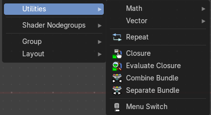

This menu contains nodes that deals with vector data.

### Repeat

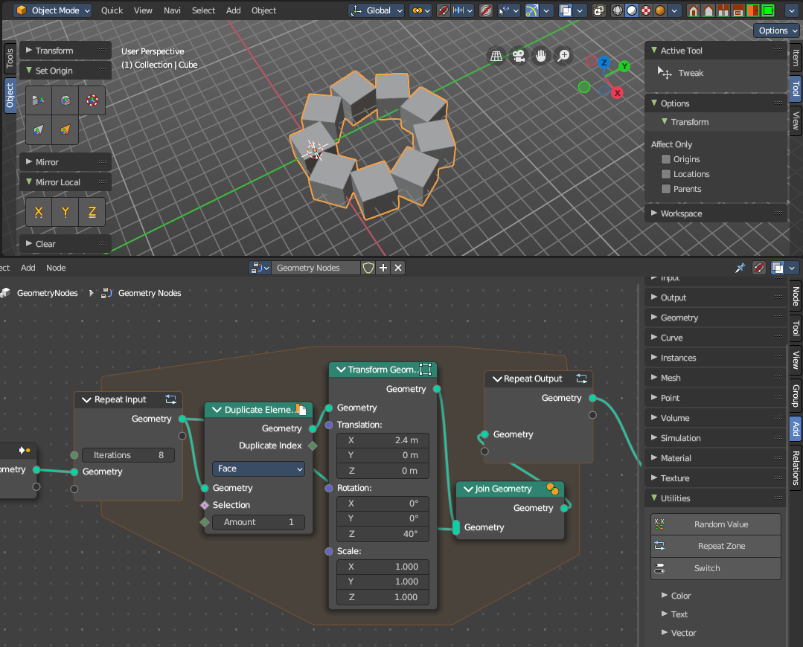

When adding a repeat zone, two nodes are added with a “zone” set between them. The inputs connected to the *Repeat Input* node reads and gets data at the beginning of the loop before starting the looping - then the data is processed within the zone, here you can set any changes to the data to then repeat the execution again at the beginning of the chain for the next iteration of the loop. This chain of operations is repeated the specified number of times in the *Repeat Input* node.

In the example in the image above, we duplicate the cube, transform it with a rotation, then join it together again. We do this 8 times in a loop, creating a circular array.

> **Note:** It is not possible to set data outside the Repeat Zone, you can only get data from outside the Repeat Zone. Any data connected from the outside of the zone are constant throughout every iteration based on their value at the current frame. The result of the looping can only be accessed via the Repeat Output node.

#### Repeat Input

The beginning of the iteration or loop. In the shader editor the zone starts without any items. Connect a link to the empty socket to add an item. Each item gets a matching input and output on both zone nodes.

##### Inputs

###### Iterations

Data type: Integer.

Number of repetitions or loops.

##### Outputs

###### Iteration

Data type: Integer.

The index of the current iteration. It starts counting at zero.

#### Repeat Output

The result and output of the iteration or loop. It has no fixed sockets. It shows one input and one output for each item of the zone.

### Closure

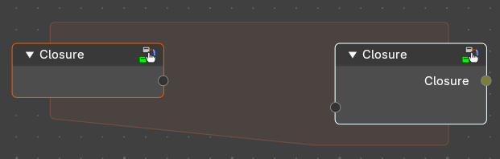

Wrap nodes inside a closure that can be executed at a different part of the node-tree

#### Outputs

##### Closure

Data type: Closure.

The closure made from the nodes inside the zone. This socket is on the Closure Output node.

### Evaluate Closure

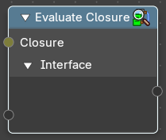

Execute a given closure.

#### Inputs

##### Closure

Data type: Closure.

The closure to execute. The other inputs and outputs of the node follow the items of the closure.

### Combine Bundle

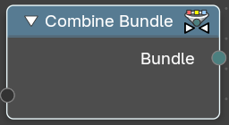

Combine multiple socket values into one.

#### Outputs

##### Bundle

Data type: Bundle.

The bundle with all the values. Connect a link to the empty input socket to add a value.

### Join Bundle

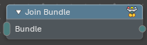

Merges two or more bundles into one. A bundle holds several values under names, like a small folder of settings, and Join Bundle puts the contents of several folders into a single one. Use it to collect the settings of different parts of a node tree into one bundle that you pass on.

#### Inputs

##### Bundle

Data type: Bundle.

One or more bundles. The empty socket at the bottom adds another one.

#### Outputs

##### Bundle

Data type: Bundle.

One bundle with the items of all input bundles.

### Separate Bundle

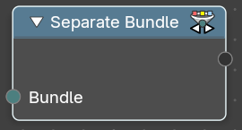

Decompose a bundle of values into the single values.

#### Inputs

##### Bundle

Data type: Bundle.

The bundle to split. Connect a link to the empty output socket to add a value.

### Index Switch

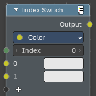

The Index Switch node chooses one value out of any number of values by its position (index). Only the chosen value is computed. It is a simpler version of the Menu Switch node: the items have no names and no dropdown, but you can have as many as you need.

#### Inputs

##### Index

Data type: Integer.

Which item to pass through, counting from 0. If the index is outside the available items, the output is the default value of the chosen data type.

##### 0 , 1 ...

Data type: follows the Data Type setting.

The values to choose from. A new node starts with two (0 and 1). Add more with the empty socket at the bottom of the node, or with Add Item in the Items panel of the sidebar. The Items panel also removes and reorders items.

#### Properties

##### Data Type

The type of the values that are switched, and of the output. In the Shader Editor you can choose Float, Integer, Boolean, Vector, Color, String, Menu, Shader, Bundle or Closure. The default is Color.

#### Outputs

##### Output

Data type: follows the Data Type setting.

The value of the chosen item.

### Menu Switch

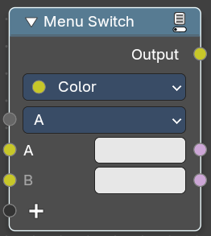

The Menu Switch node selects and computes one input based on a user-defined menu. Only the selected input is computed.

Menu entries can be added, removed, renamed, and reordered. Renaming keeps existing input links.

The menu can be used in node groups and the nodes modifier UI. Connecting the menu to a Group Input node exposes it as a group input. A menu needs to be connected to a Menu Switch node to work. An unconnected menu is empty.

Connecting multiple Menu Switch nodes to the same output creates a conflict. To avoid this, a menu switch can be grouped. Multiple groups of the same type can connect to the same menu.

> **Note:** You cannot plug in the same value socket into the Menu selector. If you’d like to use the same value for various Menu Switches, group the Menu Switch into a Node Group and use the top-level switch override.

Top level grouped Menu Switches with the same inputs work:

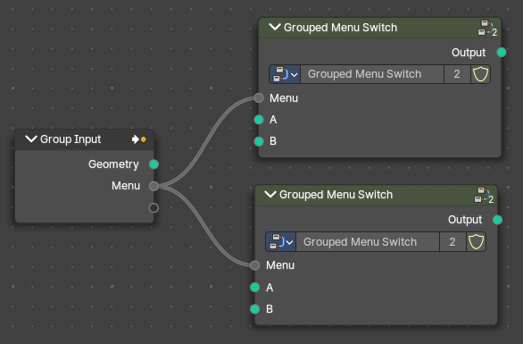

Same level Menu Switches with the same input cause a conflict:

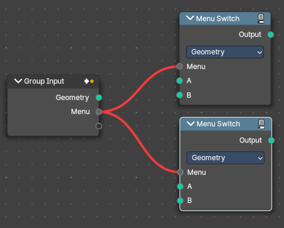

#### Inputs

##### Menu

Data type: Menu.

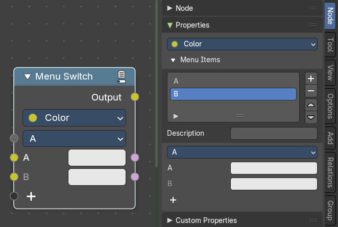

Determines which of the input options will be selected and passed through as the default.

##### A , B ...

Data type: follows the Data Type setting.

The values to switch between, one for each menu item. An item becomes the output value if it is chosen by the menu input. You can define more input sockets in the sidebar Menu Switch panel.

> **Note:** You can add more menu switch options to the empty socket.

#### Properties

##### Data Type

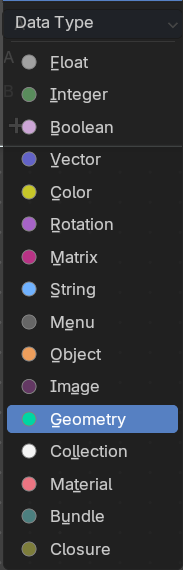

Determines the type of the data that is handled by the node.

#### Outputs

##### Output

Data type: follows the Data Type setting.

The value of the chosen item.

##### A , B ...

Data type: Boolean.

One output for each menu item, next to its input. It is true if this item is chosen by the menu input.

### Switch

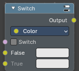

Switch between two values with a checkbox. Only the chosen value is computed.

#### Inputs

##### Switch

Data type: Boolean.

The checkbox. Off passes the False value through, on passes the True value through.

##### False

Data type: Color.

The value used when Switch is off.

##### True

Data type: Color.

The value used when Switch is on.

#### Properties

##### Input Type

The type of the two values and of the output. In the Shader Editor you can choose Float, Integer, Boolean, Vector, Color, String, Menu, Shader, Bundle or Closure. The default is Color.

#### Outputs

##### Output

Data type: Color.

The True or False value, depending on Switch.

# Math

## Add menu - Utilities - Math

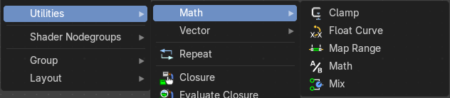

This menu contains nodes that deals with Math data.

### Clamp

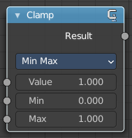

The Clamp node clamps a value between a minimum and a maximum.

#### Inputs

##### Value

Data type: Float.

The input value to be clamped.

##### Min

Data type: Float.

The minimum value.

##### Max

Data type: Float.

The maximum value.

#### Properties

##### Clamp Type

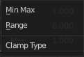

###### Min Max

Clamp values using Min and Max values.

###### Range

Clamp values between Min and Max range.

#### Outputs

##### Result

Data type: Float.

The input value after clamping.

### Float Curve

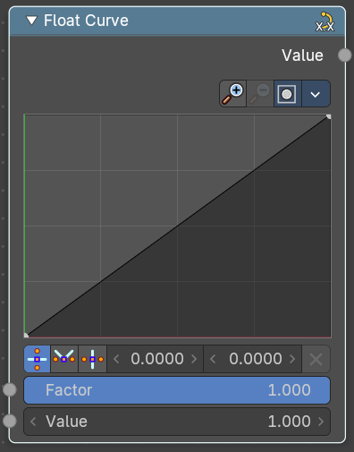

Generates a curve. This curve can then be used for profiles for example.

#### Inputs

##### Factor

Data type: Float (factor).

The input factor.

##### Value

Data type: Float.

The input value.

#### Properties

##### Curve Widget

##### Navigation elements

The navigation elements at the top are described from left to right.

###### Zoom in and out

The two buttons with the magnifying glass at it zooms in and out in the curve window.

###### Clipping

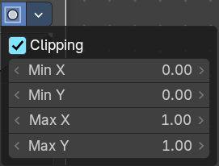

Clipping options.

###### Tools

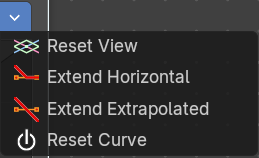

Tools is a menu where you can find some curve related tools.

###### Reset View

Resets the curve windows zoom.

###### Extend Horizontal

Extends the curve before the last point and after the last point horizontally.

###### Extend Extrapolation

Extends the curve before the last point and after the last point extrapolated.

###### Reset Curve

Resets the curve to the initial shape.

###### Vector Handle

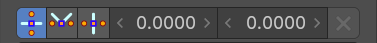

Set handle type to Vector.

###### Auto Handle

Set handle type to Auto.

###### Auto Clamped Handle

Set handle type to Auto Clamped.

###### X / Y

The x and y position of the currently selected curve point.

###### Delete Points

Delete the currently selected curve point.

#### Outputs

##### Value

Data type: Float.

The value after mapping it through the curve.

### Map Range

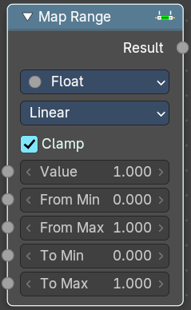

The Map Range node remaps a value from a range to a target range.

#### Inputs

##### Value

Data type: Float.

The input value to be remapped. Only with the Float data type.

##### Vector

Data type: Vector.

The input vector to be remapped. Only with the Vector data type.

##### From Min

Data type: follows the Data Type setting.

The lower bound of the range to remap from.

##### From Max

Data type: follows the Data Type setting.

The higher bound of the range to remap from.

##### To Min

Data type: follows the Data Type setting.

The lower bound of the target range.

##### To Max

Data type: follows the Data Type setting.

The higher bound of the target range.

##### Steps

Data type: follows the Data Type setting.

The number of steps. Only with the Stepped Linear interpolation type.

#### Properties

##### Data Type

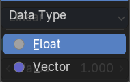

The data type to calculate.

##### Interpolation Type

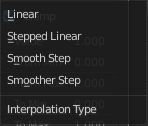

###### Linear

Linear interpolation between From Min and From Max values.

###### Stepped Linear

Stepped linear interpolation between From Min and From Max values.

###### Smooth Step

Smooth Hermite edge interpolation between From Min and From Max values.

###### Smoother Step

Smoother Hermite edge interpolation between From Min and From Max values.

##### Clamp

If enabled, the output is clamped to the target range.

#### Outputs

##### Result

Data type: Float.

The input value after remapping. Only with the Float data type.

##### Vector

Data type: Vector.

The input vector after remapping. Only with the Vector data type.

### Math

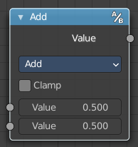

The Math Node performs math operations.

#### Inputs

##### Value

Data type: Float.

First numerical value. The trigonometric functions accept values in radians.

##### Value

Data type: Float.

Second numerical value. This value is not used in functions that accept only one parameter like the trigonometric functions, Round and Absolute.

##### Value

Data type: Float.

Third numerical value. Only for the operations that need three values: Multiply Add, Compare, Smooth Minimum, Smooth Maximum and Wrap.

#### Properties

##### Operation

Here you can choose what mathematical operation to perform.

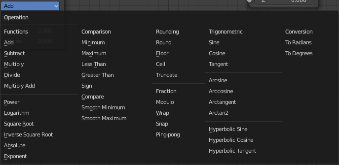

##### Clamp

Limits the output to the range (0 to 1). See clamp.

#### Outputs

##### Value

Data type: Float.

Numerical value output.

### Mix

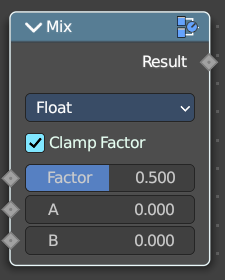

Allows to mix values and vectors in various ways. The node has three different modes. Float, Vector and Color

#### Inputs

##### Factor

Data type: Float (factor).

The mix factor. In Vector mode with the Factor Mode set to Non-Uniform, this is a Vector with one factor per axis.

##### A

Data type: follows the Data Type setting.

The first value to mix.

##### B

Data type: follows the Data Type setting.

The second value to mix.

#### Properties

##### Data Type

The mode in which the node works: Float, Vector or Color. It sets the data type of the A, B and Result sockets.

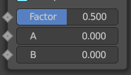

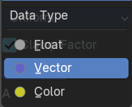

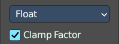

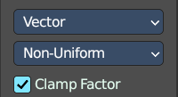

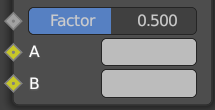

##### Factor Mode

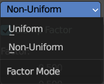

Only in Vector mode. Uniform uses one factor for all axes. Non-Uniform uses a vector factor, with one factor per axis.

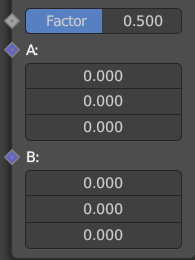

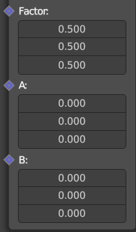

##### Blending Mode

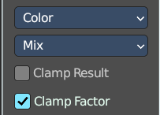

Only in Color mode. What blending mode to use for the color.

##### Clamp Result

Only in Color mode. Clamp the result to 0-1 range.

##### Clamp Factor

Clamp the factor to 0-1 range.

#### Outputs

##### Result

Data type: follows the Data Type setting.

The output value, vector or color.

# Vector

## Add menu - Utilities - Vector

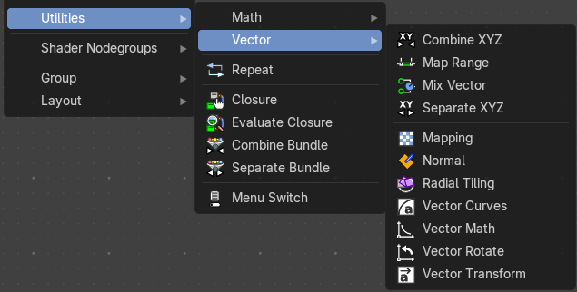

This menu contains nodes that deals with vector data.

### Combine XYZ

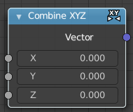

Same as with Combine RGB node. It combines color values. But instead combining rgb values, which are in the range of 0 to 255, it uses values in the range from 0 to 1.

#### Inputs

##### X

Data type: Float.

The X value.

##### Y

Data type: Float.

The Y value.

##### Z

Data type: Float.

The Z value.

#### Outputs

##### Vector

Data type: Vector.

The vector made from the X, Y and Z values.

### Map Range

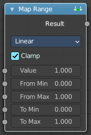

The Map Range node remaps a value from a range to a target range.

#### Inputs

##### Value

Data type: Float.

The input value to be remapped. Only with the Float data type.

##### Vector

Data type: Vector.

The input vector to be remapped. Only with the Vector data type.

##### From Min

Data type: follows the Data Type setting.

The lower bound of the range to remap from.

##### From Max

Data type: follows the Data Type setting.

The higher bound of the range to remap from.

##### To Min

Data type: follows the Data Type setting.

The lower bound of the target range.

##### To Max

Data type: follows the Data Type setting.

The higher bound of the target range.

##### Steps

Data type: follows the Data Type setting.

The number of steps. Only with the Stepped Linear interpolation type.

#### Properties

##### Interpolation Type

###### Linear

Linear interpolation between From Min and From Max values.

###### Stepped Linear

Stepped linear interpolation between From Min and From Max values.

###### Smooth Step

Smooth Hermite edge interpolation between From Min and From Max values.

###### Smoother Step

Smoother Hermite edge interpolation between From Min and From Max values.

##### Clamp

If enabled, the output is clamped to the target range.

#### Outputs

##### Result

Data type: Float.

The input value after remapping. Only with the Float data type.

##### Vector

Data type: Vector.

The input vector after remapping. Only with the Vector data type.

### Mix Vector

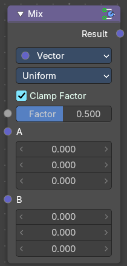

A mix node with vector preselected.

#### Inputs

##### Factor

Data type: Float (factor).

The mix factor. In Vector mode with the Factor Mode set to Non-Uniform, this is a Vector with one factor per axis.

##### A

Data type: follows the Data Type setting.

The first value to mix.

##### B

Data type: follows the Data Type setting.

The second value to mix.

#### Properties

##### Data Type

The mode in which the node works: Float, Vector or Color. It sets the data type of the A, B and Result sockets.

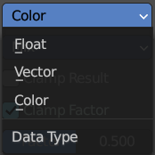

##### Factor Mode

Only in Vector mode. Uniform uses one factor for all axes. Non-Uniform uses a vector factor, with one factor per axis.

##### Blending Mode

Only in Color mode. What blending mode to use for the color.

##### Clamp Result

Only in Color mode. Clamp the result to 0-1 range.

##### Clamp Factor

Clamp the factor to 0-1 range.

#### Outputs

##### Result

Data type: follows the Data Type setting.

The output value, vector or color.

### Separate XYZ

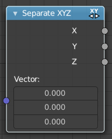

Same as with Separate RGB node. It separates color values. But instead separating rgb values, which are in the range of 0 to 255, it uses a vector with the values in the range from 0 to 1.

#### Inputs

##### Vector

Data type: Vector.

The Input vector.

#### Outputs

##### X

Data type: Float.

The X value of the vector.

##### Y

Data type: Float.

The Y value of the vector.

##### Z

Data type: Float.

The Z value of the vector.

### Mapping

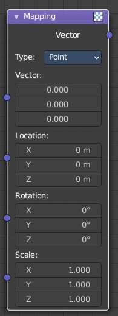

The Mapping node transforms the input vector by applying translation, rotation, and scaling.

#### Inputs

The inputs of the node are dynamic. In particular, the Location input is only available in the Texture and Point vector types.

##### Vector

Data type: Vector.

The vector to be transformed.

##### Location

Data type: Vector (translation).

The amount of translation along each axis. Only with the Point and Texture vector types.

##### Rotation

Data type: Vector (euler).

The amount of rotation along each axis. XYZ order.

##### Scale

Data type: Vector (XYZ).

The amount of scaling along each axis.

#### Properties

##### Vector type

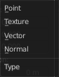

The node applies the transformation differently depending on the semantic type of the input vector.

###### Point

For this vector type, the node performs a straightforward transformation.

Transforming a texture coordinates is analogous to transforming a UV map. For instance, translating the texture coordinates along the positive X axis would result in the evaluated texture to move in the negative X axis, much like if one translated a UV map. Similarly, scaling the texture coordinates up would result in the evaluated texture to scale down. So transforming the texture coordinates would appear to have the opposite effect on the evaluated texture.

The order of transformation is: Scale –&gt; Rotate –&gt; Translate, which means:

Translation moves the input along the local rotation axis.

Rotation rotates the input around the origin of the space.

Scaling scales the input along the global axis.

###### Texture

For this vector type, the node performs an inverse transformation.

Inverse transforming a texture coordinates would, as opposed to the Point type, transform the evaluated texture itself. For instance, translating the texture coordinates along the positive X axis would result in the evaluated texture to move in the positive X axis, as one would expected. Similarly, scaling the texture coordinates up would result in the evaluated texture to scale up, as one would expect.

The order of transformation is: Translate –&gt; Rotate –&gt; Scale, which means:

Translation moves the input along the global axis.

Rotation rotates the input around the translation vector.

Scaling scales the input along the local rotation axis.

###### Vector

For this vector type, a Point transformation is performed, but with zero translation.

###### Normal

For this vector type, the node performs the inverse transpose of the transformation and normalize the result. Such transformation ensures correct normals after non-uniform scaling. So this type should be used when transforming normals.

#### Outputs

##### Vector

Data type: Vector.

The input vector after transformation.

### Normal

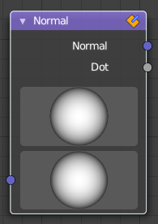

The Normal node generates a normal vector and a dot product.

#### Inputs

##### Normal

Data type: Vector (direction).

Normal vector input.

#### Properties

##### Normal Direction

To manually set a fixed normal direction vector. LMB click and drag on the sphere to set the direction of the normal. Holding Ctrl while dragging snaps to 45 degree rotation increments.

#### Outputs

##### Normal

Data type: Vector (direction).

Normal vector output.

##### Dot

Data type: Float.

Dot product output. The dot product is a scalar value. If two normals are pointing in the same direction the dot product is 1. If they are perpendicular the dot product is zero (0). If they are anti parallel (facing directly away from each other) the dot product is -1.

### Radial Tiling

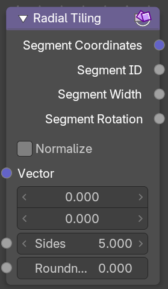

#### Inputs

##### Vector

Data type: Vector (2d).

Input vector.

##### Sides

Data type: Float.

Number of angular elements for tiling.

##### Roundness

Data type: Float (factor).

Roundness of the segment coordinate system.

#### Properties

##### Normalize

Normalize the output to a 0/1 range.

#### Outputs

##### Segment Coordinates

Data type: Vector.

Segment coordinates for texture mapping.

##### Segment ID

Data type: Float.

Unique ID for every segment.

##### Segment Width

Data type: Float.

The width of each segment.

##### Segment Rotation

Data type: Float.

The rotation of each segment.

### Vector Curves

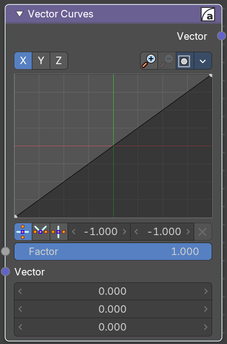

The Vector Curves node maps an input vector components to a curve.

#### Inputs

In the shader context the node also has an additional Factor input.

##### Factor

Data type: Float (factor).

Controls the amount of influence the node exerts on the output vector.

##### Vector

Data type: Vector.

Standard vector input.

#### Properties

##### Channel buttons

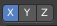

X, Y, Z. Clicking on one of the channels displays the curve for each.

##### Curve edit field

Create and tweak a Bezier curve that varies the input levels (X axis) to produce an output level (Y axis).

##### Selecting Points

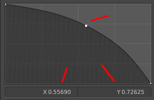

You can select curve points. This reveals two edit boxes for the x and y coordinate of this point.

Selected points can be moved around. Left click at them, hold the mouse button down and move them to a new location.

##### Adding Points

> This setting uses the **curve widget**: click to add points, drag to move them. See **[Curve Widget](../../../../interface/properties.md#curve-widget)** in the Interface chapter.

##### Navigation elements

The navigation elements at the top are described from left to right.

###### Zoom in and out

The two buttons with the magnifying glass at it zooms in and out in the curve window.

###### Clipping

Clipping options.

##### Tools

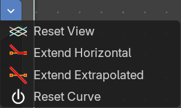

Tools is a menu where you can find some curve related tools.

###### Reset View

Resets the curve windows zoom.

###### Vector Handle

Set handle type to Vector.

###### Auto Handle

Set handle type to Auto.

###### Auto Clamped Handle

Set handle type to Auto Clamped.

###### X / Y

The x and y position of the currently selected curve point.

###### Delete Points

Delete the currently selected curve point.

#### Outputs

##### Vector

Data type: Vector.

Standard vector output.

### Vector Math

The Vector Math node performs the selected math operation on the input vectors.

#### Inputs

The inputs of the node are dynamic. Some inputs are only available in certain operations. For instance, the Scale input is only available in the Scale and Refract operations.

##### Vector

Data type: Vector.

Input vector A.

##### Vector

Data type: Vector.

Input vector B. Not used by operations that need only one vector, such as Length or Normalize.

##### Vector

Data type: Vector.

Input vector C. Only for the Multiply Add, Faceforward and Wrap operations.

##### Scale

Data type: Float.

Input Scale. Only for the Scale and Refract operations.

#### Properties

##### Operation

The vector math operator to be applied on the input vectors.

#### Outputs

The output of the node is dynamic. It is either a vector or a scalar depending on the operator. For instance, the Length operator have a scalar output while the Add operator have a vector output.

##### Vector

Data type: Vector.

Output vector. For all operations that give a vector.

##### Value

Data type: Float.

Output value. Only for the Dot Product, Distance and Length operations.

### Vector Rotate

This node provides the ability to rotate a vector around a center point using either Axis Angle, Single Axis or Euler methods.

#### Inputs

##### Vector

Data type: Vector.

The input vector.

##### Center

Data type: Vector.

The center for the rotation.

##### Axis

Data type: Vector.

The axis to rotate around. Only with the Axis Angle type.

##### Angle

Data type: Float (angle).

The rotation angle. Not with the Euler type.

##### Rotation

Data type: Vector (euler).

The rotation angles around the X, Y and Z axes. Only with the Euler type.

#### Properties

##### Type

The rotation type.

##### Invert

Invert the angle

#### Outputs

##### Vector

Data type: Vector.

The output vector

### Vector Transform

The Vector Transform node allows converting a vector, point, or normal between world and camera and object coordinate space.

#### Inputs

##### Vector

Data type: Vector.

Standard vector input.

#### Properties

##### Type

Specifies the input/output type.

Vector, Point, Normal.

##### Convert From

Coordinate Space to convert from World, Object or Camera.

##### Convert To

Coordinate Space to convert to World, Object or Camera.

#### Outputs

##### Vector

Data type: Vector.

The transformed output vector.
