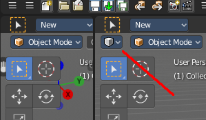
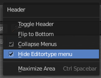
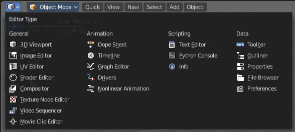
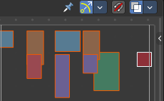
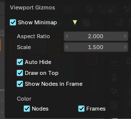

An **editor** is what an area shows: the 3D Viewport, the Outliner, the Properties editor, a node editor and so on. Any area can show any editor, and you can change it at any time. Every editor is explained in its own chapter in the **Editors** section of this manual.

Most editors are built the same way: a **header** with menus and tools at the top, an optional **footer**, a **tool shelf** on the left, a **sidebar** on the right, and the main region in the middle. Learn these once and every editor reads the same.

## Change Editor Type

There is a Editor Type menu in every header. This menu is usually hidden in the default layouts. It can be revealed by either splitting the editor window. Or in the right click menu in the header. Hide editortype menu. See next point.

When you click at this button then a menu with all available editor types opens up. And you can change the current editor to another editor type.

## Show / Hide the editor type menu

You might have noticed that the editor type menu is not available in the editors of the standard layouts. This is to reduce visual noise and to free some UI space.

You can show and hide this editor type menu. To do so right click at an empty space somewhere at the menu bar of an editor. You will see a menu now. Check or uncheck the menu item Hide Editortype Menu to show or hide the Editor Type menu.

## Node Editor Minimap

All node editors (Shader, Geometry Nodes, Compositor and Texture) can show a **minimap**: a small map of the whole node tree in a corner of the editor. Every node is a small box, and the frame shows the part of the tree that you see right now. It helps you find your way in big node trees.

- **Drag** in the minimap to move the view.
- **Scroll** over it to zoom in and out.
- **Click** a spot to jump the view there.

You turn it on in the header, in the **Viewport Gizmos** popover.

### Minimap settings

#### Show Minimap

Shows or hides the minimap.

#### Aspect Ratio

The shape of the minimap. Higher values make it wider.

#### Scale

The size of the minimap.

#### Auto Hide

Hides the minimap when you are zoomed out so far that the whole tree is visible anyway.

#### Draw on Top

Places the minimap at the top right. Off: at the bottom right.

#### Show Nodes in Frame

Also shows the nodes that are inside frames.

#### Color

Shows the **Nodes** in their category colors and the **Frames** in their custom colors. Off: everything is grey.
