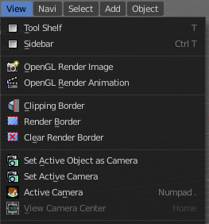
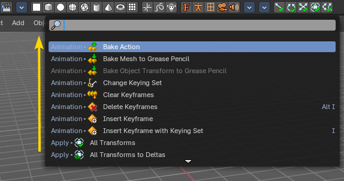
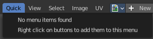
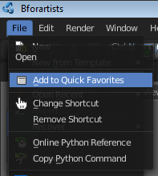
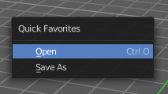
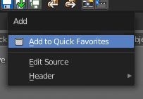
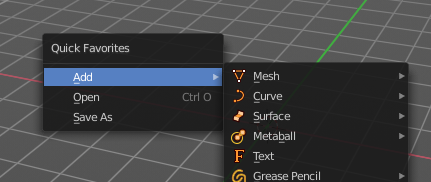
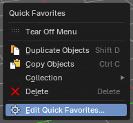
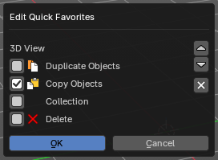
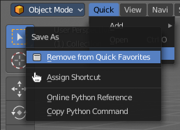

A **floating menu** opens on top of the editor: the text menus in the headers, the menus that hotkeys call (such as **Add** with Shift A), and the search menu (F3). They close as soon as you choose an item, move away, or press Esc.

> **Tip:** Want a menu to stay open? Click the **Tear Off Menu** row at its top. See [Tear-Off Menus and Panels](tear-off-menus-and-panels.md).

## Menu

In the header you may find text menus. A text menu contains usually buttons. But it can also contain toggles. Or other menus.

### Menu Search

You can search any header menu while it is open with the search menu operator by pressing Space. This will allow filtering the menu contents without navigating into the sub-menus.

## Menu shortcuts

- Arrow keys can be used to navigate into a menu
- Each menu item has an underlined character which can be pressed to activate it.
- Number keys or numpad can be used to access menu items. (Where *1* is the first menu item, *2* the second... etc. For larger menus *Alt-1* the 11th... up to *Alt-0* the 20th)
- Press **Enter** to activate the selected menu item.
- Press **Esc** to cancel the menu.

## Search menu

Press **F3** to search all operators and menus by name, then press Enter to run the one you want. The search also shows the menu path and the hotkey of each item, so it is a good way to learn where things are.

## Quick Favorites

The quick menu, or in long Quick Favorites menu, is a menu that can be customized to your needs. Here you can add operators for quick access.

It is located in the header. But it can be called by hotkey Q directly under the mouse. This hotkey works in other editors too.

When the menu is empty, then you will see the message "No Menu Items found". This means that you first have to add some tools to the menu. It is a user configurable menu.

Entries you add keep their icons, so the menu looks like the menus they came from.

Note also that the Quick menu for the UV editor shares the content with the Quick menu from the Image editor.

### Adding an operator to the Quick menu

Open the panel or the menu where your operator is that you want to add.

Let's add the open command from the File menu. Open the File menu, right click at open, and choose Add to Quick Favorites.

Do the same with Save As. We should now have two new menu items in the Quick menu, which you can use now.

As a rule of thumb, when the right click menu has an Add to Quick Favorites, then you can add it to the quick menu.

Note that you can also add operators from the tool shelf at the left. And also operators from other editor types. Some other editors have their own quick menu though. The Image Editor for example. These operators gets added in the quick menu of the image editor then. And does not show in the quick menu in the header of the 3D view.

### Adding a menu to the Quick menu

It is also possible to add a menu to the Quick menu. For example the whole Add menu. The way is the same. Right click at it, and choose Add to Quick Favorites.

### Order

Each new entry goes to the bottom of the menu, so the entries are in the order in which you added them. Menus and operators mix freely. You can change the order afterwards in the Quick Favorites editor.

### Edit Quick Favorites

When the menu has entries, its last entry is **Edit Quick Favorites...**. It opens a small editor with your entries, grouped by the editor they belong to and shown with their icons. It lists the entries of the editor and mode you opened it from.

Your changes apply right away. **OK** and **Cancel** both just close the editor.

#### Select an entry

Click the checkbox in front of an entry to select it. Only one entry is selected at a time. The buttons at the right work on the selected entry.

#### Move up and Move down

The arrow buttons move the selected entry one step up or down in the menu. This is how you sort the menu after you've added things. The up arrow is hidden for the first entry, and the down arrow for the last one.

#### Remove

The **X** button removes the selected entry from Quick Favorites.

### Removing an operator from the Quick menu

Removing is as simple as adding. Right click at the operators in the Quick menu, and choose Remove from Quick favorites.

### Context and mode dependent content

The quick favorites. menu exists in nearly all editors. But it is just in the 3D view available in the header. So that you know this functionality exists. In the other editors you call it with hotkey Q.

The content of the quick favorites. menu changes, dependent over which editor you are, and in what mode you are. When you add for example an operator from the image editor, then this operator just shows in the quick menu when you call the menu from the image editor. Same goes for the modes. Edit mode tools will just show in edit mode. And so on.
