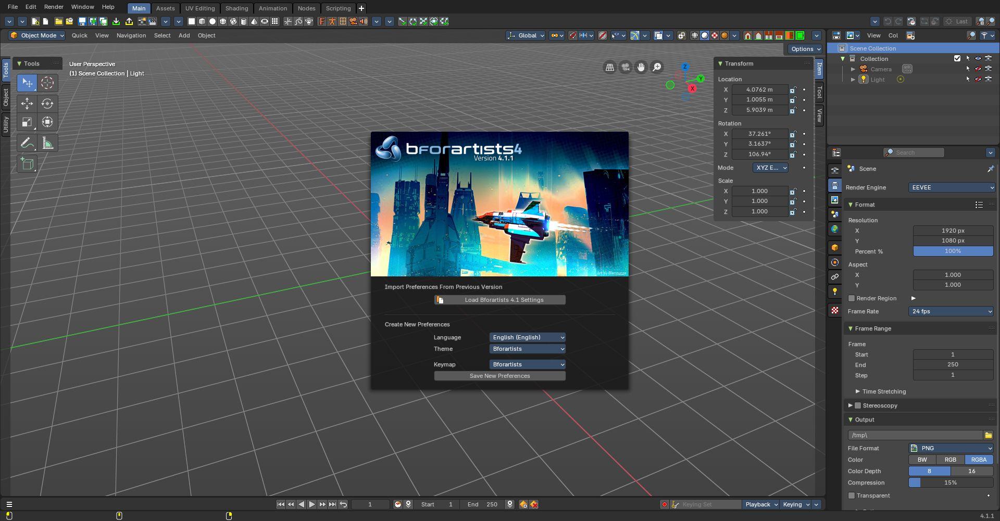
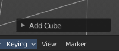
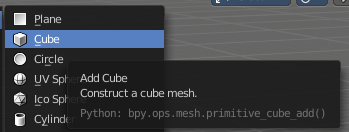
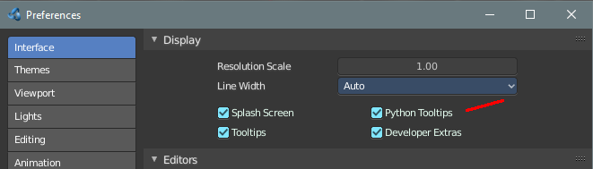
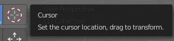
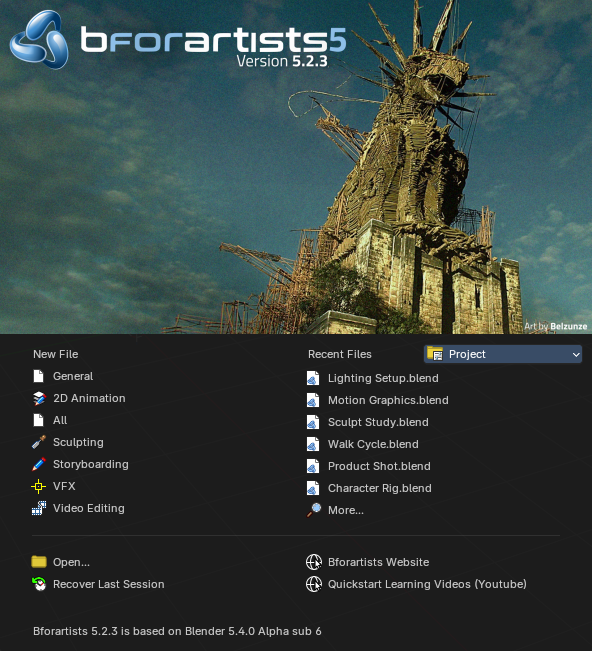
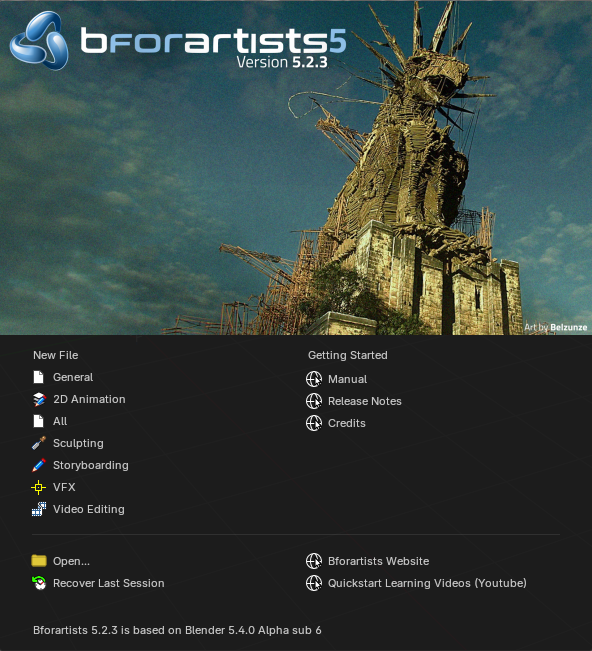

## Interface

### User Interface Principles

The UI is made of several different workspaces. Each workspace is made of several editors for the different purposes. And this editors are made of several sub elements. Like a Header or a tool shelf, or a sidebar. UI elements are organized in tabs, menus and panels.

The idea is to have a non overlapping and blocking UI with a non modal tool set. Which is just partially to achieve. See header below. And by the fact that you work in modes ...

As a consequence of the non overlapping UI concept, the interface avoids to work with popup panels where possible. You can adjust the tool after you use it, in the so called last operation panel. It can be found in the 3D view for example, down left.

## Tooltips

When you hover with the mouse over an UI element, like a button, then you can see a tooltip.

A tooltip can contain the tool name, a short description of the tool, the hotkey, and a Python tooltip.

The Python tool tip shows you the name of the operator. It is of interest for programming needs. It can be turned off in the User Preferences.

The tool tips in the Tool Shelf acts a bit different than the tool tips in the rest of the UI. It will not show you the Python tool tips, since it is a gigantic hack on top of the existing UI.

## Splash Screen

The splash screen shows at startup. The splash screen will vanish when you click with the mouse. You can also turn its showing at startup completely off in the User Preferences.

At the very first start you can do a quick setup, and choose with what language and key map and what theme you want to work. Clicking at the Save new Preferences button will then make this change permanent.

When you don't have any recent files, then the splash screen shows a Getting Started section with some links to useful resources.

And when you have recent files, then the splash screen lists them instead of the Getting Started section.

The splash screen is a bit larger than in older versions, so it has room for more entries:

- **New File**: lists the General startup file and the app templates. Templates that don't fit move into a **More** menu at the bottom of the list.
- **Recent Files**: lists your last six files. **More...** below them opens a search over all your recent files.
- **Project**: the drop-down next to the Recent Files title. It lists your recent projects, and lets you create a new project or open one. When a project is active, the list shows the files of that project first. The drop-down sits in the recent files column, so it never covers the splash picture.

The first picture shows the splash screen with recent files, the second one at a first start without recent files.

When a project with its own splash artwork is open, the splash screen shows that artwork instead. See **Splash Screen panel** on the [Project Settings](../editors/project-settings.md) page.

In the splash screen you can also read at what Blender version the current Bforartists version is based at.

