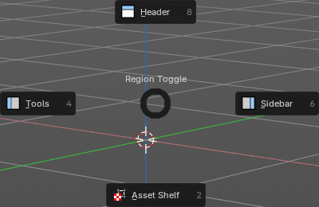

A **pie menu** opens around the mouse pointer, with its items arranged in a circle. You choose an item by moving the mouse in its direction, which quickly becomes muscle memory.

## Using a pie menu

- **Press and release** the hotkey: the pie stays open; click an item.
- **Press and hold** the hotkey: move toward an item and release the key to choose it.
- Press the **number keys** shown on the items, or press **Esc** or right-click to cancel.

## Pie menus in Bforartists

Pie menus are called by hotkeys, for example the view pie (the ` key, tilde on some keyboards) and the pivot and snapping pies in the 3D Viewport. The keymap chapters list the hotkeys. You can add more pie menus with extensions.

### Region Toggle pie

Press **T** over an editor to open the **Region Toggle** pie. It shows or hides the regions of that editor: the Tools (tool shelf), the Sidebar, the Header, the Asset Shelf, and in some editors the Footer or the Channels. Each region sits on the side of the pie where it is in the editor, so the Tools are on the left and the Sidebar is on the right.

Use it to make room in a small editor, or to bring back a region you have hidden. It works the same in every editor, and with the Bforartists keymap on Windows, Linux and macOS.
