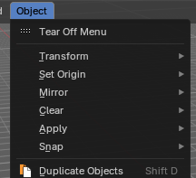
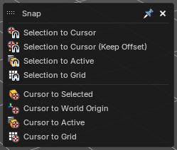
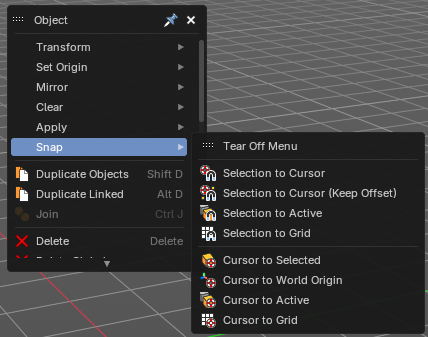
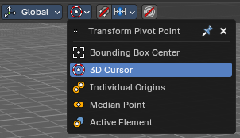
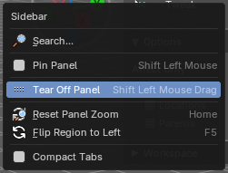
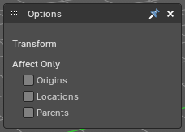
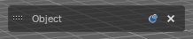
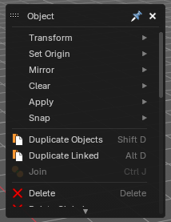
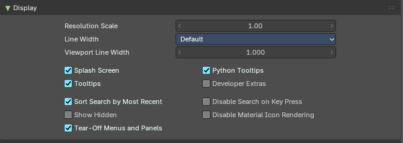

A **tear-off** is a menu, dropdown or panel that you pull out of its place so it stays open, floating over the editor. Normal menus close as soon as you pick an item. A tear-off stays, so the tools you use again and again are always one click away, without a hotkey, a deep menu or a full Quick Favorites menu.

You can tear off almost anything: header menus and their submenus, popovers, dropdowns and the panels of the sidebars, the tool shelf and the Properties editor. Tear-offs are a Bforartists feature.

> **Tip:** You can turn tear-offs off completely in the Preferences. See **Turn tear-offs off** at the end of this page.

## Tear off a menu

Every menu starts with a **Tear Off Menu** row, above its first entry.

- **Click** the row: the menu turns into a tear-off right where it is.
- **Drag** the row: you carry the new tear-off away with the mouse, and it lands where you let go.

A torn-off menu works like the menu it came from: click an entry to run it. It just doesn't close afterwards. Its title bar holds the name of the menu, a grip to move it, a pin and an **X** to close it.

### Submenus

Submenus open from a tear-off as usual, and they have their own **Tear Off Menu** row too. So you can tear off a whole menu, or only the one submenu that you need.

### Dropdowns and popovers

Dropdowns of a setting, such as the Transform Pivot Point in the 3D View header, also have a **Tear Off Menu** row. A torn-off dropdown stays live: it always shows the current value, and when you pick a value in it, the header shows the new one too. In the picture, 3D Cursor was picked in the tear-off, and the header button changed with it.

Popovers, such as the Viewport Gizmos and Viewport Overlays popovers of the 3D View header, start with a **Tear Off Panel** row instead. It works the same way: click it, or drag it away.

## Tear off a panel

Panels have no Tear Off row. Tear them off in one of two ways:

- **Shift+drag** the panel header out of its place.
- **Right-click** the panel header and choose **Tear Off Panel**.

Shift+click on the header still pins the panel, as before. See **Pinning panels** on the [Tabs & Panels](tabs-and-panels.md) page.

A torn-off panel shows the same settings as the original panel, and both stay in sync. Panels of the tool shelf keep their width and their number of columns when you tear them off.

> **Note:** Panels that belong to one item of a stack, such as a modifier, a constraint or a scene effect, can't be torn off.

## Work with tear-offs

### Move

Drag the title bar, or the grip at its left, to move a tear-off. Tear-offs always stay inside the window, also when the window gets smaller.

### Collapse

Click the **pin** icon, or double-click the title, to collapse a tear-off to its title bar. Click again to open it. Only the bottom edge moves, so the pin and the X stay under the mouse.

A collapsed tear-off fades to 60% when you don't use it, and comes back fully when the mouse moves over it. That way it stays out of the way of your work.

### Close

Click the **X** in the title bar.

### Size

Tear-offs fit their content when they appear:

- **Menus** are as wide as their widest row.
- **Panels** can be made wider or narrower: drag their **right edge**. Double-click the edge to go back to the original width.

Both menus and panels can be **cropped from the bottom edge**: drag the bottom edge up, and the tear-off shows only its top part, with a scroll bar for the rest. So a long menu can show just the entries you use.

### Stack them like windows

When tear-offs overlap, the one you clicked last is on top, as with windows. Any mouse button on any part of it brings it forward. It doesn't jump to the front: it fades in through the one that covered it in a short moment, and only the part that was covered changes.

## Where tear-offs show

A tear-off belongs to the **workspace**, the **editor** and the **mode** where you made it. Switch to another workspace, change the editor or leave the mode, and it hides. Come back, and it shows again where you left it. So a tear-off from Edit Mode doesn't get in your way in Object Mode, and a tear-off of the 3D View doesn't float over the Shader Editor.

## Saved with the file

Tear-offs are saved with their workspace, in the .blend file and in the startup file, with their position, size and collapsed state.

- With **Load UI** on (the default), opening a file gives you the tear-offs of that file.
- With **Load UI** off, you keep the tear-offs of your current workspaces.
- Auto Save and **Recover Last Session** keep the tear-offs too.

The tear-offs are stored in a way that Blender doesn't read, so a file with tear-offs still opens in Blender.

> **Tip:** Set up the tear-offs that you always want, then save the startup file with **Edit > Save Startup File**. Every new file then starts with them.

## Turn tear-offs off

**Preferences > Interface > Display > Tear-Off Menus and Panels** switches the feature on and off. It is on by default.

When it is off, menus have no Tear Off row and panels no Tear Off Panel entry, and menus behave as in Blender. Open tear-offs close, and come back when you turn the option on again.
