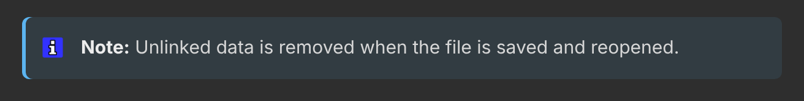
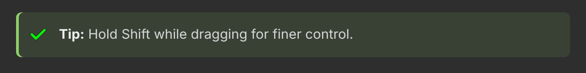
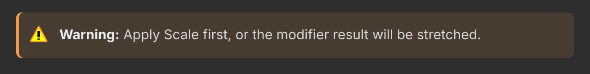
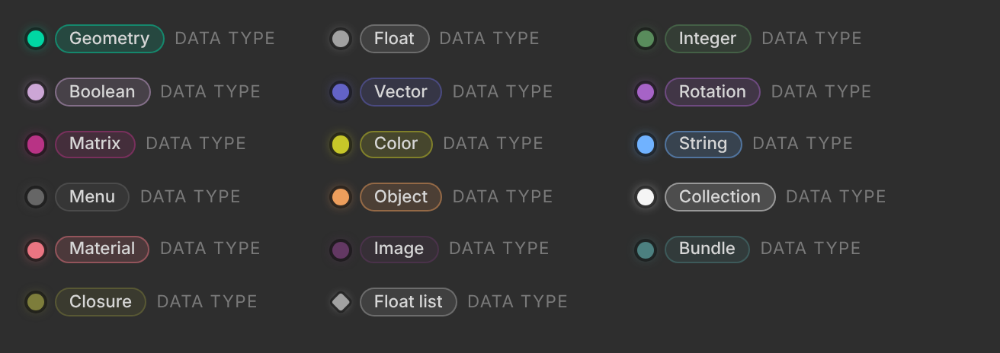
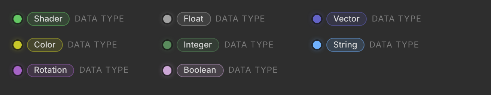
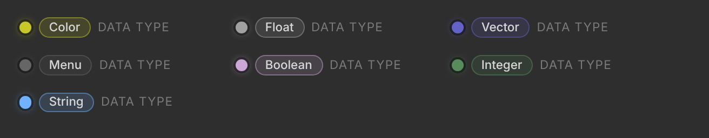

# 🏷️ Callouts and data types

> **A quick lookup for the two small labels you use most: the coloured callout boxes, and the data type line under every node socket.**

Both are plain text in the page. The website turns them into the coloured boxes and chips you see here.

---

## 💬 Callouts at a glance

| Write | Box | Use it for | Ask yourself |
|---|---|---|---|
| `> **Note:** …` | 🔵 Blue, ℹ️ | Extra background or context | *Is this good to know, but nothing goes wrong if they skip it?* |
| `> **Tip:** …` | 🟢 Green, ✔️ | A faster way, a shortcut, a **hotkey** | *Does this save them time or clicks?* |
| `> **Warning:** …` | 🟠 Orange, ⚠️ | Something can go wrong: lost work, a surprising result | *Could they lose work or get a result they didn't expect?* |
| `> **Important:** …` | 🟣 Purple, ⚠️ | A rule or limit they **must** know first | *Will the feature fail or affect other things if they don't know this?* |

🔁 **Other words work too:** `Hint` becomes a Tip; `Caution` and `Attention` become a Warning. Any other word stays a plain quote.

### 🔵 Note: good to know



Background, an explanation of *why*, or a link to a related concept. The reader can skip it and still succeed.

```
> **Note:** Unlinked data is removed when the file is saved and reopened.
```

### 🟢 Tip: a better way



A shortcut, a quicker workflow, or a trick. **Hotkeys go here** (or in a link to the keymap), never in the normal text.

```
> **Tip:** Hold Shift while dragging for finer control.
```

### 🟠 Warning: careful



Something that can go wrong: data loss, a step that can't be undone, a result that looks broken. Say what to do instead.

```
> **Warning:** Apply Scale first, or the modifier result will be stretched.
```

### 🟣 Important: know this first


A requirement or a limit: the feature only works in one mode, needs an add-on, or changes data elsewhere in the file. Use it rarely, so it keeps its weight.

```
> **Important:** This setting changes every material that uses this node group.
```

### ✍️ How to add one

- **In Markdown:** a quote line that starts with the label, as in the examples above. The bold and the colon are optional: `> Tip: …` works too.
- **In Pages CMS:** type `/`, pick **Quote**, then start the line with `Tip:`, `Note:`, `Warning:` or `Important:`.
- **One idea per callout,** one to three sentences. Put it right after the text it belongs to, not at the top of the page.
- **No headings, pictures or lists inside a callout.** If it needs those, it's a section, not a callout.
- **Don't stack callouts.** Two in a row usually means one of them belongs in the text.

---

## 🔌 Data types at a glance

Every input and output of a node says what kind of data it takes. On the website it shows as a dot in the socket's colour, the type name, then "DATA TYPE".

### ✍️ How to add one

Put one line right under the socket heading, before its explanation:

```
##### Inputs

###### Selection

Data type: Boolean.

Which points are moved.

###### Offset

Data type: Vector (translation).

How far each point moves.
```

| Rule | Example |
|---|---|
| The line starts with `Data type:` and ends with a full stop | `Data type: Float.` |
| Write the type as the socket tooltip names it | `Geometry`, `Integer`, `Rotation`, `Matrix` |
| An optional unit goes in brackets, lower case | `Float (factor)`, `Float (angle)` |
| A list socket: add `list`. It gets a diamond, not a dot | `Data type: Float list.` |
| A socket whose type is picked in the node | `Data type: follows the Data Type setting.` (grey) |

### 🔍 How to find the type

1. **Hover the socket** in Bforartists. The tooltip names the type.
2. **Look at the colour.** The dot on the website uses the same colour as the socket in the editor (see the pictures below).
3. **Look at the field** for the unit:

| The field shows | Write |
|---|---|
| A 0 to 1 slider, or % | `(factor)` |
| m, cm, mm | `(distance)` |
| ° | `(angle)` |
| X, Y, Z of a move | `(translation)` |
| s, frames | `(time)` |
| Hz | `(frequency)` |

Leave the unit out when you're not sure. `Data type: Float.` is always right for a number.

### 🟢 Geometry Nodes



The richest set. Most nodes pass **Geometry** in and out, and use **Float**, **Integer**, **Boolean** and **Vector** fields for the rest. **Rotation** and **Matrix** come with the transform nodes; **Object**, **Collection**, **Material** and **Image** pick data from the file; **Menu**, **Bundle** and **Closure** come with the newer menu, bundle and closure nodes.

### 🟢 Shader editor



Mostly **Float**, **Vector** and **Color**. **Shader** is the green socket that carries a surface or volume look (BSDFs, Emission, Mix Shader) into the Material Output.

### 🟡 Compositor



Images travel as **Color** sockets, masks and amounts as **Float**. **Menu** sockets hold a node's mode, for example the blur type.

---

## 🔗 See also

- [Plain writing](Plain-writing.md): every pattern the website understands
- [Formatting standard](Formatting-Standard.md): the node page skeleton (Inputs, Properties, Outputs)
