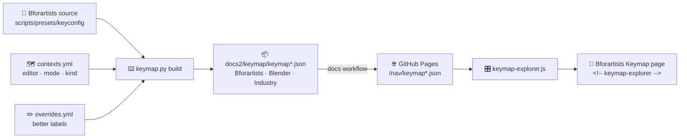

# ⌨️ Keymap

> **The interactive keymap shows the real Bforartists keys (and the Blender and Industry Compatible presets), built from the Bforartists source. Nobody types hotkeys any more: each week a robot checks the source and opens a pull request when keys change.**

---

## 🧩 How it fits together



1. **The base keymap** comes from `keymap_data/blender_default.py` in the Bforartists source. It is plain Python, so the tool runs it with the Bforartists keymap's default preferences (left-click select, Space plays, gizmos on drag).
2. **Bforartists' own changes** are in `Bforartists.py` (and `Bforartists-macOS.py`): plain data, read without running anything. Each keymap there replaces the base keymap of the same name, exactly as Bforartists does at start-up.
3. The result, about 2,500 keys for each of PC and macOS, goes to `docs2/keymap/keymap.json`.
4. **The other two presets** in Preferences › Keymap are built the same way: **Blender** (`blender_default.py` alone) into `keymap-blender.json`, **Industry Compatible** (`industry_compatible_data.py`) into `keymap-industry.json`. Their macOS versions use the source's own Ctrl → Cmd conversion (`scripts/modules/bl_keymap_utils/platform_helpers.py`). The explorer loads them only when a reader switches to them.

## 🗺️ contexts.yml: editor, mode and kind

The keymap's own names do not always say where they work ("Mesh" means Edit Mode of a mesh). `docs2/keymap/contexts.yml` says it once, for every keymap:

```yaml
keymaps:
  Mesh:   {editor: 3D Viewport, mode: Edit Mode · Mesh}
  Window: {editor: Everywhere, mode: Window}
patterns:
  - {match: "Tool: ", kind: tool}      # keys of one active tool: left out of the keyboard
```

`python3 docs2/tools/keymap.py check` lists any keymap that has no entry yet (a new Bforartists release can add some). Add a line and it passes.

## ✏️ overrides.yml: better labels

Labels come from the operator (`mesh.select_all` + action Deselect → "Select all: Deselect"). Where that reads badly, add a line to `docs2/keymap/overrides.yml`; the next build keeps it:

```yaml
ops:
  view3d.cursor3d: Place the 3D cursor
menus:
  VIEW3D_MT_pivot_pie: Pivot point
```

## 🔁 Commands

| Command | Does |
|---|---|
| `python3 docs2/tools/keymap.py build <bforartists checkout>` | Rebuilds the three keymap files (unchanged keys keep a file as it is) |
| `python3 docs2/tools/keymap.py check` | Every keymap has an editor and mode |
| `python3 docs2/tools/keymap.py diff old.json new.json` | Added, changed and removed keys, as a Markdown table |

## 🤖 The weekly update

The **Docs 2.0 keymap** workflow (`.github/workflows/docs2-keymap.yml`) runs every Monday and on demand (Actions → Docs 2.0 keymap → Run workflow). It fetches only the keymap files from the Bforartists source, rebuilds, and opens a pull request **"⌨️ Keymap update from the Bforartists source"** with the change table. Merge it, and the docs workflow publishes the new keymap files; the page updates on the next visit.

## 📄 Putting the explorer on a page

Write `<!-- keymap-explorer -->` where it should appear. To open on a given editor and mode:

```html
<!-- keymap-explorer editor="Image Editor" mode="UV Editing" -->
```

`mini="1"` lights up only the everyday keys (navigation, selection, the transform tools, modes, files, undo, render, search), as on **Important Hotkeys**. The list is `IMPORTANT` at the top of `keymap-explorer.js`.

## 🖱️ How readers use it

- The header holds the keymap (Bforartists, Blender, Industry Compatible), Windows / Linux or macOS, the editor and the mode (with their Bforartists icons), and **Find**, whose results open under the box.
- Pointing at a key only highlights it; a click or tap reads it out in the panel under the colours, every binding of that key side by side.
- On phones the same keyboard shows the key names only; the full list of keys folds open under it.

## 🔜 Next steps

- 🔗 **Operator index**: link each key to the chapter section that documents it (matched by name and menu path, with a short review list).
- 🆚 **Compare with Blender**: both keymaps are built now; next, mark every key that differs.
- 📂 **Your own keymap**: drop an exported keymap file onto the page and see your keys (read in the browser, nothing uploaded).
- 🖨️ **Cheat sheets**: one printable page per editor from `important-hotkeys.yml`.
