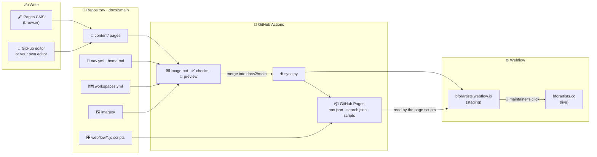

# 🧰 Maintainer guide

> **Every job a maintainer does, one page each, with the steps in order. Start here when something needs changing.**

---

## 🗺️ The whole system on one picture

**Three rules hold everything together**

| | Rule |
|---|---|
| 🐙 | **GitHub is the truth.** Never edit a docs page in the Webflow Designer or CMS; the next sync would skip it ([Troubleshooting](Troubleshooting.md#a-page-does-not-update)). |
| 🌿 | **Every change goes through a pull request into `docs2/main`.** The checks and the preview run on it; merging publishes staging. |
| 🚦 | **Live is a separate click.** Nothing the robots do ever publishes bforartists.co. |

---

## 🙋 "I want to…"

| I want to… | Who | Page |
|---|---|---|
| ✏️ Fix a typo, rewrite a section, add a screenshot | Anyone | [Editing the docs online](Editing-the-docs-online.md) |
| 📄 Add, move, rename or remove a page | Maintainer | [Structure and navigation](Structure-and-Navigation.md) |
| 🏠 Change the Docs home (popular links, teaser, workspace) | Maintainer | [Structure and navigation](Structure-and-Navigation.md#the-docs-home) |
| ✅ Mark pages as in review or reviewed | Reviewer | [Structure and navigation](Structure-and-Navigation.md#page-status) |
| 🗺️ Change a workspace map, re-shoot the workspaces | Maintainer | [Workspace maps](Workspace-Maps.md) |
| 🎛️ Change how the docs look or behave on the website | Maintainer | [Site scripts](Site-Scripts.md) |
| 🚀 Update the manual for a new Bforartists release | Maintainers | [Release update](Release-Update.md) |
| 🌐 Publish the docs on the live site | Lead maintainer | [Release update](Release-Update.md#publish-live) |
| 🩺 Something looks wrong on the website | Maintainer | [Troubleshooting](Troubleshooting.md) |

---

## 👥 Who does what

| Role | Can | Usually does |
|---|---|---|
| ✍️ **Writer** | Edit pages in Pages CMS or GitHub, open pull requests | Fixes and new text, screenshots |
| 👀 **Reviewer** | Approve pull requests, change page status | Checks text against Bforartists, marks pages reviewed |
| 🧰 **Maintainer** | Merge into `docs2/main`, edit tools, scripts and structure | Structure, scripts, workspace maps, releases |
| 🚦 **Lead maintainer** | Publish the live site, hold the Webflow and GitHub secrets | Go-live clicks, tokens, access |

---

## 🗓️ Rhythm

| When | What | Page |
|---|---|---|
| 🔁 Every merge | Staging updates by itself; glance at the Actions summary | [Website sync](Website-Sync.md) |
| 📅 Weekly | Merge open writer pull requests; check the review progress card on the Docs home | [Branches and review](Branches-and-Review.md) |
| 🚀 Each Bforartists release | Version, screenshots, workspace maps, Blender mentions, publish live | [Release update](Release-Update.md) |
