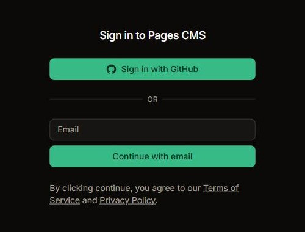
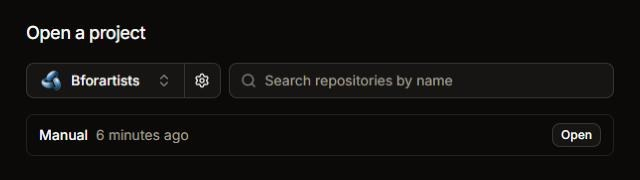
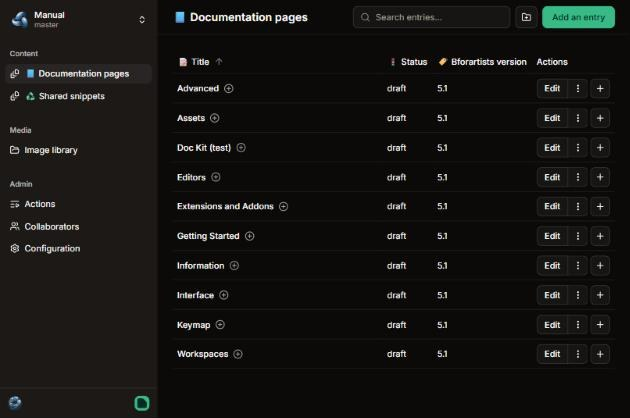

# Quick Start: set up

> **Five minutes. You need a free GitHub account and a web browser. Nothing to install.**

The Bforartists manual is written in an online editor called **Pages CMS**. It works like a simple word processor in your browser and saves straight to the manual on GitHub.

## 1. Sign in to the editor

Go to [app.pagescms.org](https://app.pagescms.org) and click **Sign in with GitHub**. The first time, GitHub asks whether Pages CMS may use your account: click **Authorize**.

> **Note:** To save changes you need access to the manual. Ask a maintainer in a [GitHub issue](https://github.com/Bforartists/Manual/issues): they can add you on GitHub, or invite you by email from Pages CMS › Collaborators.

## 2. Open the manual

Under **Open a project**, choose **Bforartists** in the box on the left, then click **Open** next to **Manual**.

## 3. Find your way around

- **Documentation pages**: every page of the manual, grouped like the website's sidebar. Click the **+** next to a group to see the pages inside.
- **Shared snippets**: short sections that appear on several pages, written once.
- **Image library**: every screenshot in the manual.
- **Top left**: the project and the **branch** you are working on. `master` is the published manual; you make your changes on a branch of your own, as the next guide shows.

## You're ready

Next: [Quick Start: your first edit](Quick-Start-First-Edit.md). It takes another five minutes and walks you from a small fix to seeing it on the website.
