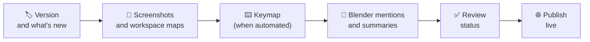

# 🚀 Release update

> **When a new Bforartists version ships, the manual follows in one pull request per step. Here is the checklist, in order.**

---

## ✅ Checklist

- [ ] 🏷️ **Version.** Update `version:` on pages you checked against the new release, and `What's new` in `appendix/manual-update-history.md`. The Docs home's "What changed" card links there.
- [ ] 📸 **Workspace maps.** Re-shoot all workspaces with `ws_capture.py` and import them ([Workspace maps](Workspace-Maps.md#re-shoot-the-workspaces-each-release)).
- [ ] 🖼️ **Screenshots that changed.** Drop new screenshots in Pages CMS; the image bot files them under the same names, so pages need no edit ([Images and screenshots](Images-and-Screenshots.md)).
- [ ] ⌨️ **Keymap.** Today: edit `keymap/standard-keymap.md` by hand. Later: the keymap is exported from Bforartists automatically (see the Interactive Keymap design doc).
- [ ] 🧹 **Clean-up reports.** `python3 docs2/tools/cleanup.py --dry` lists pages that say "Blender" for the program you use; `summaries.py --dry` lists pages without a summary. Fix what they find.
- [ ] ✅ **Checks pass** on the pull request (links, images, sidebar, workspace maps).
- [ ] 👀 **Review status.** Reviewers set `status: reviewed` on the pages they checked.
- [ ] 🌐 **Publish live** (below).

## Publish live

Only the lead maintainer does this, once staging looks right.

1. Open **bforartists.webflow.io/docs/home** and click through: a section overview, a workspace page, the keymap, the search (Ctrl K).
2. Webflow → **Publish** → tick **bforartists.co** (and webflow.io) → Publish.
3. Check the same pages on bforartists.co. If anything is wrong, fix it in GitHub and publish again; site scripts can be rolled back in minutes ([Site scripts](Site-Scripts.md#roll-back)).
