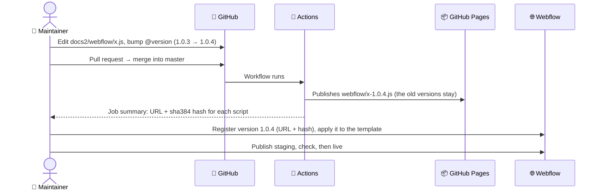

# 🎛️ Site scripts

> **The website's custom code (site-wide, Doc Pages and News templates) and the docs scripts are kept in `docs2/webflow/`. Change the file in GitHub, bump its version, and point Webflow at the new version.**

---

## 📦 The scripts

| File | Registered as | Runs on | Does |
|---|---|---|---|
| `docs-layer.js` | `bfa_docs_layer` | Doc Pages template, footer | Sidebar carets and Overview rows, breadcrumbs, section overview pages, the Docs home, status chips |
| `workspace-map.js` | `bfa_workspace_map` | Doc Pages template, footer | Workspace hover maps and the Workspaces explorer |
| `keymap-explorer.js` | `bfa_keymap_explorer` | Doc Pages template, footer | The interactive keymap ([Keymap](Keymap.md)) |
| `quicksearch.js` | `bfa_quicksearch` | Whole site, footer | The instant search popup (Ctrl K) |
| `docs-loading.js` | `bfa_docs_loading` (inline) | Doc Pages template, header | Hides the sidebar until it is ready (no flicker), with a spinner in the middle of the page |
| `docs-head.css` · `docs-head.js` | loaded by `template-head.html` | Doc Pages template, head | The docs kit styles (`bfa-doc-kit`), panel heads, section icons |
| `docs-foot.css` · `docs-foot.js` | loaded by `template-footer.html` | Doc Pages template, footer | The base docs script `bfa-docs-v6` and its CSS |
| `site-head.css` · `site-head.js` | loaded by `site-head.html` | Whole site, head | World, Paper, Cover, Layers, Heroes, Sectors, Wall, Lite, Media, Gallery, Shared |
| `site-foot.css` · `site-foot.js` | loaded by `site-footer.html` | Whole site, footer | IX Idle, Fallbacks, Fork Light, Hero Rows, Light, Shade, Round 8–10, Thumb Sizes, Site Path, Paths, Perf Note |
| `news-head.css` · `news-foot.js` | loaded by `news-head.html` / `news-footer.html` | News template | Post styles, "On this page", interview video, reading UX |
| `*.html` (loaders) | (pasted into Webflow) | Site settings or template custom code | A few `<link>` / `<script>` tags with the version and hash. Nothing else is inline. |

Each `.js` and `.css` file starts with `@version x.y.z` on its first line.

## 📉 Why the code lives here, not inline in Webflow

Inline custom code is sent again with **every page view** (85 KB site-wide, plus 70 KB more on docs pages). As files, browsers download them once and reuse them on every page, and GitHub Pages serves them, not Webflow, so they don't count toward Webflow's bandwidth (Nov 2026: about 4 GB a day against a 50 GB month).

- **Order is kept:** each loader sits where the inline code was. The footer files are preloaded from the head, so they are ready when the page reaches them.
- **Each original `<script>` block is wrapped on its own** (`try … catch`), so one failing block cannot stop the next.
- **Edit the `.css` / `.js` file, never the loader.** Bump `@version`, merge, then paste the new loader lines (URL + hash from the job summary) into the matching Webflow custom code box.

## 🔁 Change a script



1. **Edit** the file and **bump the version** on its first line. Never reuse a version: each published file is fixed, because Webflow checks it against its hash.
2. **Pull request → merge.** The workflow publishes `https://bforartists.github.io/Manual/webflow/<name>-<version>.js` and prints its **sha384 hash** in the job summary (Actions → the run → Summary).
3. **Register and apply in Webflow** (needs the Webflow API token, or Claude with the Webflow connector):

   ```bash
   # register the hosted file
   curl -X POST "https://api.webflow.com/v2/sites/650c5901cff33429a5e537f5/registered_scripts/hosted" \
     -H "Authorization: Bearer $WEBFLOW_TOKEN" -H "Content-Type: application/json" \
     -d '{"hostedLocation":"https://bforartists.github.io/Manual/webflow/docs-layer-1.0.4.js",
          "integrityHash":"sha384-…from the job summary…","version":"1.0.4","displayName":"bfa docs layer"}'
   # see what the template uses, then send the full list back with the new version
   curl "https://api.webflow.com/v2/pages/6aca79b3c07a0416be267356/custom_code" -H "Authorization: Bearer $WEBFLOW_TOKEN"
   ```

   `PUT …/pages/<page>/custom_code` **replaces** the whole list, so always send every script the page already had.

   Keep the order: `bfa_workspace_map` before `bfa_docs_layer`. Adding or updating one script moves it to the end of the list, so check the order after each release (the docs layer copes with either order since 1.0.9, but the right order avoids a flash).
4. **Publish staging** (Webflow → Publish → webflow.io only), check a few pages, then publish live with the next release.

## ↩️ Roll back

Every old version is still on GitHub Pages and still registered. Point the template back at the previous version (step 3, the `PUT` with the old version number) and publish.

## 🧪 Try a change before merging

Open a staging page, open the browser console and paste the new file's contents: it runs once, on that page only. Each script guards against running twice, so reload the page first.
