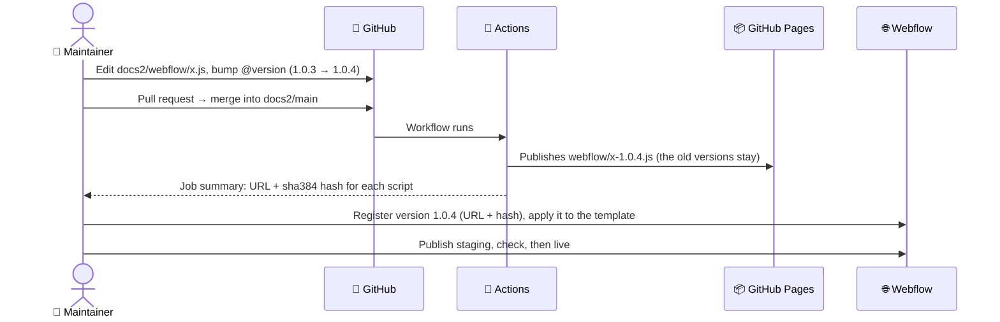

# 🎛️ Site scripts

> **The docs pages on the website are a Webflow template plus a few scripts kept in `docs2/webflow/`. Change the file in GitHub, bump its version, and register the new version in Webflow.**

---

## 📦 The scripts

| File | Registered as | Runs on | Does |
|---|---|---|---|
| `docs-layer.js` | `bfa_docs_layer` | Doc Pages template, footer | Sidebar carets and Overview rows, breadcrumbs, section overview pages, the Docs home, status chips |
| `workspace-map.js` | `bfa_workspace_map` | Doc Pages template, footer | Workspace hover maps and the Workspaces explorer |
| `keymap-explorer.js` | `bfa_keymap_explorer` | Doc Pages template, footer | The interactive keymap ([Keymap](Keymap.md)) |
| `quicksearch.js` | `bfa_quicksearch` | Whole site, footer | The instant search popup (Ctrl K) |
| `docs-loading.js` | `bfa_docs_loading` (inline) | Doc Pages template, header | Hides the sidebar until it is ready (no flicker), with a spinner in the middle of the page |
| `template-footer.html` | (pasted) | Doc Pages template, page footer code | The base docs script `bfa-docs-v6` and its CSS |

Each `.js` file starts with `@version x.y.z` on its first line.

## 🔁 Change a script



1. **Edit** the file and **bump the version** on its first line. Never reuse a version: each published file is fixed, because Webflow checks it against its hash.
2. **Pull request → merge.** The workflow publishes `https://bforartists.github.io/Manual/webflow/<name>-<version>.js` and prints its **sha384 hash** in the job summary (Actions → the run → Summary).
3. **Register and apply in Webflow** (needs the Webflow API token, or Claude with the Webflow connector):

   ```bash
   # register the hosted file
   curl -X POST "https://api.webflow.com/v2/sites/650c5901cff33429a5e537f5/registered_scripts/hosted" \
     -H "Authorization: Bearer $WEBFLOW_TOKEN" -H "Content-Type: application/json" \
     -d '{"hostedLocation":"https://bforartists.github.io/Manual/webflow/docs-layer-1.0.4.js",
          "integrityHash":"sha384-…from the job summary…","version":"1.0.4","displayName":"bfa docs layer"}'
   # see what the template uses, then send the full list back with the new version
   curl "https://api.webflow.com/v2/pages/6aca79b3c07a0416be267356/custom_code" -H "Authorization: Bearer $WEBFLOW_TOKEN"
   ```

   `PUT …/pages/<page>/custom_code` **replaces** the whole list, so always send every script the page already had.

   Keep the order: `bfa_workspace_map` before `bfa_docs_layer`. Adding or updating one script moves it to the end of the list, so check the order after each release (the docs layer copes with either order since 1.0.9, but the right order avoids a flash).
4. **Publish staging** (Webflow → Publish → webflow.io only), check a few pages, then publish live with the next release.

## ↩️ Roll back

Every old version is still on GitHub Pages and still registered. Point the template back at the previous version (step 3, the `PUT` with the old version number) and publish.

## 🧪 Try a change before merging

Open a staging page, open the browser console and paste the new file's contents: it runs once, on that page only. Each script guards against running twice, so reload the page first.
