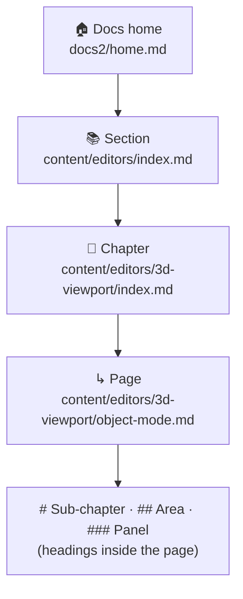

# 🧭 Structure and navigation

> **Where a page sits, what its card says and what the Docs home shows all come from three places: the page's front matter, `nav.yml` and `home.md`.**

---

## 🧱 The levels

| Level | In the repository | On the website |
|---|---|---|
| 📚 Section | A folder under `content/` with an `index.md` | Sidebar panel + an **overview page** (`/docs/editors`) with numbered chapter cards |
| 📄 Chapter | A page, or a folder with `index.md` | A sidebar row; its children become cards on it |
| ↳ Page | A page inside a chapter folder | An indented sidebar row |
| 🔖 Headings | `#`, `##`, `###` in the page | The **Page Sections** outline, anchors and instant search results |

---

## 📄 Add a page

1. Create the file where it belongs, for example `content/editors/3d-viewport/curve-edit-mode.md`. In Pages CMS: **Add an entry**, pick the folder.
2. Give it a **title** and a **summary** (one sentence: it shows on cards, in search and on Google).
3. Optional: `icon:` (a Bforartists icon name, like `view3d`), `cta:` (the card button word, like "Open") and `order:` (its place among its siblings: 10, 20, 30…).
4. Open a pull request. The robot fills in `id`, `section` and `path`, files the screenshots and checks everything.

> 💡 The web address comes from the `id` (`editors.3d-viewport.curve-edit-mode` → `/docs/editors-3d-viewport-curve-edit-mode`). Never change an `id` once a page is live; change the title instead.

## 🔀 Move or rename a page

| Change | Do | Effect |
|---|---|---|
| ✏️ New title | Edit `title:` | Sidebar, card and breadcrumb update; address stays |
| ↕️ New place among siblings | Edit `order:` (or its line in `nav.yml`) | Sidebar order changes |
| 📁 New folder | Move the file, keep its `id:` line, update its line in `nav.yml` | Same address, new place in the sidebar |
| 🧩 Merge two pages | Combine them and list the removed page's id under `replaces:` | The removed page's item is archived by the sync (`--prune`) |
| 🗑️ Remove | Delete the file (and its `nav.yml` line) | The sync archives the item; nothing is deleted in Webflow |

## 🧭 `nav.yml`: the sidebar

`docs2/nav.yml` lists the sections and their pages in sidebar order. `check.py` fails if a line points to a file that does not exist, so a moved file always needs its line updated in the same pull request.

---

## 🏠 The Docs home

`docs2/home.md` holds no body text, only fields the docs script turns into the page:

| Field | Shows |
|---|---|
| `eyebrow`, `headline`, `summary` | The hero |
| `popular` | The chips under the search box (a link can also jump on the page, like `"#dk-look"` for the workspace picker) |
| `art` | The hero picture beside the search (`image:`, a Webflow asset URL; one still picture, no animation) |
| `workspace` | The workspace picker: `pages:` lists the tabs Bforartists opens with, in order (focus tabs over one map, like the Download page's release switch); `all:` is the **Explore all workspaces** button. With only `page:` it shows that one map |
| `explore` | Optional card beside the search that jumps to the picker (off: the picker has its own button) |
| `teaser` | The **Quick Starts · coming soon** card, until the guides exist |
| `paths` | Quick Start path cards (unused while the teaser is on) |

The sections, review progress and help cards are built from the sidebar data; there is nothing to edit for them.

## ✅ Page status

Every page has `status:` in its front matter. Readers see it as a coloured chip, and the Docs home counts them.

| Value | Readers see | Meaning |
|---|---|---|
| `draft` | ● Draft | Copied from the old manual, not checked yet |
| `needs-review` | ● In review | Rewritten or checked once, waiting for a second look |
| `reviewed` | ● Reviewed | Checked against the current Bforartists version |

Change it in Pages CMS (**Status**) or in the file; the cards, the chip and the progress bars follow on the next sync.

### 🤖 It follows the pull request by itself

A bot raises the status of the pages a pull request changes, so nobody has to remember to:

| Pull request | Pages it changes become |
|---|---|
| 📝 Draft | stay `draft` |
| 👀 Ready for review | `needs-review` (● In review) |
| ✅ Approved, or labelled `reviewed` | `reviewed` (● Reviewed) |

- The bot commits the new status to the pull request's own branch, so it reaches `master` with the merge. `master` is protected: nothing is pushed there directly.
- The status only goes up, never down. A page counts as changed only when its text changed, not its header or pictures.
- It skips pull requests from forks, pull requests that change more than 25 pages (a bulk rename or a script) and pull requests with the label `no-status`.
- Preview and the staging website show the chip from the page file, so an open pull request shows ● In review in its preview, and merged pages show ● Reviewed once they were approved.
- The tool is `docs2/tools/page_status.py`; the workflow is `docs2-page-status.yml`.

## 🔎 Search

The instant search (Ctrl K, or the 🔎 button) reads `search.json`, which the sync writes from every page's title, summary and headings. A good summary and clear headings are all a page needs to be found.
