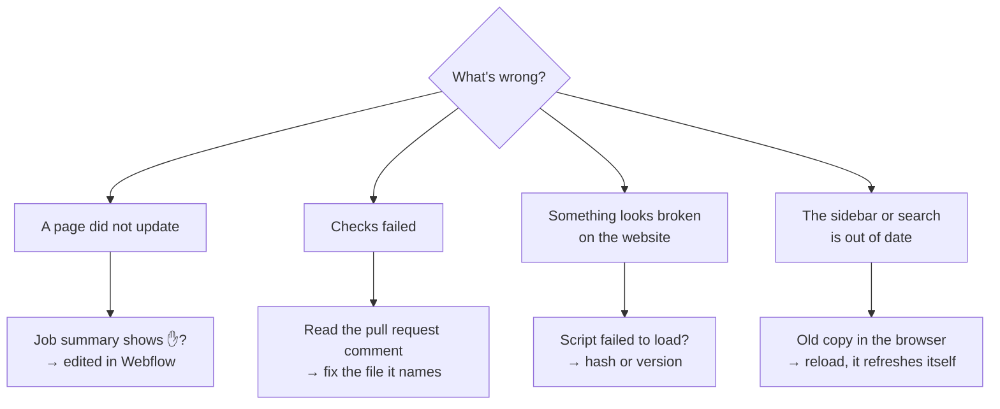

# 🩺 Troubleshooting

> **The usual surprises, what causes them and the fix. Start with the job summary: Actions → the latest "Docs 2.0 checks and preview" run → Summary.**

---

## A page does not update

| You see | Cause | Fix |
|---|---|---|
| ✋ "edited by hand in Webflow after the last sync; skipped" in the job summary | Someone changed the item in the Webflow CMS or Designer, so the sync leaves it alone rather than overwrite their work | Copy anything worth keeping into GitHub. Then, in the Webflow CMS, set the item's **Checksum** field to `reset|<now>`, for example `reset|2026-10-24T18:50:10+00:00` (a time **after** your edit), save, and re-run the workflow (Actions → Run workflow on `docs2/main`) |
| ⏭️ "unchanged" | Nothing in the built page changed | Check that your change was merged into `docs2/main`, not just a branch |
| The page is updated in the CMS but not on the site | Staging was not published | Webflow → Publish → webflow.io, or re-run the workflow |

## Checks failed

The pull request comment lists each problem with its file and line. The common ones:

| Check | Usually means |
|---|---|
| 🔗 Links | A link points to a page that moved; update the link |
| 🖼️ Images | A picture's file name changed; re-drop it or fix the path |
| 🧭 Sidebar | `nav.yml` lists a file that was moved or deleted |
| 🗺️ Workspace maps | `workspaces.yml` names an editor not in `editors:`, or a screenshot that is missing |
| 🆔 Unique IDs | Two pages have the same `id`; give the new one its own |

## Something looks broken on the website

| You see | Cause | Fix |
|---|---|---|
| Plain lists instead of cards or maps | A site script did not load. In the browser console: "Failed to find a valid digest" | The registered hash does not match the file: register the version again with the hash from the job summary ([Site scripts](Site-Scripts.md)) |
| A new feature is missing | The template still uses the old version | Apply the new version to the template and publish staging |
| A workspace map is in the wrong place | The screenshot changed but the boxes did not | Re-capture or run `ws_map.py detect <workspace>` ([Workspace maps](Workspace-Maps.md)) |

## The sidebar or search is out of date

The website keeps a copy of the sidebar in the browser for speed and checks for a newer one on every visit, so a second reload shows the change. If not, check that the workflow's "Publish the sidebar" step ran: it writes `nav.json` and `search.json` to GitHub Pages.

## Still stuck?

Ask in the Bforartists Discord, or open an issue in [Bforartists/Manual](https://github.com/Bforartists/Manual/issues) with the link to the job summary.
