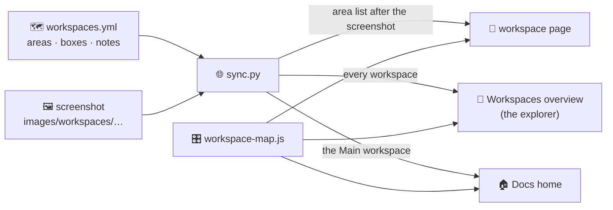

# 🗺️ Workspace maps

> **Point at an area of a workspace screenshot and the website says which editor it is, what it is for there, and links to its chapter. One file holds it all: `docs2/workspaces.yml`.**

---

## 🧩 How it fits together



## ✏️ Change what an area says

Open `docs2/workspaces.yml`, find the workspace, and edit the area's `note:`. One short line, about what the area is for **in this workspace**.

```yaml
  - page: "workspaces/shading.md"
    image: "images/workspaces/workspaces/standard-workspaces-7.png"
    areas:
      - {ed: ShaderNodeTree, box: [0, 43.97, 82.58, 56.03], note: "Build the material by connecting nodes."}
```

| Key | What it is |
|---|---|
| `ed` | The editor, as Bforartists names it (`VIEW_3D`, `ShaderNodeTree`, `TIMELINE`…). Its name, chapter, icon and colour live under `editors:` at the top |
| `box` | Left, top, width, height in **% of the screenshot** |
| `note` | What it is for here. Leave it out and the editor's general line is used |

## 📸 Re-shoot the workspaces (each release)

You need Bforartists open on the computer, nothing else.

1. In Bforartists: **File › Defaults › Load Factory Settings**, maximize the window, Resolution Scale 1.0.
2. **Scripting** workspace › Text Editor › open `docs2/tools/ws_capture.py` › **Run Script**. It steps through every workspace tab by itself (about a second each) and writes the screenshots plus `capture.json` into a `workspace-capture` folder.
3. In the repository: `python3 docs2/tools/ws_map.py import <folder>/capture.json`. It copies the screenshots to `images/workspaces/maps/`, writes the exact boxes from Bforartists, points each page at its new screenshot and **keeps every note**.
4. Open a pull request. Check the preview, merge.

> 🤖 With the Bforartists Coworker add-on connected, Claude can do steps 1–2 for you.

## 🔁 Other commands

| Command | Does |
|---|---|
| `python3 docs2/tools/ws_map.py check` | Every area has a known editor and a box, every page and screenshot exists (also part of `check.py`) |
| `python3 docs2/tools/ws_map.py detect shading` | Finds the areas again in an existing screenshot from the dark gaps between editors (when there is no live capture) |
| `python3 docs2/tools/ws_areas.py shot.png --overlay out.png` | Draws the areas it finds on a copy of the screenshot, to check by eye |

## ➕ A new workspace

1. Add its page in `content/workspaces/` (title, summary, icon).
2. Add an entry in `workspaces.yml` with `image: null` (the explorer shows "screenshot coming"), or capture it as above.
