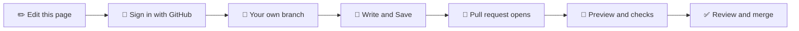

# 🚀 Writer quick start

> **Fix or write a docs page in about five minutes. You need a GitHub account that was invited to the project, and nothing installed.**

---

## 🧭 The route

| Step | What you do | What happens by itself |
|---|---|---|
| 1. ✏️ **Open the page** | Click **Edit this page** at the bottom of any docs page, or the green **Edit this branch** button in a pull request comment | A branch named `docs2/edit/<page>-<date>` is made for you from the latest docs. Clicking again the same day reuses it |
| 2. 🔑 **Sign in** | Sign in with GitHub when Pages CMS asks | Pages CMS opens your page on that branch. No access yet? Ask a maintainer to invite you |
| 3. 📝 **Write** | Change the text. Press `/` on an empty line for headings, quotes, tables and images. Drag a screenshot straight in | Nothing is public yet |
| 4. 💾 **Save** | Click **Save** (top right). Optionally type a short message about what you changed | Every save is a commit with your name |
| 5. 🔀 **The pull request** | Nothing | The first save opens a pull request. Its title reads `📄 Location > Chapter · Pages CMS: Your name` and its description lists what you changed |
| 6. 👀 **Check** | Open the comment in the pull request and click the preview link | Checks run on every save, and the image bot files your screenshots |
| 7. ✅ **Review** | Fix anything the checks flag by opening the branch again (green **Edit this branch** button) | A maintainer reviews and merges. Then the website updates |

> 💡 Lost? Every pull request comment has the **Edit this branch in Pages CMS** button and one link per changed page.

---

## ✍️ Markdown in two minutes

You never have to type Markdown, but these shortcuts are faster than the menu. Type them at the start of a line, or use the **Markdown** switch in the editor to see and edit the plain text.

| You type | You get |
|---|---|
| `# ` then text | A heading (`##` and `###` for smaller ones) |
| `**bold**` and `*italic*` | **bold** and *italic* |
| `` `code` `` | `code` in a box |
| `[text](https://…)` | A link |
| `- ` or `1. ` | A bullet list or a numbered list |
| `> ` | A quote. Start it with `Tip:` to get a tip box |
| `---` on its own line | A horizontal line |
| Three backticks | A code block |

A blank line separates paragraphs and different kinds of block. The [Comment node page](https://github.com/Bforartists/Manual/blob/master/docs2/content/editors/geometry-node-editor/header/add-menu/layout.md) has a longer example you can copy.

---

## 🖼️ Screenshots

Drag the picture into the page. Save. The image bot names it after the page and the heading above it, shrinks it if it is huge, and replaces a repeat of a picture that already exists. Write what the image shows as its alt text, not the file name. Details: [Images and screenshots](Images-and-Screenshots.md).

---

## 🧩 The few special patterns

| You write | The website shows |
|---|---|
| `> **Tip:** text` (also Note, Warning, Important) | 💡 A callout |
| `Ctrl + Space` | ⌨️ Keycaps |
| `Edit › Preferences › System` | 🧭 A menu path with icons |
| A heading named like a tool (`#### Bevel`) | 🧰 A tool card |

The full list is on [Plain writing](Plain-writing.md), and the heading and table rules are on [Formatting standard](Formatting-Standard.md).

---

## 🆘 If something goes wrong

| What you see | What to do |
|---|---|
| ❌ **Images** check: "is not in the image library" | Tell a maintainer. It is a known timing issue when the same picture was already in the library. Linking the library copy fixes it |
| 🟡 A warning about alt text | Say what the image shows instead of the file name |
| ❌ Pages CMS says you have no access | You need an invitation to the project. Ask a maintainer |
| Your change is not on the website | A maintainer merges first, then the website updates |
| You made a mistake | Save again with the fix. Nothing is lost until a maintainer merges |

More: [Editing the docs online](Editing-the-docs-online.md) · [Branches and review](Branches-and-Review.md) · [Troubleshooting](Troubleshooting.md)
